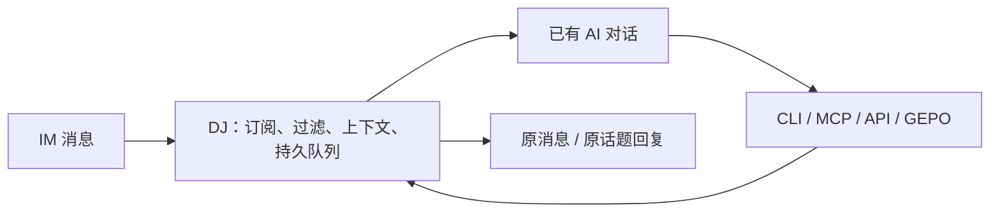

<p align="center">
  
</p>

<p align="center">
  <a href="docs/index.html">主页源码</a> · <a href="docs/delivery.md">安装与使用</a> · <a href="docs/index.md">文档</a> · <a href="skills/dj/SKILL.md">Skill</a> · <a href="LICENSE">1PL</a>
</p>

# DJ — Dispatch Junction

DJ 把 IM 消息按规则送进已有的 AI 编程对话，并为 AI 提供读取上下文、管理订阅和回复原消息的接口。一个对话可以订阅多个来源，一个来源也可以通知多个对话。

DJ 负责身份核对、订阅匹配、持久排队和投递；AI 负责判断是否处理、怎样处理、是否回复。DJ 自己不调用模型，也不会把 AI 的普通输出自动转发给 IM。

## 能做什么

- **实时订阅**：Lark / 飞书直连官方 WebSocket 与 HTTPS API，支持原生 @、关键词、组合条件，以及人员和字符触发黑名单。
- **通知原会话**：通过已有客户端的 IPC、socket 或本机 API 精确投递，不启动替代 Agent 进程。工具接线与验证范围见[能力范围](docs/release-scope.md)。
- **保留上下文**：提供历史、引用、话题和 thread；默认读取本地缓存，AI 可主动请求更多上下文。
- **固定回复位置与身份**：谁被 @、从哪里来，由 DJ 固定回复路线；AI 显式调用回复工具提交内容。
- **持久规则与待办**：对话保存自己的规则，也可以使用 `subscription.pull/ack` 主动领取和确认消息。
- **任务巡查**：从 IM 原消息查看 AI 会话和登记子对话，按管理员白名单／本人连接隔离权限，未知归属明确标注。见[使用说明](docs/guides/task-inspection.md)。
- **统一接口**：CLI、本地 API、MCP、GEPO 与 Skill 共用权限、操作目录和幂等台账。



## 开始使用

使用已生成的目录包。运行环境为 macOS arm64 与 Bun 1.4.4；账号凭据和对话身份由私有配置提供。

```sh
dj status --json
dj agent whoami --json
dj skill targets
```

1. 按[安装与使用](docs/delivery.md)准备服务和独立客户端身份；需要持续运行时配置 [macOS 常驻服务](docs/guides/macos-service.md)。
2. 为 AI 工具[安装 Skill、配置接口](skills/dj/references/clients.md)，核对原会话绑定。
3. 由接收对话建立[消息订阅](docs/guides/lark-realtime.md)，或直接向精确会话发送输入。

Skill 安装先预览，再按实际目标执行：

```sh
dj skill install --target codex --scope user --dry-run
```

安装 Skill 不会自动建立订阅，也不会修改客户端信任或启动 AI。

## 文档

- [完整文档索引](docs/index.md)
- [故障排查](docs/guides/troubleshooting.md)与[当前能力、验证边界](docs/status.md)
- [业务操作](docs/interfaces/operations.md)、[CLI](docs/interfaces/cli.md)、[MCP](docs/interfaces/mcp.md)、[GEPO](docs/interfaces/gepo.md)
- [架构](docs/architecture.md)、[安全边界](docs/security.md)、[开发与打包](docs/guides/development.md)
- [Pages 本地预览](docs/pages/README.md)与[待办](TODO.md)

## 许可证

DJ 自有代码与文档使用 [One Public License 1.0（1PL）](https://license.pub/1pl/)，完整文本见 [LICENSE](LICENSE)。第三方依赖保留各自许可证，运行包附带依赖许可证清单。
