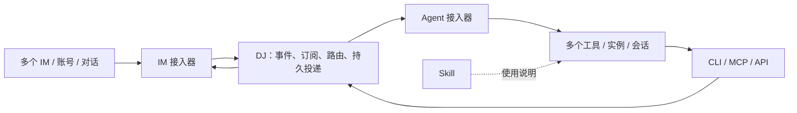

# DJ — Dispatch Junction

DJ 是连接多种 IM 与多种 AI 编程工具的消息交叉枢纽。一个 Agent 会话可以按规则订阅多个 IM 对话，一个 IM 对话也可以触发多个 Agent。名称同时带有 DJ Mixer 的多通道混合与分配联想。

DJ 还提供统一 Agent 会话控制入口：跨工具/实例/工作区机械列举和搜索、免订阅向精确会话发消息。空会话创建与客户端启停按已有原生接口显式开放；缺少接口时明确 unsupported，不以新 Agent CLI 进程替代。提供 CLI、MCP、本地 JSON API 和 GEPO，不做 IM 操作界面，不判断任务归属或自动选择目标。

**当前处于 S3 集中验收：固定源工具链与完整图构建已验证，生产源码、测试与运行资料已写齐，本地门禁正在收口。真实 IM/Agent、Skill采用和性能验收尚未全部完成。实际进度以 [状态](docs/status.md)和 [TODO](TODO.md)为准。**

**DJ 本身没有 AI 能力，不调用大模型。调用方 Agent 负责理解意图和正确调用；DJ 只按明确身份、结构化规则与权限高效收件、排队和转发。** 详见[组件边界](docs/component-contract.md)和[面向模型的接口](docs/model-facing.md)。

DJ 的核心流程：登记真实 Agent 会话 → 创建消息订阅 → DJ 常驻接收 IM 事件 → 规则匹配与持久排队 → 向指定会话投递并触发工作 → 按授权回复原对话。

订阅可设置固定提示词与确定性任务模板（spec.instruction_policy）；规则命中后，DJ 将各有效订阅的说明与原消息一起送到原会话。模板字段、版本与超限行为见[统一操作契约](docs/interfaces/operations.md#规则与提交)。DJ 不生成自然语言决策或执行任务，任务仍由接收 AI 处理。

需要由 AI 主动消费时，订阅设置 `spec.delivery_mode="pull"`，使用 `subscription.pull` 领取与 `subscription.ack` 确认或重试；租约与待办持久保存，消息、提示词和回复上下文沿用权限重检，不向原生会话重复推送。确认消费不等同于任务完成，具体授权、幂等和时效见[操作契约](docs/interfaces/operations.md)。

无需订阅时：查询或精确定位会话 → 只读核验 → 定向输入 → 查投递/原生回答；需要新实例或会话则显式 start/create。所有输入共用原生会话队列与未知结果屏障。完整分支、停止并发和创建后的接线见[统一业务流程](docs/workflows.md#统一路径与收口)，首期正向与拒绝范围见[能力矩阵](docs/release-scope.md#首期统一能力与验收适用矩阵)。

## Codex / Cursor 接线

Codex 使用已有 Desktop IPC；Cursor 可使用原生 Desktop Bridge，或由 DJ 按需管理 Inspector 的 native_api 通道。两者均已完成国际版 Lark 专用机器人→原订阅会话→独立 recipient API→原消息回复的真实验证。Inspector 只用于 DJ 调用 Cursor 的方向，操作后关闭；Cursor 主动调用 DJ 的 MCP/API 不需要 Inspector。精确配置与版本边界见[桌面端接线](docs/adapters/desktop.md)，其他工具专项验收和未通过的性能门禁仍以 TODO 为准。

Codex / Cursor 可选原生消费回调由 `dj skill hooks` 生成配置，`dj hook pull` 校验原会话后领取一项；不自动确认或安装配置。两工具事件与续轮边界见[回调说明](skills/dj/references/callbacks.md)。

## 阅读入口

先取用目录包时，阅读 [Codex / Cursor 交付与使用](docs/delivery.md)：运行前提、私有配置、原会话订阅、MCP/GEPO 与已知限制集中列出。

安装随包 Skill：`dj skill targets` 查看目录；`dj skill install --target cursor --scope project --project PROJECT --dry-run` 预览，确认后去掉 dry-run。`dj skill config --target codex --client-profile PRIVATE_PROFILE` 只生成 MCP 配置片段供合并，不更改客户端或启动 AI。完整目录、冲突与采用边界见[客户端接线](skills/dj/references/clients.md)。

- [文档总索引](docs/index.md)：所有设计的职责与阅读顺序。
- [施工手册](docs/construction/plan.md)与[唯一 TODO](TODO.md)：Eliscript 文件/符号、实现依赖、接口契约及测试验收。
- [开工准备](docs/construction/readiness.md)：精确依赖/环境事实/构建配方，配套逐操作字段表和可转写用例卡。
- [需求](docs/requirements.md)和[研究结论](docs/research.md)：明确要求、设计建议、历史证据边界。
- [总体架构](docs/architecture.md)、[领域模型](docs/domain-model.md)、[业务流程](docs/workflows.md)。
- [统一操作契约](docs/interfaces/operations.md)、[CLI](docs/interfaces/cli.md)、[MCP](docs/interfaces/mcp.md)、[GEPO](docs/interfaces/gepo.md)。
- [Agent 会话控制面](docs/agent-control-plane.md)：查询范围、索引/覆盖、直发、创建与启动；与 IM 订阅独立可用。
- [Agent 适配](docs/adapters/agent-tools.md)、[IM 适配](docs/adapters/im.md)、[可靠投递](docs/delivery-storage.md)、[权限](docs/security.md)。
- [Skill 设计](docs/skill-design.md)与[Skill 调用说明](skills/dj/SKILL.md)。
- [目录包运行说明](packaging/runtime.md)：成品结构、私有配置、启动/recipient 接线、订阅与原话题回复，以及安全排空；隔离目录包独立运行已验证，尚未安装或部署。
- [官方资料目录](docs/references/official-sources.md)与[按问题查阅](docs/references/reading-map.md)。
- [技术选型](docs/technical-stack.md)、[首批接入范围](docs/release-scope.md)、[从启动到回复](docs/startup-to-reply.md)。
- [验收方案](docs/acceptance.md)、[设计决定](docs/decisions.md)、[整体设计审阅](docs/design-review.md)、[当前状态与接续入口](docs/status.md)。

首轮设计以单机常驻枢纽为基线，保留核心库嵌入与进程外适配边界；前期采用 Eliscript 编译 ESM、Bun、SQLite 与本地 UDS；当前优先交付已授权 Lark 国际版专用机器人与 Codex、Cursor 的主要业务链，其他工具专项验收后置。精确依赖已锁定，跨机器部署在首期范围之外，真实兼容证据仍待验收。DJ 不拥有 Agent 的任务完成真相，也不因消息投递而扩大其执行权限。
