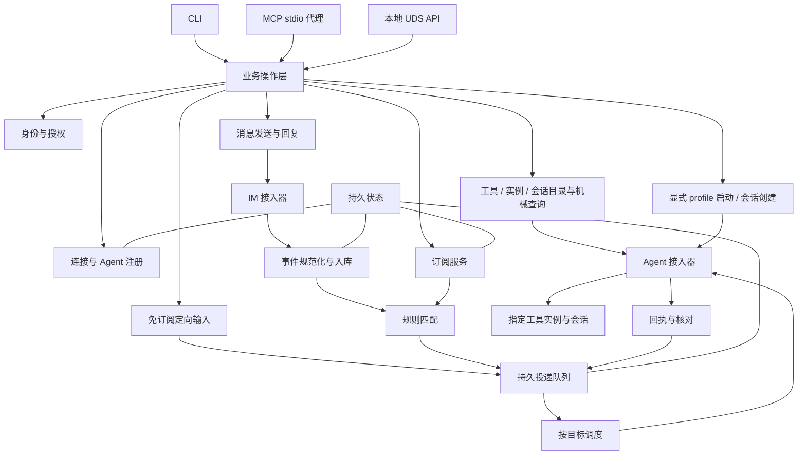

# 总体架构与模块划分

## 当前基线与目标

本轮整体复审基线为 master 的 bd6b8e2（文档设计）；最初初始化为 0907ee0。当前仅有 README、docs 与 Skill 文本，没有业务入口、运行时、数据库或适配器。当前业务流程是人工提供需求与整理研究；没有实际消息调用链。


目标形态为一个受操作系统服务管理器监督的 DJ 服务、一个可嵌入的核心和多个进程内/进程外适配器。首期采用 Eliscript 编译 ESM，由 Bun 单进程装配；具体依赖、同步存储边界和嵌入面以 [技术选型](technical-stack.md)为准。CLI 是短命客户端；stdio MCP 可作为连接常驻服务的薄代理。任何客户端退出均不删除订阅，也不自动停止 DJ。



## 确定性边界

整个核心、接口、适配器和恢复路径遵守 [组件契约](component-contract.md)。没有模型调用、智能路由、自动摘要或嵌入式 Agent。调用方模型理解自然语言并决定目标，DJ 使用 [类型化引用与预览句柄](model-facing.md)做机械校验。外部 Agent 收件后可以调用其模型，这不成为 DJ 的推理能力。

## 模块契约

下表名称是语言无关的目标模块，不是假定已经存在的源码。

| 模块 | 拥有状态与主要操作 | 不承担 |
| --- | --- | --- |
| domain | 对象、规则 AST、状态转换、错误类型 | 网络或数据库实现 |
| application | execute(principal, operation, request) → Result；业务事务编排 | 厂商帧格式 |
| policy | authorize(principal, action, resource, context) → Decision | 根据标题赋权 |
| registry | register、probe、rebind；稳定目标和临时 binding | 从历史猜活进程 |
| catalog | 工具/实例/会话索引、catalog_seq 逻辑版本、稳定键续扫、精确 probe、刷新/覆盖 | 推断任务归属、扫描任意目录、自动唤醒、持有跨请求长读事务 |
| lifecycle | 获准 profile 的实例 start/stop、空 create、归属/slot/持久 gate 与动作核对 | 任意 shell、改模型/权限、借创建自动发 prompt、把 manual 当退出证明 |
| ingestion | normalize(raw, connection)、accept(event)；事件去重和源游标 | 模型判断 |
| subscriptions | preview/commit；固定规范化规则、版本与 cutover_seq | 理解自然语言、修改来源权限 |
| routing | 用来源/事件索引取候选，执行编译谓词 → MatchDecision | 模型推理、全订阅扫描、执行 shell |
| delivery | plan、claim、dispatch、observe、reconcile；IM 订阅与直发共享 TargetRoute 队列 | Agent 任务调度与业务完成 |
| messaging | list/get/search/send/reply；回复引用和发送 outbox | 自动回传完整对话 |
| storage | 原子写入、索引、租约、游标、操作台账、outbox、幂等键 | 网络副作用 |
| adapters.im | receive、normalize、send、lookup；平台能力与源 ACK | 订阅业务判断 |
| adapters.agent | discover、list/read、probe、submit、observe、lookup、start/create；厂商能力分开 | 放大调用者授权 |
| interfaces.cli / interfaces.mcp / local API | 参数转换、结果投影、分页；同一 execute | 另建业务状态、IM 操作界面 |
| service | 启停、重连、调度、健康、优雅退出 | 隐式新建 Agent |
| skill | 教 Agent 使用接口与理解事件 | 常驻收件或权限授予 |

## 内部端口

类型定义参见 [领域模型](domain-model.md)。以下为设计签名；Result 包含 [统一错误](interfaces/operations.md)。

```text
ImPort.receive(connection, cursor, budget) -> EventBatch
ImPort.ack(source_receipt) -> AckResult
ImPort.send(outbound, idempotency_key) -> SendObservation
AgentPort.discover(scope, page) -> Page<Candidate>
AgentPort.probe(target, binding) -> ProbeResult
AgentPort.submit(binding, envelope, mode, delivery_key) -> SubmissionObservation
AgentPort.observe(binding, native_ref, cursor, budget) -> ObservationBatch
AgentPort.lookup(binding, delivery_key, native_ref) -> ReconciliationObservation
AgentCatalogPort.listSessions(scope, cursor, budget) -> SessionBatch
AgentCatalogPort.readMessages(session, cursor, budget) -> MessageBatch
AgentLifecyclePort.start(profile, launch_token) -> InstanceObservation
AgentLifecyclePort.create(instance, workspace, request_key) -> SessionObservation
AgentLifecyclePort.stop(owned_instance, drain_budget) -> StopObservation
Store.transaction(expected_revisions, mutations) -> CommitResult
```

接收可以是 push 回调或持续流；receive 是统一逻辑端口，不要求厂商都支持拉取。ack 仅在平台协议支持时调用。lookup 缺失则返回 unsupported，禁止用猜测替代。

目录/查询与生命周期的字段、预算和未知结果统一见 [Agent 控制面](agent-control-plane.md)。实例已运行、历史可查、可创建、可发送分别声明；只配置目录源不授权启动，搜索结果不自动进入投递队列。

catalog 的读取与 direct 的发送可以独立于 registry/subscriptions；TargetRoute 由规范身份唯一化，登记只是长期主体/订阅接线，不迁移旧输入。lifecycle 和 delivery 在 Store 事务中共用 instance gate/epoch，stop 先提交便禁止后续原生提交；不能各自维护一份“是否可发”。service 停机复用相同 drain 契约，核心、适配器与监督器的边界分别留证据。

## 进程与故障隔离

核心不直接启动任意用户 shell。托管 Agent 的 argv、工作区、权限与模型来自显式绑定配置；IM 消息内容只作为数据参数。插件若进程外运行，使用受控协议、身份凭证、握手、能力和大小限制；首轮不开放任意远程插件执行入口。

每个 IM 连接独立重连；每个目标按确定顺序调度，单个 offline/unknown 目标不阻塞其他目标。后台健康检查和重连由 DJ 执行，不转成 Agent 定时任务。CPU/扇出与公平调度按组件契约执行。所有队列、上下文、日志和请求有预算，具体参数见 [存储与投递](delivery-storage.md)。

## 存储与嵌入

单机持久事务存储采用 bun:sqlite、WAL/FULL 与一个受控写连接；精确生产依赖将在实现阶段锁定。同步事务与 checkpoint 的阻塞边界必须测量，不能把 async 业务函数当成异步 SQLite。核心只依赖 Store 端口，可嵌入宿主；嵌入模式仍须有唯一调度所有者、持久状态和相同授权契约。多个 CLI/MCP 进程不是多个调度所有者。

## 目标目录职责

当前实际树仅含本文档集。技术方向见 [技术选型](technical-stack.md#组件与构建布局)；未来精确 `.eli` 路径、符号和编写依赖统一维护于 [施工手册](construction/plan.md)，目标签名/事务接线见 [施工接口](construction/contracts.md)，不创建占位源码。完整启动接线见 [启动到回复](startup-to-reply.md)。

本轮交付的是产品、协议和技术设计，不是已完成实现或可执行施工验收。
