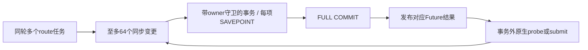

# 施工接口、数据与事务契约

## 当前工程演进约束

以项目AGENTS.md的“唯一现行实现”为准：无项目内版本化、不做向后兼容、不背历史包袱。变更直接统一更新实现与全部调用方，禁止新增旧入口/旧字段别名、双读双写、兼容适配、版本选择、迁移兼容或旧行为回退。下文历史设计与此冲突的部分不得继续作为施工依据。

revision_guard、expected_revision、身份epoch和幂等记录是当前操作的一致性检查，不能解释成支持旧接口或旧实现；面向用户不称为“订阅第N版”。原生协议要求的标识、审计快照及历史失败证据如实保留，但不形成多版本运行体系。

核心交付要求是：IM 消息到达后，DJ 根据现有订阅中的 ID、名字等定位线索，核对并主动通知原始订阅会话，消息经本机已有实例的 IPC/socket/API/MCP 送达，不经 CLI 参数传递。名字不是替换目标的依据。创建空对话仅为可选增强，没有创建接口不妨碍已有会话支持；没有原会话通知能力则不能报告该工具核心接入完成。

当前执行范围已按 2026-10-26 用户要求调整：先完成 Codex、Cursor 主要业务链并交付项目，其他工具专项验收延后；RC1–RC3 停留在已写设计，不进入测试/实现。以[当前发布范围](../release-scope.md#当前交付优先级2026-10-26-用户调整)和 TODO 顶部为准，本文旧全工具矩阵、性能优化及逐工具验收顺序不再作为当前前置任务。既有证据与未达标事实保留，不虚报通过。

绑定 eca0e26 的业务规格；新增内部名称为本次施工选择，尚未存在于源码。本文的 `text` 片段是签名/事务说明，不是 Eliscript 语法承诺或实现。公共字段、枚举、预算及错误以 [统一操作](../interfaces/operations.md)、[控制面](../agent-control-plane.md)、[领域模型](../domain-model.md)为准，首期裁剪以 [范围](../release-scope.md)为准。

## 1. 操作目录与入口

`src/application/operations.eli` 导出 `operationCatalog: Map<OperationName, OperationDescriptor>`；每项包含以下全部字段，不让入口各自猜测：

逐操作的必填/可选、K/R、互斥、嵌套类型与结果落点已展开为 [字段表](operation-catalog.md)，编写 schema 时逐行转写，不从分组描述重新猜字段。精确依赖/工具链/SDK接线见 [开工准备](readiness.md)。

| 字段 | 类型/约束 | 用途 |
| --- | --- | --- |
| operation | 精确点分名称 | CLI 每段变命令词、MCP 加 dj_ 并替换点号，API 原样使用 |
| handler_group | 下表固定模块名 | 绑定模块的 handleOperation，不能执行任意方法名 |
| input_schema / output_schema | JSON Schema 2020-12 | 每层 additionalProperties=false、互斥分支/枚举/必填，不接自由对象 |
| normalize | 纯函数标识 | 验证后补业务明确默认；不改目标、强转类型或删除字段 |
| action / resource_resolver | 权限动作/精确资源解析器 | 先范围授权后读取，不从标题/cwd 赋权 |
| effect_kind | query / accept / preview / observe | read-only、台账与协议提示的统一来源，见下文 |
| idempotency / revision_guard | none / required / lookup；既定 revision/profile_revision/epoch 规则 | operation.get 的原键查询是 lookup；不误当受理变更 |
| capability_guard / limit_refs | 首期能力与限制键集合 | 三入口相同拒绝；不隐藏降级 |
| result_resource_kind / help | 安全对象类型、描述/参数来源/副作用 | 生成 CLI/MCP 帮助，沿 resource_refs 找正确 get |

effect_kind=query 不发送模型输入；preview/只读 probe 可以产生短期引用或观察，不创建业务投递。accept 包括显式 refresh/reconcile：有持久台账但不必有消息副作用；MCP readOnlyHint 按实际持久/外部效果明确投影。operation.get 的互斥 lookup 模式、所有变更的幂等要求、修改/取消/resolve 的 expected_revision 沿公共契约，不能让同一字段在 CLI 与 MCP 有不同含义。

业务模块统一导出 `handleOperation(context, operation, args) -> Future<Result<Data>>`（纯规则模块例外）。它只分派下表本组操作，再调用施工手册列出的准确业务函数。application 在启动时静态注册全部名称，未知名称 invalid_argument；已知但未启用分支 unsupported。下表用 `/` 仅省略相同前缀，每个词都是独立操作，不新增万能 execute 工具。

| handler_group / 目标文件 | 必须覆盖的公共 operation | 输入/输出与原子边界 |
| --- | --- | --- |
| service / service/projections.eli（Core 注册） | service.status | 无业务输入；visible_operations/限制/各源各目标状态，不能用一个 ready 掩离线 |
| ledger / application/execute.eli | operation.get | operation_id XOR operation+idempotency_key；仅本人/当前可见 safe_result/resource_refs，不执行动作 |
| connections / messaging/service.eli | connection.list/get/probe | 精确配置引用/已定义 filters；只读健康/能力/凭据摘要，不输出秘密或新建配置 |
| im_catalog / messaging/service.eli | conversation.list/resolve；message.list/search/get | 精确 connection/chat/thread 或 typed ref；local Event 与 native MessageSnapshot 分开，首期公共 native 拒绝；Lark 后台收件内部读取不开放此查询能力 |
| registry / registry/agents.eli | agent.whoami/discover/register/list/get/probe/rebind/unregister | candidate 与 target_constraint 核对，recipient 代登记仅 operator；route 不因注销改变 |
| subscriptions / subscriptions/service.eli | subscription.preview/create/list/get/update/pause/resume/delete | spec 只进 preview；提交只票据，操作台账+版本/cutover/撤销原子更新 |
| delivery / delivery/service.eli | delivery.list/get/reconcile/retry/cancel/resolve；session.send | direct 的 session_ref XOR agent_id；受理返回 Delivery，resolve 仅 operator 不重发 |
| messaging / messaging/service.eli | message.send/reply；outbound.get/reconcile/retry/cancel/resolve | destination_ref 或固定 reply_context；受理返回 Outbound，首期只单文本 |
| catalog / catalog/service.eli | tool.list/get；profile.list；instance.list/get；session.list/get/resolve/probe；session.message.list/get | 查询安全投影、稳定 key/typed ref；profile 隐 argv/秘密；probe 不测试发送 |
| search / catalog/search.eli | session.search；session.message.search | literal query、scope、cursor；FTS 仅候选，原文复核、稳定顺序与覆盖分开 |
| refresh / catalog/refresh.eli | catalog.refresh/get | scope/include_content/continuation/budget；Operation+CatalogRun/checkpoint，绝不启动 Agent |
| lifecycle / lifecycle/service.eli | instance.start/stop；session.create；lifecycle.get/reconcile/resolve | profile_revision/instance_epoch/revision 各有用途；LifecycleAction 与 slot/gate 独立于 Delivery |

下表是接线的准确签名，认证秘密不进入业务 JSON 或 Result：

```text
createCore(ports: CorePorts, config: ValidatedConfig) -> Core
Core.execute(principal: Principal, operation: OperationName, args: JsonObject)
  -> Future<Result<JsonValue>>
Core.start() -> Future<Result<ServiceStatus>>
Core.stop(reason: StopReason, deadline: MonoDeadline) -> Future<Result<DrainResult>>
executeOperation(ctx: AppContext, operation: OperationName, args: JsonObject)
  -> Future<Result<JsonValue>>
handleApiRequest(request: HttpRequest, core: Core) -> Future<HttpResponse>
callService(profile: ClientProfile, operation: OperationName, args: JsonObject,
            timeout_seconds: SafeInteger) -> Future<Result<JsonValue>>
runCli(argv: Array<String>, io: CliIo) -> Future<ExitCode>
runMcp(profile: ClientProfile, transport: StdioTransport) -> Future<Void>
```

Core.execute 的 principal 是宿主可信端口传入；公开 API 先 authenticate，再调用。MCP stdio/CLI 只调用 callService，不装配 Core 或数据库。传输认证、HTTP 256 KiB 请求限制、成功/领域失败 envelope、CLI stdout/stderr/退出码均沿既有接口；请求体的 api_version 为字符串 "1"。客户端超时不取消已受理动作，不自动改键重发。

runMcp 使用官方 SDK Server + serveStdio(factory)，tools/list 投影同一描述符，tools/call 将合法协议壳的原始业务 arguments 转给服务权威校验。避免高层默认校验在 handler 前用另一格式覆盖业务错误；该选择不放宽 inputSchema，服务仍独立校验。连接时核对 service.status 的 api_version/build_id/operation_catalog_digest，摘要不符 incompatible。固定包/具体边界见 readiness 第4节，当前没有实现。

API 的 HTTP 200 表示已解析并得到业务 Result，领域失败仍 ok=false，调用者不得只看 HTTP；请求壳/版本/JSON 格式错误为 400，认证失败 401、入口授权失败 403、体积超限 413、服务尚未可用 503、未归类服务故障 500，均尽可能返回同一安全 envelope。业务中的 forbidden/unavailable 等 code 仍以 Result 为准。写出响应时连接丢失不能撤回受理事实。同步此映射到 api、callService、三入口契约测试，MCP 不把领域失败改成无结构自由文本。

## 2. 类型、字段与所有权

types.eli 维护 wire 和内部类型边界。`OpaqueId` 为不透明字符串；`Seq` 内部精确整数、wire 十进制字符串；`Revision` 为正 safe integer；`UtcTime` 为 UTC RFC3339；`MonoDeadline` 仅用于本进程超时，绝不存为跨重启的 UTC 事实。所有集合/false/null/缺失值通过显式宿主互操作区分，不能以 Lisp truthiness 代替 schema。

完整业务对象字段已列在 domain-model 和 agent-control-plane，施工不删减。为实现跨模块事务，再固定下列内部记录；`?` 表示可缺省，所有其他字段必填。默认值只在明确写出的地方生成。

| 类型 / 唯一维护位置 | 字段与类型 | 生成、更新、保留 |
| --- | --- | --- |
| AppContext / application/execute | principal:Principal、authorization_revision:Revision、store:Store、ports:CorePorts、request_id:OpaqueId、now:UtcTime | 每请求冻结身份/授权版本；不含模型状态、自由 endpoint 或 argv |
| OperationDescriptor / application/operations | 第 1 节全部字段 | 启动装配一次只读；CLI/MCP 共享投影 |
| AcceptedOperation / storage/schema | operation_id、principal_id、operation、key_hash、request_hash、resource_refs:Array<TypedResourceRef>、state、safe_result?、created_at、result_expires_at | principal+operation+key_hash 唯一；同事务受理；墓碑不随完整响应过期删除 |
| TypedResourceRef / core/types | kind:subscription/delivery/outbound/catalog/lifecycle/instance/session、id:OpaqueId | 指向持久资源；session kind 的 id 为 session_key，不能当短期 handle |
| HandleRecord / policy/handles | ref、kind、principal_id、resource_key、authorization_revision、resource_revision?、instance_epoch?、content_version?、expires_at | 凭查询/预览签发；类型/主体/权限/期限检查；过期不使已受理对象消失 |
| InstanceGate / lifecycle/gates | instance_id、instance_epoch、revision、state:open/closed、reason?、stop_lifecycle_id?、closed_at? | ready 打开，stop 受理先关闭；只允许 lifecycle/recovery 在事务中改变，不由 delivery 缓存覆盖 |
| ManagedSlot / lifecycle/gates | profile_id、profile_revision、instance_id、instance_epoch、launch_token、start_lifecycle_id、state:starting/ready/stopping/unknown、ownership_evidence_ref | 每 profile 一个活动记录；已证不存在才释放，实例历史留存；manual 不等于 absence |
| CatalogVersion / catalog/snapshots | resource_kind、resource_key、valid_from:Seq、valid_to?:Seq、payload_version、tombstone:Boolean | 写目录/正文/索引同事务增 catalog_seq；valid_to 缺省表示当前；删除优先于旧快照 |
| QuerySnapshot / catalog/snapshots | snapshot_id、principal_id、scope_hash、query_hash、sort、authorization_revision、as_of、catalog_seq、expires_at、last_scan_key?、pending_group?、result_count:SafeInteger | result_count 初值 0；最多 32 活跃/各 10000 结果引用；失效不能拼新水位 |
| PendingSearchGroup / catalog/search | session_key、last_message_key?、scan_offset_bytes:SafeInteger、matched_fields:Set<Field>、snippet_refs:Array<VersionedSnippetRef> | 组内未扫完先持久再让出；计数/片段有上限，不复制整个正文进 cursor；扫完才输出一次 |
| CatalogCheckpoint / catalog/refresh | catalog_run_id、source_id、native_cursor?、continuation_ref?、consumed_records、consumed_messages、consumed_bytes、coverage、last_observed_at | budget 逐批累计；partial 不证明删除；过期/越权 continuation 拒绝 |
| RouteState / delivery/scheduler | route_id、canonical_target_key、session_key、binding_id?、next_delivery_seq:Seq、claim_epoch:Seq、claim_owner?、unknown_delivery_id? | route 唯一、首次入队事务分配序号；unknown/注销/重新登记不重置顺序 |
| DirectInputRecord / delivery/service | operation_id、principal_id、route_id、agent_id?、content:TextContent、delivery_policy、authorization_revision、expires_at | origin=direct；event_id=null、无 Contribution；受理时字段不倒改 |
| Contribution / core/types | 既有 delivery_id、subscription_id/revision、effective_grant_refs、context_policy、delivery_policy、expires_at | 每订阅版本独立；当前有效集合决定合并，取消一个不抹其他有效项 |
| AttemptRecord / delivery/service | attempt_id、delivery_id/outbound_id/lifecycle_id 三选一、dispatch_key、binding_epoch?、state、created_at、native_ref?、definite_not_sent:Boolean | definite_not_sent 初值 false；写出前 submitting 落盘，没回执不证明未送 |
| EchoGate / messaging/service、ingestion/service、storage/schema | connection_id、conversation_key、outbound_id（联合唯一）、created_at | Outbound submitting 同事务建立；确证 native ID/echo_index 或未发送才删除；unknown/manual 不释放；matchBatch 保留该地址 routing_work 为 held |
| SourceProgress / ingestion/service | connection_id、cursor、last_ingress_seq:Seq、gap_status、ack_control:Boolean | 和事件或拒绝诊断同事务推进；可控 ACK 才持久后确认 |
| PollCheckpoint / adapters/im/lark、storage/schema | connection_id、conversation_key、identity_revision、activation_at、completed_until?、window_start?、window_end?、page_token?、generation:Revision、next_due_at、retry_count:SafeInteger、last_success_at?、gap_status | user 轮询每页与 Event/拒绝诊断同事务；默认值、窗口和过期 token 恢复见 IM 接入；身份变化不沿用 |
| DrainResult / service/main | state:draining/stopped、pending_native_work:SafeInteger、unknown_refs:Array<TypedResourceRef>、held_deliveries:SafeInteger、deadline_reached:Boolean | 只报告获准安全信息；期限到可以仍 draining，不能假 ready/停止成功 |

TextContent、DeliveryPolicy、SubscriptionSpec、Result/Error、Receipt、Sender/ApiSender、ReplyContext、LifecycleAction 使用原业务契约。limits.eli 是所有固定上限的唯一键源：文字 16384 UTF-8 字节、TTL 60–604800/默认 86400、字段 query 1024 字节、常规 limit 50/200、短串扫描 1000 记录/4 MiB、目录与队列配额等；投影 help/schema 引用同一键，不三处重复常量。

搜索跨分块字面匹配必须保留足够尾部，避免 UTF-8 边界或块间关键词漏查；PendingSearchGroup 只保存有界状态/正文版本引用。cursor 为服务签发的不透明引用，不把原始 SQL、主体凭据或可执行表达式交给调用者。

## 3. 模块内部签名与端口

每个 public handleOperation 只用本组的业务函数；下列名称与施工树一一对应。所有读取返回授权过滤的 Result，未授权对象不能泄露数量/片段；业务模块不能绕过 executeOperation 的共同受理合同。

```text
validateRequest(operation, json) -> Result<ValidatedArgs>
normalizeArgs(operation, validated) -> NormalizedArgs
authenticate(credential, configured_principals) -> Result<Principal>
authorize(principal, action, resource, authorization_revision) -> Decision
issueHandle(kind, principal, resource, constraints, expires_at) -> HandleRecord
resolveHandle(ref, expected_kind, principal, now) -> Result<ResolvedResource>
openStore(config: StorageConfig) -> Result<Store>
Store.transaction(expected: RevisionGuards, mutate: Tx -> Result<T>) -> Result<T>
Store.readPage(query: PreparedQuery, checkpoint, budget: ScanBudget) -> Page<T>
Store.backup(destination: HostResolvedPath) -> Result<BackupSummary>
pollDueSources(ctx: AppContext, now: UtcTime, budget: LarkReadBudget)
  -> Future<PollTurnResult>
readPollPage(watch: LarkWatch, checkpoint: PollCheckpoint, cancel: AbortSignal)
  -> Future<Result<PollPage>>
commitPollPage(ctx: AppContext, watch: LarkWatch, expected_generation: Revision,
               page: PollPage) -> Result<PollCheckpoint>
discoverAgent(ctx, args) -> Future<Result<Page<Candidate>>>
registerAgent(ctx, args) -> Future<Result<AgentTargetProjection>>
rebindAgent(ctx, args) -> Future<Result<BindingProjection>>
unregisterAgent(ctx, args) -> Future<Result<AgentTargetProjection>>
querySessions(ctx, operation, args) -> Future<Result<SessionPage>>
getSession(ctx, args) -> Result<SessionProjection>
resolveSession(ctx, args) -> Future<Result<SessionProjection>>
probeSession(ctx, args) -> Future<Result<ProbeResult>>
openSnapshot(ctx, scope, query, sort) -> Result<QuerySnapshot>
advanceSnapshot(ctx, snapshot, scan_result) -> Result<SessionPage|MessagePage>
searchLiteral(ctx, operation, args) -> Future<Result<SessionPage|MessagePage>>
acceptRefresh(ctx, args) -> Result<Accepted<CatalogRun>>
runCatalogBatch(ctx, catalog_run_id, budget) -> Future<Result<CatalogRun>>
acceptLifecycle(ctx, operation, args) -> Result<Accepted<LifecycleAction>>
runLifecycle(ctx, lifecycle_id) -> Future<Result<LifecycleAction>>
reconcileLifecycle(ctx, lifecycle_id) -> Future<Result<LifecycleAction>>
assertGate(tx, instance_id, expected_epoch, required_state) -> Result<InstanceGate>
closeGate(tx, instance_id, expected_revision, lifecycle_id) -> Result<InstanceGate>
releaseSlot(tx, profile_id, absence_evidence) -> Result<Void>
previewSubscription(ctx, args) -> Future<Result<PreviewProjection>>
commitSubscription(ctx, operation, args) -> Result<Accepted<Subscription>>
changeSubscriptionState(ctx, operation, args) -> Result<SubscriptionProjection>
acceptEvent(ctx, connection_id, normalized_event, source_cursor) -> Result<EventReceipt>
matchBatch(ctx, routing_checkpoint, budget) -> Future<Result<RoutingProgress>>
acceptDirect(ctx, args) -> Result<Accepted<Delivery>>
planContribution(tx, event, subscription_version, decision) -> Result<Delivery>
claimRoute(ctx, route_id) -> Result<RouteClaim>
beginSubmission(ctx, delivery_id, claim) -> Result<FrozenSubmission>
recordReceipt(ctx, attempt_id, observation) -> Result<DeliveryProjection>
reconcileDelivery(ctx, delivery_id) -> Future<Result<DeliveryProjection>>
queryMessages(ctx, operation, args) -> Future<Result<MessageResult>>
acceptOutbound(ctx, operation, args) -> Result<Accepted<Outbound>>
dispatchOutbound(ctx, outbound_id) -> Future<Result<OutboundProjection>>
reconcileOutbound(ctx, outbound_id) -> Future<Result<OutboundProjection>>
loadConfig(config_ref, host) -> Result<ValidatedConfig>
recoverState(ctx) -> Future<Result<RecoverySummary>>
runService(config_ref, host) -> Future<Result<DrainResult>>
```

Result 不抛跨进程原始异常；I/O 异常按故障发生阶段映射 definite_not_sent/unknown。`Tx -> Result<T>` 必须同步、有界、不能返回 Future 或 await；Bun 同步 SQLite 不能被包装成“异步无阻塞”。`createHostPorts` 在显式启动时提供 Clock/IdSource/File/Http/Process/Audit，Clock 支持 UTC 与单调时间两条用途；规则模块只依赖纯数据。

端口沿 architecture.md 的 ImPort/AgentPort/AgentCatalogPort/AgentLifecyclePort。增加统一调用上下文 `CallContext={abort_signal,deadline,max_frame_bytes,max_response_bytes}`，每个网络/子进程调用必须接收；取消读取不能倒改已写出的外部事实。接口返回的能力有 supported/unsupported/unknown、evidence_kind/checked_at/limitations。

| 工厂与调用者 | 实现端口 | 具体约束 |
| --- | --- | --- |
| createLarkPort(config, host)；D16 装配 | ImPort | event consumer ready 前不在线、stdin 保持、stdout/stderr 并发排空；ack_control=false，message_id 去重；只停自有 consumer |
| createTelegramPort(config, host)；D16 装配 | ImPort | webhook 已有则拒绝；update/诊断与连续 cursor 同事务后推进 offset；unknown send 不换消息重发 |
| createOpenCodePort(config, host)；D16 装配 | AgentPort/Catalog/Lifecycle | 精确 endpoint_ref/namespace/epoch；204 仅接受；existing 不被 stop；managed serve 单 slot；空 create 不 prompt |
| createPiPort(config, host)；D16 装配 | AgentPort/Catalog/Lifecycle | JSONL 唯一关联 ID、get_state sessionId、只当前/已采集历史；现有 RPC create unsupported；巨帧排空截止隔离通道，不杀工具 |

目录请求默认单帧上限 1 MiB，超出不解析为完整成功，按既定 partial/oversized 处理；每连接同时最多一个全量目录请求，5 秒排空截止。输入信封的最大线帧预算由适配器声明，正文 16 KiB 不包含可信头的编码成本；beginSubmission 对编码后的完整帧再验原生预算。无法安全表达则 blocked/limit_exceeded，direct 不截短。IM 可截断注入但必须显式 bytes/原始引用，不能截断后谎称完整；平台单条发送超限受理前拒绝。

## 4. SQLite 迁移与关键事务

`schema.eli` 定义按递增 migration version 的首次 schema；不是保存生产 SQL 的另一语言业务层。`repository.eli` 提供预编译语句、实体映射与 keyset 查询，唯一受控写连接由 sqlite.eli 持有。默认 WAL/FULL/FK、busy_timeout=0，容量/版本不足不启 intake；版本要求和备份边界沿技术选型。

| 表组 | 主键/关键唯一索引 | 必需读取/调度索引 |
| --- | --- | --- |
| operations/idempotency | operation_id；principal+operation+key_hash | 主体/创建时间、resource_refs；同键请求摘要冲突拒绝 |
| agents/bindings/routes | agent/binding/route ID；canonical_target_key | session_key、recipient、状态；同 route 下 delivery_seq 唯一 |
| profiles/instances/managed_slots/instance_gates/lifecycle_actions | profile/instance/lifecycle ID；活动 profile slot、launch_token 唯一 | instance_epoch、action/state、归属观察；expected_revision 更新 |
| sessions/session_versions/session_messages/text_index | 稳定 session_key；原生消息键+版本；版本区间键 | tool/namespace/instance/workspace/updated_at/session_key、FTS 候选稳定键与可见版本 |
| catalog_runs/query_snapshots/handles | run/snapshot/ref ID | 主体、期限、catalog_seq、授权修订、checkpoint；删除时失效相关游标 |
| events/ingress_cursor/routing_work/match_decisions | connection+source_key；event+订阅版本 | ingress_seq、来源/话题/事件种类、未完成 routing_checkpoint |
| subscription_versions/contributions/deliveries | subscription+revision；贡献版本；订阅 route+event 唯一 | 目标/有效范围、state/delivery_seq/expires_at；direct operation 唯一 |
| attempts/receipts/claims/reply_contexts/outbound/parts | 各 ID、回执原生键、part_id | submitting/unknown、目标 claim epoch、固定回复目的地；首期一 part |
| service_lease/echo_index/audit | service owner；connection+native_message_id | 归属与时间；审计无正文/秘密 |

授权过滤先于计数/片段；索引设计必须支持选择范围和稳定排序，不用无索引 LIKE+LIMIT 伪装预算。目录版本占配额，不能一直保留版本不清理；清理先显式失效受影响快照。保留/删除/撤权不得清除未结算台账与投递事实。

以下为必须保留的事务顺序和局部状态，代码结构可拆辅助函数，行为不得改：

```text
executeOperation:
  descriptor := operationCatalog[operation]
  caller := ctx.principal                 # 通道认证所得
  request_hash := hashCanonicalBusinessArgs(args)   # 不含 request_id
  existing := lookup(caller, operation, idempotency_key)
  if existing: compare hash; project by current grants; return original record
  validated := validateRequest -> normalizeArgs -> resolve exact resources
  authorize current action; check ref/preview/revision/capability/gate
  transaction: recheck mutable guards; create Operation + domain object + key record
  return operation_id + typed resource_refs      # 未写外部 I/O

beginSubmission:
  transaction: verify claim_epoch + instance_gate/epoch + current grants
    + valid contributions/direct authorization + TTL + native state
  frozen := encode bounded envelope; sign reply_context only if permitted
  attempt := persist submitting/dispatch_key/frozen envelope
  commit
  outside transaction: submit exact binding; append native receipt
  on uncertainty: unknown barrier on same route; never blind replay

stop/start/create:
  stop accept transaction closes gate before new input/create can submit
  start accept transaction reserves profile slot/instance/launch_token before spawn
  create submit transaction checks epoch/gate before native create
  drain waits native work/in-flight/unknown; queued stays hold
  reconcile only adds evidence; manual resolution does not release unknown slot

acceptEvent/matchBatch:
  transaction: normalized Event or bounded rejection diagnostic + cursor/ingress_seq
  if ack_control: ACK only after commit
  transaction per batch: decisions + contributions + Delivery + routing checkpoint
```

预览/普通只读请求不要求幂等键；受理变更及 reconcile 要求原规范的键。网络超时后 operation.get 按原键查回；未查到不证明尚未受理。safe_result 引用过期先按稳定 key/get 查，不改变原操作或自动重新执行。

## 5. 编译、配置与退出接线

固定源码快照的项目配置文档已只读重核：使用 schemaVersion=2、sourceRoot="."、非空 entries 数组、outDir，路径相对配置文件，源图不得越界。三个配置分别为 eliscript.json（四生产入口）、eliscript.tests.json（测试 manifest 对应入口）与 eliscript.tools.json（tools/build.eli、tools/verify.eli、tools/package.eli）；不能在同一配置中混 entry 与 entries。[EL03](../references/official-sources.md#eliscript-runtime)是格式依据，不是本项目编译通过证据。

生产 entries 精确为 src/service/main.eli、src/interfaces/cli.eli、src/interfaces/mcp.eli、src/library.eli，输出保持源相对路径、扩展名变 .mjs：dist/src/service/main.mjs、dist/src/interfaces/cli.mjs、dist/src/interfaces/mcp.mjs、dist/src/library.mjs。测试/工具配置 outDir 为 dist-tests/dist-tools，测试入口在 dist-tests/tests/ 下，工具在 dist-tools/tools/ 下；各图的共享源依赖由编译器输出，不能跨 sourceRoot 手工拼导入。

package 的 build/build:test 使用 `bun dist-tools/tools/build.mjs --scope all`；build:tools 明确指向项目隔离的固定源入口和 dist 模块目录。S3 先准备固定源 stage3 与目标 Bun PATH，再 build:tools；构建器拒绝缺失/不一致的完整回执，不自动退到 npm 冻结产物或启动 bootstrap。all 重建生产/测试/工具三图并记录输入/输出/来源 manifest，不运行测试或启动服务。该步骤避免先运行尚未编译的 `.eli`；测试只消费既有产物，不隐式重建。

Bun/SDK/Ajv 导入只通过 `.eli` 显式 interop，不在字符串中藏 JS 服务。运行依赖闭包与编译工具闭包分列，目录发布包只含生产图、必需 runtime/生产依赖和 Skill；测试/工具图、Emacs、编译器及本地证据不随服务启动。首次真实构建与互操作验证仍在全量实现之后。

loadConfig 校验 schema_version、service.service_id、storage、principals/grants、connections、agent_endpoints、managed_profiles、client_profiles；默认根 ~/.dj、service.json；显式 --config 优先，路径从配置目录解析、秘密是 credential_ref、未知字段拒绝。sample 配置不得包含本机绝对路径、真实账号或可用 token。服务配置版本、数据库迁移版本、wire api_version、信封 schema_version 和对象 revision 独立。

runService 只在恢复完成后启 intake/ready；Lark 的 pollDueSources/readPollPage/commitPollPage 和 PollCheckpoint 遵守 adapters/im 的固定身份、预算与事务，connection.get/probe 投影其安全 source_health；后台刷新/探测由 DJ 自己调度，不能要求调用方模型设 timer。Core.stop 和 instance.stop 共用 gate/drain；服务 draining 仍开放 status/get/reconcile、获准 manual 结案/暂停取消，拒绝新 start/create/send/订阅启用。监督器/自有子进程生命周期必须在真实测试证明管道未提前关闭，不能凭退出码宣称安全停止。


## S1 测试装配接线补充

Core 的可信宿主面补充 `tick() -> Future<Result<SchedulerProgress>>`、`ingest(event: NormalizedEvent) -> Future<Result<IngressResult>>`，供服务调度和已装配 IM 端口调用；它们不进入61公共操作，不向 CLI/MCP 增加万能导入或测试命令。Core.start/stop 仍显式管理唯一 owner/持久化/恢复，导入库不自动启动。

CorePorts 的宿主键统一为 clock（utcNow/monoNow）、process（spawn，返回有归属的子进程与流/退出句柄）、http（fetch）、credentials（resolve）、files、ids、audit；agent_ports 为 tool→端口 Map，im_ports 为 connection_id→端口 Map。测试注入的 faults 只从可信装配传入；产品请求/schema/config 不接受故障点。poll.before_page_commit/poll.after_page_commit 位于短事务前后，不能在同步 SQLite 事务中 await 故障回调。

测试的 host/process 是完整 Core+生产 API 的隔离宿主，`/__fixture/control` 只定义在 tests/support/host.eli，不得复制到产品接口。controlled peer 与真实厂商/模型边界分开；真实组仍要求原生身份、开始、reply调用及原话题消息 ID。真实控制器/观察器的运行资源、权限和命令来自受保护授权 profile，缺失就 not_run，不以观察器自报代替 DJ/原平台事实。

CLI/MCP 私有 client profile 使用 schema_version=1、default_endpoint 和 endpoints 数组；每项 endpoint_id/socket_ref/credential_ref，相对路径以该 profile 文件目录解析。身份仍由凭据校验取得，文件名或请求中的 principal_id 不赋权。expected_operation_catalog_digest 是可选的进一步收紧约束，不能覆盖客户端编译目录本身的摘要核对。示例和测试的凭据只在受保护本地目录生成。

### 原生适配器与存储测试的具体接线

`tests/support/agent-protocol.eli` 提供本次 loopback HTTP 和流式 ProcessPort 对端；它们输出 OpenCode/Pi 原生记录，不输出 DJ 规范化 AgentPort 结果。测试仍属于受控协议集成，不能证明真实厂商或模型采用。工厂参数是可信部署配置的适配器子集，公共61操作不能传这些配置或任意协议命令。

| 内部接口 | 固定接线与输出 |
| --- | --- |
| createOpenCodePort({endpoints}, host) | endpoints 每项 endpoint_ref/base_url/native_namespace/instance_id/instance_epoch/ownership/workspace_ref/directory/credential_ref；配置 loader 解析工作区与端点，不能让请求覆盖。host.credentials.resolve 返回相应 Basic 身份材料，HTTP 端口只访问选定端点；路径逐段编码 native_session_id，directory 用 URL 参数编码 |
| createPiPort({profiles}, host) | start(profile,launch_token,ctx) 经 host.process.spawn 获得自有 stdin/stdout/stderr/exited 句柄，持续读两管道；get_state 的 sessionId 核验后返回 initial_session。profiles 来自预配配置，不从调用者取自由 argv。create 对已有 RPC 返回 unsupported，零 new_session |
| 生命周期核对端口 | AgentLifecyclePort.inspectInstance(instance,launch_token,ctx) 返回当前 state/归属/精确 token/absence_verified 及 evidence_level；只有已持有进程句柄退出或可证归属观察才给 absence_verified=true，不能按 PID/进程名猜。lookupCreate(instance,request_key,native_ref,ctx) 无原生关联保证时返回 unsupported/unknown，不根据标题猜新会话；manual 结案仍可追加核对事实，未证 absence 不释放 slot |
| createPiChannel(io, limits) | io 为 clock/write（可异步，调用者负责真实管道背压），不通过 kill 回收工具。request(command,args,ctx) 分配唯一原生关联 ID，返回 Result，其 data 保留原生命令数据；feed 接受字符串或字节流，严格 LF 分帧并正确拼接 UTF-8；tick 处理截止；drainEvents 取出有界独立事件队列；status 给 state/buffered_bytes/oversized_frames |
| 原生观察 | submit 返回 kind=accepted/evidence_level=native_protocol，Pi 另保留 disposition=started/queued/handled；handled 不合成 started。observe.items 使用独立 started/ended/settled，agent_end 不把实例转 idle；probe 也核对 isStreaming/isCompacting/pendingMessageCount，不仅看单一布尔。OpenCode 204 不合成 started/settled |
| 原生失败 | 写出后响应丢失为 unknown、definite_not_sent=false；无原生 lookup 不重发。Pi success=false 仅对该命令拒绝提供未接受证据，不能抹掉此前任务。无在途请求的完整超帧可在确定 LF 后恢复；存在在途且无法关联超帧时隔离通道，在途输入仍 unknown；不关闭活跃工具或重发 |
| Store.backup | 仅可信宿主使用解析后的私有目标路径，不新增公共操作。使用 SQLite 一致性备份机制（Bun 环境可用 VACUUM INTO），拒绝非空目标与事务中调用；完成前不宣称备份可恢复。不复制运行中的主文件忽略 WAL，不修改源库/未结算事实 |

Storage.transaction 的 ok=false 业务结果、异常、返回 Future 均不得留下半提交；SQLite FULL/LOCK 映射 storage_unavailable。测试以第二真实连接写锁和单个数据库 max_page_count 触发故障，后者是实际 SQLite FULL，不能冒充主机卷 ENOSPC。版本、模式与 FTS5 仍由 S3 实读证明。

### I06/I07 测试对应的提交和宿主接线

- Telegram receive 以当前持久 SourceProgress 读取；只有本批每个 update 已形成 Event 或受控拒绝诊断后，ack/下一次 getUpdates 才能给更高 offset。端口重建不得从易失内存推断已确认水位；非 created update 同样需要连续持久处理，不能越过尚未落盘的一项。协议测试使用 support/telegram-http 的原生 Bot API 记录，不访问真实 Telegram。
- `ImPort.send` 的输入是已冻结的内部 Outbound 投影，含 destination/content/dispatch_key，reply 时另有从 ReplyContext 复制的 native_reply_to。它不是模型自由传入的原生目的地。Lark 主流使用 +messages-send，原话题使用 +messages-reply/--message-id/--reply-in-thread，固定 profile/--as user/纯文本；Telegram 固定 chat/message_thread/reply_parameters，不设置允许丢引用发送或文本 parse_mode。无法表达的精确话题在受理前拒绝，不能回到主流。
- Agent 端口的 `capabilities.max_input_frame_bytes` 是完整编码线帧预算；受理后能力变小，beginSubmission 仍须重检并 blocked，不截短 direct。它与 TextContent 的 UTF-8 字节上限是两个约束。
- `encodeAgentInput` 是 direct 受理预算、scheduler 冻结预算与原生写入共用的纯编码器。OpenCode 请求包含 parts 和由 dispatch_key 确定的 messageID；Pi 请求包含同一 dispatch_key 作为关联 id。预算包含 JSON 转义、可信头及 Pi 的 LF，不只计正文；没有模型/工具/系统提示选项。实际 OpenCode ID 格式兼容性归 S3 原生验证，源码生成 ID 不代表厂商已接受。
- OpenCode 的 messageID 只用于原尝试正向关联。lookup 可对精确原生消息 ID 查回接受；404、超时、未提供 lookup 或查不到均不能证明未送达，不能据此重发。同一 messageID 的原生幂等去重未被本期宣称；能力仍为 unsupported，lookup 标 positive_only。assistant.parentID 与原 ID 的关联用于独立 started/turn_finished 观察；204 不合成开始/结束。具体依据为官方 Server 的 Messages 接口，兼容性和真实开始证据仍待 A16/A20。
- Pi 通道保留 ended 与 settled 的独立事实，agent_end/willRetry 不转换成 idle；probe 必须同时核对 sessionId、isStreaming、isCompacting、pendingMessageCount。正文读取采用官方 get_entries 的原生 entry.id，覆盖当前 session 的 append 顺序（含保留的旧分支），不从 get_messages 的位置合成 ID。缺失/重复 ID、超帧或不支持命令均 partial，不将跳过记录的空页报完整，也不据此删除历史；固定本机 Pi 版本仍须 S3 实测。
- `tests/support/host` 的 hold-operation/release-operation 只在既有测试控制路由中，分别在调用生产 API 前、返回已受理响应前设置屏障，模拟迟到受理与响应断线；生产 API 不包含这些字段/路由，也不接受取消网络请求作为撤销台账指令。
- `tests/support/standalone` 直接启动编译后的 src/service/main 入口，配置/凭据/状态/UDS 均隔离，connections/endpoints/profiles 为空。生产 main 接受 --config，配置相对路径以文件目录解析，config_root 是可信 Core 装配上下文，不是公开 service.json 字段。启动失败须在 stderr 返回带 error.code 的安全诊断并以非零退出；恢复后才 ready，空队列 SIGTERM 正常 drain 后退出0。真实活跃任务的期限/管道仍按既有 draining 合同，不套用空服务退出条件。
- 测试 fixture 的 before_restart 是可信装配回调，仅用于重建端口后证明持久游标恢复，不进入产品配置；测试 getSession 先取得稳定 key，再用真正调用者的 session.get 签发引用。operator 的查询引用不能直接交给 sender；API/CLI/MCP 同主体测试也遵守此规则。

所有上述测试当前均为源码；真实账号、厂商接收器、模型开始和安全停止证据仍在 S3，不从模拟对端或 main 的空配置退出推断通过。

### S1 真实 fixture、资源与构建绑定

config/acceptance.example.json 是不可直接启用的模板，所有真实授权为 false；来源/目标/凭据/费用与控制器仍由当前明确授权的测试环境提供。Telegram bot 自己发出的消息不作为其 getUpdates 的真人输入，stimulus-telegram 必须使用获准独立发送方。缺输入为 not_run，不从其他工作会话补位；模板和环境开关不构成授权。

approvedDriver 只运行受保护 profile 中的自有有限期 controller：kind=test-controller、safe_to_terminate/authorized=true、entry_ref/entry_sha256 绑定用户所有的私有非链接文件；argv 首项必须为本次 Bun，第二项解析为该控制器入口。不能把 Pi/OpenCode 等活工具程序当可杀控制器；控制器不持有活跃 Agent 的 stdio 所有权。请求为 {schema_version:1,request_id,run_id,operation,parameters}；响应重复四个关联字段并给 ok/data，错关联拒绝。stdout 上限1MiB、stderr有界排空，超时只终止该控制器，不强杀它观察的目标。

控制器操作与测试输入：busy-target/release-target 操作当前授权目标的测试任务；stimulus-{lark,telegram}/observe-reply-* 留原生源/回复ID；observe-native-start 给精确 session ID、observed_delivery_id 与 native_event_id；observe-empty-opencode/observe-direct-input 留原生读回；stop-dj-with-active-target 仅用于允许停止的专用 DJ；observe-skill-adoption/observe-reply-key-recovery/create-and-wire-recipient/run-without-reply 提供实际原生工具调用/身份记录。preview 不产生 Operation，其采用证据必须给实际 preview_id、preview_call 与 create_call 的原生调用ID/参数，再由 DJ subscription.get 交叉核对。

measure-owned-deployment 的输入为60秒/100ms采样请求；返回 measurement_source=proc_pid_rusage、native_capture_id、complete、interval_ms、duration_ms、samples。每样本含 elapsed_ms/processes；每进程含 pid/start_abstime/category(dj或external_agent)/roles/ownership_verified/physical_footprint_bytes/rss_bytes。roles 至少覆盖 dj/lark_websocket/mcp_proxy/external_agent，保留出生代际与完整短进程覆盖依据。resources.eli 独立求和 DJ、外部Agent和合计；不能仅报RSS或自报总数，缺采集/归属/完整窗口拒绝通过。采集器实现和原生数据仍须在S3核实；本轮只交付其 fixture 合同及断言，不宣称已有真实采集。

verify 的默认 performance 只选本地负载；带 --real 才包含部署资源用例。汇总同时列 excluded_required_case_ids/suite_complete，局部通过不能抹掉未运行的真实项。授权门未过时仍写 summary/timing 的 not_run，runner不启动；缺失/重复/意外case或非passed状态均不能汇总通过。构建使用 `.local/build/manifest.json` 绑定全部维护输入/输出字节，测试开始前拒绝旧产物；这是S3的运行行为，S1/S2只写源码。

S2 共享实现位置补充：application/results.eli 维护结果 envelope 与严格安全 Projection schema，operations.eli 按操作引用它，避免输出定义分叉；core/errors 的 field_errors 使用 model-facing 的 pointer/code/expected/received_type。storage/repository.eli 只允许固定内部表/列与绑定值，变更要求当前同步事务；Store.transaction 的 expected.validate 是可信同步 guard，失败回滚。executeOperation 给 handler 提供 can/requirePermission/accept，accept 重检当前授权并同事务写 Operation、业务对象、typed resource_refs 和原键记录；projectOperation 由装配层提供当前授权投影，没有投影时只返回最小自有台账状态。I30 仍须完成所有业务模块与这些共享入口的实际装配；源码写入不是验收证据。

S2 登记/目录/生命周期接线补充：application/context.eli 提供共享权限/短事务/typed handle/有界 CallContext 工具；catalog/records.eli 维护原生稳定身份、目录版本、共享 route/binding 和安全投影。session_versions 有范围/稳定键/updated_at 排序索引；message_versions 单独保存版本正文，目录与列表元数据不复制正文，读取旧引用先检查当前删除/授权再读其固定版本。snapshot 额外保存 operation 与 scope；cursor 持有固定页 checkpoint，不靠 QuerySnapshot 的可变全局位置消费下一页。

LifecycleAction 的 recorded 表示已受理尚未写原生；submitting 是可能产生外部效果的提交点，ready 表示已核验 start/create 的原生结果，不等于外部模型完成。当前实例状态独立保留在 current_instance；并发 stop 已关闭的 gate 不被迟到 start-ready 打开。Core 后续只调度 recorded/stopping，unknown 仅观察核对；reconcile_requested/reconcile_principal_id 保存显式核对请求及其当前授权主体，不能重新 start/create。session.create 的可选 title 只作为 nativeCallContext.title 交给空会话创建端口，不作为身份、输入或关联键。stop 的在途/unknown 原生工作和排队待送分开计数，只有可证 absence 才 releaseSlot；manual 记录继续保留 slot/未知事实。

S2 刷新与分发接线：catalog_seen_sessions/catalog_seen_messages 记录固定扫描根，continuation 在同主体/范围/include_content/授权下转移 checkpoint；旧 run 保留历史与来源摘要，不复制新 run 待处理正文。catalog_body_barriers/catalog_source_barriers 保存完整覆盖的 scan_id/cutoff_seq，读取立即屏蔽可证缺失项，再按批清理；partial/oversized 不建立删除证明。cutoff 绑定原生读取开始前的 catalog_seq，不能用旧扫描覆盖后来证据。正文/索引容量由 SQLite dbstat 页统计；宿主支持与实测指标仍待 S3。

Scoped Tx.context 提供当前可信上下文，回调仍同步有界、无 await。acceptEvent 可嵌入整页外层短事务，事件或拒绝诊断、游标及 routing work 一起落盘；ACK 由 Core/IM 在提交后执行。matchBatch 的异步准备/故障边界在事务外，决定/贡献/队列/checkpoint 同事务提交。默认64候选、硬上限128；编译缓存2048项/8MiB，单事件 memo1024项，字符预算耗尽保留可续算状态，不生成 indeterminate/no_match。CPU 采样独立于 TTL 时钟，当前只有源码，没有性能证据。

subscription_event 的 Delivery 在该 Event 全部候选计算完前保持 routing_incomplete，不因一个贡献先命中就写原生。direct 不依赖事件屏障，但共用 route/claim/unknown。取消只撤销调用者自己的未提交贡献；操作员按既有管理 grant 可处理全部，不倒改 submitting/accepted 事实。通用 self 指 owner/principal，recipient 例外只用于 origin=subscription_event 的 Delivery，不扩大订阅管理权。非人类事件默认不分发，allowed_sender_kinds 只能在可信连接配置显式开放；没有公共作者策略或 AI 判断入口。

首期 Agent 原生输入编码统一使用 delivery/envelope.encodeAgentInput，供受理预算、提交预算及具体端口复用，避免正文长度冒充完整 JSON/JSONL 帧。Pi 使用 LF 边界并保留 Unicode 原文含义；不指定模型、系统提示、工具或审批策略。I20 scheduler 与 I22 两端口的调用源码已经写入，实际行为留 S3 证明。

S2 服务与入口接线已写入：service/core 安装各操作分组，共享 config/principal/handle authority/store/runtime，library 显式 createCore；main 才加载私有配置、恢复和绑定 UDS。可信 Core.reloadConfig 仅原子替换 principals/client_profiles，持久 principal_registry 禁止 ID/kind 复用，已有策略变更必须提高 authorization_revision；standalone SIGHUP 使用同一路径，普通 CLI/MCP 没有权限管理入口。完整图已在S3编译，业务仍在集中实测，不能据此宣称整个I30已验收。

conversation.resolve 先检查配置地址/当前权限，再调用 ImPort.resolveConversation(address, NativeCallContext, AppContext)，只有精确地址正向证据后才在事务内重检当前 identity_revision/地址/权限并签发引用。Telegram getChat 只证明 chat 可见及 forum topic 地址形状；Lark 仅复用同 identity_revision 下最近60秒成功读取的精确 watch，没有新 CLI 命令、用户事件流或账号全局目录保证。失败/缺端口拒绝，不从标题造目的地；conversation.list 的配置目录也不宣称平台全量覆盖。

Store 新增 sqlite_version、admissionStatus() 与 checkpoint() 可信内部端口。启动实际读 SQLite>=3.51.3，设置 WAL/FULL/FK/max_page_count；容量按活页重检并保留既有对象维护空间。runtime 分批过期响应/审计，永久保留幂等墓碑；PASSIVE checkpoint 的 busy/帧/停顿进入 operator 的 service.status.storage_metrics。包内 build_id 由固定源码/输出/编译器/Bun 摘要确定，tools/package 的 manifest 与独立运行用例另归 A01/A18/A19，签名提交和运行通过仍待最终阶段。

## S2 声明与消费者交接

以下记录写完后的装配位置，属于 I30 施工交接，不是编译、调用覆盖或代码审阅通过证据。S3 应按同一位置核实实际导出/互操作/每操作正反向与副作用。

| 施工模块 | 声明/实现入口 | 已写消费者 |
| --- | --- | --- |
| I09/I12 目录/校验/执行 | application/operations/schema/results/execute/help | library 导出目录/摘要/校验；Core.execute 进入 executeOperation；API/CLI/MCP 共用目录，operation.get 由执行层处理 |
| I10 身份/授权/引用 | policy/principals/authorize/handles/registry | Core.authenticate/可信 reload；AppContext 当前授权；每个业务 handler 的 can/requirePermission 与 typed handle；恢复 seed 持久主体墓碑 |
| I11 SQLite/仓库 | storage/schema/sqlite/repository | Core.start 唯一 owner 下创建 repository/HandleRecords；各同步受理事务；runtime 容量/维护/checkpoint，可信 backup 端口 |
| I13 登记 | registry/agents.handleOperation | Core registry 分组；catalog.records 提供稳定 session/route/binding；recipient 与订阅共同消费固定目标 |
| I14/I15 查询/刷新 | catalog/records/snapshots/service/search/refresh | Core catalog/search/refresh 分组；runtime 启动有界 CatalogRun；AgentPort.listSessions/readMessages/probe；统一结果投影 |
| I16 生命周期 | lifecycle/service/gates | Core lifecycle 分组；runtime recorded/stopping/reconcile；AgentPort start/create/inspect/stop；scheduler 同一实例 gate；recovery 保留 slot/unknown |
| I17–I20 订阅/入站/路由/投递 | subscriptions/service、ingestion/service/visibility、routing/matcher、delivery/service/envelope/scheduler | Core subscriptions/delivery 分组；runtime 逐源提交后 ACK、候选分批、route claim/队首、冻结输入与回执/观察；direct 共用 route |
| I21 IM 端口 | adapters/im/lark、telegram | Core 按配置工厂与 initialize；全局 Lark limiter；runtime poll/receive/ack；messaging resolve/send/lookup；stop 关闭己方读任务 |
| I22 Agent 端口 | adapters/agent/opencode-http、pi-rpc | Core 显式 existing/profile 工厂；catalog 只读；lifecycle 显式启动/创建；scheduler 原会话提交/观察；recovery/drain 归属核对 |
| I23 IM 查询/出站 | messaging/service.handleOperation | Core connections/im_catalog/messaging 分组；runtime dispatchOutbound/reconcileOutbound；ReplyContext 与 echo gate/index 在提交/回执事务内 |
| I24/I25 服务/嵌入 | service/config/ownership/recovery/runtime/projections/core/main、library | standalone 只在入口显式 runService；嵌入只在 start/tick/stop；reload 无普通请求入口；排空后才释放 owner/存储 |
| I26/I27 三入口 | interfaces/api/client/cli/mcp | API→Core.execute；CLI/MCP→受保护 profile→同一 UDS；MCP SDK shell 与业务 Result 分开；EOF 不取消已受理对象 |
| I28/I29 交付资产 | config 两示例、skills/dj、bin/dj、tools/package、packaging | build-inputs 绑定维护资产；四 ESM/三工具编译配置；打包复制指定资产/许可证并写 build identity；目录包系统用例消费实际成品 |

I30 源码与交接文本已写齐，可进入全批 S3。真实控制/观察器及当前授权 profile 是 S3 真实组的外部前置输入：必须检查程序源码、摘要、归属和原生记录，缺失就记录 not_run；不把任意 JSON 自报器当原生实现。首期范围、必需 A/T 和目标不因输入缺失被削减。

## S3 Eliscript 与宿主边界补正

core/native.eli 的 nativeGet(object,key,...fallback) 对缺失属性返回undefined或显式fallback，对显式null/false/0/空串保留原值，且可选receiver为空时不解引用。宿主字段值使用字符串，js-object字段名/interop位置仍使用语言允许的语法关键词；不得把语言Keyword实例交给SDK/JSON/JS对象索引。宿主typeof/构造器/计时器只在窄桥接中显式绑定，不把业务搬到JS字符串。

固定语言不支持内层defun/defasync或return/break/continue语句：局部函数用词法lambda/async绑定；提前返回和循环控制用每次调用私有token界定，catch必须透传该token、finally仍清理，不能捕获为领域失败。tools/runtime.installFixedRuntime固定三图runtime/platform导出并记录摘要；其源只来自已核验隔离编译器，build manifest纳入运行闭包。

Core.start失败日志仅给固定service_start_failed与prepare_config/open_store/acquire_owner/seed_configuration/recover_state/publish_ready阶段，不打印原始异常/凭据。agent.discover复制适配器返回的数组再推进内部pending；发现分页不可改变适配器的目录所有权或使后续probe查不到原会话。

## S3 大目录计数与配置规模

S3目录读写回查：当前metadata字面查询使用有界字段扫描，维度列表使用普通SQL索引；FTS候选读取仅用于message.text。删除刷新中未被查询消费的indexMetadata写入，避免每个metadata记录额外生成三份全文索引。T47.metadata-index-boundary.sqlite验证实际FTS仅含正文，元数据与正文的精确查询均不丢失；字段、分页预算和公开接口不变。

createMetadataQuota(context)只在同步写事务内读取一次当前live会话数，返回事务局部的CatalogQuota={live_count:NonnegativeInteger}。runCatalogBatch完成身份/epoch/revision重检后为本批创建quota，传给writeSessionVersion(context,record,quota?)；每条新增或复活的记录写成功后才增加计数，既有live记录更新不增加。事务失败时整个quota对象随批次丢弃，不能放入runtime或跨事务复用；后续删除阶段不再使用该计数。其他低频调用可省略quota，仍从数据库读当前值。十万条上限不变，T40.metadata-quota-rollback.sqlite验证真实SQLite边界/回滚/现有记录更新。

配置principal上限调整为4096，容纳1000个独立接收主体及操作员/其他调用主体，仍受配置文件字节和grants边界限制；Agent/Subscription/队列规模不随之放宽。性能组仍使用1000目标、10000订阅与100000目录，不减少规模。

S3性能复测补正：sessions_live_key为tombstone=0的session_key部分索引，支持有界目录计数；初始schema与已存在schema-1均幂等补齐该性能索引，不更改逻辑数据版本。contentIndexBytes先从sqlite_schema选定原有正文/索引表，再以精确name约束dbstat聚合，仍统计原来同一组实际B-tree字节；不以估算替代配额。真实SQLite回归同时与完整dbstat扫描比对。性能fixture先配置新增主体，再生成各自凭据；正文页缩至8条64KiB以满足1MiB原生帧上限，8193条总负载和512MiB配额不变，capacity按布尔字段/精确reason判定。

S3观察热路径：observeDelivery仍先按原attempt/binding取原生事实并幂等落回执；仅当next_cursor与已存cursor不同才提交checkpoint，并在事务内重检旧cursor，防止迟到页覆盖更新。空页且cursor不变不改attempt、不消耗写提交；不削弱submitting前落盘或原生回执持久化屏障。T16.observation-checkpoint.sqlite用实际SQLite total_changes证明无变化页零行写、游标前进一次持久化。原6000事件负载保持完整，落后目标速率时仍让出macrotask以执行截止。真实profile读取复用loadClientProfile的私有文件与相对路径解析，不依赖runner工作目录。
# S3 冻结信封存储

`delivery/snapshot.eli` 的 `packEnvelope(envelope)` 将经过原生编码校验的冻结信封以 deflate-raw-v1、原始UTF-8字节数、SHA-256及base64保存到attempt.envelope_snapshot；压缩级别1，原始和解压上限均为1MiB。`unpackEnvelope(snapshot)` 校验长度、摘要、codec和信封结构，也可读取先前的原始信封。原生submit继续使用同一事务冻结的原始内存值；核对/恢复仍依据binding、dispatch_key和回执，不能因解码再次提交。内部存储表示不改变公开输入、能力、幂等或unknown语义，不提高1GiB容量上限。旧attempt的envelope字段保留可读，不要求重写历史数据。

绑定表记录为不可变快照。新attempt只保存原始binding_id，`attemptBinding(context, attempt)`只按该ID读取；旧记录缺ID时兼容内嵌binding，绝不读取route当前binding替代原提交目标。完整信封及绑定不在多个表中重复保存，unknown、receipt、observe仍解析原固定身份。T16.observation-checkpoint.sqlite同时验证legacy与ID引用、路由改绑后仍观察原目标。

T38.envelope-snapshot.unit覆盖Unicode/null/false/0无损往返、旧值、损坏与解压上限；T27原负载必须逐条受理成功且实际输入60000次，不能只记录循环计数6000。
# S3 同轮持久化合批修复

当前基线为工作区build31：application/context.inTransaction在已有同步事务内复用该事务；delivery/scheduler.dispatchRoute依次单独提交claimRoute、beginSubmission、recordReceipt，原生probe/submit位于事务外。稳态采样表明FULL提交是主要开销之一。

新增内部`application/write-batch.eli`：`enqueueWrite(context, mutate: () -> Result<T>) -> Future<Result<T>>`。runtime共享一个至多64项的队列，同一轮微任务内已就绪的动作使用现有带owner守卫的Store.transaction提交一次。每项以固定SAVEPOINT隔离，返回的领域失败以及must抛出的有效domain_result（ok严格为false且非thenable）只回滚该项；其他异常、非Result、Future或提交失败回滚整批，所有Future失败。事务内禁止Future、异步函数及重入；各Future只有整批COMMIT成功之后才能发布成功。队列溢出拒绝本次调度，不启动变更或原生I/O，不自动重试。

dispatchRoute只把三个同步持久化阶段改为await enqueueWrite，原逻辑和权限/epoch/gate/cutover检查留在各回调实际执行时。不同route可共用提交，同一route仍受jobs key、claim和队首屏障约束。submitting的Future未提交前不能进入native submit；native回执提交失败仍留下原submitting/unknown屏障，不重发。finally先只读检查ownsClaim，已释放则不再开空事务；仍持有时进入同步事务，由releaseClaim重检owner与epoch后清理。draining时仍允许既有回执落盘。WAL/FULL、1GiB、64MiB预留和所有负载规模不变。

reconcileDelivery在事务外完成lookup，再用一个enqueueWrite同步回调执行recordReceipt及清除reconcile_requested；回执返回失败时保留待核对标志，写标志失败时回滚本项全部回执变更。recordReceipt原本已通过inTransaction原子落盘，合批时复用外层事务。observeDelivery仍使用该原子回执入口，空事实且cursor不变保持零写入。

schemaStatements及schema-1幂等补建列表增加deliveries_route_head(route_id,delivery_seq)，部分谓词与selectHead的ready/deferred/blocked/submitting/unknown五状态完全一致。队首读取排除终态历史，同时保留在飞/结果不明屏障。原runtime活跃route查询已有deliveries_state计划，暂不添加重复三状态索引或修改claim_owner过滤条件；吞吐提升须以完整原负载实测判定。



施工位置：新增write-batch的enqueueWrite/flushWrites；scheduler在dispatchRoute的claimed/prepared/recordReceipt三个调用点等待合批结果。回归先写入integration/storage：合批且提交后可见、项失败隔离、整批异常/提交失败、64项边界和异步/重入拒绝。随后完整实现，再集中构建/集成/系统及原始性能负载。受影响验收的旧通过仅作历史证据，复验后恢复勾选。

## S3 吞吐修复批次：事务内只读复用与调度配额

当前基线为build37；此节是下一修复批次的精确施工约定，实施/验收状态由唯一TODO及status记录。既定100事件/秒、6000事件/60000次输入、100连接/1000目标/10000订阅、4KiB、FULL和总jobs=64保持不变，不以预估收益声称达标。

| 位置 / 基线符号 | 精确变更与契约 |
| --- | --- |
| 新建 `src/delivery/read-scope.eli` | `withContributionReads(context,work)`只允许已有同步事务。work收到`read(table,key)`；仅agents/subscriptions/connections/sessions可复用，最多256条，超额即时读取；禁止可变route/投递状态、配额和授权判定缓存；四类表在该事务内只读的状态字段随记录复用。finally清理并撤销read，scope外调用抛错；work返回thenable抛错，由外层事务回滚。只读记录不得传入replace；不跨await/事务/合批项共享。 |
| `routing/matcher.eli matchBatch` | 只在既有同步写事务回调内建立读scope，候选计算/故障await仍在事务外。`planContribution(tx,event,version,decision,read?)`传入显式reader；没有reader的原调用仍即时查库。 |
| `delivery/service.eli isContributionEffective` | 签名追加可选`read,knownRoute`；只复用四类记录。planContribution在同一次调用中读取当前route一次并传入，分配序号仍真实SQL，routes不得进入缓存。当前config授权与TTL仍逐项检查，不缓存允许/拒绝结论。 |
| `ingestion/visibility.eli eventContentAvailable` | 追加可选`knownConnection`；仅接受与event.connection_id一致的当前事务记录。未传时原样即时读；身份、地址、墓碑、正文有效期判定不变。 |
| `delivery/scheduler.eli effectiveContributions` | 在beginSubmission既有同步事务中建立独立scope，传入该事务已读的route；不与matchBatch或同批其他提交项共享。gate/epoch/队首/unknown及提交前持久屏障保持原检查。 |
| `storage/repository.eli defineTable` | 一次预计算表级select/insert/update/update-revision/delete SQL和列数组，继续绑定每个SQL值、检查revision与事务。只保存固定结构，不缓存业务记录/授权，也不增加无界statement缓存。 |
| `service/runtime.eli readSource` | receive/事件提交/ACK顺序不变；末尾健康状态短事务经enqueueWrite合批，并在项内重读连接身份。失败只回滚本项；结果在批COMMIT后发布。 |
| `service/runtime.eli queueControlJobs/queueWriteJobs` | 只取key的pendingRows删去payload；catalog仍取payload。本节原每tick单轮32/16由末节J1–J3替代为有门控的最多两轮，每轮32/16且总jobs仍64；无余量不查询/推进该角色cursor。活任务按原key去重，keyset保持最终回绕。 |
| `tests/performance/router.test.eli T27` | 精确计数与持久排空完成后、事后service.status之前冻结负载结束时间；actual_events_per_second必须≥100，保留原pacer/规模/CPU/队列/截止。框架通过不再遗漏吞吐目标。 |

不在此批增加principal索引、全局队列计数缓存或observe节流，不提高jobs并发上限，不并发匹配多个事件。预计算SQL只能替换构造位置，不能去除参数/表名白名单、乐观锁、BIGINT序号和事务断言。

验收复用既有存储/权限/顺序/ACK/恢复用例，追加scope撤销与跨事务新值、thenable回滚、同route序号、健康项身份失败隔离及两出站角色公平/总量上限。当前处于S1/S2完成后的D修复阶段，本批测试与业务按已授权异步分工并行补齐；双方全部写齐并冻结后集中构建及受影响集成/系统/路由性能验收；未受影响结果按输出摘要复用，原失败保留。


## S3 热路径修复：队列计数与回执投影

基线为build39；57份业务输入及184份生产输出与build38相同。unit12、integration15除T12外、system07与T12定向integration16可组合支撑已覆盖的本地功能结果；performance10的路由60.627事件/秒仍失败。此批只处理下表三处已核实开销，不包含多事件匹配合批、缓存扩容或正式负载驱动调整。

| 位置 / 符号 | 变更及不变量 | 必需回归 |
| --- | --- | --- |
| `src/delivery/service.eli queueCapacity` | 单route五状态COUNT固定使用`INDEXED BY deliveries_route_head`，谓词仍为ready/deferred/blocked/submitting/unknown，参数绑定及全局/单route容量上限保持原值。索引由初建及schema-1迁移保障。不能把accepted历史计入待处理容量，也不能漏掉submitting/unknown屏障。 | T40.pending-work-indexes.sqlite用实际计数SQL验证计划命中部分索引；加入accepted历史与五种待处理状态，核对计数与原语义一致。 |
| `src/delivery/service.eli projectDelivery` | 无请求principal的后台context先返回原`minimalDelivery(record)`，在此分支不读取route/session/event/connection、不查询回执。存在请求principal时保留原授权、正文可见性及完整投影代码，不缓存授权，不改变公开字段。recordReceipt原子落盘和返回Result保持不变。 | T16或既有投影用例直接计数后台投影0次repository.get且字段精确等于minimal；有效主体完整投影、无权限主体最小投影、正文失效后不可见与原用例保持。 |
| `src/storage/schema.eli schemaStatements/migrate` | 新增`attempts_delivery(delivery_id,attempt_id) WHERE delivery_id IS NOT NULL`与`attempts_outbound(outbound_id,attempt_id) WHERE outbound_id IS NOT NULL`。初建与已有schema-1均幂等补齐；只增索引，不修改schemaVersion或台账/外键/回执顺序/1000条上限。 | T40.pending-work-indexes.sqlite删除后两次迁移恢复；真实两种receipt JOIN SQL计划按attempts对应ID索引与receipts_attempt查找，结果不混入其他delivery/outbound。 |

本批仍处于D集中整合修复。业务与测试分属两对话并行写齐，双方完成后冻结全部绑定输入；测试方一次集中构建，并执行受影响storage/delivery/agent/im/interfaces集成及完整路由性能。上一批未受影响的unit/system与其他三项performance保留原证据，不机械重跑。若新变更影响这些边界则按实际影响补验。保持FULL、6000/60000、100/1000/10000、4KiB、100事件/秒硬门禁及所有截止不变。新结果未收齐前不宣称吞吐达标。


## S3 有序匹配写入组

基线为build42；B/C/D功能回归通过，原路由仍61.8777事件/秒，完整首期目标不变。此批由原matcher和runtime两个业务文件实现有界有序写入组，复用既有enqueueWrite，不新增第二套事务/SAVEPOINT执行器，不跨事件共享读scope，不扩大256上限。正式性能驱动契约仍需结合容量测量单独评估，不能把仅换驱动作为生产吞吐改进。

| 位置 / 精确签名 | 行为契约 |
| --- | --- |
| `routing/matcher.eli matchWithWriter(context,checkpoint,budget,write)` | 从原matchBatch内部抽出同一主体。候选计算及routing.before_checkpoint_commit仍在事务外；两处原inTransaction提交改为write(mutate)，mutate仍为同步(tx)->Result。原matchBatch(context,checkpoint,budget?)包装默认write=inTransaction，签名/结果不变。此内部函数不公开为CLI/MCP操作。 |
| `routing/matcher.eli matchTurn(context,works,budget?) -> Future<Result<Array<Result>>>` | works是SQL按ingress_seq排序的RoutingWork数组，至多16条；空组成功，超限/非数组拒绝。每项建立有界slot；其write同步收集一次mutate并返回延迟Result Future。各项准备完成或提前not_found/done/抛错时只标ready，尚不入写队列。全部ready后按输入次序在同一同步循环调用enqueueWrite，回调仅inTransaction(context,mutate)。不使用完成顺序排序，不在收集期间写入，不await事务内工作。准备阶段抛错时整组尚未入队，解除所有等待Future并返回unavailable，整组零写；not_found/done等明确早退仍可与其他项并存。 |
| 写入边界 | 既有write-batch每项SAVEPOINT隔离领域失败；未知异常/Future/COMMIT失败仍整批回滚，只有COMMIT后才释放slot的结果Future。队列64上限及溢出拒绝不变，不为组保留槽位、不扩大并发或自动重试。四表scope仍每个mutate独立，序号/队列/授权/身份/TTL在实际同步回调里即时判断。 |
| `routing/matcher.eli publishMatchMetrics` | 将原事务内runtime样本更新移到提交Result成功之后。每事件candidate CPU保持独立原测量，不除以组大小；wall包含本事件准备和等候提交时间。整批回滚不发布成功样本。 |
| `service/runtime.eli routeEvents` | 原SQL仍最多16条且ingress_seq排序。收集未busy的work并加入busy；保留routing_after推进/回绕，在try/finally内只await一次matchTurn，finally撤销所有已收集busy。不按异步prepare完成顺序写入。整组失败恢复本轮开始的routing_after，避免未知准备失败后越过该组。遇返回storage_unavailable/capacity_exceeded设置storage_blocked，其他领域失败仍由持久work留待后续轮次。 |

此有界准备允许故障await先后不同，但不并发执行同步数据库写入。没有外部probe/submit移入事务，不改claim/submitting/unknown、FULL、jobs64、route32/outbound16、20ms main周期或公开信封。组内多事件允许共用一次COMMIT；有其他已就绪写项或队列拒绝时按原写队列合同处理，不能宣称每组必定单独一笔COMMIT。

验收复用T12/T31/T40/T41：同route多事件准备乱序仍按ingress_seq分配序号；单项must领域失败回滚自身且相邻事件提交；未知写异常/Future整批回滚且无成功样本；准备后pause/revoke/identity/TTL变化按提交点重检；组过大拒绝且无写，早退not_found/done及准备抛错不挂起其他slot；外部输入仍在submitting持久提交之后。全部测试和业务写齐冻结后再集中构建、集成/系统与必要性能验收，未变unit不重跑。性能驱动若需修正须先写清容量定义和等价/更强负载证据，不能降低100门槛或隐去旧失败。


### 同批附属热路径与明确不采用项

以当前源码而非概括报告为准：receipt JOIN目前仍按receipt_id排序，没有loadDeliveryReceipts/loadOutboundReceipts函数或recorded_at字段；B/C/D只改两个业务文件。integration15实际wall47402.49ms与integration17的43601.44ms是单轮观察，不能声称36.7%确定加速。observeDelivery观察的是accepted状态，不能改成只观察submitting。

本批扩为matcher/runtime/delivery.service/delivery.scheduler与新planning-scope五个业务文件，全部写齐后集中验收，禁止只修其中一条就运行：

- matcher准备阶段将connection提升到外层let*，候选循环复用它调用eventContentAvailable(context,event,connection)。原连接局部块外不可直接加参数；准备阶段无await，提交仍逐贡献用当前四表scope重读身份，不将准备快照带入授权提交点。
- 新`delivery/planning-scope.eli withEventPlans(context,event,work)`：仅在同步事务内创建单事件私有工作状态，最多128条route/delivery映射（超出退回即时读取），不是跨事件只读缓存。`route(id)`返回本工作项加载并拥有的可变route；`delivery(routeId)`按当前event_id读或复用本项已写的delivery；`capacity(routeId)`惰性读当前事务全局五状态计数一次，单route计数仍读真实部分索引；`created(delivery)`仅在真实insert成功后记录工作项内delivery并增加已初始化global计数。所有方法退出scope撤销；thenable/async/事务外拒绝，失败回滚后丢弃全部工作状态。不同事件/不同SAVEPOINT不共享，调用方不能在scope内绕过这些方法插入或改变待计数delivery。授权、时间、可变队首/unknown与已完成决策不缓存。
- `planContribution(tx,event,version,decision,read?,planning?)`显式使用该可选规划状态；未传保持原逻辑。路线序号仍由真实SQL分配/replace，权限/订阅revision/身份/TTL仍逐贡献检查。mapper只有本项拥有的route/delivery对象；失败或scope关闭不向后续事件泄漏。match_decisions和contributions的重复探测暂保留：last_subscription_id为空并不证明首次写入，容量阻塞时可能已有decision而checkpoint未推进，不能盲跳SELECT或用宽泛OR IGNORE掩盖错误。
- scheduler新增内部`observationAttempt(context,attemptId)`固定参数SQL，只选attempt_id、binding_id、legacy binding JSON与observation_cursor，不取envelope/envelope_snapshot。observeDelivery先读delivery并排除非accepted，再读这份元数据及原binding/instance；观察原目标/epoch不变。cursor变化时依旧在同步事务内重读完整attempt并检查旧cursor再replace，保持信封快照及其他字段；recordReceipt始终读完整attempt，不改回执/恢复。不得缓存binding/instance跨tick，不得跳过accepted观察。

追加回归：准备connection复用与提交后identity变化拒绝；单事件多订阅只加载/查一次route+delivery、全局容量计数只读一次且每次实际insert后递增；下一项/失败回滚后重新读取，阈值256/10000保持；重复checkpoint/已有match_decision不报唯一冲突；metadata观察兼容legacy binding、旧cursor及空页零写，变化时原完整快照保持，accepted有事实可继续推进且非accepted零重读。


## S3 路由候选查询与有限连续派发

本批基线为build47，58份业务源码与build43相同。原路由性能仍未达100事件/秒；独立20ms诊断同样出现积压，不能归因于测试驱动后宣称容量成立。以下两处构成同一修复批次，先写齐全部回归，再一次实现、冻结与验收。不得扩大并发配额或修改正式性能驱动。

`service/runtime.eli queueWriteJobs` 的routes候选改为以下固定SQL；bind仍为严格after和本轮budget：

```sql
SELECT r.route_id AS key FROM routes r
WHERE r.route_id>? AND r.unknown_delivery_id IS NULL
AND EXISTS (
  SELECT 1 FROM deliveries d INDEXED BY deliveries_route_head
  WHERE d.route_id=r.route_id
  AND d.state IN ('ready','deferred','blocked','submitting','unknown')
  AND d.state IN ('ready','deferred','blocked')
)
ORDER BY r.route_id LIMIT ?
```

五状态条件准确匹配既有部分索引，三状态条件保持原候选语义；不新增索引、物化计数或内存队列。routes主键提供唯一性及keyset次序，无需扫描全部待处理投递后DISTINCT。EXISTS判断任一三状态投递；即使队首为unknown/submitting，只要后面有ready，候选与原SQL一致，真正队首屏障仍由dispatchRoute检查。不得将查询改成绕过队首提交。unknown_delivery_id非空的route仍排除，空页回绕、limit与公平游标保持原pendingRows行为。

新增非导出内部方法`runRouteJob(context,routeId) -> Future<Result>`，由queueWriteJobs的routes岗位调用：

1. `steps=0`、`result=success(nil)`。当`steps<4`且`runtime.state==ready`时，首次直接进入原`dispatchRoute`；后续尝试前先按下述只读窄投影查询队首，无行或头为submitting/unknown则退出，避免空头新增写事务。仅ready/deferred/blocked才await一次原`dispatchRoute(context,routeId)`，随后steps递增。达到上限或draining不再查询。

   ```sql
   SELECT state FROM deliveries INDEXED BY deliveries_route_head
   WHERE route_id=?
   AND state IN ('ready','deferred','blocked','submitting','unknown')
   ORDER BY delivery_seq LIMIT 1
   ```

   该预检不claim、不赋权，也不代替实际dispatch中的新鲜队首/当前权限检查；预检后才入队的新投递由后续tick选取，不丢工作。仅此SQLite读取抛错时返回storage_unavailable，让既有launch设置storage_blocked；不得继续派发或把读失败当空队列。
2. 仅当该次`result.ok===true`且`result.data.state===accepted`，才继续下一头项；空队列、nil、领域失败、deferred、unknown均立即退出并返回该次Result。
3. 每次dispatchRoute仍重新claim/probe/beginSubmission/receipt，冻结原信封并在COMMIT后才开始原生I/O；不共享claim、授权结论或binding快照，不在原生submit未知时重试。
4. 同一route岗位key保持到本方法退出，最多四次串行尝试，每route至多一个原生输入在途。岗位退出后仍有待处理项则由后续调度重新选取，不在本方法内无限排空。四次上限包含任何失败/空头尝试。
5. draining时不得开始下一次dispatchRoute；已经在途的调用仍完成原回执落盘。每次原路径的serviceOpen、gate、epoch、身份/当前贡献和未知队首检查保持不变。

本节修复时单tick最多启动32个route岗位、16个outbound岗位、总在途64个，角色优先级每tick轮换；后续“tick内有界第二轮派发 J1–J3”明确替代每tick岗位总量的限制，保留每轮32/16、全局64及单route每tick最多一个四步岗位。`dispatchRoute`本身仍只处理一次，原调用方及测试接口不变。不增加公共操作或测试后门，不新增模型能力。

回归必须覆盖SQL真实计划及原SQL结果等价；同route至少六条ready在一个岗位最多处理四条、后续岗位继续且序号严格；第二次probe busy/unknown后停止；首次submit在途时draining保留回执而不开始下一头；既有64route/48outbound公平与unknown屏障保留。原T27全规模/FULL/100硬门槛仍须在修改后必要复验，查询微基准与45秒采样均不作验收。


## S3 容量驱动与超时隔离契约

此节由build49的performance14超时触发，限定测试驱动和验收执行方式；不修改产品调度、持久性、吞吐目标或公开接口。原T27将每条输入与一次完整tick串行绑定，无法覆盖生产main的独立20ms调度；下一轮按本节完成测试侧设计与独立核查后再实施。换驱动后的结果单独标记，不与旧驱动耗时直接比较以声称优化收益。

### 容量测量边界

- 被测对象仍是完整Core摄取、规则匹配、持久排队和适配器提交链路，使用真实SQLite WAL/FULL与受控原生协议对端；不是厂商模型或真实IM验收。
- 保留6000事件、60000次原生输入、100连接、1000目标、10000订阅、4KiB正文、候选CPU与所有容量/错误率断言。配置、授权、序号、unknown屏障与32/16/64岗位上限均保持。
- producer按开始时刻加index×10ms的绝对日程摄取，首条index=0；仅剩余delay>0时等待；等待若被consumer通知提前唤醒，须重新核对绝对目标时间，不能直接提前ingest。落后时追赶，不重置开始时刻或隐藏延迟；连续追赶最多16条便让出一次宏任务机会，避免饿死consumer。
- consumer与producer独立，使用20ms周期和非重入保护，与main的setInterval语义一致。上次tick未完成时跳过该次周期，不另排并发tick；记录实际tick次数、错误及被跳过周期，不能改成每20ms后再额外串行睡眠。
- producer保留逐条ingest成功断言；consumer错误即停止新的输入并作为失败传播。逻辑时钟仍每条事件推进10ms；真实吞吐一律用performance.now，不用逻辑时钟或tick计数替代。
- 起点为首条输入日程开始，终点为60000次原生输入且独立只读SQLite确认accepted=60000、unaccepted=0、claims=0、routing_work未完成=0的时刻。wall必须包含摄取、排队、提交及最终排空，不能用offered rate或仅摄取完成时刻冒充完成吞吐。service.status等事后采样在冻结wall之后。
- 实际完成吞吐仍须≥100事件/秒（6000×1000/wall_ms），错误率为0。绝对60秒输入日程不是自动通过证明；末尾派发未在门槛内完成即失败。

### 截止、取消与证据

- producer和consumer共用用例局部停止状态，所有定时器、在途tick及错误均有明确所有者。成功、失败、内部截止都在finally中停止定时器、阻止新ingest/tick、等待已开始的工作退出，再调用原fixture清理；不得用Promise.race声称已经取消其失败分支。
- 负载内部采用有界70秒运行截止（原60秒摄取日程及10秒排空预算总额），只用于尽早终止失败和留出清理机会，不放宽60秒端到端通过门槛。未完成时保存实际摄取/accepted/积压及截止原因，不能生成完整6000/60000的通过报告。即便已完整排空，低于100事件/秒仍是失败；原始报告须区分调度完成和硬门槛通过，不能在吞吐断言前固定写passed。保留先落原始指标再执行硬断言的证据顺序。
- 框架原300秒总截止不增加；它仍覆盖setup和异常清理。同步阻塞或不可取消的await可能使内部截止无法及时执行，因此不能只依赖协作取消保证进程隔离。
- 后续四项本地performance分别通过现有--case选择器启动独立受控验证进程，串行运行；一项终态并确认cleanup_complete后才开始下一项。沿用现有runner/run_id/JUnit/逐例计时，不新增测试平台或改变integration/unit调度。外部超时缺逐例终态时仍判失败，保留框架报告，不能补造成功计时。
- 原performance14后三项的完成断言可以如实保留，但其耗时不作为无干扰基线。必须区分“程序机制探针证实超时不取消”与“原运行确实在某时刻继续写入”；最终mtime、WAL截断和退出时checkpoint不足以独自证明后者。

### 本批回归与所有权

审核测试方负责测试驱动源码及必要支持代码，先写齐：按时/落后producer、单tick非重入、consumer异常传播、内部截止取消、成功/失败finally无新任务且清理、完整精确计数与持久排空。可复用既有fixture和Case ID覆盖，不添加Core后门。主开发负责本契约、施工清单、业务代码保持冻结与集中整合；无证据不追加生产热路径修复。全部测试侧改动完成并冻结后，构建一次，验证受影响调度/清理合同，再运行独立T27；必要其他性能验证沿上述隔离方式执行。结果必须重新绑定构建输入摘要。

## S3 匹配与投递重复写收敛

基线为build51及业务快照repair-48（58份源码）。诊断19只定位成本，不是验收：23244个JSC样本中仓库insert/replace/get对应4614/3109/3416，COMMIT3658，其中入口仅229。以下修改消除可证明的冗余读写，不预测提速比例，不更改FULL、所有配额、提交前授权重检、事件/路由顺序和unknown屏障。

| 位置与内部契约 | 精确行为 | 验收 |
| --- | --- | --- |
| `storage/repository.eli defineTable/createRepository` | 预计算带主键冲突目标的`INSERT ... ON CONFLICT(key...) DO NOTHING`，新增仅供`match_decisions`、`contributions`使用的`repository.insertIfAbsent(table,record)->boolean`。仍强制同步事务、参数绑定和完整payload；true表示实际插入，false只表示同主键已存在且未覆盖。不得使用广义`OR IGNORE`吞掉CHECK/NOT NULL错误；其他约束异常传播，由既有事务/SAVEPOINT处理。原insert/replace不改。 | T40：两种复合主键重复不覆盖，新增正常；无事务或其他表拒绝；非法外键/CHECK/NOT NULL不伪装重复；单项/整批回滚保留。 |
| `delivery/service.eli allocateSequence` | 单条UPDATE同时自增整数列并用`json_set(payload,'$.next_delivery_seq',CAST(next_delivery_seq+1 AS TEXT))`同步payload，RETURNING文本序号。更新当前工作route对象，移除二次replace；沿用signed-64溢出保护与错误。 | T40/T12：跨事件和重试严格递增，列与payload文本相同，边界溢出零变化，回滚不消耗序号。 |
| `delivery/planning-scope.eli withEventPlans(context,event,work,completeInOneTurn?)` | 新增可选boolean提示，默认false；只在首次游标为空、候选全部已准备且未yield时由matcher传true。`planning.initial_ready`保存提示；`created`继续计容量，另记录本项新建delivery对象（最多128）；`delivery`读到持久旧投递时设置`existing_delivery_seen`。新增同步`planning.finish(state)->boolean`，返回是否需要既有blocked解锁UPDATE：done且（提示false或看到旧投递）。提示true但最终未done时，把本项新建投递逐个恢复blocked/routing_incomplete/revision1并replace；不得改旧ready投递。全部对象和标志仅活在本事件同步写项内，finally清理；不得跨SAVEPOINT缓存。 | T40：一次完成与容量/预算/续页分支，9999→10000再重试，单项失败和整批失败；无越过128缓存限制。 |
| `delivery/service.eli planContribution`、`routing/matcher.eli matchWithWriter` | 新建delivery在initial_ready提示下以ready/revision2/blocked_reason=null插入，否则沿用blocked/revision1。此时仍在未提交的同步事务中，不能开始外部调用；只有最终done才将这些ready提交。容量阻塞由finish恢复blocked，再与routing_work一起提交。final done时仅在finish返回true才执行旧blocked解锁SQL。两处存在性get改insertIfAbsent，完整贡献/决策数据与重放不覆盖语义保持。候选预算/异步fault仍在事务外，提交时仍实时核验当前订阅/授权；提示不是授权或匹配结论缓存。 | T12/T40：正常最终revision2且没有二次delivery UPDATE；半轮/容量阻塞仍blocked revision1，续页done后旧投递ready revision2；无缺贡献、重复决策或提前派发。 |
| `delivery/scheduler.eli claimRoute` | 单条UPDATE自增claim_epoch、设置claim_owner，并同步payload中的文本epoch与owner，保留RETURNING文本/溢出保护；随后插入claims，移除二次route replace。 | T31/T40：列与payload同值、owner/epoch正确，异常回滚与四条连续岗位不变。 |
| `delivery/scheduler.eli recordReceipt` | 在当前事务已加载route上计算unknown变化；读取一次claim。仅对owner等于当前owner_token且epoch等于本attempt的claim执行删除；route.claim_owner也相同时清空。仅在unknown或claim_owner实际变化时replace一次route。原delivery/attempt/receipt原子性不变；外国owner/其他epoch的claim绝不释放。保留dispatch finally的只读ownsClaim后备，不引入未经回执证明的settled标志。 | T31/T16：accepted/unknown/reconcile/重复回执，正常只写一次route，无变化零次；其他owner/epoch保留，新旧claim隔离，draining中在途回执提交。 |
| `delivery/scheduler.eli beginSubmission/freezeEnvelope` | 队首校验改固定窄SQL只取delivery_id，仍五状态、有序、`INDEXED BY deliveries_route_head`；freezeEnvelope增加可选已加载agent，beginSubmission复用贡献核对时同一事务读取的agent，其他调用方保持回退读取。不能拿准备阶段的旧agent替代提交阶段重检。 | T40查询计划；T31队首/unknown/drain/cutover；完整matched/ReplyContext/正文信封保持。 |

本批不采用跨事件共享读缓存或准备阶段JOIN结论替代提交时读取：同批可能插入暂停/撤权写项，缓存失效与SAVEPOINT回滚尚无必要增加复杂性。也不改checkpoint/cache、入口同步内核、角色配额、四次续派或正式驱动。所有测试先写齐、全实现完成后集中构建及受影响集成/系统验证，再将四个本地性能用例分别放入独立受控进程串行执行。large-fanout直接使用同一匹配/派发路径，catalog-load/body-quota的刷新公平性断言也订阅并转发事件，均受本批生产变更影响；build51测试驱动修复时对未受影响三例的复用不能延用于本批。完整吞吐和真实资源验收仍开放。

## S3 诊断20后的状态窄写与订阅窄读

基线为build53/repair-52，58份业务源码。功能943项及三个独立性能用例已覆盖，T27仍在内部70秒截止失败。本次30秒私有诊断计量到3278次COMMIT、约4.853秒；已包装SQL方法约21.484秒，其中delivery全列UPDATE约2.012秒、subscriptions完整payload读取约1.628秒。惰性iterate的next执行不在SQL计时内；异步tick阶段包含交错任务，不能与SQL耗时相加。这些是诊断证据，不是吞吐验收或净提速预测。

| 编号 / 内部接口 | 精确契约 | 验收 |
| --- | --- | --- |
| P1 `repository.replaceProgress(table,record,expectedRevision?) -> Result` | 仅允许deliveries、attempts、routes，强制当前同步事务。固定更新列分别为`state revision`、`state definite_not_sent`、`binding_id claim_owner unknown_delivery_id`，另始终写完整stableJson payload；主键仅作WHERE。其余所有已声明列使用`column IS ?`作为不变条件，以拒绝调用者意外改动身份、路由、序号、TTL等列造成payload不一致；不匹配、记录不存在或revision失配返回revision_conflict且零写。expectedRevision沿用原replace规则，仅revision表允许。参数全部绑定、SQL只从固定表定义预计算；不增加记录快照缓存或动态字段白名单。原replace保持完整更新。 | T40：三表字段/payload一致、NULL/boolean/文本64位序号、错误表/无事务拒绝、不可变列变化拒绝、乐观锁及SAVEPOINT/外层回滚；只读EXPLAIN证明省去不变索引列的更新路径，不将opcode数量冒充物理写次数。 |
| P1 调用接线 | scheduler中的delivery hold/submitting/receipt/reconcile清标志、attempt receipt/观察游标、route释放claim/receipt均改用replaceProgress；catalog.records.attachBinding的route更新改用该方法。原claim/sequence单条SQL、其他控制操作与全量replace保留。每次仍完整持久化payload，事务边界、Result/must、revision递增和异常处理不变。 | T16/T31/T12/T49：故障注入须拦截实际窄写方法；清标志失败仍回滚同项回执，claim owner/epoch、unknown、drain、四条续派、cutover与冻结binding保持。 |
| P2 `repository.getSubscriptionState(subscriptionId)` | 固定绑定SQL只读`subscription_id,owner_principal_id,state,revision`四列；不存在返回nil，拒绝非非空字符串。供即时有效贡献核验使用，不读取或反序列化规则payload、不返回授权结论、不缓存结果。subscriptions的typed列与payload原有同事务一致性契约保持。 | T40：精确四字段、缺失记录、无效ID、当前暂停/revision/owner变更即时可见；完整get结果不变。 |
| P2 `withContributionReads(context,work,subscriptionStateOnly?)` | 第三个可选boolean默认false；只有true且table为subscriptions时调用getSubscriptionState，其余原样get。仍是原四表、256条上限、单事件或单提交项的同步事务局部只读scope，freeze、finally撤销和thenable拒绝全部保留。默认模式仍返回完整订阅，不修改既有消费者。 | T40：默认完整、显式窄读四字段、作用域/容量/撤销/Future、跨事务新值；窄模式不触发subscriptions完整get。 |
| P2 热路径接线 | matcher的单事件同步提交scope及scheduler.effectiveContributions的提交scope显式传true。isContributionEffective继续逐次检查当前config授权、TTL、身份、当前订阅revision/state；不复用准备阶段结论，不跨事件/提交项/事务共享。 | T12准备后暂停/撤权、T10/T16/T31实时重检；新轮次必须读当前四列，不能使用旧值。 |

本批仅修改repository、read-scope、matcher、scheduler和catalog.records五个既有业务文件，不增接口操作、源码路径、schema版本或索引。不调整页缓存、checkpoint、32/16/64/4配额、入口同步内核、claim→probe→submitting提交顺序或正式性能驱动。先写齐所有回归，再完成五文件施工，最后冻结集中构建与受影响功能验证及四项独立性能验收；原失败与基线证据保留。

P3补齐同一次beginSubmission内部的读取复用：将`withContributionReads(context,work,true)`移至beginSubmission同步inTransaction回调内，覆盖整个提交准备项；session与agent从该reader读取。`effectiveContributions(...,route?,read?)`新增可选已有reader，传入时直接复用，未传时仍创建独立scope。`freezeEnvelope(...,knownAgent?,read?)`及`replyContext(...,recipient,read?)`沿调用链传递该reader，replyContext的connection读取由同scope完成；缺reader沿用即时get。不得把reader放入frozen结果、attempt或异步probe/submit，beginSubmission返回时一律撤销。这样仅消除同一提交项内的重复session/connection读取，保持每个提交项独立的256条scope和全部授权核验；不与matcher或其他SAVEPOINT共享。T40/T31覆盖同项读取去重、默认独立调用、scope撤销及完整matched/ReplyContext不变。

## S3 诊断22后的单事件有界多行写入（W1–W3）

基线为build56/repair-54：943项功能覆盖成立，四项独立performance三通过、路由负载仍内部截止失败。私有诊断22在25.63秒窗口中计量query/prepare约0.76秒，不支持以查询缓存为主要修复方向；贡献与决定各55250次单行插入分别约2.26秒/0.84秒。诊断包含包装开销及环境差异，不预测净收益，不替代完整吞吐验收。以下仅减少同一事件的SQL调用，不减少持久记录、检查或FULL提交。

| 编号 / 接口 | 精确契约 | 验收 |
| --- | --- | --- |
| W1 `repository.insertManyIfAbsent(table,records) -> integer` | 仅允许match_decisions、contributions，强制当前同步事务。records须为0至128项的密集数组，每项为非null、非数组对象；非法容器/行数/元素在执行SQL前抛TypeError。空数组返回0且零SQL。defineTable为这两表预计算1至16行VALUES语句，列与原insertIfAbsent完全一致，每行仍包含完整stableJson payload；仅对原声明主键ON CONFLICT DO NOTHING。按输入顺序、每块最多16行执行，返回各块实际changes之和；主键重复不覆盖旧payload，CHECK/NOT NULL/FK等其他错误继续抛出。块间无await，不另开事务/SAVEPOINT；错误必须传播给既有事件SAVEPOINT/外层事务，由其回滚整项，不能捕获后当成功提交。原insertIfAbsent保持不变。 | T40：0/1/16/17/128与129边界、非法表/事务/容器/元素、块内/跨块/既有主键重复、不同revision、全payload及typed列、约束错误和后块失败的事务回滚、领域失败的单项隔离与非领域异常的整批回滚。只统计实际SQL调用，不把调用减少等同物理写减少。 |
| W2 `planContribution(tx,event,version,decision,read?,planning?,pendingContributions?)` | 第七个可选参数默认nil，保持原即时insertIfAbsent路径。显式提供时须为长度小于128的数组，且context.store.inTransaction必须为true，否则在业务写入前抛TypeError；仅把原本应写入的完整contribution追加至数组，仍即时写delivery、分配序号与执行容量/授权/订阅/TTL核验。无效贡献、已终态delivery与limit_exceeded不追加贡献；返回Result语义保持。数组由该事件同步提交闭包独占，不缓存或外泄，不跨事件/事务。 | T40：默认即时与显式暂存对照、非法/满数组及事务外暂存拒绝、有效/无效/终态/容量停止点、投递序号及容量语义不变。 |
| W3 matcher单事件提交 | 在matchWithWriter当前同步提交项内新建decisions和pending-contributions两数组，各最多128。将原循环的decision插入改为追加，planContribution传入第七参数；只遍历原prepared，保持顺序与blocked停止点。循环正常或因容量停止后，先insertManyIfAbsent(match_decisions)，再insertManyIfAbsent(contributions)，随后执行原planning.finish、routing_work更新与必要解锁。容量失败候选的decision仍写入，但不推进原last_subscription_id/last_revision；重试靠原主键幂等去重。其他领域失败或异常不执行尾部flush，由原事件SAVEPOINT回滚；后块错误同样回滚此前delivery/序号/两表/工作状态。严格沿用write-batch分类：返回领域失败或must抛domain_result时仅回滚当前dj_write_item；SQL约束等非领域异常仍使整个外层批回滚，不能新增吞错或逐项成功语义。 | T40隔离/容量9999→10000/多轮续页/准备失败/乱序准备；T12暂停、撤权与序号/cutover；T31提交及unknown屏障。原single insert spy改为验证新实际方法和SQL块数；保留最终数据断言。 |

仅修改repository、delivery.service、matcher三个既有业务文件；不扩展公共API/CLI/MCP操作、schema、索引或源码路径。原planning-scope、P1–P3、只读scope、授权新鲜度、32/16/64/4、ACK、外部I/O与提交点、性能驱动及所有门槛不变。先由搭档核对本契约并写齐整批回归但不运行，主开发再完成三文件，最后冻结集中验收；吞吐不足继续如实记录。

## S3 订阅状态批读与冗余索引收敛（K1–K3）

基线build58/repair-57，943项功能覆盖、performance18三项通过，路由负载未达标。诊断23确认窄订阅单键读98540次/1318.30ms，以及delivery插入和进度更新的实际成本。诊断24没有取得事务内页溢写证据，因此页缓存、cache_spill与Statement缓存均保持。以下是内部读写成本收敛，不能预先声称足以满足吞吐门槛。

| 内部契约 | 精确行为与边界 | 对应验收 |
| --- | --- | --- |
| K1 `repository.getSubscriptionStates(ids) -> Array<SubscriptionState>` | 须在同步事务内；ids为0至128项密集Array，每项为非空字符串。事务外、非法容器/长度/任意位置坏元素或空洞均在任何SQL前抛TypeError。整数组校验后用Set去重，按输入去重后的顺序每16键分块；模块预计算1..16个占位符的固定`SELECT subscription_id,owner_principal_id,state,revision FROM subscriptions WHERE subscription_id IN (...)`。空数组返回空Array且零SQL；只返回实际存在的四列记录，顺序不构成契约，缺失键不伪造行。返回最多128条去重记录，不读取payload，不写库、不另开事务。原getSubscriptionState保持。 | T40：0/1/16/17/128、重复/缺失键、非法/稀疏/坏末项零SQL、事务外拒绝、跨事务暂停/改revision/owner即时可见；实际SQL块数及四列精确投影。 |
| K1 `withContributionReads(context,work,subscriptionStateOnly?,subscriptionIds?)` | 第四参数默认nil，原三参数行为保留。提供非nil ids时必须第三参数严格为true；使用getSubscriptionStates执行整批验证和读取，在调用work之前将每个请求键的当前四列对象或nil放入本scope的Map。对象freeze、256缓存上限、同步回调/拒绝thenable、finally撤销全部保留。仅此同步只读业务项内复用，绝不在事件之间或SAVEPOINT之间共享。未预载的合法键仍走原单键路径。 | T40：缺失键负缓存、已有/未预载键、冻结/撤销/256上限、模式拒绝、异常和Future回滚、下一事务新鲜度。 |
| K2 matcher | matchWithWriter从本轮prepared中提取answer为true的version.subscription_id，至多128项，仅把ID列表传到同步提交项；withContributionReads显式传true及该列表，数据库状态仍在写事务内读取。每个贡献仍独立执行isContributionEffective，包括当前主体授权、TTL、连接身份、版本和目标检查。容量停止点、单事件SAVEPOINT、两表批写、顺序/指标发布保持。 | T40 isolation：两命中订阅使用一次批查询且单键读为0；50/128候选按16键分块。T12：准备后提交前pause/撤权/版本变化仍生效。 |
| K2 effectiveContributions | 保留流式iterate/next/return和原overflow提前结束。查询改为contributions c LEFT JOIN subscriptions s，按`c.subscription_id,c.revision`排序，选择c.payload与c.subscription_id，以及s四列的`current_*`别名。每行解析贡献前构造冻结的当前窄订阅对象（s不存在则nil）；仅对table=subscriptions且key等于该行typed contribution_subscription_id的读取返回此对象，其他读取转发原read。将这个行局部reader传给isContributionEffective；不把reader存入贡献、信封或attempt。原expired/revoked回写不变。 | T16/T12：单次beginSubmission不再执行订阅单键查询；缺失/暂停/新revision/不同owner与有效贡献结果相同，完整matched/ReplyContext保留；大量跨页贡献仍流式、overflow不提交前缀、撤权/过期回写完整，退出关闭iterator。 |
| K3 deliveries_route_pending | 新库schemaStatements不再创建`deliveries_route_pending(route_id,delivery_seq,state)`；migrate先确保现有deliveries_route_head创建成功，再执行固定`DROP INDEX IF EXISTS deliveries_route_pending`，两次调用幂等。保留表/数据、所有唯一/FK约束、五状态head、state/observe/reconcile/owner等索引与schemaVersion=1。route序号历史顺序仍由UNIQUE(route_id,delivery_seq)支持；当前delivery.list按delivery_id快照分页，不依赖此旧索引。 | T40 pending-index：模拟旧库带该索引与真实数据，两次migrate后只删除目标索引、数据/约束不变；selectHead/窄head/计数/候选新旧结果一致且无TEMP B-TREE，unknown/submitting屏障、历史顺序与公开列表分页保持。对比EXPLAIN写字节码只作维护工作减少证据，吞吐仍需正式实测。 |

K2不得采用“一个delivery最多128贡献”的假设：单事件可跨多个matchBatch累积远超128条候选。禁止将全量contributions改为all或LIMIT 128，也不能只提交有效贡献的前缀。LEFT JOIN不按订阅state/revision过滤，确保失效贡献仍经过原判断及回写。当前read-scope所覆盖业务项不写四张只读表，不能把它借用于管理变更后的陈旧读取。

本批只改repository、read-scope、matcher、scheduler、schema五份业务文件；不采用claim释放标记、claim携带route提示或入口PRAGMA缓存建议。公共操作、payload、持久状态、owner/授权、32/16/64/4、FULL、性能驱动与所有验收门槛保持。先写齐全部测试但不运行，再一次完成全部实现，最后冻结并集中验收。


## S3 实体主键的时间局部性 U1–U3

基线为build61：58份业务源码、113项构建输入和522项产物。私有诊断仅支持进入正式修改，不是容量验收。保持FULL、全部约束、32/16/64/4配额、原生产调度与6000事件/60000投递/端到端100事件每秒门槛。

| 项 | 确定契约 | 验收 |
| --- | --- | --- |
| U1 纯UUID格式器 | 新增`host/bun/ids.eli`导出`entityUuidV7(milliseconds, randomUuid) -> string`。milliseconds必须为number、safe integer且在0..281474976710655范围，违例抛RangeError；randomUuid必须为小写标准UUIDv4字符串（含variant 8/9/a/b），违例抛TypeError。不取整、不夹紧、不替换异常时钟，不重试或回退v4。h为时间戳的12位小写hex，返回`h.slice(0,8)+"-"+h.slice(8,12)+"-7"+randomUuid.slice(15)`。保留74位CSPRNG随机位，无counter、无跨调用状态，无I/O。 | 固定向量、0/最大时间、同毫秒尾部保真、跨毫秒及回拨、非法数字/字符串/UUID拒绝。 |
| U2 宿主ID接线 | 同模块导出`nextHostId(prefix)`：只有event、delivery、attempt、receipt、binding、reply_context_record、route、agent、subscription九个精确前缀走U1，时钟为宿主Date.now，随机源为node:crypto.randomUUID；其余前缀原样使用UUIDv4且不读取时间。`createHostPorts().ids.next`接此函数。宿主源抛错原样传播，禁止吞错、Math.random或秘密/句柄工厂改造。 | 九个前缀v7、控制/幂等/未知前缀v4；真实host ports接线、handle工厂仍v4且照常校验主体与TTL。 |
| U3 数据与业务兼容 | 仅影响新实体ID的生成，前缀及36字符连字符UUID长度不变。既有v4行不改写、不迁移，无版本识别条件。UUID仍opaque，不可作权限、序号、TTL或因果顺序；这些继续依赖现有授权和显式Seq/时间。唯一约束仍是最终碰撞防线，冲突走原事务失败/回滚，绝不覆盖或静默换ID。 | 真实SQLite中静态v4/v7混存公开列表完整无重复、原授权拒绝；后台keyset到尾回绕能找到较小的新键；队首顺序仍由delivery_seq决定。 |

同毫秒只提供相近的键区间，不承诺同一B-tree页、生成顺序单调或随机值绝不碰撞；时钟倒退保留其实际时间戳，可降低局部性但不改变业务序号。跨毫秒字典序仅在同前缀、时间递增条件下成立。UUIDv7时间可见，但没有跨实体共享计数器；这不等同于隐藏吞吐或绝对不可推断。

分页兼容的准确边界：静态混合ID集合仍按不可变键全序遍历；当前delivery.list的query snapshot固定查询、身份和页checkpoint，查询本身未按创建水位物化所有deliveries。并发新增且key<=当前cursor的行不保证进入本次扫描，需新查询，不承诺升级带来更强快照隔离。后台pendingRows在遇到空页时从空键回绕，沿原有有界轮询语义覆盖较小键；不宣称持续任意外部写入下的绝对等待上界。agent/subscription分页与matcher候选边界不改，现有真实结果/续页回归保留。此处只限定ID改造的兼容性证明，不降低原统一查询/快照合同，也不以当前资源列表实现为完整快照隔离已通过的证据。

只修改新ids模块、io接线及必要规格；不加入binding复用、缓存调参、WITHOUT ROWID、额外派发波次或其他热点修复。测试方先写齐所有回归及用例目录而不运行，再一次完成全部实现；最终独立审核、构建与分层验收。root/peer完整身份及私有诊断路径仅留本地，不入提交。

## S3 tick内有界第二轮派发 J1–J3

U批已完成945项组合功能覆盖，完整路由吞吐仍失败。本节是该集中验收发现的下一项完整修复，不改变U批实体ID实现。基线为build64的114项输入/526项产物，业务59份；只修改`service/runtime.eli`。目标是配平一次匹配最多16事件/160投递与单轮最多32个四步route岗位的覆盖能力，不承诺仅此修改即可达到100事件/秒。

本节明确替代此前“每tick最多32 route/16 outbound”的内部调度约束：**每轮仍最多32个route岗位和16个outbound岗位，单tick最多两轮，全局在途上限仍64；同一route或outbound在同tick不重复启动，同route仍最多一个四步岗位。** 因而单tick最多新启动64个不同route岗位及32个不同outbound岗位，不表示可同时在途96个。main的20ms非重入调度、每岗位四步、每次派发的claim/probe/授权/COMMIT/receipt和未知队首屏障全部保留。

| 项 | 确定行为 | 边界与错误 |
| --- | --- | --- |
| J1 扫描与本tick去重 | `pendingRows(context,role,sql,limit,scan?)`保持原SQL、查询次数及游标行为；可选局部scan对象写入`from_start:boolean`，标识本次实际返回的查询是否从空键开始，空页回绕后为true。`queueWriteJobs(context,routeFirst,seen)`返回局部`{launched:0,dispatched:0,more:false}`；routeFirst决定本轮角色顺序，函数不再翻转runtime字段。seen为单tick Set，初始化包含当时jobs全部key；查询选中完整job key后先去重/加入seen，再调用原launch。 | 每角色budget仍为min(32或16,64-jobs.size)。budget为0时不查询、不动该角色游标，more=true；有查询时，仅rows.length==budget或scan.from_start==false表示仍可能有其他候选，置more=true。空键起扫且不足budget为已穷尽，不自行追加查询。候选被seen跳过仍沿原游标推进，不补查填满；后续tick按既有回绕重选，不删除持久工作。seen最大64个初始key加两轮各48个候选key，局部最多160项，不进入持久状态。 |
| J2 有效进展 | `runRouteJob(context,routeId,progress?)`每次dispatchRoute返回`ok && data.state=="accepted"`后递增局部progress.dispatched，再判断是否继续；只改计量传递，不改变四步控制流。outbound在原dispatchOutbound返回`ok && data.state=="accepted"`后递增相同计数。queueWriteJobs把本轮结果对象传给route worker或由outbound闭包更新。 | 这是本轮已持久提交的有效投递次数，不是已启动/已结束任务数，也不是COMMIT次数。deferred/blocked/unknown/失败均不算进展；部分route已接受、随后busy或在途时，已完成部分仍可计入。**现有outbound持久与公共状态为accepted，不是sent。** 所有native I/O仍在原事务提交以后。 |
| J3 第二轮及公平/停机 | ready路径完成routeEvents后，读取本tick第一轮优先级，runtime.write_route_first仅翻转一次，建立seen并启动第一轮，然后调用原settleReadyJobs。仅第一轮dispatched>0、more==true、runtime.state==ready且storage_blocked!=true才等待一次nativeSetTimeout(0)宏任务让出；唤醒后重新检查state/storage并调用ownerGuard，成功才以相反优先级执行第二轮及settleReadyJobs。 | 第一轮全挂起、全busy/unknown或已扫描穷尽时不进入第二轮、不新建该宏任务。轮间owner冲突置owner_lost并返回原owner失败Result；不启动第二轮。已有native调用仍按原逻辑结算。第二轮不能翻转下一tick优先级、不能递归或安排第三轮；下个tick第一轮始终与上个tick第一轮相反。draining时不开始第二轮或route下一步，在途回执照常落盘。 |

扫描metadata、progress与seen都只在当前调用/在途闭包中存在，不挂到公开结果、信封、attempt、repository或持久runtime字段。只有原`write_route_first`继续跨tick保存；不新增公共操作、Core测试后门、任务泵、后台定时循环或缓存授权结论。source/control/catalog/routing在同一tick仍只执行原来的一遍；错误Result和launch的storage_blocked处理不变。

回归复用既有T31用例：第一轮全挂起维持32/16/48，后续tick的64总槽和角色轮换不变；两轮快速不同route/outbound的确切启动数、总并发及Seq；第一轮满32且回绕只剩已见长队列/busy route时不重启；少量已穷尽候选省去第二轮扫描；busy/unknown不作进展；轮间draining、owner丢失、storage_blocked均阻断第二轮。继续保留每次submit前独立SQLite确认submitting已提交、同route四步上限、未知不重发与原回执原子性。所有测试先写齐但不运行，全部实现后统一构建/独立审核/功能验证及四项隔离性能；6000/60000、FULL、持久排空、CPU及100事件每秒硬门槛不降低。


# S3 单事件投递批量创建与派发窄读 L1–L3

本批以build69（114输入/526产物，59份业务源码repair65）为基线，仅修改repository、delivery.planning-scope、delivery.service、routing.matcher、delivery.scheduler五份既有业务文件。目标是减少单事件新建delivery的SQL调用与两处无需完整payload的读取；不预先承诺净提速或通过容量门槛。既有W/R/P/K/J契约仅在下述明确说明处扩展，默认调用语义保持。

| 契约 | 准确接口与行为 | 必须保持的边界 |
| --- | --- | --- |
| L1 严格批插 | 新增内部`repository.insertMany(table, records) -> integer`，仅支持deliveries且必须在同步事务内。先完整校验records为0..128稠密Array，每项为非空非数组object；非法表/数组/元素在任何SQL前抛TypeError，事务外按既有assertTransaction拒绝。defineTable为deliveries预计算1..16行严格INSERT模板，按最多16行分块绑定全部typed列及完整stableJson(record) payload，累加changes返回。空数组返回0且零SQL。 | 不使用OR IGNORE或ON CONFLICT，PK/UNIQUE/CHECK/NOT NULL/FK违例原样抛出；第2块失败由外层事务或SAVEPOINT回滚此前块，不自开事务。原insert/insertIfAbsent/insertManyIfAbsent保持不变。 |
| L2 单事件缓冲 | `withEventPlans(context,event,work,completeInOneTurn?,bufferDeliveries?)`新增第5可选布尔，默认false；显式true时planning公开只读`defer_insert=true`，created-records最多128条，仅属于本事件/当前同步write item。planContribution在该模式要求合法非nil的pendingContributions（现有第7参数）后才允许任何业务写入；新delivery仍按原候选顺序allocateSequence，但先放入planning.created，不立即insert。原默认路径仍立即insert再created。 | 每个贡献仍完整鉴权、TTL、订阅版本核验；保留真实查库查重，不凭last_subscription_id为nil跳过existing delivery读取。缓存不跨事件/事务/SAVEPOINT，不缓存授权结论。 |
| L2 容量与finish | 缓冲模式全局COUNT首次结果加当前尚未落库的新记录数，后续每次created递增；单route五状态COUNT加该route尚未落库的新记录数。finish(state)在同一同步事务只允许调用一次：本轮新记录按最终状态归一化后调用insertMany(deliveries,created-records)。done的新记录最终为ready/revision=2/blocked_reason=nil；非done最终为blocked/revision=1/blocked_reason=routing_incomplete。既有持久行不由该内存循环修改，仍按原needs-unlock判断解锁旧blocked行。 | 只对本轮新建的routing_incomplete/ready记录归一化；同route重复命中复用同一delivery，不二次分配序号。finish退出后即使后续失败，所有投递/序号/决定/贡献仍由原事务回滚。缓冲finish成功后所有planning方法失效；成功work缺少finish或重复finish抛TypeError，不能在finish后继续created；失败Result可在finish前返回交由SAVEPOINT回滚。finally清空并吊销全部局部状态。默认非缓冲finish保持原行为。 |
| L2 matcher接线 | matchWithWriter在原同步写回调显式传第5参true，先计算current.state/reason/predicate_memo，调用planning.finish，再按match_decisions→contributions的既有相对顺序执行insertManyIfAbsent，随后replace routing_work并按原needs-unlock处理旧行。 | 新deliveries必须先于contributions落盘满足FK；limit_exceeded的阻塞候选仍落decision、不落contribution且checkpoint不越过；领域失败只回滚当前item，非领域异常整批回滚，所有指标仍在COMMIT成功后发布。 |
| L3 派发窄读 | claimRoute内部改读`SELECT delivery_id,state FROM deliveries INDEXED BY deliveries_route_head WHERE route_id=? AND state IN ('ready','deferred','blocked','submitting','unknown') ORDER BY delivery_seq LIMIT 1`；beginSubmission只检查routing_work.state的位置改为`SELECT state FROM routing_work WHERE event_id=?`。 | 保留导出selectHead的完整payload行为，队首unknown/submitting不越过；缺失routing或非done仍原hold语义。其余读取、assertGate/epoch、claim→probe→submitting提交顺序、冻结信封、COMMIT后native submit及receipt持久化全部不变。 |

不采纳本轮建议中的第二轮routeEvents、跨订阅route级有效性缓存、首轮必空查重假设、known-instance提示、帧字节手算、binding复用或claim释放标记。routeEvents仍每tick一次/最多16事件；J两轮派发、32/16/64/4、FULL、外键/索引、页缓存、1GiB容量保护、正式驱动与6000/60000/100硬门槛均保持。

B先一次写齐T40批插/容量/保存点、T12撤权与Seq、T16窄读/队首回归以及测试说明，不构建不运行；C一次完成五文件；D再集中独立审核、受控构建、功能与四项隔离性能，保留原始失败。


## S3 tick内第二组匹配准备 N1–N2（B写齐、C已实现，D待执行）

本节是build75集中验收后的下一项候选设计；独立设计核对已完成并统一组级/单事件失败语义，不改变L1–L3既有实现、945项功能通过或performance22失败记录。原L节“不增加routeEvents轮次”仍约束已冻结L批；只有本节完成独立设计核对并按A/B/C/D交接后，才在本节精确范围内替换该限制。B四文件已全部交回且停写；C已按本节一次完成runtime唯一业务文件，未编译或测试。实现存在不表示新行为已通过。

### 需求与证据边界

- N-Q1：允许已释放派发容量的同一tick再准备一组不同事件，保持每组最多16项、每事件原候选/CPU配额和现有事务边界。目标是减少路由积压等待下一个完整tick的间隔，不把单组16项静态上限认定为全部性能差值的根因。
- N-Q2：保持每tick最多两轮派发、每轮routes32/outbound16、全局jobs64、同route每tick最多一个四步岗位、角色跨tick一次翻转，以及unknown屏障、当前授权、先submitting持久化再native I/O、FULL与全部容量限制。
- N-Q3：保持正式10ms绝对输入日程、20ms非重入consumer、6000事件/60000投递/持久排空/100事件每秒及所有CPU和资源门槛。不允许用组件诊断、短窗口或已物化行数替代正式通过。
- build75私有诊断40的完整窗口为25154.786208ms：2503个事件已摄取，2282个routing_work完成，21580条投递accepted，221个事件仍待匹配；各项有观察开销且非验收。它只支持继续评估调度形态，不证明增加一组即可通过。两组最多32事件可能生成超过两轮派发可接收的投递，仍依赖既有10000/1000容量保护；不假设每事件恒为10条投递或宣称绝对配平。

### N1：routeEvents只读扫描元数据与tick局部事件去重

仅修改`src/service/runtime.eli`中的内部方法，签名变为`routeEvents(context, seen?, progress?) -> Promise<Result>`。未传可选参数时保留原有单次调用行为与Result。`seen`是本tick创建的Set，仅保存本tick实际加入matchTurn组的event_id，最多32项，不持久化、不包含授权结论。`progress`是本次调用独占普通对象，初始化为`{selected:0, attempted:0, more:false}`，返回Result不改形状。

沿用原SQL的`LIMIT 16`与空页后从0回绕；最终查询的rows长度写入selected，`more = (selected == 16)`仅表示可能存在下一页，不代表已证明还有第17项。循环仍按每一行推进routing_after；只有routing_busy和seen均不含id时才同时登记busy/seen并加入group。attempted等于group长度。故同tick回绕、容量blocked、分多页或失败事件均不会进入第二个matchTurn组，下一tick新Set允许正常重试。

现有失败恢复不变：matchTurn返回失败或抛错时恢复调用开始的routing_after；storage_unavailable/capacity_exceeded保持storage_blocked；finally只清理本组routing_busy，不删除tick局部seen。既有真实delivery查重、逐订阅owner/revision/TTL/授权检查及匹配写项SAVEPOINT保持原义。

### N2：第二轮派发前可选准备第二组

在tick现有write-wave作用域增加`routing-seen = new Set()`、`routing1 = {selected:0, attempted:0, more:false}`与`routing1-result = nil`；第一组调用改为`routing1-result = await routeEvents(context, routing-seen, routing1)`。现有派发seen仍与routing-seen分开，优先级仍只在第一轮翻转一次。

第二轮入口仍要求wave1真实`dispatched > 0`、state ready且!storage_blocked。候选未穷尽条件变为`wave1.more || (routing1-result.ok && routing1.more)`：第二分支只为本节新增的路由准备服务，不能使全部busy/offline/blocked/unknown或挂起且零accepted的第一轮启动第二轮。

保留原0ms宏任务让出；恢复后先重验state/storage，再执行ownerGuard，失主仍置owner_lost并返回原owner失败。在此门禁之后，仅当`routing1-result.ok && routing1.more`才调用一次`routeEvents(context, routing-seen)`。其他情况直接保持原J第二轮派发路径，不补路由查询。

第二组会await，因此其返回后必须再次重验state ready、!storage_blocked与ownerGuard，不能复用await之前的结论；这包括第二组准备期间发生drain、异主或storage失败的场景。若第二组返回失败，不再启动本tick第二轮派发，保留其Result/游标恢复语义并在下一tick重试；既有tick整体返回约定不新增错误码、不吞异常。只有第二组成功或本次没有第二组，并且上述门禁通过，才以相反优先级和原派发seen调用queueWriteJobs与settleReadyJobs。绝无第三组匹配或第三轮派发。

第一组routeEvents级Result失败（ok=false）不产生新增第二组准备；若原J的wave1.more路径本来允许第二轮且state/storage/owner均正常，仍保持原J行为。matchTurn把非致命的单事件失败（例如revision_conflict）保留在success(results)内，此时routeEvents的ok仍为true，第二组资格继续按more计算，不能新增“组内任一失败即停止”的规则。no_match是match_decisions的正常决策值，不是本条的Result失败示例。

### 非本批与最终门禁

本批不改matcher、repository、schema、配置、ID、快照压缩、批量大小、缓存或鉴权结论；不加入route级授权缓存、binding复用、claim释放标记、帧字节手算或强制主键索引。候选性能收益完全待正式D证明。N-A1..N-A7的精确用例映射与前后流程见plan末节；B测试与两份说明已写齐；C的N-D1..N-D3全部完成，下一步绑定新快照进入D，验收尚未执行。


## S3 在途存储调用与安全停止 V1–V2（B写齐、C已实现，D待验）

真实证据为build80的T31.cancel-before-submitting：合法`Core.stop(reason, monoNow+2000)`在tick轮间等待时完成drain并关闭存储，随后tick末尾nativePendingCount访问已关闭SQLite抛RangeError。原始失败保留；不得通过缩短为过期deadline或吞掉异常把问题改写为仅测试构造错误。本节补既有“排空后才释放owner/存储”的生命周期合同。

- V-Q1：Core内部runtime增加非持久`active_store_ops:0`，覆盖Core.tick、execute、ingest、reloadConfig四个会在await后继续访问存储的宿主入口。四者通过同一词法store-call工作包装：若store-sealing为true，异步返回现有unavailable；否则在第一个await之前同步加一，try/await完整work，finally减一。底层入口原有owner/state/store检查与Result/throw语义保留。start/stop、authenticate、describeOperations、transportState不计入此工作计数；start仍按既有显式单次启动合同，不引入重启或启动取消语义。
- V-Q2：Runtime.drain完成beginDrain与原settle后，active_store_ops>0即按原格式返回success(state=draining)，保留owner、端口和SQLite。不能等待当前调用自身，否则从宿主回调等待stop可能自锁。deadline_reached沿原时钟/截止计算，pending_native_work仍只按原jobs/native计数，不加入active_store_ops冒充原生工作。
- V-Q3：Runtime.drain本身含native probe/stop等await，因此其最终Result前要重新保留active_store_ops/jobs/native排空条件；Core.stop收到stopped候选后，必须再次同步检查active_store_ops、jobs及该候选的pending_native_work。有未完成工作即返回同一data但state=draining；均为零时在同一同步段设置词法store-sealing=true，之后才进入端口关闭的await、releaseOwner和store.close。四入口在最终封闭窗口不得准入新存储调用。try/finally在停止未完成或异常时清除store-sealing，成功关闭后保持拒绝。Core.stop返回受跟踪的清理Promise，失败只传播给调用方，不额外产生未被消费的finally拒绝。通常draining中的只读查询与收尾仍可进入；只有最终不可逆资源关闭阶段封闭新调用，不在整个drain尝试期间禁用tick/只读操作。
- V-Q4：只有计数归零并建立封闭闸门、且所有原drain条件满足才可关闭适配器、释放owner与存储；不扩大进程终止权限，不新增公共操作、错误码或配置。原两组匹配、两轮派发、32/16/64/4、FULL、授权、unknown、容量与性能目标不变。

D修复业务范围为core+runtime两处。回归保留已有两处future-deadline N-A4与query-throw，并增加execute/ingest/reloadConfig在途保护和端口close悬停时四入口拒绝/异常后解封；所有新增测试先写齐不运行，再一次实现业务后新冻结验证。此前冻结与失败不倒写为已通过。

V批B全部测试与两份说明已交回停写；C已按V-D1..D4一次写齐core/runtime的完整实现，包括drain异步边界后的原jobs/native排空重验。当前尚未执行新构建或测试，不能由实现存在推导N/V验收通过。


## S3 临时子日志写放大收敛 Y1–Y2（D功能通过，完整性能待闭环）

诊断46以同一Apple SQLite的公开VFS原样转发获得非WAL临时写入证据；组件47在原FK/STRICT/完整payload、每事件SAVEPOINT及WAL/FULL下，用官方SUBJOURNAL打开标志确认子日志。相同样本ABBA中，连接temp_store=2消除了子日志文件写入，WAL写入字节与同步数不变。同build87私有服务对照48–51只用于选择方案，不代替6000/60000/100或部署物理资源门禁。此前排除的页缓存调参、WITHOUT ROWID、claim/receipt合并不因此恢复。

- Y-Q1：openStore(config)创建自己拥有的连接后，在原foreign_keys=ON之后、wal_autocheckpoint=0之前执行固定`PRAGMA temp_store=MEMORY`。在原设置readback的同一and条件中增加`PRAGMA temp_store`的temp_store字段等于2；失败走原异常关闭连接及storage_unavailable，不悄悄退回文件临时存储。每次新开、重开或从备份打开都独立设置；该PRAGMA不持久化到数据库、不改变其他连接。
- Y-Q2：仅临时表/排序/子日志的存储策略改变。主库journal_mode=WAL、synchronous=FULL(2)、foreign_keys=ON、checkpoint/页缓存/容量/超时/STRICT/所有索引与SQL冲突处理不变。事务/SAVEPOINT、领域失败单项隔离、非领域异常整批回滚、submitting提交后才native I/O、owner/授权/claim/unknown和J/N/V边界均不变；不是journal_mode=MEMORY或取消回滚日志。
- Y-Q3：不增加公共配置/操作/状态字段，不使用全局sqlite3_config、不替换SQLite、不将私有VFS/FFI探针带入产品。旧schema/data格式不变，无迁移或schema_version提升。嵌入宿主的其他SQLite连接不受此连接参数影响。
- Y-Q4：该策略可能提高瞬时内存使用。现有输入/查询/目录/正文/队列预算保持，不能提高资源门槛或用fixture RSS代替部署physical footprint；SQLite内存状态接口返回0/0时标测量不可用。完整945功能、四项独立性能及原256MiB真实部署门禁仍须按各自证据验收，短窗不能证明整体性能或最坏内存上界。

施工仅一份业务文件storage/sqlite.eli。B由原独立审核搭档一次写齐storage集成测试与两份测试说明、不运行；C由主开发一次写入Y-Q1并更新台账；D集中构建、完整功能、独立审核与四项性能，保留所有失败。Y-A1..Y-A5精确步骤见plan末节；未通过不勾完整验收。


## S3 提交期 EchoGate 再检的规划收尾 EG1–EG2（D功能成立，完整性能未过）

基线build88，59业务/114构建输入/526产物；Y功能945完整通过、正式performance25为3/4，吞吐仍未通过。D源码核对发现matchWithWriter事务内echo再检的成功早退位于withEventPlans的缓冲作用域内：prepared期间echo仍clear，而routing.before_checkpoint_commit外部事实写入后echo变held/echo时，原L328–333只更新routing_work并返回success，未调用finish。planning-scope对缓冲成功返回要求finished=true，故此分支会被守卫拒绝。此为具体既有分支遗漏，不把Y策略或新优化候选当原因；尚无新竞态实跑证据。

- EG-Q1：保持准备前和提交期两次EchoGate检查及echo_index优先。提交事务内echo非clear时，将current.state按原规则设为held/done，将reason与原准备前分支一致设为echo_gate/own_echo；调用planning.finish(current.state)后再must(repository.replace("routing_work",current))并原success早退。
- EG-Q2：此分支位于候选规划循环之前，本调用created-records为空。finish只完成空缓冲的生命周期，不创建deliveries、match_decisions或contributions，不执行正常完成后的历史blocked解锁SQL；已有blocked投递的state/revision/payload及last_subscription_id/last_revision原样保留。finish返回的needs-unlock布尔在此分支刻意忽略。
- EG-Q3：finish、routing_work写入和Result仍在原同一同步事务/SAVEPOINT；revision_conflict等领域失败保持单项回滚/邻项提交，未知SQL异常保持整批回滚。不得移除buffered成功收尾守卫、把失败改成成功或绕过EchoGate。
- EG-Q4：唯一业务文件matcher.eli；不改方法参数/导出、source授权、候选/队列/32-16-64-4与两组两轮配额、TTL、FULL/MEMORY、claim/unknown/submitting切点、输入驱动或100EPS定义。不引入全局计数/记录缓存、索引/批块调参或新公共操作/配置/Case ID。没有性能收益声明，完整目标及真实资源保持开放。

完整基线与精确施工、独立测试/验收编号见plan末节EG；B只写storage集成测试与两份说明且不运行，C再一次修改上述早退分支，最后D统一冻结/构建/审核与分层验收。

D结果：build91/repair89冻结114输入、526产物与59业务，EG-A1..A4通过，原固定OpenCode Go/High搭档独立审核无确定业务缺陷。功能945为组合覆盖：build90 unit35 75/75、integration54其余844项、system28 25/25，加build91 integration55定向T40 1/1（197 expect）；90→91仅EG-A4测试两处，生产/工具/其余测试产物字节一致，不称单次845/845。performance26四项独立串行收齐3/4通过、全部cleanup_complete：route-load完成6000事件/60000投递，待处理/routing/claims均0，但完整负载67070.761375ms（ingest60890.257375ms、drain6180.504ms），89.45775889516656 EPS，status=failed、schedule_completed=true、throughput_below_target；另三项通过。EG-A5完整吞吐、真实256MiB/IM/Agent/Skill及最终签名继续开放，不把排空或跨轮差值当作性能达标或EG净收益。

## S3 同组匹配容量计数复用 G1–G2

基线为build91/repair89。仅削减同一matchTurn连续写项内重复的全局五状态COUNT；不改变队列10000/单route1000容量、逐候选检查、授权、真正delivery查重、事务单位、64项拒绝、32/16/64/4、两组两轮、FULL/MEMORY、原生切点或100EPS。诊断56的全局COUNT累计耗时仅作为成本定位，组件60强制head索引的有限差值不足以支持另改SQL；本批不改SQL文本、索引或估算行数，不预先承诺吞吐通过。

- G-Q1：matchTurn通过原参数校验后创建私有`capacity-state = Object.seal({store: context.store, count: null, active: true})`，只属于当前调用；私有matchWithWriter增加第五可选参数并传给withEventPlans第六可选参数。matchBatch省略，保持当前路径。不挂入context/runtime/store/repository，不导出新factory或公共API。
- G-Q2：连续入队的已接纳同组mutate只能落在同一flush：enqueueWrite在pending.length>=64时直接返回unavailable，不加入pending；flush同步splice最多64项并在同一同步事务逐项执行。若已有60项，同组仅前4项接纳、后12项立即拒绝，并非留下待下一批。后续microtask不得插入当前同步forEach中间。保留此拒绝和原Result，绝不聚合16事件为1 item或另开子事务。若未来修改此排队语义，须同时使计数复用失效并重验。
- G-Q3：withEventPlans只在buffered=true、当前同步事务、同一store、active=true且count为null或非负安全整数时接受state；任何planning方法仍检查原作用域和state活性。首次需要global-count时若count=null执行原真实COUNT，否则复用count；仍加本事件尚未落库created-records.length，仍逐条执行原单route真实计数。created仍只增加本事件local global-count。不能把局部缓存计数当估算容量。
- G-Q4：只有work完整同步返回ok=true、原finish成功且所有原routing_work/批写已完成后，才将非null local global-count发布回state.count；若有新created但未读取global-count则使state.count=null，下一项真读库。work返回失败Result或抛出任何异常（包括domain_result）、thenable/漏finish守卫失败时，在退出当前mutate前立即count=null；write-batch保持原SAVEPOINT回滚后下一项再读。没有失败项增量进入邻项。
- G-Q5：matchTurn无论准备失败、排队拒绝、结果失败、COMMIT失败或异常都在finally把state.active=false及count=null。COMMIT失败时已接纳整组已在本flush执行完且全部按原外层结果失败，没有持state的未执行项可进入下一批；下一组有新对象并真实读取当前事务。不得把Promise提交后回调当作逐项回滚失效的时点。
- G-Q6：无论同事件同route多订阅还是beginSubmission，每条贡献仍独立重检owner/revision/expires_at/grants。memo只保存一个全局活跃数量；不保存记录、权限或订阅有效性。对任意外部request/schema/profile/cases.json无变化。

精确施工、原/目标调用图、失败边界及G-A1..G-A7见plan末节。A先写齐，固定搭档B一次写完storage集成与两份说明但不运行，root C完成两业务文件后再D集中冻结、构建、分层验证、独立审核和四项性能；整体目标及真实资源保持开放。

D终态：build94原字节manifest 50b2d0bab09d32aa7c46ed7a9e9bb17b95fd041d57bb293dcf747f23a8e5dd77，114输入/526产物/59业务无漂移。G-A1..A6功能与固定独立搭档审核成立；945为build93 unit36的75项、integration56其余844项、system29的25项，加build94 integration57定向T40 1项的组合覆盖，非单次845/845。performance27四项独立进程串行终态为3/4，全部cleanup_complete=true。route-load为status=failed、schedule_completed=false、internal_deadline；负载wall70011.342125ms，摄取4549事件、接受34110条投递、unaccepted9872、routing183、claims0，remaining10055为混合单位，非10055条投递；tick144、skip143、error0、最大并发tick1、退出无在途tick。大扇出10000候选/1000投递、173turn、exercise2693.264375ms、候选CPU p95 2.813ms；目录10万metadata/转发500、exercise53758.796292ms；正文配额534962176bytes、capacity_exceeded=true、转发84/11轮。完整100EPS、真实256MiB/IM/Agent/Skill及最终签名保持开放；不作跨轮净收益或主机因果归因。 原始失败及测试修正范围证明均保留，完整G-A7与S3不勾。

## S3 授权部署物理资源捕获 M1–M3

基线build94/repair92，114输入/526产物/59业务无漂移；功能945组合覆盖、performance27为3/4。全Goal与A01–A20不收缩。本批实现`measure-owned-deployment`的原生读取/固定森林采样与保护入口基础；完整真实DJ拓扑的动态角色和短进程覆盖仍待补齐，另外14项仍待原生观察入口/授权资源。只增加验收工具，不改59份业务、吞吐驱动/门槛、服务配置或自动部署；真实256MiB尚未证明。

- M-Q1：新增Eliscript工具`tools/resource-capture.eli`、`tools/resource-controller.eli`。仅macOS，使用Bun FFI调用公开libproc的`proc_pid_rusage`（RUSAGE_INFO_V1=1）、`proc_pidinfo`（PROC_PIDTBSDINFO=3）、`proc_pidpath`及`proc_listchildpids`；不读取SQLite内部地址、不换引擎、不编译非Eliscript控制程序。读取144字节rusage_info_v1中resident_size/phys_footprint/start/exit，分别从64/72/80/88偏移解码；出生值以十进制字符串保持64位精度，内存值须非负安全整数。BSDINFO为136字节，pid/ppid/euid在12/16/20偏移。proc_listchildpids返回PID数量而非字节数，33槽满时拒绝，不能截短。系统布局与Bun FFI见Apple公开头/实现及Bun官方文档；实验性FFI只用于验收工具，不接入产品运行时。
- M-Q2：资源绑定文件须在显式保护profile根内，为非链接、同uid、无组/其他权限、最大64KiB的JSON；顶层schema_version=1、authorized=true及1..16个roots，每项固定pid/start_abstime/executable/category/roles。pid为正i32，start为非零十进制u64，executable为精确绝对原生路径（仅私有profile保存）；category为dj/external_agent，roles为当前人工审阅并授权的实际部署角色，必须覆盖dj/lark_websocket/mcp_proxy/external_agent，禁止以进程名猜测用途。静态示例默认false，不填真实PID/路径或自动授权。
- M-Q3：每次样本重新验证root出生标识、原生可执行路径和真实euid；递归枚举其子进程，按内核parent+出生事实接纳同uid子树，归属类别继承已验证祖先。已证明的子进程即使重挂父仍追踪其pid+出生标识到确证退出；显式external_agent根可以位于DJ子树内，该根及其后代以明确根分类为边界，不继承外层DJ类别，不重复计入；只有非root已追踪身份被另一类别无明确根边界地重认时拒绝。根退出/复用/exec、UID变化、权限错误或未知计量均使捕获失败，不能以0代替。已退出或被复用的非root旧进程从旧身份追踪中移除；新身份必须重新证明当前祖先。每样本PID唯一、实际存活进程最多32；任何截断/超量失败。只有角色对应的显式root带该角色，普通后代roles=[]，不凑角色。
- M-Q4：控制器只接受既有schema1关联请求operation=measure-owned-deployment，parameters.run_id与顶层一致、duration_ms=60000、interval_ms=100；request_id/run_id为1..256字符受限ASCII标识。完整捕获使用单调时钟与绝对100ms日程，首点0，实际相邻间隔<=200ms且严格递增，末点>=60000；不复制样本补洞、不用fake时钟运行真实入口、最多602点。结果沿用summarizeResources既有原始协议；native_capture_id由本次随机UUID生成，measurement_source=proc_pid_rusage，complete仅在完整窗口与所有身份检查通过后true。
- M-Q5：stdin最多64KiB；stdout恰一条关联JSON，失败退出非0并只报固定错误码，不输出绑定内容、任意异常栈或秘密。只有measure-owned-deployment在approvedDriver中提高stdout上限到8MiB，其余仍1MiB；stderr32KiB、120秒截止和自有child回收不变。32进程/602点/标识长度有界，最终串行化亦硬检8MiB；不会让通用driver无限输出。FFI句柄无论成功/失败finally关闭，工具不启动/发送/停止/杀任何被测进程。
- M-Q6：依赖注入只用于模块级单元测试，真实CLI始终从公开libproc构建reader、宿主单调时钟及实际uid，不从JSON或环境读取伪造样本/时钟/native接口。新增2个本地Case（unit pure sampler/native-record decode与integration真实自身reader/保护文件/CLI失败），不把这些用例或601点模拟数据当真实部署通过。A20/真实T27仍需获准部署、实际四角色60秒/100ms及DJ峰值<=268435456bytes；不能用controller自己的内存或受控guard峰值替代。

A精确手册见plan M节。B由原固定搭档一次写齐两测试文件、cases与两份说明，不运行；C root写齐上述两工具、入口配置、real.eli唯一输出上限分支与默认未授权示例；D统一构建、单元/受影响集成、真实自身native只读组件与独立审核。59业务与performance输入不变时不无故重跑四项性能；现有performance27失败仍有效。其余控制器与资源保持未完成，不能把本工具完成写成全部真实验收就绪。

M D发现及修复：build100本地947通过后，独立170指出非root在children/after中途退出被误判fatal；原报告保留。build104采用明确ESRCH/确认旧身份已消失时只删除非root自身、保留已登记子孙，权限/未知错误仍fatal，并补首读旧path/after新path及PID新birth重新由祖先接纳的确定性测试。unit41 76/76、native integration60在等价helper的build103 1/1，加build100其余845集成及25system形成947组合覆盖；并非全部104实跑，当前171增量独立审核中。M固定根基础仍不证明runCli短生命周期角色完整覆盖；原289节要求不降低，不能称真实controller已就绪或勾A20。


## S3 OpenCode只读原生观察 O1–O3

范围是补齐三个原生观察操作的OpenCode分支，不改业务运行时、不运行真实模型、不扩大资源授权。基线build104，生产59文件保持repair92；原生协议固定上游v1.18.30/3104c1428ec91f809e5ab86631300de41eb6952e。本地参考副本已fetch该tag，工作区HEAD保留原样。

O1：新增tools/opencode-observer.eli及tools/opencode-observer-controller.eli。后者实现既有schema_version/request_id/operation/run_id/parameters关联协议，stdin最多64KiB，stdout最多1MiB，错误仅固定代码、不回显凭据、URL、正文或异常原文。绑定文件沿用当前用户所有、根目录/文件无组及其他用户权限、非symlink、O_NOFOLLOW、64KiB上限；不得从环境切换为模拟transport。示例opencode-observer.binding.example.json默认未授权，不安装profile。

绑定schema_version=1、authorized=true；endpoint含base_url、directory、native_namespace、instance_id、native_instance_id；base_url必须无凭据、query、fragment且path为/，只接受HTTP loopback或HTTPS；directory为绝对路径。auth为{type:"none"}或{type:"basic",username,password}，只从保护文件读取；targets为0..16个唯一native_session_id。三操作均只允许GET，禁止redirect，不跟随Link URL，仅将X-Next-Cursor作为before参数在原origin/path发下一页。GET /global/health必须healthy=true、version="1.18.30"；不匹配拒绝，不自动适配其他协议。

O2：observe-native-start和observe-direct-input要求parameters.tool="opencode"、native_session_id在绑定targets内、非空delivery_id、parameters.run_id与外层一致。GET精确/session/:id核对id/projectID/directory；GET同会话/message?limit=64按X-Next-Cursor完整取页，最多16页/1024条、每响应2MiB、整次8MiB，单请求含body最多5秒、整次25秒。超界、重复cursor/消息ID、跨会话row/part、非JSON或不支持结构均失败，不截断后宣称完成。所有输入参数在首个HTTP前校验。message.info.role为user且text part是schema1 external_message信封，delivery_id精确一致、content.text包含本轮run_id，才算输入证明；direct必须origin=direct，native-start必须origin=subscription_event。重复匹配输入拒绝歧义。direct返回原生user消息ID；native-start必须另有同session的assistant消息parentID精确指向该user消息，返回该assistant.id为native_event_id。只有HTTP成功、原生user存在、DJ accepted或旧run均不足以证明native-start。结束时再GET会话复核精确身份；不读DJ数据库/适配器receipt，不返回正文。

O3：observe-empty-opencode保留原instance_id/session_key/run_id并新增native_session_id。T51先通过session.get把lifecycle.session_key解析为地址，此结果仅是定位信息；控制器必须以stableSessionKey([opencode,绑定namespace,原生id])等于请求session_key，并在原生GET中复核id/projectID/directory及整个消息列表为空，才能返回prompt_count=0。instance_id必须等于绑定endpoint.instance_id。该操作允许读取授权实例中新创建的精确session，不列出其他会话、不按title搜索。native_instance_id来自操作者审核的endpoint映射，响应明确instance_identity_source="authorized_endpoint_binding"，不声称HTTP提供了进程PID/epoch证明；原生会话存在/为空由HTTP独立证明。GET之后会话新增消息属于之后状态，不宣称持续监控。

所有响应保留请求关联，包含native_session_id、native_event_id（empty为session.id）、observation_source="opencode_http_v1"、native_version；输入操作另含observed_delivery_id、native_message_id，empty另含session_key/prompt_count/native_instance_id/instance_identity_source。Pi分支明确不支持，observe-native-start的示例配置仍保留原未实现入口，不能把通用操作切成OpenCode-only后冒充两Agent就绪。只有OpenCode专用direct/empty示例指向新编译入口，仍authorized=false/零digest。真实安装、凭据与资源绑定、原生E2E及M完整短进程覆盖仍开放。


## S3 Lark验收刺激与独立回复观察 LI1–LI3

基线build106，118输入/546产物/59业务；本批补齐stimulus-lark与observe-reply-lark控制器及真实调用接线，不改src业务、不自动部署、登录或实际外发。CLI-only、国际版、显式--as user/固定profile不变。协议依据固定CLI v1.0.76/af8507ea8e008d7c404a8c43a8eee533d071b8cc：shortcut用户态声明、cmd/whoami、原始api成功信封及消息formatter。已fetch精确tag，保留现有参考工作区；新版或安装升级不在本批。官方消息API文档保留原始chat_id/thread_id/parent_id/body，但旧公开文档部分只列tenant_access_token；不能把文档及CLI用户态声明当作当前租户实测支持。真实资源阶段必须验证user token实际响应，不回退bot。


请求沿用schema_version/request_id/operation/run_id/parameters；parameters.run_id等于外层。stimulus参数为connection_id/chat_id/thread_id?/run_id/text，text必须精确为现有realRelay模板“DJ acceptance <run>: use DJ message.reply to return this exact marker.”。observer参数新增connection_id与reply_to_message_id（取真实stimulus.native_message_id），其余chat_id/thread_id/native_message_ids/run_id保留；ids为1..50个唯一om_ ID。只给Lark调用增加这些字段，Telegram旧wire保持相同。运行时读取CLI --version必须为1.0.76，whoami --as user --profile读取profile/appId/brand=lark/identity=user/onBehalfOf.openId并与绑定逐一核对；本地whoami不是token新鲜度或目标可见性的证明，不能因其本地token状态代替实际API结果，CLI正常刷新仍由原认证链处理。

LI2：刺激写入先以(run,connection,chat,thread)派生稳定intent_key=“intent_”+64hex；payload_hash另含固定profile/应用/用户/精确text，防同逻辑run改内容或身份后重新发送。私有SQLite intents日志使用DELETE+FULL及唯一intent_key；未知记录必须提交成功后才允许一次CLI写调用。native idempotency key为dj-test-+前40hex（48字符），传--idempotency-key，原生1小时窗口不等于永久幂等，本地永久记录不能过期重发。无native_message_id的unknown重放立即失败、零CLI写；已有native ID（unknown或confirmed）只允许原生只读核验，确认后可收敛confirmed，绝不重发。并发首次create以ON CONFLICT DO NOTHING确定单一发送者，失败者不发送；写入/读回/状态更新任何异常均保持未知证据，不加--yes、不按exit码猜definite_not_sent、不自动换run/key重试。

native写仅使用+messages-send --chat-id（无thread）或+messages-reply --message-id <绑定root> --reply-in-thread（有thread），都显式user/profile/text/idempotency-key。thread写前通过同CLI原始GET mget读取绑定root并确认chat/thread；无权、缺失或不能证明映射则零写入。成功CLI信封须exit0/ok=true/identity=user/非dry_run且含原生message_id/chat_id；将ID持久化为unknown后通过原始GET mget核对实际新消息的ID、chat/thread、sender用户、精确text与thread父ID，才标confirmed并返回。读回尚不可得时保留unknown/native ID，下次只能读回恢复；不会把send返回值直接当已读回证明。


CLI原始GET mget使用与现有user shortcut相同的/open-apis/im/v1/messages/mget及message_ids数组，避免借用文档仅声明bot的single-get作为已证用户通路。读取命令显式--as user/--profile/--format json，不加下载资源、reaction、page-all或任意URL。成功业务数据为CLI信封data.items（上游code/msg已由官方CLI剥离）；不兼容猜测第二套wire。独立观察不发消息、不登录、不改权限，无法证明user支持或父字段时如实not_run/失败。

工具入口tools/lark-acceptance-controller.eli只使用NativeBun.spawn固定argv，无shell；stdin64KiB、stdout1MiB、原生CLI单次stdout2MiB/stderr32KiB、全请求CLI stdout总8MiB、单CLI最多10秒、整体30秒（按剩余时间收紧），终止信号/超限时终止并等待本次child，必要时500ms后SIGKILL，不杀既有Lark进程。CLI stderr/异常/正文/账号元数据不复制到响应，固定失败为native_lark_acceptance_unavailable/exit1/lark_acceptance_failed换行。绑定文件/日志均为当前用户所有、非symlink、保护根0700/文件0600；CLI依赖非symlink/不可组及其他用户写且实际SHA匹配，主入口不存在配置/环境mock函数开关。测试可在模块级注入runtime；自有fixture进程只证明管道/超时/回收，不冒充真实Lark。

日志使用独立应用标记/版本1的私有SQLite文件，拒绝已有外来SQLite/JSON文件，不在DJ业务库建表，不用另一未知数据库覆盖事故现场。runtime.readIntent/createIntent/updateIntent均同步持久操作；不跨native I/O持有SQLite事务。类型列与payload一致；create返回bool，状态只允许unknown→有ID的unknown→confirmed及同ID confirmed保持，不换原native ID或payload_hash。finally关闭本次DB/文件/child，保留已提交未知记录供恢复，不删除真实消息。

成功response关联所有顶层字段。刺激data={native_message_id,chat_id,thread_id,identity:"user",observation_source:"lark_websocket_raw_v1"}；观察data={native_message_ids,chat_id,thread_id,reply_to_message_id,identity:"user",observation_source:"lark_websocket_raw_v1"}，地址/parent均由已核验原始消息产生，不只是回显参数。不输出正文/凭据/原始CLI响应。真实发送仍须另有获准chat/topic、身份与模板内容许可；新默认binding与driver配置不会给予这些权限。真实四组合、Pi、M完整短进程覆盖、100EPS与最终交付仍开放。

## S3 Pi 原生日志观察与双工具观察入口 PO1–PO3

基线build109（124输入/562产物，59业务未改）。本批补齐Pi的独立原生输入/开始观察和共享driver分流；不接管RPC、不启停实例、不创建会话、不发送prompt、不安装/部署或读取未授权实际会话。协议固定官方Pi v0.80.3/a23abe4a695df8b69b613f73e9fdda2a8af894d4（与本机安装元数据0.80.3对齐），参考工作树未切换。session-manager.ts L30–64/L912–965及同tag session-format.md确认JSONL v3、header id/cwd、entry id/parentId和user/assistant message；尚无assistant且未flush的新session可能不落盘，记录未出现时必须拒绝/等待真实证据，不合成条目。文件证据证明已记录输入/assistant，不声称测得原生进程PID、瞬时存活、模型成功或完整历史覆盖。

PO1：新tools/pi-observer.eli导出validatePiObserverRequest(request)、validatePiObserverBinding(binding)、observePiLog(request,binding,snapshot)。请求仅observe-direct-input/observe-native-start，parameters.tool精确pi，并含native_session_id/delivery_id/run_id，沿既有schema/request/operation/run关联；所有ID为1..256字符ASCII字母数字_.:-，run内外相同。binding={schema_version:1,authorized:true,targets:[{native_session_id,cwd,log_path}]}，targets为1..16稠密对象、session ID和log_path分别唯一，cwd/log_path均绝对、log_path以.jsonl结尾；均复制冻结，实际路径不回显。无标题猜测或RPC回退。

snapshot={header_text,entries_text,prefix_truncated,trailing_fragment_discarded}由可信文件读取端构造。header必须是type=session/version=3/id与当前target session一致/cwd精确一致且timestamp可解析；entry每条完整JSON行<=1MiB、最多8192条，id唯一/parentId为ID或null/timestamp有效；重复header/非法完整行/重复ID拒绝，未知非message类型可保留父链但不作为输入或开始事实。不把partial、旧版本或其他文件猜为当前来源。

目标user message.content为原生string，或稠密text数组逐项text按原顺序拼接（混入非text不作为候选）；解码后须为schema_version=1/kind=external_message、精确delivery_id、origin与operation一致（direct或subscription_event）、content.text含当前run。唯一候选才可通过direct。native-start还须存在后续assistant message，其parentId链在已读窗口内可追溯到该user，且其最近user祖先就是该候选；不得越过另一user、缺失父链、环或未来父节点归因。仅返回白名单data={native_session_id,native_message_id,native_event_id,observed_delivery_id,observation_source:"pi_session_jsonl_v3",session_format_version:3,instance_identity_source:"authorized_session_log_binding",history_coverage:"bounded_tail"}。消息/事件ID取原生entry id；不输出正文、文件路径、模型思考或原始日志。

PO2：新tools/native-observer-controller.eli装配readNativeObserverRequest(stream)、loadNativeObserverBinding(root,ref)、loadPiObserverBinding(root,ref)、readPiSnapshot(target,ports?)、executeNativeObservation(request,root,binding,runtime?)及guarded main。绑定文件与root保护沿O规则（0700目录/0600文件、当前uid、非symlink、64KiB、O_NOFOLLOW）；native-observer.binding.json为{schema_version:1,authorized:true,opencode_binding_ref,pi_binding_ref}，两ref固定basename，复制冻结。请求先验证，再按tool（empty操作固定opencode）只加载对应保护绑定；OpenCode仍调用原loadObserverBinding/observeOpenCode，原字段/namespace/25s限制不改。Pi只读取显式target.log_path；不调用任何stdin/stdout、get_entries、drainEvents或recordEvents，配置/环境不能注入函数。

readPiSnapshot原生端只用lstat/open(O_RDONLY|O_NOFOLLOW)/FileHandle.read/stat/close。原生日志须常规文件、当前uid、不可组/其他用户写（允许原生0644），lstat与打开后dev/ino一致；使用bigint stat固定size/mtimeNs/ctimeNs。先从0读取最多65536字节取得完整首行header，再最多读取文件尾8388608字节，64KiB分块、每步检查25s单调期限。tail从header下一字节或size-8MiB较大者开始；若之前一字节非LF则丢弃首个不完整片段，丢弃末尾未终止片段后以fatal UTF8解码完整行。前后打开句柄及路径dev/ino/size/mtimeNs/ctimeNs必须相同，读期append/truncate/replace均拒绝，不拼接两个版本；finally关闭本次handle。ports仅模块测试可显式传入，真实main固定原生端口。上限不是完整会话历史声明；所需链落在窗口外时失败，不补造关联。25s为返回后/分块检查期限，底层单次文件系统阻塞由外层120s自有controller回收约束，不伪称可取消内核read。

main stdin<=64KiB、stdout<=1MiB，成功顶层关联不变；固定失败native_observation_unavailable/exit1/native_observer_failed换行，未解析/非法请求关联为null，已验证请求后失败保留关联，无原文/路径/凭据/stack回显。O原独立controller及其API保留。示例native/pi bindings默认未授权；observe-direct-input及observe-native-start默认入口改为新共享controller，observe-empty-opencode保留原O入口，15操作总数不变。T49真实direct现有仅OpenCode，新增Pi companion case并共享同一runDirectControl测试步骤；不把O的真实证据计入Pi。真实file/endpoint/模型工作未获资源时保持not_run，完整PO/A13/A15/A16/A20/S3仍开放。

PO3：先写齐纯Pi/共享分流组件、真实受保护JSONL/CLI集成及Pi direct real用例，再写齐两个工具和全部配置/入口，最后D集中构建/分层验证与原固定搭档一次独立审核。保留所有失败、当前性能/资源缺口及原始manifest字节；不新增生产业务文件或依赖。

T49接线：原control用例已在T49前单独导入waitStarted，并非漏导入；新增tests/support/direct-control.eli导出runDirectControl(f,tool,actions?)，在helper显式导入waitStarted/approvedDriver，两个真实case均调用该helper。actions只为模块测试显式注入，默认使用真实测试观察入口。任何API动作前要求精确tool为opencode/pi、目标authorized/allow_model_work均true且两个原生定位字段非空；session.get后在send前复核tool/native_session_id/session_key与绑定一致。真实无IM连接、direct origin、event/reply context为空、原生delivery/session关联和证据断言沿用，不因新增Pi分支降低。新增本地unit覆盖拒绝时零send和两工具参数接线；不把原未运行T49当旧通过证据。

## S3 同岗位回执与下一新 claim 合并提交 RC1–RC3

基线build115，130输入/578产物，59业务源码；本地953为组合覆盖，正式验收12/20。performance28的T27.route-load仍在70082.022ms内部截止（5582事件/42614已接受输入），不归因为主机，不把混合remaining10289当投递缺口。私有组件63的部分owner索引及64的额外微任务ABBA均不采用。当前原生边界与FULL保持，不预先承诺本批可达100EPS。

RC1：保留现有 dispatchRoute(context, routeId) -> Future<Result<DeliveryProjection|null>> 的两参数行为与返回结构，内部委托新 dispatchRouteBurst(context, routeId, maximum, progress?)，maximum须为整数1..4，旧入口固定1，runtime岗位固定4。新入口仅为内部模块调用，不进入operationCatalog、CLI/MCP/API参数；progress沿用dispatched计数。该函数拥有整个有界循环及当前已提交claim，不向调用方、公开Result、delivery、attempt或envelope输出continuation/carrier/next_claim；不新增跨attempt释放标志、route提示位或授权/绑定缓存。初次claim、每次新probe、beginSubmission/submitting提交、原生submit、recordReceipt与原故障点保持。

RC2：新增私有同步 settleRouteAndClaim(context, attemptId, receipt, routeId, remaining)，仅由一个enqueueWrite回调调用；先调用原recordReceipt。主回执失败原样返回失败；主回执成功才返回内部success包装，data={receipt_result, next_result}，前者为原完整Result，后者为nil或下条claim的Result。仅receipt_result.ok严格true且data.state为accepted、remaining>0、runtime.ready、非storage_blocked、ownerGuard仍匹配时，按原五状态head索引查真实队首；仅ready/deferred/blocked可继续，unknown/submitting/空队列不申请。不得复用claim时的observation、授权结论、TTL或binding；后续beginSubmission仍实时重检所有内容。

下一新claim使用原claimRoute，在独立SAVEPOINT dj_next_claim内完成。返回Result或抛出的有效domain_result，仅not_found/delivery_unknown/limit_exceeded白名单失败可回滚此savepoint并释放savepoint，继续提交主回执；受控关闭/失主由明确前置门禁停止，不把任意unavailable猜作业务失败。无head/成功nil不制造claim。storage_unavailable/capacity_exceeded、非法Result/Future、其他非白名单失败及非领域异常必须以无domain_result的异常传播到原write-batch，保持整批ROLLBACK；不得因普通ok=false就吞存储异常。ROLLBACK TO/RELEASE自身失败同样向外传播。savepoint失败后丢弃该次claim对象，不复用被回滚的内存记录。原recordReceipt主失败及其他write item的领域/非领域隔离合同不变。

包装仅用于同步事务内部和await后的模块内解包。只有await enqueueWrite确认整批COMMIT成功后，Burst才能接受next_result.data为当前新claim、更新已接受计数或发布原主回执Result。其余item非领域失败或COMMIT失败时，不得发布accepted或下一claim；原submitting/unknown屏障与原dispatch_key保持，不自动重发。四步岗位在静态路径最多把12段enqueue减少为9段，不等于必然少3次物理COMMIT，实际合批与完整吞吐必须实测。

RC3：每个已预留next claim在下次probe前重新读claim行、route和真实head，并重新ownerGuard；claim行和route都须owner/epoch匹配，delivery_id须等于当前head且head仍为queued三状态，runtime仍ready且非storage_blocked。若不匹配、取消/重绑、失主或停止，释放仍实际持有的claim并结束本岗位，不在同tick另claim替代项。下条仍按原协议重新probe与beginSubmission，最新pause/cancel/grants/gate/TTL在提交前生效。不得在原生I/O期间持有SQLite事务，也不改变每route每tick最多一个岗位/四步、两波、32/16/64与公平轮换。

新增私有 checkedReleaseClaim(context, claim) -> Result<{released:boolean}>。事务外先只读比较当前claim归属，无本claim则成功released=false且不开空事务；有本claim则inTransaction内重读claim与route，双方owner/encodeSeq(epoch)都匹配后才删除claim并清route.claim_owner，沿用replaceProgress完整payload。更新/外国claim不得修改；claim行仍匹配但route栅栏不匹配返回stale_reference，不能声称释放成功。事务失败Result必须向worker上报，不能忽略。旧releaseClaim本身不调用inTransaction，原dispatch finally调用者忽略了事务失败结果；本批不把这项事实写成旧函数自行吞事务异常，也不扩大成全仓释放接口改造。

Burst的finally只依据当前claim对象重检和清理，不用跨attempt released标志。发生draining/storage_blocked/owner_lost、异常或在已提交下一claim后退出，都必须执行checked cleanup。清理失败保留已经提交的accepted记录与progress计数，同时向内部岗位返回失败，error.details使用固定reason=claim_cleanup_failed及可选last_accepted_delivery_id，不回显原始异常；不能用失败Result倒改已提交回执，也不能吞清理失败。失主标owner_lost；storage_unavailable/capacity_exceeded沿既有launch路径标storage_blocked。默认一条dispatch的公开成功/失败和未知语义不变。

只改scheduler/runtime两份业务源码、两份既有integration测试及既有施工/验收说明，不增加Case ID、测试/产品依赖、schema/索引、配置授权或公开操作。先写齐RC-A1..A7测试但不运行，再全部实现，最后集中构建、分层功能、独立审核及四项孤立performance。完整性能或真实证据未通过时RC/S3不勾；真实IM/模型/部署仍须原明确资源授权。

## AI 调用面：订阅指令与任务模板

新增 spec.instruction_policy 可选对象（prompt/task_template，至少一项，每项 1..8192 UTF-8 字节），由 preview 校验、hash/票据及原 create/update 版本机制持久化。仅六个显式占位符 message.text/event.id/sender.id/source.chat_id/source.thread_id/subscription.id，双花括号、最多 32 项；不 eval、不执行 shell、不递归替换正文。prompt 始终原样。

planContribution 将 version.instruction_policy 复制到贡献；beginSubmission 继续逐条 isContributionEffective 后 freezeEnvelope 生成 instructions，保留订阅 ID/revision。多个订阅不覆盖，不缓存授权结论，不变更 dispatch_key/unknown/claim/队首语义。旧订阅未设字段不改变旧信封；历史 attempt 保持已冻结快照。单渲染任务最大 32768 字节；任何溢出走原 holdDelivery(blocked,limit_exceeded) 与 handle/claim 清理，绝不发送前缀。

## AI 调用面：订阅主动消费

delivery_mode=push|pull（默认 push）随版本保存。pull 贡献在匹配事务中写独立 inbox_entries，唯一键 subscription_id/revision/event_id，完成 routing_work 后可领取；不创建 deliveries、不分配原生 route sequence、不调用 probe/submit。活动队列仍受每订阅 1000、全局 10000 上限；只计当前活动版本且未过期项。新表通过既有 migrate 的幂等附加 DDL 创建，保留旧库数据。

subscription.pull 和 subscription.ack 是共用台账/权限的接收动作，独立 subscription.consume 授权且必须为 Agent recipient。pull 一次一项、最多扫描 50，租约 1..300 秒默认 60，受 TTL 限制；inbox_claim 是绑定主体/authorization_revision/时效的受限句柄。空领取也持久为 inbox_pulls，重放不重新选项。ack consumed 清除正文快照并确认消费，retry 清除代次并释放；两者不是任务完成事实。过期重领会换代，旧确认及旧 reply_context 不能受理或出站。

拉取信封复用权限、正文预算、指令和 ReplyContext 装配，delivery_id=null/inbox_id 明确来源。inbox_reply_contexts 与原 deliveries 外键隔离；message.reply 从受保护 handle 的来源选择记录，并在出站再次重检当前领取代次。operation.get/重放通过 inbox/inbox_pull 当前安全投影，权限撤回、过期、已消费或新代次时不返回旧正文或新租约。不得更改原生队列、unknown 或安全停止语义；停止不等待 AI 业务处理，未确认租约持久保留。

## 本机工具回调：Codex / Cursor 主动消费

新增本地 `dj hook pull --target codex|cursor --client-profile FILE --agent ID --subscription ID`，只作为已运行客户端的原生命令 Hook，不启动 AI、不装配云端或新会话。Codex 仅处理根会话 UserPromptSubmit(session_id/turn_id)；Cursor 仅处理 stop(conversation_id/generation_id)、completed 且 loop_count=0，拒绝后台/子 Agent 标记。调用 agent.whoami/agent.get 核对绑定 Agent、tool 与原生 ID，再调用既有 subscription.pull，一次一项、不自动 ack。当前回调输入来自可信本机宿主，不构成新的认证机制。

回调幂等键为工具、事件、原会话、原 turn/generation、Agent、订阅的 SHA-256；重复回调复用原领取或固定空结果。profile 只走既有私有读取，输入最多 1MiB，完整调用预算 5 秒；输出最多 64KiB。错误/空结果/身份不符输出 {}，不阻断用户、不回显原始输入、凭据或错误、不重试未知受理；可能已领取时留租约自然恢复。模型确认消费仍显式使用 ack，回调完成不宣称任务完成。

Codex 输出 hookSpecificOutput.additionalContext，Cursor 输出 followup_message，使用固定来源/权限边界文字并将领取项封为外部 JSON 数据，保留 prompt/task 与 reply_context；不把 IM 内容当宿主指令。Cursor 配置 loop_limit=1，无第三轮或定时器。`dj skill hooks` 只生成命令 Hook 配置片段，不写配置、不注册信任、不启用功能；仅 Codex/Cursor，有明确原生格式依据，其他工具返回 unsupported。真实客户端加载/采用另记，不用本地协议输入证明已部署。

## Cursor 已有本机会话的按 ID 加载

native_api 列表继续只报告已加载的本机对话，不为枚举加载历史。对精确既有 ID 的 probe/messages/submit，可核对原生 header.source=local、localRepo.agentMap 中记录存在、workspaceIdentifier.id 等于已配置 workspace，随后调用本机 localRepo.loadAgent；没有记录或工作区不符时拒绝，不新建会话、不走其他后端。查询只恢复客户端记录，不提交输入或触发模型；临时引用在请求结束释放，真正 submit 的原引用仍由原模型请求生命周期持有。

新增内部 probe 请求返回当前原生行及现有 instance_epoch，原 PID/birth/origin/UID、版本、window/workspace 与提交期 epoch 栅栏保留。Bridge/Codex 路径不变；外层消息读取与提交不再以“列表必须已包含此 ID”作为 native_api 的前置，而由同一精确记录校验执行。重启后端点身份仍须重新发现，不能把新进程静默当旧实例；已接受输入不自动重发。


## 本机既有原生收件端 NC1–NC3

1. NC1：Claude Code 与 Antigravity 仅接入已有同用户进程；端点绑定 PID、进程出生时间、准确工作区与原生会话。Claude 使用原生 UDS 注册与回调，Antigravity 使用已核验监听端口、私有 CSRF 及固定叶证书的 loopback HTTPS。无云端控制、配对、扩展注入或新 Agent argv 回退。
2. NC2：生产装配支持两端的原会话发现、核验、有界文本读取与 start_idle 提交；Antigravity 保留原模型/用户配置，Claude 保留原生 accept/hold/refuse 权限。无 ACK/held/超时不重发；只在原生确认后接受，实际模型完成和平台出站另记。明确 unsupported 的创建/启停/完成观察不伪造支持。
3. NC3：native configure 仅产生新的私有本机端点/凭据文件；不改客户端信任/配置，不启动 AI。按最新用户范围，接线与原生接收为验收目标，模型额度不阻塞接线交付。无活 Claude Code 时仅报告实现与本地协议结果，不能以 Claude Desktop 或历史 JSONL 冒充真实 Code 接收。

## 当前消息上下文合同

消息历史、引用链和AI主动读取统一按[0007](../specs/0007-message-context.md)执行；默认直接读取DJ缓存，recent已启用且为新订阅默认，current仍是明确的正文策略而非兼容分支。MCP/API/GEPO/CLI共用message.context/history，显式原生补取只写上下文缓存、不重新路由；历史文档中的recent未启用描述不再适用。
