# DJ 首期施工手册

当前执行范围已按 2026-10-26 用户要求调整：先完成 Codex、Cursor 主要业务链并交付项目，其他工具专项验收延后；RC1–RC3 停留在已写设计，不进入测试/实现。以[当前发布范围](../release-scope.md#当前交付优先级2026-10-26-用户调整)和 TODO 顶部为准，本文旧全工具矩阵、性能优化及逐工具验收顺序不再作为当前前置任务。既有证据与未达标事实保留，不虚报通过。

日期：2026-10-23。规格基线：master / eca0e26，起始工作区干净、没有 remote。本手册前文保留开工准备时的设计快照；其中“仅文档/未来新增”等陈述属于当时阶段。当前已按明确授权完成S1/S2，处于S3集中验收修复；实际进度与证据以status/TODO及本文末节增量施工约定为准，继续使用Eliscript。

## 1. 使用方式与唯一进度

先读 [当前状态](../status.md)，再读本文、[开工准备](readiness.md)、[模块契约](contracts.md)、[测试实施方案](test-plan.md)及根目录 [TODO](../../TODO.md)。TODO 是施工和验收 checkbox 的唯一维护位置；现有 acceptance.md 维护 T 场景含义，status.md 维护会话接续摘要，不能另复制一套勾选进度。未来使用的 [Goal 正文](goal.md)仅供后续明确授权后采用，本文草稿不自动启动新目标；实际运行状态见 status。

前轮开工资料基线为 4e06ea8，本次复核基线为 e6c99ca：readiness 固化精确包选择/构建配置/环境事实，operation-catalog 逐项展开 61 操作字段，case-cards 固化72父场景的具体输入/断言及四组合分支；本文的 eca0e26 行号快照继续保留，不假装它是当前代码行号。当前仍只有 Markdown，不重建已经完成的施工手册或另起 TODO。

业务规格的字段、默认和错误仍归 [统一操作](../interfaces/operations.md)、[Agent 控制面](../agent-control-plane.md)、[领域模型](../domain-model.md)及[投递](../delivery-storage.md)。本文负责落实位置、依赖和执行步骤；发现矛盾先修所属业务规格并同步消费者，不让施工层私自改变语义。

## 2. 当前快照与差异

eca0e26 的全部跟踪文件为以下 31 份 Markdown；没有 src/tests/tools、包配置或实际业务调用者。`{a,b}` 表示逐个列出的同目录文件，不代表另有未列源码。

```text
dj/
  README.md
  docs/{index,requirements,research,component-contract,model-facing,
        agent-control-plane,design-review,technical-stack,release-scope,
        startup-to-reply,architecture,domain-model,workflows,
        delivery-storage,security,skill-design,acceptance,decisions,status}.md
  docs/interfaces/{operations,cli,mcp}.md
  docs/adapters/{agent-tools,im}.md
  docs/references/{official-sources,reading-map}.md
  skills/dj/SKILL.md
  skills/dj/references/{workflows,delivery,control}.md
```

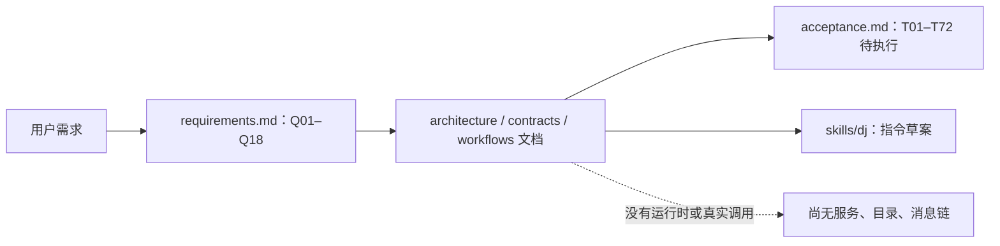

本轮仅新增本文档组和 TODO、更新阅读入口/状态；目标实现全部为未来新建，不存在可填写的旧源码行号。下表行号从 eca0e26 实际文档读取，后续按标题和符号定位，不能拿基线行号当新文件行号。

| 锚点 | 基线位置 | 决定及施工使用位置 |
| --- | --- | --- |
| B01 | requirements.md L3；Q01–Q18 | 本文第 3 节、TODO 需求覆盖 |
| B02 | technical-stack.md L5/L24/L53；采用方案、互操作、构建布局 | D01/D02/D18；Eliscript → ESM/Bun |
| B03 | architecture.md L50/L74；模块契约、内部端口 | D03–D18；端口与依赖注入 |
| B04 | interfaces/operations.md L5/L19/L77；共用校验、操作目录、原键找回 | D03/D05/D17；唯一操作目录 |
| B05 | domain-model.md L5/L38/L48/L81；所有权、身份、spec、提交边界 | D04/D06/D10/D11 |
| B06 | agent-control-plane.md L25/L47/L59/L73；查询、快照、索引、操作目录 | D07/D08/D17 |
| B07 | agent-control-plane.md L101/L111；直发、显式生命周期 | D09/D12/D14/D16 |
| B08 | delivery-storage.md L3/L31/L49/L63/L71；原子性、状态、贡献、恢复、幂等 | D05/D10–D16 |
| B09 | release-scope.md L5/L39/L65；首批、适用矩阵、协议差异 | D13/D14/D18、test-plan |
| B10 | startup-to-reply.md L26/L47/L139/L147；部署、启动、停止、独立控制 | D16/D18；真实流程接线 |
| B11 | security.md L3/L9/L58；身份、动作、撤权 | D04/D05 及所有提交点 |
| B12 | acceptance.md L5/L82；T01–T72、测试组织 | D02 和 test-plan 全范围 |

## 3. 交付范围与不变量

首期保持 macOS arm64、单 DJ 调度者、多受约束主体、Lark 国际版（user）/Telegram × OpenCode/Pi；CLI、MCP stdio、UDS API、可嵌入 ESM 核心和 Skill 均属同一首期。OpenCode 支持已配置 HTTP 实例、获准 managed serve 启动与实例内空会话创建；Pi 支持 managed RPC 和获准初始会话，现有 RPC 上 create 拒绝。其他工具、私有桌面控制、远程公开服务、IM 操作界面、媒体/多片出站均不扩入实现批次。

Q01–Q07 的登记/订阅/唤醒/回复不能因新增 Q14–Q18 控制面而被削减。查询/直发无需 IM 或登记；创建后要订阅则由可信部署面接入独立 recipient，不能把创建者改绑。accepted/started/模型完成分别留证据；外部模型不成为 DJ 的推理模块。

必须贯穿每模块的约束：

- 核心、适配器、错误恢复均无模型、embedding、语义路由和自动摘要；调用方选择精确目标。
- 一份结构化操作目录、严格 schema、当前授权、类型化引用和固定 preview；CLI/MCP/API 不独立赋权。
- Operation/幂等记录与业务对象原子受理；外部 I/O 在事务外；submitting 是可能已有外部效果的提交点。
- 同原生会话一个 canonical route；订阅与 direct 共用序号/Binding/unknown。登记/注销不清屏障、不取消独立 direct。
- start/create/Delivery 共用持久 instance gate；manual 不是进程退出证据；停机不强杀活跃 stdio 会话。
- 查询只读外部内容；逻辑版本与覆盖可解释，有界扫描、稳定键续页、无跨请求 SQLite 长读事务。
- `.eli` 维护业务和测试，生成 ESM 不手改；不以 JS/TS 重写绕过语言缺口，不把运行时语言验证悄悄塞进本轮文档任务。

## 4. 目标源码树与职责

以下每个路径均为计划新增 `+Dxx`；本轮不创建。D 对应下一节，完整符号/类型见 contracts.md。测试文件的准确集合见 test-plan.md，均属于 D02，未来先写齐再实现。

```text
dj/
  package.json、bun.lock、.gitignore                       +D01
  eliscript.json、eliscript.{tests,tools}.json              +D01
  tools/{build,verify}.eli                                +D01/D02
  src/core/{types,errors,limits,rules,states}.eli           +D03
  src/application/{operations,schema,execute}.eli          +D03/D05
  src/policy/{principals,authorize,handles}.eli             +D04
  src/storage/{schema,sqlite,repository}.eli               +D05
  src/registry/agents.eli                                 +D06
  src/catalog/{service,snapshots,search,refresh}.eli        +D07/D08
  src/lifecycle/{service,gates}.eli                        +D09
  src/subscriptions/service.eli                           +D10
  src/ingestion/service.eli                               +D11
  src/routing/matcher.eli                                 +D11
  src/delivery/{service,scheduler,envelope}.eli             +D12
  src/messaging/service.eli                               +D15
  src/adapters/agent/{opencode-http,pi-rpc}.eli             +D14
  src/adapters/im/{lark,lark-events,lark-wire,telegram}.eli                  +D13
  src/host/bun/{io,process,clock}.eli                      +D01/D16
  src/service/{config,recovery,main}.eli                   +D16
  src/interfaces/{client,api,cli,mcp}.eli                  +D17
  src/library.eli                                        +D16
  tests/{unit,integration,system,e2e,performance}/*.test.eli +D02
  tests/support/{case,fixtures,faults}.eli                  +D02
  tests/cases.json                                        +D02
  config/{service,client}.example.json                     +D18
  packaging/launchd.example.plist                         +D18
  skills/dj/{SKILL.md,references/*.md}                     ~D18
  docs/{technical-stack,release-scope,status,...}.md         ~D18
  dist/、dist-tests/、dist-tools/                          未来生成/忽略
  .local/acceptance/、.local/state/、.local/secrets/          隔离测试运行/忽略；默认部署根为 ~/.dj
```

无删除或迁移现有源码；仅扩展现有设计对应的首次实现。`...` 只代表现有文档的受影响更新，不隐藏计划源码。package/编译配置字段以锁定编译器的正式接口落地，不能虚构它已经可执行。

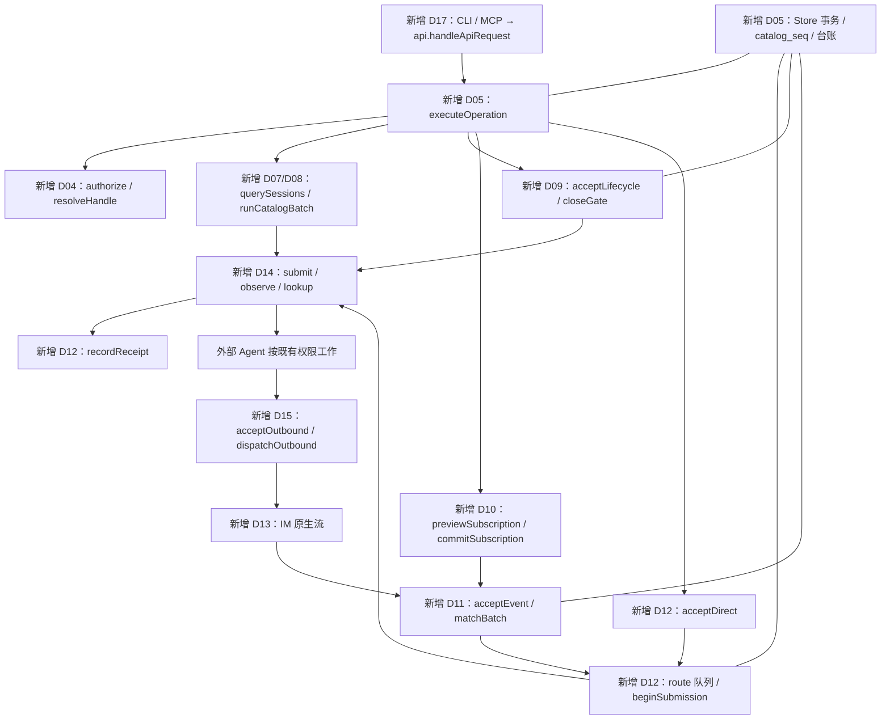

相比当前只保存文档，以上所有业务节点都是新增；公共鉴权、Store 和 gate 是跨路径共享连接点，不能拆成两套互不感知的“直发服务”和“订阅服务”。

## 5. 逐文件施工单元与实现顺序

新文件无基线行号；“写完”指声明、实现、导入/导出和调用接线都齐，不表示编译或运行通过。D01–D18 的预计文件数以目标树为准，实际行数在施工后写回，不预填虚假代码行号。`Ixx/Axx` 的 checkbox 只在 TODO。

| 差异 | 准确目标位置/公开符号 | 从当前到目标的施工动作 | 依赖 / 施工 / 验收 |
| --- | --- | --- | --- |
| D01 | package.json、bun.lock、三个 eliscript 配置、.gitignore；tools/build.eli `buildEntries`；host/bun `createHostPorts` | 新增多入口 `.eli`→ESM 生成清单、固定编译器/宿主/生产依赖完整性、无运行期编译器；I/O/进程/时钟显式端口，无导入副作用 | B02；I01/I03；A01 |
| D02 | tools/verify.eli `runSuite`；tests/support `withCase/createFixture/atFault`；全部 test-plan 文件 | 一次写齐全部用例/故障位置/证据 manifest，拒绝未授权 real 组；只写不运行 | D01 设计；I02/I04–I08；A02–A20 |
| D03 | core 五文件；application/operations.eli `operationCatalog`；schema.eli `validateRequest/normalizeArgs` | 新建精确类型、状态转换、规则 AST、错误、上限；一个声明目录映射三入口，补互斥/字节校验，不静默强转 | B04/B05；I09；A03 |
| D04 | policy 三文件 `authenticate/authorize/issueHandle/resolveHandle` | 凭据从受保护 profile/宿主取得；解析 Principal，不信自报；各引用类型与授权修订隔离 | D03；I10；A04 |
| D05 | storage 三文件 `openStore/migrate/transaction/readPage`；application/execute.eli `executeOperation` | 原子台账、唯一约束、短事务、迁移/版本读回、幂等重放过滤；副作用 I/O 不在事务中 | D03/D04；I11/I12；A05 |
| D06 | registry/agents.eli `discoverAgent/registerAgent/rebindAgent/unregisterAgent` | 同原生身份 route 复用；操作员代登记独立 recipient；绑定不越权、不创建进程 | D05；I13；A06 |
| D07 | catalog/service.eli `querySessions/getSession/resolveSession/probeSession`；snapshots.eli `openSnapshot/advanceSnapshot` | 多维授权范围、key/ref 恢复、typed cursor/catalog_seq、删除/撤权失效；列表稳定顺序 | D05、Agent 端口契约；I14；A07 |
| D08 | catalog/search.eli `searchLiteral`；refresh.eli `acceptRefresh/runCatalogBatch` | FTS 候选+精确复核/短串扫描、组内续扫、原子 checkpoint、partial 不删、受限大帧 | D07；I15；A08/A09 |
| D09 | lifecycle/service.eli `acceptLifecycle/runLifecycle/reconcileLifecycle`；gates.eli `assertGate/closeGate/releaseSlot` | start/create/stop 独立动作；持久 launch token/slot/epoch；manual 不放栅栏；初始 session key | D05/D07；I16；A10 |
| D10 | subscriptions/service.eli `previewSubscription/commitSubscription/changeSubscriptionState` | 固定 preview，不再接 spec；start/cutover_seq，当前授权、revision、实例 gate，暂停旧贡献撤销 | D06/D09；I17；A11 |
| D11 | ingestion/service.eli `acceptEvent`；routing/matcher.eli `matchBatch` | 入库去重/源游标/routing work；按索引候选执行三值规则，分批进度与贡献/投递同事务 | D03/D05/D10；I18；A12 |
| D12 | delivery 三文件 `acceptDirect/planContribution/claimRoute/beginSubmission/recordReceipt/reconcileDelivery` | 两 origin、共享 route 序号/unknown、贡献合并与独立 TTL；提交前冻结信封/回复引用；按原生事实映射回执 | D09/D11；I19/I20；A13/A14 |
| D13 | adapters/im 两文件 `createLarkPort/createTelegramPort` | Lark user profile/有界轮询/PollCheckpoint/并发排空与固定 user 回复；Telegram webhook 检查、持久后 offset；created/单文本/精确回复、回声 ID/EchoGate | 端口契约及 D11/D15；I21；A15 |
| D14 | adapters/agent 两文件 `createOpenCodePort/createPiPort` | 查询/probe/submit/lookup 与 lifecycle 端口按能力装配；OpenCode 204 与 Pi handled 不映射为任务完成；拒绝 Pi 同 RPC create | 端口契约及 D07–D09/D12；I22；A16 |
| D15 | messaging/service.eli `queryMessages/acceptOutbound/dispatchOutbound/reconcileOutbound` | local 查询、message_ref 与 Event 分开；固定 reply_context、单条 outbox、当前授权与 accepted/unknown/安全取消 | D05/D12；I23；A17 |
| D16 | service/config.eli `loadConfig`；recovery.eli `recoverState`；main.eli `runService`；library.eli `createCore` | 配置/秘密验证、单 owner、恢复后开流、后台调度/公平预算；同 gate drain，嵌入和 standalone 不共占状态；关闭资源有归属 | D05–D15；I24/I25；A18 |
| D17 | interfaces/client.eli `callService`；api.eli `handleApiRequest`；cli.eli `runCli`；mcp.eli `runMcp` | API 私有 UDS、薄客户端鉴权、统一错误/超时台账、操作投影/help/stdio 清洁；不另建库/调度者 | D03/D16；I26/I27；A19 |
| D18 | config 两个安全 example、packaging 示例；Skill/文档 | 接收主体最小 grants、真实作用域/Skill 采用、监督器安全停止、目录发布包与能力证据；不夹真实账号/秘密 | D13/D14/D16/D17；I28/I29；A20 |

依赖是实现编写顺序，不是逐模块测试许可。S1 只做 D01 的依赖/配置准备和 D02 的全部测试编写，D01 的生产宿主端口在 S2 的 I03 才写。D13 依赖的是先写定的 ImPort 及 messaging 签名，D15 不依赖具体 IM 实现，不形成运行时装配循环；两个工厂在 D16 最后注入。D07–D09 同样先按 AgentPort 契约实现，D14 最后提供端口，不能为消除写作依赖提前启动工具。

建议线性顺序：D01/D02 → D03/D04 → D05 → D06/D07/D08/D09 → D10/D11/D12/D15 → D13/D14 → D16 → D17 → D18。一切 schema/类型/支持矩阵已在测试编写阶段约定；所有实现写齐后才进入集成与测试。

## 6. 数据和接线落实

contracts.md 第 2–5 节给出字段、端口和事务伪代码；它们是目标接口说明，不是可编译实现。导出函数名在源码中保持一致；JS SDK/Bun API 只从 host/适配器显式引入。application 通过 operationCatalog 的 handler_group 调用唯一业务模块，不在 CLI、MCP 或 API 复制授权/状态逻辑。

服务启动按 loadConfig → acquireOwner → openStore/migrate → recoverState → instantiatePorts → startSchedulers/intake → exposeReady。恢复期间不能读到 ready；未知输入、slot 与 source gap 在接流前投影。嵌入入口导入无副作用，Core.start/stop 才管理资源。

完整业务分支沿用 [workflows](../workflows.md#统一路径与收口)，施工不能漏掉以下收口：查询未覆盖→精确 refresh；直发→同 route；start→当前 epoch；create→稳定 key；新订阅目标→可信 recipient 接线；IM→原话题回复；未知/停止→reconcile/安全 drain。每条都对应测试实施方案和 TODO 验收项。

## 7. 阶段、前置缺口与接续

本次只完成 A 阶段的施工设计。后续获得有效实现指令时执行：A 完成设计/依赖静态锁定 → B 写齐全部测试和验收脚本但不运行 → C 写齐全部实现 → D 集中构建、测试、审阅、验收、签名交付。A/B/C 中不编译探针、不 lint/typecheck、不跑测试或真实工具验证；必要依赖准备不能夹带验证。最终失败成批修复，只复验失败和真实受影响项。

| 前置项 | 当前事实 | 下一步及阻塞边界 |
| --- | --- | --- |
| P01 当前工作边界 | 本轮明确要求施工准备；已有 active Goal 与文案分开记录 | 本轮不执行 B/C/D、不新建目标或改现有状态；后续执行以届时有效用户指令为准 |
| P02 依赖锁定 | readiness 已固定 SDK 2.3.1/Ajv 8.20.0 等精确选择/SRI与编译器源身份，但没有实际 DJ lock/成品，当前 Bun 仍1.4.0 | I01 按准备配方落 package/lock/目标工具链；npm Eliscript 无 gitHead 不当作同源证明；实际产物/互操作/SQLite 在 S3 验证 |
| P03 账号/接收目标 | Lark 国际版/user 要求已知，未做 OAuth/连接测试账号或工具，无真实可见性保证 | 测试代码使用 fixture/profile 引用写齐；最终 real 验收只用当时已授权的测试资源，缺权限只阻塞相关 A15/A16/A20，不能伪报发布完成 |
| P04 原生限制 | idle、lookup、fencing、安全 stdio 停止未有 DJ 实证 | 能力显式 unknown/unsupported；D 阶段证明首期必需路径，达不到则报告缺口，不通过削弱范围强行发布 |
| P05 资源/费用 | 外部模型实际执行独立计费且当前未运行 | 未来 real 运行遵守届时资源/费用授权；不默认访问生产对话或创建新账号 |

工作恢复先读 status/TODO，再核对 Git、当前阶段、上次证据和缺口；只推进当前阶段未完成项。写完施工项及时勾 I，验收 A 仍空。本次默认根 ~/.dj、Lark user OAuth/有界轮询覆盖旧 bot-only 接线；完整配置/方法/窗口按 readiness 第7节和 adapters/im。当前运行目标为 active，本轮未改状态且只交付准备资料。当前下一步是交付本轮文档；用户未来授权实现后从 I01/I02 开始，不重写既有业务设计。


## S3 有序匹配批次增量施工

当前基线为build42，生产输出与build40一致；功能回归为integration17的843项与build42/integration18的T16，正式路由61.8777事件/秒未达100。本节登记本次完整修复范围，精确边界见[契约](contracts.md#s3-有序匹配写入组)，状态只在根TODO勾选，不另建进度表。

| 文件 / 基线锚点 | 完成后的符号和差异 |
| --- | --- |
| matcher.eli / matchBatch L144 | 提取matchWithWriter，保留matchBatch兼容包装；新增matchTurn最多16项，readiness与实际写入分离；publishMatchMetrics在COMMIT后才发布。准备阶段connection变量提升并显式复用，提交阶段重读身份。 |
| runtime.eli / routeEvents L399 | SQL仍按ingress_seq最多16条；先收集busy组，matchTurn按SQL顺序入原写队列；失败复原原cursor，finally撤销本组busy。route/outbound/总jobs与20ms不变。 |
| 新delivery/planning-scope.eli | withEventPlans提供单事务单事件的可变工作状态，四方法route/delivery/capacity/created；最多128个route及delivery、超额即时读，finally撤销。不得跨SAVEPOINT或返回Future，不缓存授权/队首。 |
| delivery/service.eli / planContribution L535 | 第6个可选planning参数；按本工作状态复用路线与本事件delivery，容量global仅第一次查询、真实insert后+1；原方法未传planning保持即时读。序号SQL、重复决策/贡献探测不变。 |
| delivery/scheduler.eli / observeDelivery L1012 | 非accepted提前返回；observationAttempt只读取原binding及游标元数据，不载信封；变化时仍重读完整attempt并对旧cursor检查后写入，兼容旧内嵌binding和JSON游标类型。 |

```text
src/
  routing/matcher.eli                    修改：准备/有序收集/原提交路径
  service/runtime.eli                    修改：每轮最多16工作项
  delivery/planning-scope.eli             新建：单事件事务工作状态
  delivery/service.eli                   修改：规划状态的显式消费者
  delivery/scheduler.eli                 修改：最小观察元数据
```

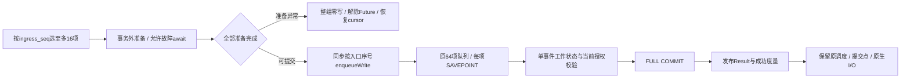

回归一次覆盖准备乱序、单项领域回滚/整批异常、早退/准备失败解除等待、当前授权/订阅/身份/TTL、同route序号/容量与scope关闭、观察元数据/旧binding/游标保真及原信封保持。全部测试与业务写齐后按同一快照集中构建、集成与系统，原完整T27允许在本次实际业务改变后对比复验一次；禁止降低目标或把短诊断当验收。不新增全局记录缓存、不跳过重复检查、不跨tick复用binding/instance、不改变正式性能驱动，后者需要先单独统一容量测量定义。


## S3 路由候选与有限连续岗位修复施工

当前为D阶段的新证据修复；基线build47的runtime.eli，精确契约见contracts末节，施工与验收状态只维护在TODO的S3修复记录。无产品范围变化。

| 文件 / 基线符号 | 现状与变更 | 对应验收 |
| --- | --- | --- |
| `src/service/runtime.eli:437 queueWriteJobs`、`:453 routes SQL` | JOIN/DISTINCT改为按routes主键遍历+既有head部分索引EXISTS；两类状态交集、unknown过滤、strict after、limit、回绕均保持 | T40.pending-work-indexes.sqlite；A12/A14 |
| 同文件，queueWriteJobs之前新增`runRouteJob(context,routeId)` | 初始steps=0/result=success(nil)，while steps<4且ready；后续尝试先只读head的state，无头或unknown/submitting即停止，不增加空claim事务；await dispatchRoute后递增，仅ok且data.state=accepted继续，其他停止返回result；非导出 | T31/T49，A14 |
| 同文件queueWriteJobs的routes task分支 | 改调runRouteJob，outbound保持dispatchOutbound；32/16/64及轮换保持 | T31.cancel-before-submitting.sqlite，A14 |
| `tests/integration/{storage,delivery}.test.eli`及两份测试说明 | 由审核测试方写齐计划/等价与连续岗位的排序、上限、busy/unknown/drain断言；保留原门槛 | A12/A14/A20 |

源码树只修改`src/service/runtime.eli`；不新建生产文件，不修改scheduler的单次派发接口、schema或对外CLI/MCP/API。

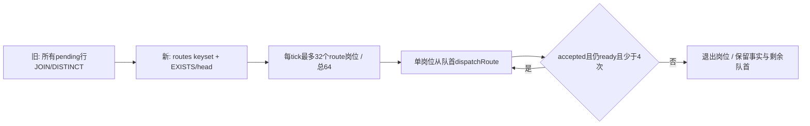

所有原生I/O仍在事务外，各头项按原流程独立claim、提交与回执；四次连续不能变成重发同一未知输入。先完成全部测试源码，再写齐这两处实现，一次冻结后集中构建及T40/T31/T49与必要T27；未受影响证据按同生产摘要复用。不得从查询局部加速估算整体已达标。


## S3 容量驱动与超时隔离施工

基线为build49，58份业务源码不改。contracts末节规定独立producer/consumer、严格完成吞吐与隔离边界；本项是性能验收真实性与收尾修复，不是放宽产品目标。

| 文件 / 基线锚点 | 变更与归属 | 验收 |
| --- | --- | --- |
| `tests/performance/router.test.eli:290 T27.route-load.performance` | 审核测试方将锁步循环改为绝对10ms producer与20ms非重入consumer；共享停止状态，70秒内部截止；原计数/持久排空/FULL/100门槛保持；保存取消、tick、积压证据 | 原T27精确6000/60000及端到端≥100；所有错误和截止如实失败 |
| 测试方按需要选用既有support模块 | 先写齐生产调度形态与取消/清理的有效回归；不修改Core、不断言mock通过等于容量通过 | 不重入、异常传播、截止后无新输入/调度、finally回收 |
| `tools/verify.eli --case`既有接口 | 本批无需为进程隔离改runner；验收执行者每项单独启动受控进程，保留独立run_id/JUnit/终态与清理 | T27超时不能继续占用下一性能用例事件循环 |
| `src/**`、配置与产品接口 | 主开发保持build49业务快照；仅有独立证据证明业务缺陷时再统一扩展本批设计和回归 | 58份摘要零漂移，不重复未受影响功能验收 |

```text
tests/performance/router.test.eli  修改：独立输入与20ms调度、截止和收尾
测试支持文件                       按必要回归确定，不新增产品接口
src/**                            保持不变
```

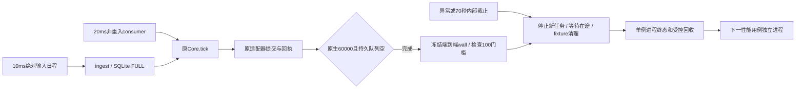

先统一本节与测试方设计，再由测试方一次写齐必要回归及驱动，冻结后集中构建和受影响验证。不在驱动编写中试跑完整负载，不把内部诊断当验收，不为通过增加外部截止。

## S3 诊断19后的重复写收敛施工

基线build51、业务repair-48的58份源码，仍是全实现后的D阶段修复。根因与不变量见contracts末节；所有修改在现有文件内，不增源码路径或schema版本。

```text
src/                          当前 → 目标（文件树不变）
  storage/repository.eli      R1: get后insert → 主键冲突目标insertIfAbsent
  delivery/service.eli        R2: sequence双写 → 列/payload单语句；规划初态提示
  delivery/planning-scope.eli R3: 初态固定blocked → 事务内最终状态收敛
  routing/matcher.eli         R4: done必UPDATE → 按finish结果解锁旧记录
  delivery/scheduler.eli      R5: claim/receipt双写 → 单次route更新；窄队首/agent复用
tests/integration/{storage,delivery}.test.eli  测试方补边界；其余有效用例复用
```

| 差异 | 基线行号/符号 | 精确施工 | 依赖与验收 |
| --- | --- | --- | --- |
| R1 | repository L7 defineTable、L215 insertRecord、createRepository赋值 | 增`insert_if_absent_sql`，主键列来自固定表定义。方法仅允许两个去重表，assertTransaction后复用sqlValue/stableJson/参数绑定，返回changes===1；无泛化OR IGNORE。 | T40约束/重复/回滚；先写齐测试 |
| R2 | service L56 allocateSequence、L535 planContribution | 合并序号列/payload更新，内存route保留文本序号；按planning.initial_ready选择ready/revision2或blocked/revision1；贡献调用insertIfAbsent。 | R1/R3；T12/T40序号、容量、贡献 |
| R3 | planning-scope L7 withEventPlans | 第四可选参数complete-in-one-turn；新增created-records数组（最多128）与existing-delivery-seen布尔。created仍递增惰性global-count；finish同步收敛最终state，必要恢复本轮新记录blocked/revision1，返回需不需要解锁旧记录。finally清空数组/Map；默认参数维持已有直接调用。 | T40一次完成、9999→10000、续页、SAVEPOINT、Future拒绝 |
| R4 | matcher L174 matchWithWriter、提交回调L300 | 初始checkpoint无last_subscription_id且未yield、prepared长度等于rows长度才给初态提示。两处去重探测替换；计算current.state后调用finish，保存routing_work，再按返回值执行既有解锁SQL。异步准备/同步提交顺序不改。 | R1–R3；T12/T40，零提前外部输入 |
| R5 | scheduler L70 claimRoute、L298 freezeEnvelope、L429 beginSubmission、L730 recordReceipt | claim的epoch/owner/JSON单语句；回执用已加载route/claim精确owner+epoch判断，仅有变化时写一次route；保留finally后备。beginSubmission窄head固定SQL，局部agent在同一事务传给freezeEnvelope可选参数。 | T31/T16/T40；unknown、drain、fairness、四次续派 |

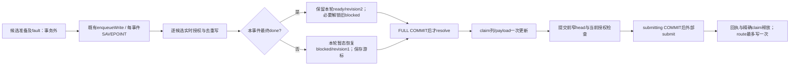

图中“暂态”仅存在于同步事务内，不是可观察的新状态；任何异常仍走原SAVEPOINT/整批回滚。实施顺序为R1→R3→R2/R4→R5；测试方先补齐上述完整边界，主开发再完成所有五项，之后一次冻结构建、受影响集成/系统，以及四个分别独立进程的本地性能用例。large-fanout与两项catalog性能中的实时转发也经过这些生产热路径，须复验；仅测试驱动修复时可复用三例的判断不适用于本批。施工/验收勾选唯一维护在TODO，本节不复制清单；不得预先把提速或性能通过写成结果。

R1–R5已全部施工，业务repair-52仍为58份源码，较build51仅上述五文件变化。施工后锚点：repository的insertIfAbsent在L231；planning-scope的withEventPlans在L8；service的allocateSequence在L56、planContribution在L534；matcher的matchWithWriter在L174；scheduler的claimRoute在L70、freezeEnvelope在L299、beginSubmission在L430、recordReceipt在L735。括号静态平衡通过；新构建及行为验收留给集中执行，不能用这些行号或源码快照证明性能达标。

## S3 诊断20后的窄写与窄读施工

当前仍为D阶段集中修复，基线build53/repair-52，未提交实现保留。contracts末节为本批唯一契约；施工及验收checkbox只维护在TODO。当前943功能覆盖及performance16三例通过不预先支撑本批改动。

```text
src/                          当前 → 目标（不新增文件）
  storage/repository.eli       P1: 全列replace → 另提供固定状态窄写及不变列守卫
                              P2: 完整订阅payload → 另提供四列即时状态读取
  delivery/read-scope.eli      P2: 默认完整 → 可显式选窄订阅，原256/scope边界不变
  routing/matcher.eli          P2: 同步提交贡献校验显式选择窄订阅
  delivery/scheduler.eli       P1: 状态推进改窄写；P2: 提交前仍即时核验
  catalog/records.eli          P1: attachBinding仅更新route可变绑定/claim列及payload
```

| 编号 | build53基线行号 / 锚点 | 精确施工 | 测试及依赖 |
| --- | --- | --- | --- |
| P1a | repository L7 defineTable、L256 replaceRecord、L349导出对象 | 在表定义加入固定progress列数组、其余invariant列数组、带IS占位符的progress SQL与revision SQL；在createRepository增加replaceProgress局部函数及对象字段，复用assertTransaction/sqlValue/stableJson/Result。values顺序为progress列、payload、keys、invariants、可选expectedRevision。未支持表在执行SQL前抛TypeError。 | T40先写齐；保留复合主键等原replace回归 |
| P1b | scheduler L59 releaseClaim、L141 holdDelivery、L671 beginSubmission、L871 recordReceipt、L1023 reconcileDelivery、L1089 observeDelivery；records L268 attachBinding/L304 | 仅将这些状态更新的replace改为replaceProgress，其他调用/事务/异常处理保留；不重排claim/probe/提交。 | T16/T31/T12/T49；测试注入点同步迁移到实际方法 |
| P2a | repository L210 getRecord附近 | 加getSubscriptionState(subscriptionId)，固定SELECT四列并绑定非空string；返回row或nil，加入repository对象，不修改原get。 | T40精确投影及当前值 |
| P2b | read-scope L6 withContributionReads、L24读库位置 | 第三个可选参数subscription-state-only，默认false，校验nil/boolean；只在true且subscriptions时改调新方法，其他表与默认方式不变。records Map仍每scope独有，不增加新表/记录类别/容量。 | T40默认/窄模式、冻结与撤销、容量及跨事务更新 |
| P2c | matcher L301 withContributionReads；scheduler L168 effectiveContributions | 闭包结束处传入true，所有live授权/版本/TTL判定不改，禁止跨await或跨项共享。 | T12/T31提交前暂停/撤权及旧绑定恢复 |


实施顺序P1a/P2a→P2b→P1b/P2c。全部测试源码先由审核方写齐并交接，主开发再完成五文件，双方保存新快照后集中构建、功能及独立性能验收。不得为验证SQL局部变化临时放宽吞吐门槛或在半批实现期间试跑。

P3仍只修改既定scheduler文件：`beginSubmission`基线L430的inTransaction同步回调包在单个窄模式withContributionReads内，L444 session与L530 agent改由reader取；`effectiveContributions`基线L166增加可选read参数并用局部work函数复用原循环，传入时不再建立第二个scope，未传时仍自行创建。`freezeEnvelope`基线L299增加可选read并传给基线L225的replyContext；replyContext新增可选read，connection经reader或原get获取。调用链所有权止于该同步准备项，返回结果不携带reader。实际probe/submit和claims清理顺序均保持。对应T40/T31同项session/connection各一次读取及完整信封/原话题ReplyContext、撤销/回滚断言由测试方与P1/P2一次写齐；施工/验收与P1/P2同批冻结。

P1–P3五文件已统一施工，业务快照repair-54共58份。施工后符号：repository.getSubscriptionState L237、replaceProgress L294，read-scope.withContributionReads L6；scheduler.effectiveContributions L166、replyContext L229、freezeEnvelope L303、beginSubmission L434；matcher窄模式在同步提交scope，catalog.attachBinding L268的route窄写L304。词法括号及调用结构核对不替代编译/行为；其后build56的功能943项已覆盖，四项性能三通过、路由负载失败，原始证据见status。

## S3 诊断22后的单事件多行写入施工

基线build56，113份输入/522项产物已核对，58份业务源码匹配repair-54。P1–P3功能943项覆盖、三项性能通过，T27负载未达标；当前进入W1–W3集中修复的设计/测试准备，未写业务实现。唯一进度仍为TODO；对应契约见contracts末节，不把私有诊断当验收。

```text
src/                         当前 → 目标；不新增文件
  storage/repository.eli      单行insertIfAbsent保留；新增固定两表、16行分块、最多128行的insertManyIfAbsent
  delivery/service.eli       planContribution默认即时写保留；显式第七参数时暂存同事件contribution
  routing/matcher.eli        每候选即时写decision/contribution → 当前事件同步闭包独有的两个有界数组，循环后统一写
tests/integration/
  storage.test.eli            W1原生约束/计数/分块与W2/W3停止点、回滚、幂等及spy更新
  delivery.test.eli           保留并补足匹配到提交前暂停/撤权、序号与cutover证明
docs/construction/
  contracts.md / plan.md      当前精确契约与施工手册
  test-plan.md / case-cards.md 搭档维护原Case ID的完整回归及验收说明
```

| 编号 | build56行号 / 符号锚点 | 施工内容与预定结构 | 依赖与核对 |
| --- | --- | --- | --- |
| W1a | repository L7 defineTable、L31表信息对象 | 为仅两个允许表增加batch_insert_sql数组：下标0为nil，1..16各为固定列清单、N组占位符及原主键ON CONFLICT DO NOTHING。值始终绑定，不从record取SQL标识符；不改原insert/insertIfAbsent/update SQL。 | 沿用keys/columns/insert-columns；无schema/index变更 |
| W1b | repository L212局部声明、L257 insertIfAbsent后、L409导出对象 | 声明/定义/暴露insertManyIfAbsent。先assertTransaction与表/密集数组/全部元素校验，再按start=0、count=min(16,length-start)分块；逐行按columns经sqlValue取typed值，再追加stableJson；执行预计算SQL、累加changes，返回整数。空数组只返回0。 | 全部W1测试先写齐；异常交回既有SAVEPOINT/transaction，不另包事务 |
| W2 | delivery.service L534 planContribution签名与L635贡献插入 | 在现有read/planning之后新增可选pending-contributions参数。非nil时在业务写入前验证Array、length<128且context.store.inTransaction为true；原贡献可写分支改为`if pending-contributions then push contribution else repository.insertIfAbsent(...)`。其他对象构造、授权/容量、route与delivery写入以及Result保持。 | 默认调用不变；数组仅传同事件闭包，128上限与prepared硬上限对应 |
| W3a | matcher L306同步提交let*、L352 decision写入、L357 planContribution | 当前项新增`decisions=(js-array)`、`pending-contributions=(js-array)`；decision按原顺序追加，显式守卫长度<128；planContribution传入pending数组。既有prepared与当前config核验保持。 | 不跨事件共享，不挪动事务外准备/fault/await；其他失败仍走原Result回滚 |
| W3b | matcher L375循环结束与predicate_memo之前、L390 planning.finish | 循环结束后同步调用两次新方法，顺序为match_decisions、contributions；其后继续原memo/state、finish、routing_work与必要解锁。容量停止包含当前decision但不推进cursor；无其他新异步点。 | 后块失败不得留下本事件的序号/投递/贡献/决定；领域失败仅回滚当前项，非领域SQL异常按原合同整批回滚；metrics仍COMMIT后发布 |

预定核心调用片段（符号名与上表一致，具体括号随原结构接入）：

```lisp
;; matcher：同一个同步写入项，每次新建，至多128条。
(js-call decisions :push decision)
(planContribution tx event version decision read planning pending-contributions)
;; 原循环结束后；无await，必须在planning.finish/checkpoint之前。
(js-call repository :insertManyIfAbsent "match_decisions" decisions)
(js-call repository :insertManyIfAbsent "contributions" pending-contributions)
```

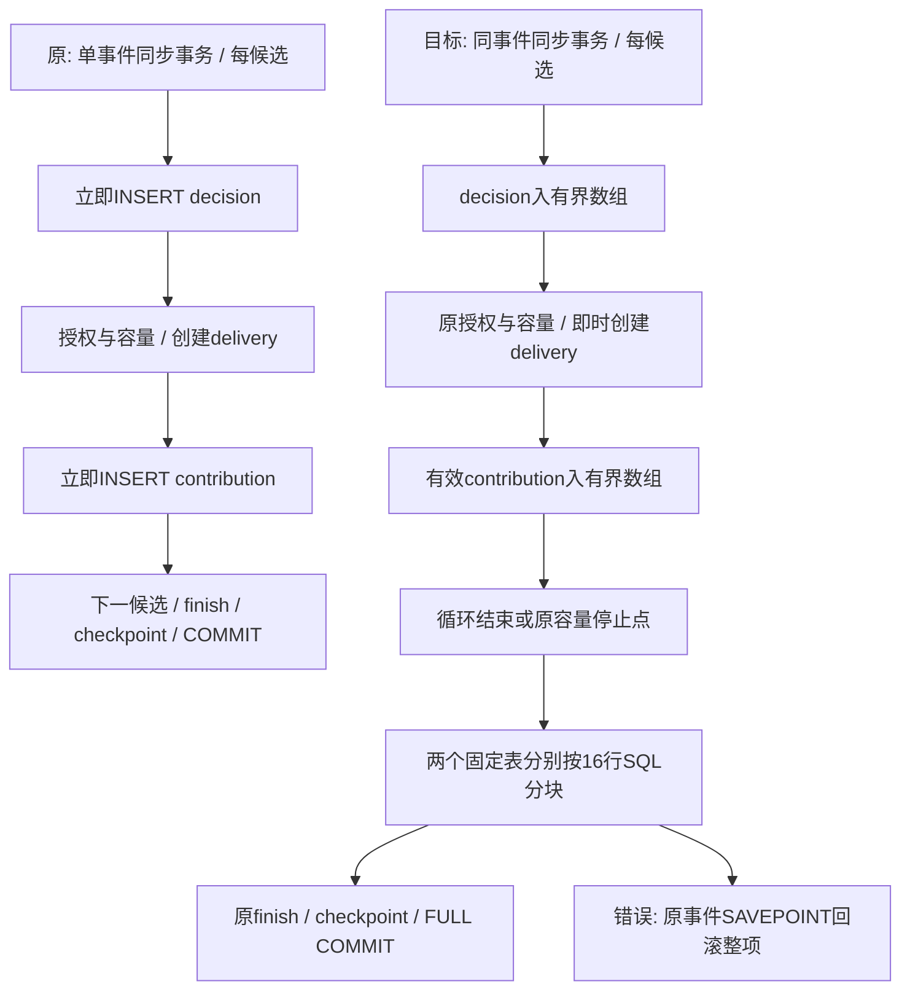

先W1–W3全量设计由搭档核对，搭档完成所有测试源码和说明但不运行；主开发按W1a/W1b→W2→W3一次实现三文件，保存新业务快照/绑定输入后集中构建、受影响功能回归与四项独立性能验收。重点验收T40的0/16/17/128边界、后块约束失败整项回滚、重复主键不覆盖、容量9999→10000和续页；T12/T31保留即时撤权/顺序/提交点证明。原始失败保留，T27仍需6000事件/60000输入持久排空及100事件/秒，减少SQL调用不自动满足该门槛。

W1–W3三文件已全部施工完成，业务快照repair-57共58份，只有既定三文件较build56变化。实际符号：repository.defineTable L7、insertManyIfAbsent L285及对象导出字段；delivery.service.planContribution L534与事务/数组守卫L538；matcher同步项数组L310、decision追加L356、带pending参数调用L361、两表尾部落盘L380。测试交回后、业务实现之前，主开发仅补W2事务外合法数组拒绝且total_changes不变的回归。集中审核及build58已完成，功能943项组合覆盖成立；四项performance18独立进程验收为3/4，T27路由负载70秒内部截止失败，原始证据与夹具修正见status。源码/测试/产物继续冻结，不将施工勾或部分功能通过当成吞吐验收。

## S3 诊断23/24后的订阅批读与索引收敛施工

当前基线为build58，manifest为394dd421a3e385bb9a311839f8783677c605bdd7c22af1993ae03aa746e68318，113份输入/522份产物已核对，业务58份匹配repair-57。master已提交基线仍为c1eb7b1，工作区实现未提交。K1–K3是整体S3失败收敛的一批内部变更，不另起产品阶段；准确行为见contracts末节。页缓存与Statement缓存观察没有获得调参依据，不修改两者。非本批的所有源码、测试和生成物保持。

当前与目标树（均省略未改的其他模块、依赖和生成物）：

```text
src/
  storage/repository.eli   当前：窄订阅单键读取；目标K1：新增16键分块批读
  storage/schema.eli       当前：route_pending与head并存；目标K3：安全移除前者
  delivery/read-scope.eli  当前：单键惰性Map；目标K1：第四可选ID列表预载
  delivery/scheduler.eli   当前：贡献iterator加逐订阅查询；目标K2：同事务LEFT JOIN流式读取
  routing/matcher.eli      当前：每候选单键查询；目标K2：传prepared的命中ID列表
tests/integration/
  storage.test.eli         K1/K3接口、失败、迁移、计划与流式回归（测试方）
  delivery.test.eli        K2准备后撤权/暂停/多轮与信封回归（测试方）
```

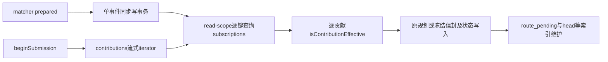

实际变更位置全部绑定上述基线，新增后的行号在完成时另记；不修改公共操作目录和数据记录格式。

| 差异 | 基线位置 / 符号 | 精确动作与局部结构 | 依赖与验收 |
| --- | --- | --- | --- |
| K1a | repository L6 tables附近、L216 createRepository、L222局部声明、L250 getSubscriptionState之后、L453导出对象 | 新增模块级subscriptionStateSql数组，下标0=nil、1..16为固定四列IN查询；新增局部getSubscriptionStates及返回对象同名方法。参数ids，先验证同步事务/Array/长度<=128/所有own下标的非空字符串，再`keys=Array.from(new Set(ids))`；循环start=0、count=min(16,remaining)，all绑定该块，收集rows，返回Array。全部校验先于SQL；空列表零SQL，不改变单键方法。 | T40 commit：边界/重复/缺失/非法末项零SQL、四列投影/当前事务状态 |
| K1b | read-scope L6 withContributionReads、L19 try前/进入回调前、L24原read闭包 | 增加第四可选subscription-ids；非nil列表要求subscription-state-only严格true。原store/work同步校验后，调用getSubscriptionStates；先为每个请求ID在records中设nil，再将返回四列对象freeze并覆盖同键。key仍为`subscriptions:<id>`，预载去重最多128，所有缓存仍<=256。原read的未命中、mode、thenable和finally撤销分支保留。列表不写入context/返回结果。 | T40 commit/failure/bound：默认兼容、负缓存、冻结/撤销、跨事务/回滚后新鲜度 |
| K2a | matcher L228 prepared声明、L292 fault结束之后、L301 withContributionReads及其尾部true实参 | 增加subscription-ids，来源只为prepared中过滤answer==true后的version.subscription_id（最多128，允许重复）；可在事务外计算ID，禁止在事务外读取当前订阅状态。将列表作为withContributionReads第四参数；原规划、容量、两表批写、current cursor守卫、SAVEPOINT与发布逻辑不变。 | T40 isolation：50命中=4个IN块，原单键查询0；T12 pause/revoke/version cutover |
| K2b | scheduler L166 effectiveContributions、L171 rows查询与L186逐行读取 | SQL替换为下方固定LEFT JOIN，仍iterate。每行保存row，JSON.parse(row.payload)仍只在实际处理该行时执行；用current_subscription_id判缺失，构造`{subscription_id,owner_principal_id,state,revision}`并freeze。item-read仅拦截subscriptions且key等于row.contribution_subscription_id，返回该行窄记录或nil；其他键转发原read。调用isContributionEffective时传item-read，其他参数及expired/revoked/overflow/return保持。每行局部对象不进入信封/持久记录。 | T16：无订阅单键查询，缺失/失效/owner/TTL行为相同；>128贡献仍全流式核验，overflow不提交前缀，完整matched/ReplyContext与撤权回写不变 |
| K3 | schema L64 schemaStatements、L125 head幂等创建后的迁移语句列表 | 删除fresh-schema的旧CREATE；在head的CREATE IF NOT EXISTS之后增加固定DROP INDEX IF EXISTS deliveries_route_pending。其余约束、索引、数据、schemaVersion及迁移错误传播不变。 | T40 pending：新库无旧索引、旧库补head再删旧索引、两次migrate、数据/约束/序号/五状态与分页结果保持 |

K2b的固定SQL与行局部reader目标片段：

```sql
SELECT c.payload,c.subscription_id AS contribution_subscription_id,
       s.subscription_id AS current_subscription_id,
       s.owner_principal_id AS current_owner_principal_id,
       s.state AS current_state,s.revision AS current_revision
FROM contributions c LEFT JOIN subscriptions s ON s.subscription_id=c.subscription_id
WHERE c.delivery_id=? ORDER BY c.subscription_id,c.revision
```

```lisp
(item-read (lambda (table key)
  (if (and (= table "subscriptions")
           (= key (nativeGet row "contribution_subscription_id")))
    subscription
    (funcall read table key))))
;; subscription为本行冻结的四列对象或nil；继续逐行完整授权计算。
(isContributionEffective context item event agent item-read route)
```

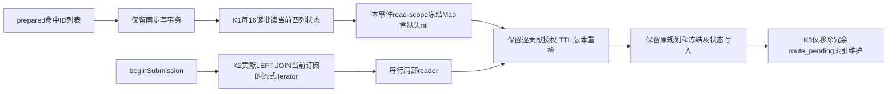

本批不采纳claim hint/释放标记及入口PRAGMA缓存；避免把低占比建议扩大为无关改造。单delivery的贡献可能跨多轮累积超过128，LEFT JOIN必须保留流式读取及现有提前停止/iterator.return，不允许all、LIMIT 128或只交付部分matched。

唯一施工/验收状态留TODO的K1–K3行。执行依赖：测试方先写齐storage/delivery测试、test-plan/case-cards但不运行；主开发随后按K1a→K1b→K2a/K2b→K3一次完成全部五文件，保存58份业务与全输入快照，再集中构建与审核。测试方负责T40边界、SQL次数与迁移、T16大贡献/完整信封、T12即时撤权；旧T31提交点/draining/unknown/公平调度断言全部保留。

D阶段固定Bun1.4.4内外PATH，复用现有guard与tools/build/verify入口；先scope all一次构建，再unit、完整integration、system，最后4个本地performance逐case独立进程串行。示例运行参数为`bun dist-tools/tools/verify.mjs --suite integration`及`--suite performance --case T27.route-load.performance`；各执行器session-id、原始日志/manifest与逐例计时沿用test-plan，不复制敏感环境。功能出错先收齐可独立失败再统一修复，按确切影响必要复验；不复跑没有变化的真实组。全部FULL/6000/60000/100门槛保持，真实资源缺口仍按real-preflight跟进。

本批五文件已一次完成实现，58份业务快照repair-59仅既定五文件变化，四份测试/说明保持交回摘要。实际锚点：repository的subscriptionStateSql L7、getSubscriptionStates L268和导出L488；read-scope签名L6与预载L21；matcher命中ID L297及第四参数L421；scheduler的流式LEFT JOIN L176；schema旧索引迁移删除L129。全部写完后才完成五份源码括号平衡检查并保存root-freeze-59的113项输入；build61构建、unit21与system15已通过；integration34原始840/844加修正后integration35四例定向全部通过，四例外源码/共享函数及所有非测试产物字节一致，943项功能覆盖成立。performance19四项独立进程终态收齐，3/4通过：route-load内部截止未达标，另三项通过且清理完成。下一步对build61私有副本做有界SQL/iterator计量，共享业务、驱动、缓存与配额不变。源码完成不等于A通过。


## S3 实体主键局部性施工 U1–U3

基线：master已提交c1eb7b1，工作树保留全部未提交施工；build61原始manifest的113项输入/522项输出及repair59的58份业务源码是本批起点。io.eli基线SHA256=a175f2247bced346afe37939622fa4d53d81d64ea8734485464cd7cc2022100c。当前完整功能943项覆盖成立，路由容量失败仍开放。本批不承诺诊断计数差值为净收益。

当前树（其他业务层仍沿原S3结构，不改生成物和依赖）：
```text
src/
  host/bun/io.eli          # createHostPorts；L74–75内联UUIDv4 ids.next
  host/bun/clock.eli       # 业务UTC/单调时钟，保持
  policy/handles.eli       # 独立UUIDv4受限句柄，保持
  application/context.eli # nextId原调用入口，保持
  delivery/service.eli    # 业务序号/静态keyset列表，保持
  service/runtime.eli     # pendingRows回绕，保持
```

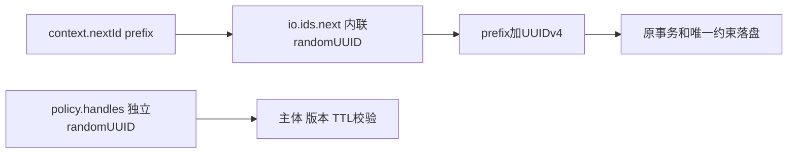

目标树与逐文件动作：
```text
src/host/bun/ids.eli       # 新增U1/U2：纯格式器、私有九前缀白名单、nextHostId
src/host/bun/io.eli        # 修改U2：导入nextHostId并作为ids.next
src/policy/handles.eli     # 保持，不接新工厂
src/application/context.eli# 保持，继续调用ports.ids.next
```

| ID | 文件/基线锚点 | 完整动作 | 接口/变量与失败边界 | 测试责任 |
| --- | --- | --- | --- | --- |
| U1 | 新建src/host/bun/ids.eli，无旧行号 | module dj.host.bun.ids；导入node:crypto randomUUID与../../core/native.eli的nativeTypeOf。私有const entityPrefixes为九字符串Array，私有uuidV4Pattern为小写标准v4正则；导出entityUuidV7和nextHostId。 | `entityUuidV7(milliseconds,randomUuid)`先验证时间safe整数及范围，再验证随机字符串；局部h为`milliseconds.toString(16).padStart(12,"0")`。返回固定拼装表达式，无副作用/状态。时间违例RangeError，随机违例TypeError。 | 测试方在unit/identity.test.eli新增T38.entity-ids.unit，固定向量/边界/74位尾部/错误/回拨，另验证真实生成。 |
| U2 | io.eli导入L16附近，createHostPorts ids L74–75 | 增加`import ./ids.eli nextHostId`，原`ids: {next:lambda...}`改为`ids:{next:nextHostId}`。io原randomUUID导入继续供writePrivate临时文件，不移除。 | `nextHostId(prefix)`白名单内先Date.now再randomUUID传U1，非白名单只randomUUID；返回prefix+下划线+uuid。保持prefix原字符串拼装习惯，不新增公共配置或测试选项。纯helper可直接测试，不修改业务Clock。 | 九前缀精确名单；owner/launch/epoch/dispatch/outbound_dispatch/lifecycle_dispatch/preview/req/create/snapshot/未知等v4；createHandleAuthority各合法kind仍v4，非主体/过期拒绝。 |
| U3 | docs/domain-model.md L3与本批契约；tests/integration/storage.test.eli既有SQLite fixture | 补充opaque实体生成规则及与秘密工厂的隔离；无Schema、旧行或公共API变化。测试方新增T40.mixed-entity-ids.sqlite并更新tests/cases.json、test-plan、case-cards。 | 静态混合v4低/高键、新v7键的delivery.list分页、agent/subscription既有列表/候选回归；通过公开tick与受控对端核验后台keyset回绕，不导出pendingRows或加Core后门。构造相同ID插入验证原唯一约束拒绝及事务回滚。并发新行在游标之前只通过新查询查全，不要求旧快照包含。 | 测试方一次写齐以上测试，不运行；既有T12/T31/T40原断言保留。 |

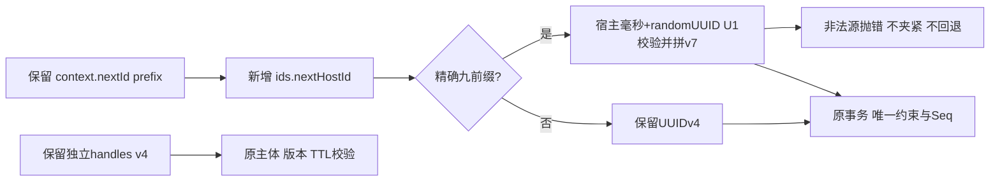

本批施工与验收状态只维护TODO的U行。顺序：A完整契约/手册→B测试方写齐unit/identity、integration/storage、cases.json与两份测试说明（不构建/运行）→C主开发一次写齐ids/io/domain文档并保存新源码及全部输入快照→D集中构建、unit、完整integration、system，四项本地performance逐例独立进程串行。新增一个生产文件使生产模块从58增至59，若不新增测试路径则构建输入从113增至114，实际以build-inputs清单核验，不手改生成物。

最终验收：U-A1固定格式/异常输入/随机尾部与无counter状态；U-A2真实host九前缀v7及全部其他/handle v4隔离；U-A3静态混存分页、后台回绕、Seq与授权/碰撞回滚；U-A4原全套功能、FULL及所有性能硬门槛。分别记录实际证据才勾验收，任何部分采样不能替代完整排空吞吐。源与测试冻结后才能构建/审核，失败一次收齐再合并修复，仅必要复验。未受影响真实组仍待授权资源，不自动外发、部署或改用其他模型。

U1–U3全部实现已一次写齐：新增ids.eli的纯格式器、九前缀nextHostId与导出，io.ids.next直接接线，writePrivate及独立handles保持原v4路径；domain-model补齐实体/受限句柄与Seq边界。B五份测试/说明摘要与交接一致。施工完成，进入D；当前不得将原build61证据套用于新源码。

U批实际锚点：ids.entityUuidV7 L19、nextHostId L40、export L48，io import L17及ids.next L76。repair62含59份业务文件，相对build61仅ids新增/io接线修改；root-freeze62为114项输入。首次build62已成功，原始manifest114输入/526产物核对无漂移；unit23原始74/75（新增UUID单测因测试固定向量超长失败）保留，完整integration/system仍在本轮集中执行，不修改绑定输入。测试常量修正统一归测试方，不能放松U1验证来适配错误向量。

U批D终态更新：build64仅修正两份测试，业务59份及全部非测试产物相对build62零变化；完整unit24为75/75、system18为25/25，integration36旧844项与integration37新增T40定向1项组合覆盖845项，合计945项功能覆盖。原始unit23/integration36失败不覆盖。performance20四项独立串行收齐，3项通过，route-load在70011.61ms负载窗口内部截止，2657事件/19187输入，持久未接受7243、routing14、claims0。所有受控任务清理完成；U-A4与整体验收未勾。

私有诊断35完成轮次计量并退出：79轮tick，单轮新增投递中位160、完成原生输入增量中位/最大128、route岗位中位/最大32；单轮wall中位281.53ms。两项状态更新计数器绑定展开错误，作为不可用字段保留；不据其零值推断行为。下一步先确定派发轮次与公平/取消/停机边界的完整契约，再按A/B/C/D一次推进；当前未改配额、main的20ms调度、正式性能驱动或共享build64。

## S3 tick内有界第二轮派发 J1–J3 施工手册

完整契约见contracts同名末节。当前master已推送基线c1eb7b1，大量完整实现仍为保留中的WIP；本次基于build64实际冻结，原manifest摘要1f742eb0b0fa6c5eb35d842ad5dd485244d23dad651d9efd775e213e3b6307f9，114输入/526产物。runtime基线SHA256=e600337e533d4881158b89bbabc97d1a8f3b23954adce3f4998be3c7d731a1ac。私有快照scheduling-baseline-64保留准确绑定，生产不新增文件，输入路径集合保持114项。

当前相关树（其余业务模块、生成物、依赖保持）：
```text
src/service/main.eli             # L262，20ms非重入调用Core.tick，保持
src/service/core.eli             # runtime/jobs/cursors和tick入口，保持
src/service/runtime.eli          # pendingRows L94、runRouteJob L435、queueWriteJobs L465、tick L607
src/delivery/scheduler.eli        # dispatchRoute及事务/原生边界，保持
src/messaging/service.eli        # dispatchOutbound，终态accepted，保持
src/application/write-batch.eli  # 64项SAVEPOINT合批，保持
tests/integration/delivery.test.eli # T31两例，测试方写入
docs/construction/{contracts,plan}.md # 本手册与规格，主开发维护
```


目标树仅一份业务文件修改；测试方修改delivery.test及test-plan/case-cards三份归属文件，复用Case ID，cases目录不变。没有生成物手工修改、配置、Schema、ID或外部接口变化。

| 变更 | 文件/基线锚点 | 精确施工动作与局部数据 | 对应验收 |
| --- | --- | --- | --- |
| J1 | runtime.eli L94–108 pendingRows；L465–490 queueWriteJobs | pendingRows第五可选scan=nil；rows查询前写scan.from_start=(last缺失或空串)，执行原空页回绕时改为true。函数仍返回rows Array。queueWriteJobs签名改为(context,route-first,seen)，局部turn={launched:0,dispatched:0,more:false}，roles由传入优先级决定，删去内部write_route_first翻转。每角色role-limit=32或16，budget保持原式；0时more=true且不查询；有查询时局部scan={}、rows=原pendingRows(...,scan)，满budget或非from_start置more=true。每row组装key，若seen.has跳过，否则seen.add后原launch；成功启动才turn.launched++。返回turn。 | J-A1、J-A2、J-A3 |
| J2 | runtime.eli L435–464 runRouteJob与J1的launch闭包 | runRouteJob第三可选progress=nil；每次dispatchRoute await后、steps递增附近，若result.ok且data.state==accepted则progress.dispatched++（有progress才写）。四步/ready/队首预检与返回Result保持。queueWriteJobs的route任务传turn；outbound任务await原dispatchOutbound，成功accepted时turn.dispatched++，原Result返回launch。不捕获或吞原失败。 | J-A1、J-A2、J-A4 |
| J3 | runtime.eli L628–636 tick的routeEvents/queueWriteJobs/settle区段 | 建立本tick局部wave1=nil、route-first读取原布尔、seen=new Set(runtime.jobs.keys())。保持ready时routeEvents一次；真正进入第一轮时把runtime.write_route_first置not route-first，再setq wave1=queueWriteJobs(context,route-first,seen)。保持一次settleReadyJobs（draining路径也需结算原jobs）。满足wave1.dispatched>0、wave1.more、ready且storage未阻断才await一次0ms宏任务；唤醒后二次state/storage复核、ownerGuard。owner失败设owner_lost并用现有djReturn9Token提前返回owner Result；成功才queueWriteJobs(context,not route-first,seen)及await settleReadyJobs。然后原maintenance/checkpoint/状态返回。 | J-A1、J-A2、J-A4、J-A5 |

以上字段为局部可变JS对象/Set，所有数字为非负整数：每轮launched<=48、dispatched<=32*4+16，more默认false；seen含最多64初始job key及96候选key，最多160项。scan.from_start只反映实际返回查询的起点，不判断记录的业务可派发性。第二轮跳过seen候选不追加补查，允许保守少派；不为填满配额无界扫描。

目标关键控制流（示意变量名绑定上表）：
```text
ready -> routeEvents一次 -> 第一轮(queueWriteJobs, route-first, seen)
所有状态 -> settleReadyJobs
if wave1.dispatched>0 && wave1.more && ready && !storage_blocked:
    await 单次nativeSetTimeout(0)
    if ready && !storage_blocked:
        owner=ownerGuard(context)
        if !owner.ok: state=owner_lost; return owner
        queueWriteJobs(context, !route-first, seen)
        await settleReadyJobs
原维护/检查点/状态
```

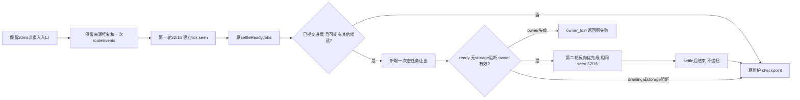

测试方B阶段一次写齐以下场景，归属仅delivery.test、test-plan、case-cards，不运行。现有T31.submit-cutover与cancel-before-submitting保留；不为新逻辑导出queueWriteJobs/pendingRows或加Core访问后门：

| 验收 | 输入与操作 | 预期 |
| --- | --- | --- |
| J-A1 快速两轮及硬边界 | 准备64不同route各4条ready和32条outbound，原生对端立即接受；单次tick，独立SQLite和对端计数交叉核验。 | 第一轮最多32/16，第二轮其余32/16；256条route输入及32条outbound无重，单route严格Seq，所有在途始终<=64。原FULL与submitting先提交断言继续有效。 |
| J-A2 挂起/公平 | 保留64route/48outbound异步门闩场景，第一轮全部挂起；再分轮释放16槽。另以两个连续快速tick覆盖第二轮均触发时第一轮角色不锁死。 | 原Tick1为32route+16outbound、in_flight48；全挂起不进第二轮，后续64总槽与原相邻tick优先轮换保留。两轮时第二轮反向、下tick第一轮仍反向，不被偶数次翻转抵消。 |
| J-A3 去重/穷尽 | 保留单route六条ready一tick只四条；另恰好32个候选，其中一条六项长队列、另一条首项accepted后第二probe busy，其余快速接受，触发满额后第二轮回绕。少量从空键起扫的候选以有界query spy核验无第二轮查询。 | 单route当tick只一个岗位，第二轮不再次probe长队列/busy route，后续项仍ready/deferred；每次claim_epoch变化符合真实dispatch次数，无空头或重复claim。不能只靠新短页门控覆盖掉回绕去重测试。 |
| J-A4 失败/停机 | 保留busy/unknown停止与在途submit期间draining；新增第一轮已有成功接受且轮间宏任务触发draining的场景；owner失效在相同边界发生，之后恢复fixture租约以便清理。 | 全busy/unknown为0进展，不开始第二轮；已提交回执不丢。同tick已见route不重探；draining不新派，owner失败返回owner_conflict并无第二轮probe/submit。只通过现有对端/故障入口或自有SQLite夹具，不添公共字段。 |
| J-A5 storage阻断及集中门禁 | 用自有SQLite夹具使第一轮前的来源health合批失败（例如source_progress更新触发器，错误批次与后续派发分开），第一轮现有ready仍可部分成功，验证有进展也不进入第二轮；finally删除触发器并保留原失败观察。随后D统一构建、75unit/845integration/25system与四项隔离性能。 | storage_unavailable使原launch设置storage_blocked，第一轮成功不覆盖该标志，第二轮受阻；不以全批0进展替代此断言。零残留任务；完整route-load仍须6000/60000/FULL/持久排空/CPU与100硬门槛，不承诺事前通过。 |

测试可用的轮间原生门控：第一轮对端成功提交时仅安排一次0ms回调（drain或自有SQLite租约变更）；该回调在新第二轮宏任务之前执行。必须等待/恢复自己安排的回调，finally清理自有trigger/连接/门闩，不跨用例残留。具体fixture和返回结构严格按现有接口，outbound终态accepted；不能用不存在的sent或公共settled字段。

A全部契约/手册已定稿；B整批测试写齐不运行→C一次完成runtime全部改动并冻结→D集中构建/独立审核/功能及四项串行性能。源码施工与验收分别维护TODO的J行；C已一次完成runtime的pendingRows扫描metadata、runRouteJob有效进展、queueWriteJobs局部seen与轮次统计，以及tick最多两轮及轮间重验接线。施工已勾，验收待D集中执行。真实19项/授权资源缺口保持，调度改动不授权外发或部署。


# S3 单事件投递批量创建与派发窄读 L1–L3 施工手册

## 当前基线、范围与差异

基线为master已提交c1eb7b1上的保留工作区，冻结build69原始manifest SHA256为7dfcd13bee0d95c3f7dd4405d229fd1fedd084b99e547b9b14d617b1d335fd87，114输入/526产物/59业务文件零漂移。当前945功能组合覆盖、performance21为3/4；route-load负载窗口70122.717208ms，6000事件、50006已接受，882事件待物化与1174 ready delivery合计尚差9994条投递，不是2056条投递尾差。

诊断37仅作定位：25.052秒中22670次delivery单行INSERT为1969.59ms，42886次delivery进展UPDATE为1562.46ms；COMMIT共5188次/2535.09ms，不等于每个write item独立提交。多行插入仍须逐行维护B-tree、约束和外键，不按调用数降幅外推耗时。此批不改调度量子，不缓存逐贡献鉴权结论；不跳过真实查重。

当前/目标源码树（除标注五文件外均保持，生成物仅D重建）：
```text
src/
  storage/repository.eli       # L1: 新增仅deliveries的严格insertMany及1..16模板
  delivery/planning-scope.eli  # L2: 第5可选参数、局部缓冲/计数/一次finish
  delivery/service.eli         # L2: planContribution按scope选择暂存或原立即插入
  routing/matcher.eli          # L2: finish落投递→决定→贡献→checkpoint
  delivery/scheduler.eli       # L3: claim队首与routing.state窄投影
tests/integration/{storage,delivery}.test.eli  # B补齐，复用既有Case
docs/construction/{test-plan,case-cards}.md   # B补齐断言映射
```

现状：


目标：


错误路径保持：limit_exceeded记录阻塞decision并保留未越过候选的checkpoint；其他领域失败由dj_write_item回滚本事件；SQLite约束异常由外层整批回滚。Seq、投递、贡献和指标不越过同一提交边界。默认外部内部调用不传新布尔时仍立即插入，不强迫其他调用方缓冲。

## 精确施工顺序（位置绑定build69；目标行号随新增内容移动）

| ID | 文件/基线行号与符号 | 全部目标动作与局部数据 | 对应验收 |
| --- | --- | --- | --- |
| L1 | storage/repository.eli L15 defineTable、L318 insertManyIfAbsent邻位、末尾工厂导出 | 为deliveries计算`batch_insert_strict_sql[1..16]`；闭包声明/赋值/返回接入`insertMany(table,records)`。完整形状预校验复用W1规则；仅表名deliveries。每块values按records顺序、columns顺序、stableJson顺序绑定，run.changes累加；空数组0次SQL，严格模板无冲突忽略子句。原方法不改。 | L-A1/L-A2 |
| L2a | delivery/planning-scope.eli L8 withEventPlans、L31 planning对象、L55 capacity、L66 created、L80 finish | 增加`buffer-deliveries`第5可选参数，nil/boolean合法，默认false；新增局部`finished=false`、`pending-route-counts=Map`，规划对象`defer_insert=buffer-deliveries===true`。记录/Map只在作用域内有效，不暴露数组，不持久化。缓冲时capacity的DB初始global-count加created-records.length；created后递增已初始化global-count及对应route pending数；route COUNT另加pending数。 | L-A3/L-A4 |
| L2b | 同文件created/finish/finally | 原最大128、同event/route重复保护保留。缓冲finish重复调用拒绝；按state为done或非done将新记录最终规范为ready/rev2/reason nil或blocked/rev1/routing_incomplete，随后insertMany(deliveries,created-records)，成功后finished=true并清除pending-route-counts（已进入DB）。返回原needs-unlock表达式；default模式保留原replace行为。缓冲finish成功后所有planning方法均失效，不能再created/读/计数；work成功而未finish拒绝，thenable照旧拒绝；work失败Result可未finish。finally clear/splice并撤销active，清空新增Map。 | L-A3/L-A4 |
| L2c | delivery/service.eli L534 planContribution入口、L632单条insert位置 | 在任何allocateSequence/insert/created前，若planning.defer_insert为true则必须有合法非nil pending-contributions Array并处于同步事务；仍沿W2校验length<128。新行分支仅在非缓冲时执行原repository.insert，随后两模式均planning.created。buffered新delivery返回完整原record；查重/鉴权/容量/Seq/贡献收集逻辑不变。 | L-A3/L-A4/L-A5 |
| L2d | routing/matcher.eli L312 withEventPlans回调、L380两表批写、L425第4参数末尾 | 在withEventPlans原第4参后增加true第5参；候选循环后先设置current.predicate_memo/state/reason并调用finish，随后decision→contribution批插，再replace routing_work和原旧行解锁。prepare、候选顺序、CPU预算、指标提交后发布不变；不能因缓冲略过delivery查重。 | L-A4/L-A5 |
| L3 | delivery/scheduler.eli L85 claimRoute head绑定、L533 routing状态检查 | claimRoute把selectHead调用替换为contract的双列部分索引SQL；导出selectHead函数及其他调用者不改。beginSubmission的routing_work完整repository.get仅此处替换为单列state查询，nil/非done分支原样。既有session/instance/assertGate等读取及所有native切点不改。 | L-A6/L-A7 |

关键伪码（非新增公共操作）：
```text
withEventPlans(..., bufferDeliveries=true):
  capacity(route):
    global ??= DB_COUNT_ACTIVE + created.length
    route_count = DB_ROUTE_ACTIVE + pendingRouteCounts[route]
  created(record): cache; append<=128; increment(global if initialized, pendingRouteCounts)
  finish(state):
    assert active and not finished
    normalize only newly created rows to final routing state/revision
    repository.insertMany("deliveries", created)
    finished = true; pendingRouteCounts.clear()
    return original needsUnlock

matchWithWriter write item:
  candidate loop: same per-contribution authorization, capacity, Seq, decisions
  current.state/reason/memo = original calculation
  needsUnlock = planning.finish(current.state)
  insertManyIfAbsent("match_decisions", decisions)
  insertManyIfAbsent("contributions", pendingContributions)
  replace("routing_work", current); original unlock if needsUnlock
```

归一化仅处理本scope新建的ready或blocked/routing_incomplete记录，不修改已读到的既有ready/accepted记录。done的新blocked行在内存转换为ready/rev2，旧blocked行仍由原event_id UPDATE解锁；这保留最终revision且避免新行同事务二次UPDATE。缓冲模式成功必须finish，领域失败提前退出允许未finish；所有未持久化数组由finally丢弃，外层回滚此前Seq。

## B写入归属与D验收

B归属审核搭档：仅tests/integration/storage.test.eli、tests/integration/delivery.test.eli、docs/construction/test-plan.md、docs/construction/case-cards.md；不加Case ID、不改业务、cases.json、TODO、dist或构建绑定输入以外文件。先一次写齐并交回摘要，不构建、不运行、不预审实现。C归属主开发五份业务文件，一次写完并按TODO标施工完成，冻结后才进入D。

| 验收 | 复用用例及前置/操作 | 精确期望 |
| --- | --- | --- |
| L-A1 批插形状/调用数 | T40.write-batch-commit真实SQLite；事务外、非法表、非数组、129项、第17项hole/nil/Array/number；0/1/16/17/128项 | 非法输入在第1条INSERT前拒绝；合法分块0/1/1/2/8次SQL，返回实际新增条数，typed/payload一致且Seq>2^53保真。 |
| L-A2 严格约束/回滚 | 同T40；重复PK/route_seq/operation唯一键、NOT NULL/CHECK/FK；17行第2块失败；enqueueWrite邻项 | 不忽略冲突；外层事务回滚前16行，非领域异常整批回滚；领域失败SAVEPOINT隔离保持。无自行嵌套事务或序号泄漏。 |
| L-A3 scope默认/缓冲 | T40.write-batch-commit；同一scope先created再capacity、同route重复、finish前/后查库、done/blocked、已有delivery、重复finish/成功缺finish/thenable/退出后调用 | 默认仍立即插入且finish原行为；缓冲finish前DB无新delivery、容量含pending；finish后精确最终state/revision且一批落库，新行0次replace；既有记录不被内存改写；非法生命周期拒绝。 |
| L-A4 多事件/容量 | T40.write-batch-isolation；原9999→10000后释放1重试、多轮分页、18候选、同route多贡献、领域与SQLite注入 | 容量不超10000/route256，阻塞decision及未越过checkpoint保持；新/旧blocked完成后均ready/rev2，无重复delivery/Seq/贡献；SQL顺序为delivery批插先于contribution，跨块错误回滚与提交后指标保持。 |
| L-A5 授权/直接路径 | T12.update-cutover及既有W2；准备后暂停/撤权、不同订阅owner/revision/TTL、无planning或默认scope | 每条贡献独立核验，失效不新增投递/贡献；直接/默认路径仍立即入库；原Seq与busy/idle/accepted revision一致。 |
| L-A6 窄队首 | T40.pending-work-indexes与T16；空/ready/deferred/blocked/submitting/unknown混合队首，EXPLAIN QUERY PLAN | claimRoute仅delivery_id/state，无payload JSON解析，命中deliveries_route_head，不越过未知/在飞头；完整selectHead仍可读全记录，claim_epoch/owner/Seq语义保持。 |
| L-A7 窄routing与最终门禁 | T16/T12/T31；routing缺失/ready/blocked/done，submitting切点与回执异常；D受控构建后unit/integration/system及4项performance逐例隔离串行 | 非done不提交，done继续完整授权/gate冻结；原生submit前独立SQLite证实submitting已提交。功能覆盖无缺失；route-load仍6000/60000、FULL、持久排空/CPU/100硬门槛，失败原样保留，不按调用数推算净收益。 |

唯一施工/验收勾在TODO的L行，以上L-A为覆盖映射，不另建竞争清单。A已定稿→B整批测试写齐→C全部实现→D集中审核/构建/功能与性能。真实资源/controller/最终签名交付仍开放，本批不授权真实外发、部署或更改模型。

L批C已一次完成五份业务文件的全部实现，TODO施工已勾；未运行编译/测试/预审。严格批插、pending容量和一次finish吊销、matcher落盘顺序、两处派发窄读均已接线，下一步绑定新快照交D集中审核/构建与分层验收。既有默认路径及未选中的候选保留。


## S3 第二组匹配准备 N1–N2施工设计（B写齐、C已实现，D待执行）

### 基线、当前全貌与完整范围

沿用master c1eb7b1上的保留工作区；当前冻结build75原始manifest SHA256为57e421d3b0beb4d0ea3f7591cbf5c5c066f6a813f52b6f6b41fc9d8b250f73c6，114输入/526产物/59业务源码。本节业务基线runtime SHA256为755f0ea3be20ce4944d0d3cec8a7c36c2134b51099dc7abcb8a526e544050493。现有大量未提交施工成果保留，不重置或按HEAD覆盖。945功能通过、performance22的3/4与所有原始失败保留，完整S3仍开放。

只评估一组额外的有界匹配准备，不将其预测为100EPS保证。诊断40/41使主体缓存、规范JSON/压缩重写、强制主键定位不作为当前主方案；部分owner索引仅留次要候选，本批也不实施。图索引对涉及路径coverage不可用，现状依据当前源码直接读取；不作图谱完整性声明。

当前相关源码树（省略未改业务、依赖与生成物）：
```text
src/
  service/runtime.eli      # routeEvents、runRouteJob、queueWriteJobs、tick
  routing/matcher.eli      # matchTurn：每组<=16，顺序enqueueWrite，逐事件SAVEPOINT
  application/write-batch.eli # 共享同步事务，FULL，原批量边界
  delivery/{planning-scope,service,scheduler}.eli # 容量、逐订阅授权、独立claim/提交/回执
  storage/{repository,sqlite,schema}.eli # 批插、约束、持久化，不改
 tests/integration/
  delivery.test.eli        # T31两轮派发与切点、T12撤权
  storage.test.eli         # T40写项隔离、游标恢复与匹配多轮
```

当前数据流：
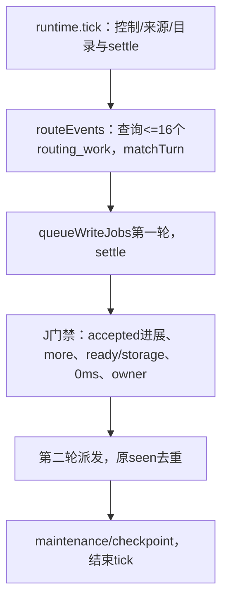

### 逐文件精确施工差异（C已全量实施，D待验）

| ID | 文件/基线锚点 | 当前行为 | 精确变更与变量 | 依赖/验收 |
| --- | --- | --- | --- | --- |
| N-D1 | src/service/runtime.eli L402–439，routeEvents(context) | 查询固定LIMIT16；空页回绕；busy集合；matchTurn Result与finally | 签名增加`&optional seen progress`。当progress非nil时先写selected=0/attempted=0/more=false；查询回绕结束后写selected/满16的more；原L420条件加`(not (and seen (js-call seen :has id)))`，加入group时向seen登记id；调用matchTurn前写attempted。Result、routing_after恢复和finally保持。预计增加约12–18行。 | N-Q1/N-A1、A2、A5、A6 |
| N-D2 | src/service/runtime.eli L652–659，tick write-wave let及第一组调用 | 只有wave1/route-first/派发seen，直接await单组 | 同一let增加routing-seen:Set、routing1:Object、routing1-result:Result或nil；第一组调用用N-D1新参数并保存Result。现有seen名称/用途及一次write_route_first翻转不变。预计增加约5–8行。 | N-D1/N-A1、A2、A3 |
| N-D3 | src/service/runtime.eli L661–673，第二轮门禁/owner/派发 | 必须wave1.more；0ms后一次owner重检，直接queue第二轮 | more条件扩为`(or wave1.more (and routing1-result.ok routing1.more))`；原门禁后let `routing2-result=(success nil)`、`routed2=false`，仅eligible时await第二组并置routed2=true；第二组后再次state/storage/owner重检，第二组失败不派发第二轮；未调用第二组时原J路径不变。保持第二轮相反role-first、同一派发seen与最多两轮。预计增加约20–35行。 | N-D1、D2/N-A1..A7 |
| N-D4 | tests/integration/delivery.test.eli：T31.submit-cutover.sqlite、T31.cancel-before-submitting.sqlite；storage.test.eli：T40.write-batch-isolation.sqlite | J、L既有断言已通过 | B先一次写齐下表N-A1..A7；复用Case ID，不改cases.json；保留既有J/L硬断言，不为新调度改弱四步/并发/切点。fixture方法、原生probe/submit计数与SQLite查询spy用现有局部包装并在finally恢复。 | 全部A设计独立核对后，由测试写入所有者接手 |
| N-D5 | docs/construction/test-plan.md、case-cards.md | 现有L与J映射 | B同步补N各编号与对应输入/门禁，不改变正式性能驱动、目标、断言或旧结果。 | N-D4 |

内部元数据完整定义：`routing-seen`仅tick作用域Set<string>，不持久化，最多32个实际入组ID；`routing1`为第一组progress对象，字段selected/attempted为0..16整数，more为布尔，默认0/0/false；第一组Result保存于routing1-result。第二组Result与routed2仅第二轮let内使用，不写入runtime或对外status。没有导出方法、注册表、配置或数据库迁移变更。

目标关键流程伪码（行为顺序，C阶段按Eliscript准确语法接线）：
```text
routing1_result = await routeEvents(context, routing_seen, routing1)
wave1 = queueWriteJobs(context, route_first, seen)
await settleReadyJobs(context)
route_more = routing1_result.ok && routing1.more
if wave1.dispatched > 0 && (wave1.more || route_more) && ready && !storage_blocked:
    await macro_task_0ms
    require current ready, !storage_blocked, ownerGuard
    routing2_result = success(nil)
    if route_more:
        routing2_result = await routeEvents(context, routing_seen)
        require current ready, !storage_blocked, ownerGuard again
    if routing2_result.ok && ready && !storage_blocked:
        queueWriteJobs(context, !route_first, seen)
        await settleReadyJobs(context)
```
`require`的state/storage失败只跳过新增后续步骤并继续既有maintenance；owner失败置owner_lost并返回原Result。routeEvents异常继续由既有tick异常边界传播，不创建第三轮或重试循环。不得把success(nil)误解为可缓存的owner结论。

目标源码树：与当前树一致，仅runtime.eli修改N-D1..D3，两个集成测试和两份测试说明修改N-D4..D5；不新增业务模块、不改变matcher/write-batch/delivery/storage。

目标流程及差异：
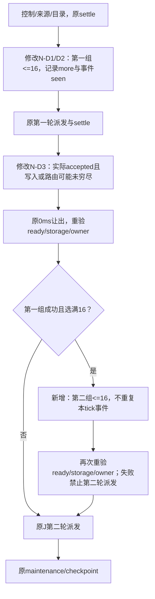

### 逐条验收输入、步骤和判定（B写齐，D待运行）

| ID | 测试/前置 | 步骤与明确预期 |
| --- | --- | --- |
| N-A1 两组完整接线 | T31；32个不同事件各命中独立route且原生idle；无既有routing忙项；fixture将event0..15映射到按route_id排序的低16项，event16..31映射到高16项，避免把第二组新低键必入旧游标误当合同 | 一次tick第一组16、第一轮16条accepted；第一轮routes短页但routing1.more=true，第二组再16、第二轮再16，32个work均done/32个delivery均accepted。按SQL/原生调用记录最多2次routeEvents实质组、每组<=16、无第三组/轮；submitting提交点仍由独立只读SQLite连接在submit入口验证。 |
| N-A2 两套seen与四步边界 | T31；32事件同一route，另有不同route/outbound与回绕夹具 | 第一组后该route最多4条accepted，第二组产生同route新投递也不得在本tick再次上岗；后28条保持待处理，下一tick继续。断言routing_seen不能与`route:`/`outbound:`派发seen混用。既有连续tick优先级、全局64及J全部断言继续保留。 |
| N-A3 零进展/短页不额外匹配 | T31；分别挂起、全busy、unknown；并有>16未路由事件；另设只有1个事件短页 | wave1.dispatched==0时不进第二组，即使首组满16；短页且原J无more时不发额外routing SQL；无重复probe和新岗位。挂起的旧32/16/48及后续64槽断言不变。 |
| N-A4 双await切点门禁 | T31两例；>16事件与accepted进展 | 在0ms间隔分别触发draining、storage_blocked、异主，第二组与第二轮均不启动；在第二组routing.before_checkpoint_commit的await期间触发同三种状态，第二组返回后不得继续第二轮。异主返回owner_conflict/owner_lost；finally精准恢复本fixture租约和注入点，drain恢复仍显式有界。 |
| N-A5 游标/失败/容量 | T40 isolation；构造首组routeEvents级失败、success(results)内revision_conflict单项、非领域回滚、第二组失败及全局9999/route999容量边界 | routeEvents返回ok=false或抛错时恢复各调用开始的after，抛错继续向tick外传播；success(results)内单事件失败保持原游标推进语义，不新增恢复。先前同批邻项SAVEPOINT提交/整批异常回滚边界不变；首组组级失败不新增第二组，但原J more路径不被额外改写；首组success(results)含领域失败时仍按满页/more准备第二组。第二组组级失败不启动第二轮，第二组抛错须传播，不混为成功跳过；同tick失败/blocked事件不重复入组，下一tick新seen可重试；全局10000/route1000不可超额。 |
| N-A6 空页回绕/分多页 | T40/T31；首组16个大候选事件尚未完成且游标在尾，另有低键held/blocked | 第二组至多原有两次SELECT（一次尾部空页+一次从0回绕），最多16行；过滤同tick已见ID后可为空，不为补满扫描第三页或开启第三组。下一tick允许继续原分页，保留last_subscription_id、无重复贡献/投递、无丢失work。另设第二组创建的route_id低于当前派发cursor，允许留待下一tick按原空页回绕处理，不要求本tick全部派发；静态最终排空必须无遗漏。 |
| N-A7 集中回归与正式容量 | 全N实现写齐并新冻结后 | controlled build(profile build)，unit完整75、integration完整845、system完整25；再按test-plan四项performance独立受控进程串行，逐项终态/cleanup齐备。保持原T27计时与6000/60000/FULL/100/持久空队列等全部断言；性能失败原样保留，不把N-A1的32事件局部通过当作100EPS通过。真实IM/Agent/Skill/资源验收独立开放。 |

### 唯一清单、阶段与恢复

唯一TODO的N行施工已勾、验收未勾。A已完成独立设计核对：组级Result失败与组内单事件失败已区分；满页只代表可能续页、第二组失败Result与抛错分别断言。B四文件已按SHA交回且停写，全部测试与说明已写齐但未运行；C唯一业务runtime已一次实现N-D1..N-D3，D未启动。原工具详情按需补读范围保留，不冒充全部阅读或当前独立代码验收。

核对后依次B一次写齐N-D4/D5 → C按N-D1→D2→D3一次实现与新业务快照 → D统一构建/功能/性能/独立审核。A核对及文案修正已完成，按B交接直接写齐用例；B完整交回后才进入C。开发者保留主要生产实现，双方不覆盖对方文件或无关WIP。无需新Goal，不缩小原首期目标；后续恢复直接由本节、contracts末节与TODO的N行继续。

C完成位置：runtime的routeEvents增加seen/progress与按实际入组登记；tick使用独立routing-seen和第一组Result/more，原0ms门禁后最多准备第二组，并在await后重新检查state/storage/owner。未改变matcher、每组16、派发32/16/64/4、FULL、业务授权或正式容量断言。B的全部新增tick场景集中于T31.cancel-before-submitting；T31.submit-cutover复用原断言，storage复用原单项领域失败断言。此为实际覆盖映射，D须核验断言强度及夹具时序，不能以映射代替通过。


## S3 在途存储调用与安全停止 V1–V2修复手册（B写齐、C已全量实现，D待验）

基线build80，manifest52b78f19d63cd3edf7b65a2cc7c7737154d2a93854c631e34e7cf948a4094154，114输入/526产物。core/runtime源摘要绑定business-source-repair-76；后续独立设计核对指出drain及port.close均有await，单一tick计数不覆盖检查后关闭窗口，因此精确采用四入口计数+最终同步seal，不缩短测试deadline。

当前与目标源码树均保持：
```text
src/service/core.eli      # runtime构造、宿主四入口、stopCore最终回收
src/service/runtime.eli   # drain早期活跃调用保护；N调度保持
 tests/integration/delivery.test.eli # T31既有future deadline回归、新V用例
 docs/construction/{test-plan,case-cards}.md # 测试映射
```
当前流程：
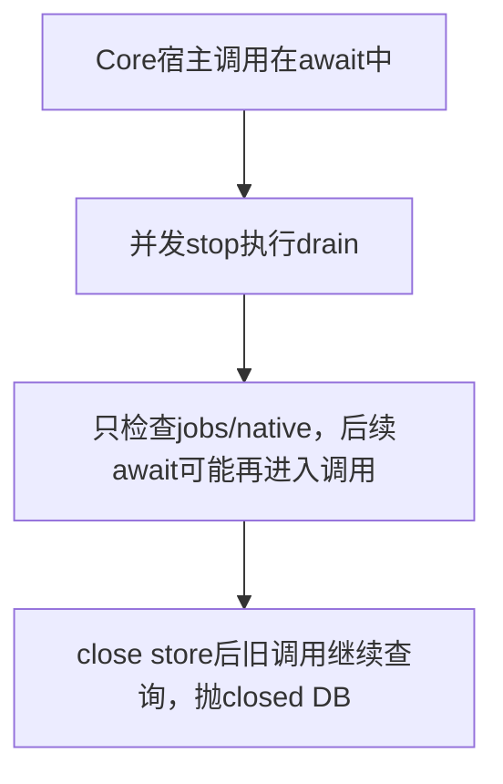

| ID | 文件/基线符号 | 精确操作、字段与类型 | 验收 |
| --- | --- | --- | --- |
| V-D1 | core.eli createCore runtime L49；词法let* L78–85 | 增加runtime.active_store_ops整数0、词法store-sealing布尔false、store-call async(work)闭包。封闭则failure(unavailable)，否则同步+1、try await work、finally-1 | V-A1..A5 |
| V-D2 | core.eli Object.assign的execute/reloadConfig/tick/ingest L566–608 | 全部经store-call包住完整原调用。execute/reloadConfig用捕获参数的lambda；tick完整Runtime.tick；ingest完整commitIngress/fault await；原owner/state/输入检查不搬动不删改 | V-A1..A4 |
| V-D3 | runtime.eli drain原unsettled guard L755 | 原or中加active_store_ops默认0 >0；最终success前再次检查active_store_ops/jobs/native，未排空置blocked；返回原draining结构且pending_native_work不混入计数 | V-A1/A2/A3 |
| V-D4 | core.eli stopCore L509–549 | await drain候选stopped后，再同步查计数、jobs及候选pending_native_work；有在途返回success(Object.assign({},result.data,{state:draining}))；无在途立即seal=true再try原close/release/store.close；finally未成功store-closed时seal=false。不得在整个stop尝试入口就封闭日常draining只读/收尾 | V-A4/A5 |
| V-D5 | delivery.test.eli T31 N前缀与两份测试说明 | 保留原N-A4 future deadlines；补四入口在途/封闭/解封、throw最终stopped硬断言。先一次写齐再全实现，不新增case ID/产品后门 | V-A1..A6 |

目标流程：
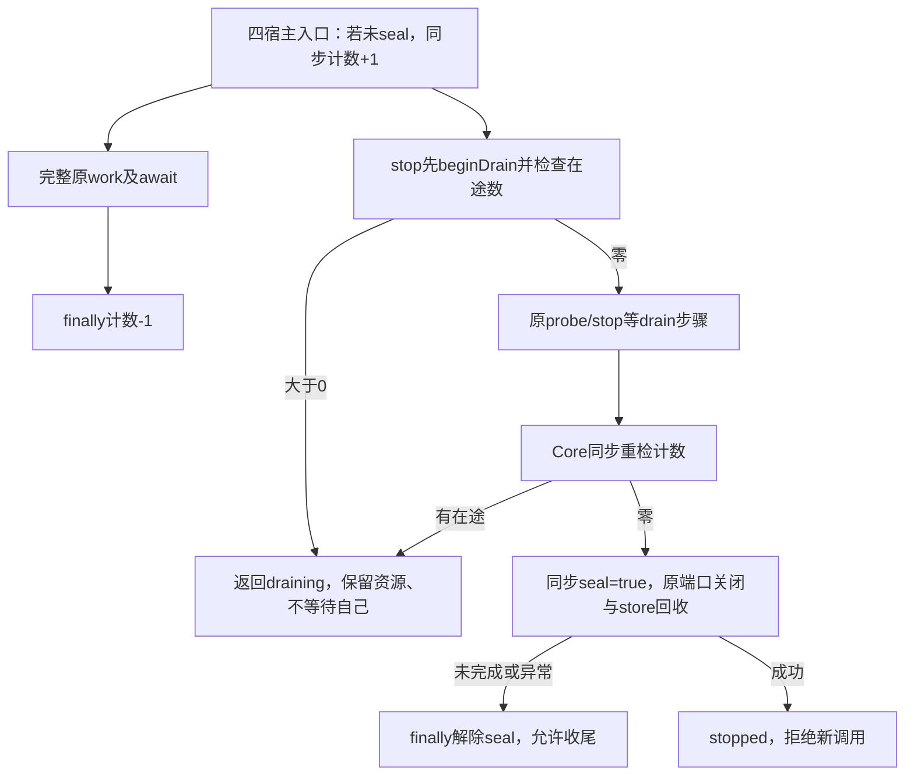

| 验收 | 输入/步骤 | 判定 |
| --- | --- | --- |
| V-A1 tick正常在途 | 原N-A4 gate/second-drain，未来deadline monoNow+2000 | tick未完成时stop返回draining不关DB；tick正常Result并阻断后续波次；之后有界stop为stopped |
| V-A2 tick异常/失败释放 | N-A5 query throw恢复；owner失败restart | throw/失败Result不泄漏计数，恢复后显式nStopToStopped硬断言；不吞原异常 |
| V-A3 其他三入口在途 | 专用fixture分别在ingest event.after_commit_before_ack、execute合法agent.probe原生I/O、reloadConfig host.files.mkdir等待处挂起；调用future deadline stop | 原工作未完成时stop返回draining且DB/管道仍活；release后原Result/错误按合同完成，计数释放，最终stop为stopped；全部barrier/fault/ports在finally恢复 |
| V-A4 最终关闭闸门 | 专用fixture把某自有agent port.close悬停，让drain候选已stopped且正在最终关闭 | 此时Core.tick/ingest/execute/reloadConfig均返回现有unavailable，不进入native/fault/配置动作；release close后正常stopped，不能check-then-close漏进新调用 |
| V-A5 未完成/异常解除闸门 | port.close分别首次返回draining或抛错，之后恢复 | stop保持原Result/throw；未关闭store时四入口可重新进入既有draining收尾语义，后续stop最终成功，不永久封闭 |
| V-A6 完整影响面 | 业务全写齐、重新冻结；受控build→完整75unit/845integration/25system→独立审核→四项performance隔离串行 | 生命周期更改影响全局，不能仅沿用旧844项；保留原始失败，真实安全停止与首期全部目标仍独立开放 |

B只写delivery/storage测试与两份说明，storage不必无意义改动。C归root仅core/runtime业务+施工台账；D绑定新快照。store-call不是通用任务调度/新公开平台，start并发取消等未观测独立议题不在本修复承诺内。

V-D3/D4最终排空补充是同一安全条件在异步边界后的重验：不能只在drain开始读一次jobs/native再经过多次await后关闭资源。它不改变pending_native_work计数含义、配额或操作结果，也不产生第三种关闭状态。

V施工完成：runtime.active_store_ops与词法store-call/sealing已接线四入口；Runtime.drain早期/最终排空重验、Core.stop候选后的同步重检/最终seal/未完成finally解封，以及同一受跟踪stop-promise均已实现。B四文件交回后才写业务，未运行编译/测试/预审；接续按新冻结D集中构建和全量75/845/25，不复用build78其余844项。


## S3 临时子日志写放大收敛 Y1–Y2 精确施工（A）

### 基线、现状与差异

基线build87原字节manifest `8593865fc76ed34bca789624e084de744a8829b3e74ce97737fb3400a21fcf0c`，114输入/526输出，59业务匹配repair81；storage/sqlite.eli SHA256 `1f01a1ae0db89338fc777d7c259d632e34869254020dc2cac6bb8342c9557cb4`。大量既有WIP保留。945功能为已登记的组合覆盖，performance23/24均仅3/4，不称完整S3完成。诊断46/组件47及私有服务48–51为临时子日志的证据入口，不是验收。

当前/目标源码树（其他业务文件全部保留）：
```text
src/storage/sqlite.eli       openStore: 原持久策略 -> 增加连接temp_store=MEMORY及readback
src/application/write-batch.eli  原64项/SAVEPOINT；不改
src/routing/matcher.eli      原批写/逐贡献重检；不改
src/service/core.eli         原生命周期；不改
src/service/runtime.eli      原两组匹配/两轮派发；不改
tests/integration/storage.test.eli  复用原Case ID补Y回归
 docs/construction/contracts.md   Y-Q1..Y-Q4
 docs/construction/test-plan.md   Y-A1..Y-A5覆盖说明
 docs/construction/case-cards.md  原T40卡补说明
```

当前流程：
```mermaid
flowchart LR
  O[openStore创建私有连接] --> P[设置并回查WAL/FULL/FK]
  P --> M[migrate并返回store]
  M --> W[write-batch每项SAVEPOINT]
  W --> J[SQLite按默认策略存子日志]
  J --> C[原COMMIT/ROLLBACK与调用方结果]
```
目标流程只在连接初始化增加策略；SAVEPOINT与持久提交完全相同：
```mermaid
flowchart LR
  O[openStore创建私有连接] --> P[原WAL/FULL/FK加temp_store MEMORY]
  P --> G[回查WAL/FULL/FK与temp_store=2]
  G -->|一致| M[原migrate并返回store]
  G -->|失败| E[原关闭连接及storage_unavailable]
  M --> W[原SAVEPOINT及SQLite内存子日志]
  W --> C[原COMMIT/ROLLBACK与原生提交切点]
```

### 全部施工清单（执行前未勾）

| ID | 施工 | 文件/基线锚点 | 精确操作与完成判定 | 验收 |
| --- | --- | --- | --- | --- |
| Y-D1 | [x] | sqlite.eli openStore L101–104，foreign_keys之后 | 插入`(js-call db :run "PRAGMA temp_store=MEMORY")`，紧接原wal_autocheckpoint；不另开事务、无条件分支/新配置 | Y-A1/A2 |
| Y-D2 | [x] | sqlite.eli openStore L119–147，设置readback and | 原foreign_keys==1之后新增`(= (nativeGet (js-call (js-call db :query "PRAGMA temp_store") :get) "temp_store") 2)`；与原durability检查同一失败路径。保留外层catch close及storageFailure，不改其他事务/备份/生命周期方法 | Y-A1/A2/A4 |
| Y-D3 | [x] | storage.test.eli T40.wal-fault.sqlite及backup-wal；write-batch-commit/failure | B一次补齐全部Y断言；仅此测试文件及test-plan/case-cards归搭档。Case IDs/cases.json/共享辅助函数不变；不运行 | Y-A1..A4 |
| Y-D4 | [x] | contracts本节、plan本节、TODO修复行/status | C写齐后勾施工；绑定新的59业务/114输入快照。只有D实跑才能勾验收；不把短窗或只读设计采用标成通过 | Y-A5 |

预定业务片段（精确插入，不引入helper）：
```lisp
(js-call db :run "PRAGMA foreign_keys=ON")
(js-call db :run "PRAGMA temp_store=MEMORY")
(js-call db :run "PRAGMA wal_autocheckpoint=0")
;; 原and回查中，foreign_keys条件后追加：
(= (nativeGet (js-call (js-call db :query "PRAGMA temp_store") :get) "temp_store") 2)
```

### 全部验收清单（均待D）

| ID | 验收 | 前置/操作 | 精确判定/用例/证据 |
| --- | --- | --- | --- |
| Y-A1 | [x] | T40.wal-fault.sqlite对setup的真实openStore连接读取PRAGMA；另建独立raw连接设temp_store=FILE，重开原库与backup | openStore连接temp_store=2，journal_mode=wal/synchronous=2/foreign_keys=1、schema_version及完整数据不变；独立raw连接仍FILE；每次重新openStore和backup恢复连接均重新设2，无迁移 |
| Y-A2 | [x] | 同T40中对受测openStore的固定temp_store设置注入throw，以及对其readback注入不符；try/finally恢复spy；随后正常打开 | 两次均返回storage_unavailable，不返回store、不降级；原库/版本/已提交数据未变，恢复后设置和读写正常。不得放宽FULL/FK或泄漏句柄 |
| Y-A3 | [x] | T40.write-batch-commit/failure中准备足以超过原64KiB子日志阈值的多行记录（如64行×4KiB）；同批成功邻项、写后领域失败项、后续成功邻项 | 领域失败仅回滚本SAVEPOINT，成功邻项提交；保留错误码、完整旧值与Promise COMMIT后可见；temp_store=2。再构造多行CHECK中途失败，整批非领域回滚，前块/邻项无残留；FK、NOT NULL、唯一、后块回滚原断言全部保留 |
| Y-A4 | [x] | 当前完整system恢复/安全停止与storage WAL/backup/future-schema用例 | 持久已提交状态、native提交切点、submitting/unknown恢复、备份内容与拒绝未来schema均不变；不以memory临时策略跳过崩溃/回滚证明 |
| Y-A5 | [ ] | B全写齐、C全实现后冻结；受控build，完整75unit/845integration/25system，独立审核，四项performance独立进程串行 | 945功能逐项终态，四性能真实结果；T27仍原6000events/60000accepted、FULL、实际>=100EPS、持久空队列/CPU/candidate硬门槛。记录guard RSS/footprint及fixture边界；256MiB真实部署独立未验则保持开放。失败完整保留、合并修复、只复验受影响项 |

R39/R43分工：原OpenCode Go固定模型/High作设计采用与B测试，主开发C只改上述一份业务文件；同一冻结验收进程运行时不改输入。D影响全部存储连接，故全功能及四性能均受影响；不能只跑新增T40就恢复整体验收。真实IM/Agent/Skill/资源与最终Git交付仍按原目标另行闭环。

Y批B三文件已全部停写交回；C唯一业务文件的固定设置/readback已按Y-D1/D2一次写齐，无其他业务改动。施工完成不等于验收；接续D集中整合、冻结、构建与全量验证。

Y批D终态（build88）：75 unit/845 integration/25 system完整单轮945全通过，原固定搭档独立审核无确定业务缺陷。D整合修正FILE=1、路径作用域、独立大值表的单项多行UPDATE领域回滚/单SQL末行CHECK整批回滚及误入旧用例的测试片段；原始B交付及旧失败均保留。Y-A1..A4以上述真实用例成立；Y-A5四性能收齐3/4，route-load负载70010.171416ms、6000事件全部匹配、56970accepted、3030待接收、routing/claims=0，内部截止未通过；大扇出/目录/正文配额通过。完整100EPS与真实部署256MiB、真实资源及最终签名交付未验，不勾完整验收。下一步只围绕本冻结新剩余成本做有界计量，不原样重跑性能或恢复已排除方案。


## S3 提交期 EchoGate 再检的规划收尾 EG1–EG2（A）

### 1. 基线、现状与边界

基线build88的matcher SHA256为6ce2b6a24b18dae9ad32fe6d6cbeffae8553448dac99f775720203451611d410，master已提交基线仍c1eb7b1；现存全工作树实现与WIP保留。业务相关方法为matchBatch(context,work,budget?)、matchTurn(context,works,budget?)共同调用私有matchWithWriter；签名和调用顺序不变。echoState读取echo_index/echo_gates，先echo再held；准备后fault hook在事务外await，事务中重读current并重检echo是必需的。withEventPlans(...,buffer-deliveries=true)要求成功返回前finish，否则抛TypeError。当前事务早退缺少该收尾，不能靠删守卫掩盖。

现状涉及树（未列出的已实现业务模块保持原样；dist/依赖/私有诊断图不施工）：
```text
src/routing/matcher.eli               L328–333事务内echo早退，待修
src/delivery/planning-scope.eli        缓冲finish及成功退出守卫，保留
src/application/write-batch.eli       单项SAVEPOINT/整批异常回滚，保留
src/storage/repository.eli            routing_work替换，保留
src/storage/sqlite.eli                Y的WAL/FULL/MEMORY，保留
src/service/{core,runtime}.eli        J/N/V调度和生命周期，保留
tests/integration/storage.test.eli    T40.write-batch-isolation复用
 docs/construction/{contracts,plan,test-plan,case-cards}.md
TODO.md / docs/status.md              唯一进度入口及证据
```

```mermaid
flowchart LR
  M[matcher准备时echo clear] --> F[事务外await准备hook]
  F --> C[事务中重读current并重检echo]
  C -->|held或echo| S[更新routing_work并success早退]
  S --> E[planning-scope发现finished false并拒绝]
  C -->|clear| P[原候选循环和finish提交]
```

### 2. 精确施工差异与目标

| ID | 施工 | 文件/基线与锚点 | 精确操作 | 对应验收 |
| --- | --- | --- | --- | --- |
| EG-D1 | [x] | matcher.eli L328–333，`unless (= echo "clear")`内current.state之后 | 插入current.reason和planning.finish两条语句，随后保留原must replace及success/token早退；无新变量或字段类型 | EG-A1..A4 |
| EG-D2 | [x] | storage.test.eli的T40.write-batch-isolation及两份测试说明 | B一次写齐以下竞态、邻项及回滚断言，不运行/不修改cases.json或既有断言；可在现case末尾独立q/eg前缀fixture块，避免破坏已有计数 | EG-A1..A4 |
| EG-D3 | [x] | 本节、contracts末节、TODO/status | C完成即勾施工；D新快照绑定后记录真实结果；性能/真实未过不勾整体验收 | EG-A5 |

目标代码仅在当前state与must之间插入：
```lisp
(unless (= echo "clear")
  (put current :state (if (= echo "held") "held" "done"))
  (put current :reason (if (= echo "held") "echo_gate" "own_echo"))
  (js-call planning :finish (nativeGet current "state"))
  (must (js-call repository :replace "routing_work" current))
  ;; 保留原success current与控制流token早退
  ...)
```
`current.reason`为既有内部字符串，值与准备前分支相同；current.state仍held/done，其他持久字段不变。planning是本调用同步作用域对象；此处created-records必为空，只完成生命周期。绝不使用finish返回布尔去解锁旧行。无新增数据结构、局部变量、依赖、导入/导出、迁移、配置或资源生命周期。

目标树仅EG-D1的matcher修改、EG-D2测试说明追加与EG-D3台账更新；planning-scope/write-batch/sqlite/core/runtime不改。
```mermaid
flowchart LR
  M[原准备阶段clear] --> F[原事务外hook]
  F --> C[原current和echo再检]
  C -->|held或echo| R[原state并补既有reason]
  R --> Z[新增 空planning.finish]
  Z --> W[原事务内routing_work替换及success早退]
  W --> K[原SAVEPOINT RELEASE/COMMIT]
  W -->|领域失败| D[原单项ROLLBACK TO 邻项提交]
  W -->|未知异常| B[原外事务ROLLBACK]
  C -->|clear| P[原候选及批写路径]
```

### 3. 全部测试/验收清单

| ID | 验收 | 输入/操作 | 精确判定 |
| --- | --- | --- | --- |
| EG-A1 | [x] | 真实SQLite中初始echoState=clear的事件，routing.before_checkpoint_commit hook内独立事务插入匹配echo_gate；matchBatch提交再检 | Result ok=true；routing_work held/reason echo_gate，原cursor不变；无本调用新delivery/decision/contribution；hook确实执行，未走准备前早退 |
| EG-A2 | [x] | 同类初始clear事件，hook插入精确connection/native_message_id的echo_index；matchTurn以正常no_match邻事件在前、echo事件在后共批 | 两项ok；邻事件正常done且决策按原语义落库，echo事件done/reason own_echo、无新投递/贡献/决策；非领域整批失败不再由遗漏finish触发 |
| EG-A3 | [x] | held竞态事件含先前轮持久blocked/routing_incomplete/rev1投递和非空cursor；提交前出现gate | 原blocked投递typed/payload逐字段不变，checkpoint cursor原样；无ready解锁SQL或新投递，不因忽略finish布尔而越过屏障 |
| EG-A4 | [x] | echo再检分支的routing_work replace注入revision_conflict，同批前邻事件正常；用try/finally恢复故障/spy | 失败项原state/reason/cursor及已有投递回滚，领域错误码保留，邻项提交；hook外事务的echo事实不冒充被当前SAVEPOINT回滚。保留既有未知异常整批回滚和准备前已gated的语义断言 |
| EG-A5 | [ ] | B写齐、C全改后新冻结；受控build、完整75 unit/845 integration/25 system，原固定搭档独立审核，四项performance独立串行 | 分层真实终态及guard cleanup留存；945与性能分别记录，不降低6000/60000/FULL/端到端100EPS及真实256MiB门槛。旧build88/performance25失败不覆盖；真实IM/Agent/Skill/资源与最终签名仍开放 |

测试数据归本fixture；用唯一eg前缀operations/outbound作为真实FK父行，不复用冲突idempotency键。echo_gates/index只注入本事件/连接/会话，hook与repository spy必须finally恢复，所有新增循环有界。新测试可在当前T40 case末尾创建独立命名空间/上下文复用实际SQLite，或在现有mt-context作用域内插入；不得改共享辅助函数或原用例断言。B只写允许三文件，不运行编译/测试/静态预审；主开发C一次写齐再D。

EG批D结果：build91/repair89冻结114输入、526产物与59业务，EG-A1..A4通过，原固定OpenCode Go/High搭档独立审核无确定业务缺陷。功能945为组合覆盖：build90 unit35 75/75、integration54其余844项、system28 25/25，加build91 integration55定向T40 1/1（197 expect）；90→91仅EG-A4测试两处，生产/工具/其余测试产物字节一致，不称单次845/845。performance26四项独立串行收齐3/4通过、全部cleanup_complete：route-load完成6000事件/60000投递，待处理/routing/claims均0，但完整负载67070.761375ms（ingest60890.257375ms、drain6180.504ms），89.45775889516656 EPS，status=failed、schedule_completed=true、throughput_below_target；另三项通过。EG-A5完整吞吐、真实256MiB/IM/Agent/Skill及最终签名继续开放，不把排空或跨轮差值当作性能达标或EG净收益。 build89词法布尔错误和后续unit缺manifest拒绝、build90 EG-A4缺失reason与nil错误期望均保留原始记录；D统一修为t及完整before-4记录比较，旧断言未削弱。

## S3 同组匹配容量计数复用 G1–G2（A写齐，B待交回）

### 基线、范围与实际前置

当前master/c1eb7b1之后的大量实现WIP须保留。build91原字节manifest a97bd3c1844e2e27ea11196cd1d780faeda4f20faed25dc9f51d9bb80aebee2c，114输入/526输出、59业务匹配repair89。EG功能945组合覆盖，正式performance26仍3/4：6000/60000排空但完整wall67070.761375ms/89.4578EPS。诊断58解决空窗，59验证同线程CPU计量；其短窗不是吞吐验收。真实IM、Agent、Skill、物理部署和签名交付仍缺当前完整证据。

成本定位：planning-scope每事件已缓存本事件global-count，但同matchTurn最多16事件仍分别扫全局五状态。diagnostic56有2192次/970.26ms，不能把次数比例外推完整净收益。组件60在同一只读6195 pending集合验证原deliveries_state计划与强制head计划的相同COUNT及8轮耗时，差值有限，不采用强制索引。选择仅复用同组一个数值，所有真实逐候选容量与授权继续执行。

前置证明：write-batch.eli L37–54 pending已满64即unavailable，未接纳项不保存；L5–36同步splice最多64项并同步逐项原SAVEPOINT。matchTurn L483–491同步forEach连续入队，不能与其他JS回调交错；队列最多64，故同组已接纳前缀在同一次flush，绝无“前4本批、后12留队列下批”。158号搭档回复中的该反例不采用，后续B交接须明确纠正并加满队列测试。write-batch本批不改。

### 1. 当前/目标源码树与流程
```text
src/routing/matcher.eli                 # 改G-D1，私有matchWithWriter及matchTurn
src/delivery/planning-scope.eli         # 改G-D2，withEventPlans同步工作结果后发布计数
src/application/write-batch.eli         # 保留，不改；连续接纳/64拒绝/SAVEPOINT/COMMIT
src/application/context.eli             # 保留，同步inTransaction
tests/integration/storage.test.eli      # B改G-D3，只追加/扩现T40用例
docs/construction/test-plan.md          # B改G-D3
docs/construction/case-cards.md         # B改G-D3
TODO.md/docs/status.md/contracts.md     # root改G-D4
```
```mermaid
flowchart LR
 A[原matchTurn准备全部候选] --> B[原同步连续enqueue每事件]
 B --> C[原flush单事务逐项SAVEPOINT]
 C --> D[原每事件withEventPlans各COUNT]
 D --> E[原逐route容量/创建/finish/决策/贡献/checkpoint]
 E --> F[原失败单项回滚或未知异常整批回滚]
```
```mermaid
flowchart LR
 A[原matchTurn准备 新增本组私有state] --> B[保留每事件连续入队与64拒绝]
 B --> C[保留flush事务与SAVEPOINT]
 C --> D[首事件真COUNT 后邻项复用成功值]
 D --> E[保留逐候选容量/授权/查重/序号及原批写]
 E -->|同步成功后| P[发布local global-count到state]
 E -->|失败或异常| I[立即清空count 原回滚后邻项真读]
 P --> F[原所有结果完成 包括COMMIT失败]
 I --> F
 F --> Z[新增finally关闭state 不跨调用/事务]
```

### 2. 精确施工手册

| ID | 施工 | 基线行号/符号 | 一次修改内容 | 对应验收 |
| --- | --- | --- | --- | --- |
| G-D1 | [x] | matcher L174–175 matchWithWriter；L424–427 withEventPlans末参；L437–500 matchTurn | 私有matchWithWriter签名加`&optional capacity-state`，传入withEventPlans末位。matchBatch仍四参。matchTurn在外层let声明capacity-state初值nil，通过校验后创建Object.seal state；slots维持原let；把state作为matchWithWriter第五参；用try/finally包现有准备及同步enqueue/结果聚合主体，finally active=false/count=nil，不改变排队循环或Result分支 | G-A1/A4/A5/A6 |
| G-D2 | [x] | planning-scope L8签名；L10–30 let/验证/assert-active；L70 capacity全局COUNT；L140 work结果/异常/finally | 加第六可选capacity-state（默认nil，不新增shared-count局部变量）、校验store/active/count及buffered；原assert-active增加共享active要求。local global-count首次取非null共享count或原COUNT，再加本事件pending created数。work整个结果通过原同步/finish守卫后：ok===true且global-count非null则publish，global-count为null但created>0则invalidate；ok非true或catch任何异常则invalidate再原样返回/抛。原finally清理不改。finish本身不提前发布 | G-A1/A2/A3/A4 |
| G-D3 | [x] | storage.test.eli现T40.write-batch-{commit,isolation,failure,bound}.sqlite及两份说明 | B一次写齐下表全部输入/断言；可复用现Case ID，不改cases.json/业务/共享helper/旧断言；独立g前缀fixture不污染旧计数，所有spy/fault finally恢复 | G-A1..A6 |
| G-D4 | [x] | 本节/contracts/TODO/status | 每项C写完即时勾施工，D绑定新freeze与真实结果再勾G-A；性能和真实未通过不勾整体验收 | G-A7 |

新增内部结构MatchTurnCapacityState：store为当前store对象只用于身份检查；count为null或非负Number安全整数，初值null，当前组成功写后的准确五状态总量；active为布尔，初值true，在matchTurn finally置false。Object.seal禁止添加键，count/active可变；由matcher唯一创建，仅透传同步规划回调，无持久化，不挂入context/runtime，不返回到Result/envelope/attempt，不跨组或暴露给公共请求。没有新增导出/配置/表/索引/依赖。计划增加约40–65行，实际位置在C/D记录。

withEventPlans目标签名：`(context event work &optional complete-in-one-turn buffer-deliveries capacity-state)`。省略或nil保留全部原行为；非nil仅允许buffered=true且合法同store/active计数。错误输入在work/首SQL前TypeError。assert-active对关闭state亦抛TypeError。原global-count局部变量仍按created逐条增加，route COUNT SQL文本不变。
```lisp
; capacity首次需要时，sharedCount非null才替代真实DB COUNT；当前事件created数仍按原规则加。
(setq global-count (+ (if (and capacity-state (not (nativeNullish (nativeGet capacity-state "count"))))
  (nativeGet capacity-state "count") (nativeGet (js-call (js-call db :query "SELECT COUNT(*) AS n FROM deliveries WHERE state IN ('ready','deferred','blocked','submitting','unknown')") :get) "n"))
  (if buffered (js-length created-records) 0)))
; 完整work结果通过原thenable/finish守卫以后发布，不在finish/created中提前更新共享值。
(when capacity-state
  (if (= (nativeGet result "ok") t)
    (if (not (nativeNullish global-count)) (put capacity-state :count global-count)
      (when (> (js-length created-records) 0) (put capacity-state :count nil)))
    (put capacity-state :count nil)))
; catch error先count=nil，再throw同一个error；finally保持原清理。
```

错误/回滚映射：limit_exceeded按原matcher blocked Result语义处理，成功提交的已建active行必须计入下一事件；revision_conflict失败项全回滚且count失效；未知约束异常仍整批回滚；COMMIT失败无后续同组跨批执行，所有结果原样失败并关闭state。第一项无匹配/echo早退无容量读则不强制造COUNT；后一项首次真读。准备阶段不读取计数。

### 3. B测试与D逐项验收

| ID | 验收 | 输入/操作 | 明确判定 |
| --- | --- | --- | --- |
| G-A1 | [x] | 同组16事件、每事件至少1条新delivery；全局/route SQL spy；对照matchBatch直调和两次matchTurn | 组内原全局COUNT仅1次；逐route真实COUNT次数/逐候选授权不减少；所有deliveries/decisions/contributions/seq按原语义。两个组各真读，matchBatch仍按每事件原读；空/全no_match不强制读 |
| G-A2 | [x] | baseline活跃9998，同组3事件各1条新delivery；以及单route999已存在 | 只容纳2条到10000，第三条原limit_exceeded/blocked路径且无新delivery/贡献；单route1000后拒绝。读取state所有五种均计入，accepted等终态不计；不能因共享而超限 |
| G-A3 | [x] | 中间事件创建后routing_work revision_conflict；前/后邻项正常；首/末项失败变体 | 失败项delivery/seq/决策/贡献/检查点全回滚；失败码不变、邻项提交。下一个有效事件重新真COUNT（故至少额外1次），只计算原DB及成功邻项，没有失败增量 |
| G-A4 | [x] | 非领域第2块FK失败/外层COMMIT失败后重试新group；以及同组无capacity的echo/no_match邻项 | 未知/提交失败仍整批回滚，无样本发布/新原生I/O。新group真读库、正确容量。echo/无匹配不抹原合法计数或新增虚拟行；已存在blocked及续页保持原语义 |
| G-A5 | [x] | 在matchTurn准备完成后的同步enqueue前，预填60个原write item，再排16事件；另预填64项 | 60+4接纳且最多64执行、后12立即unavailable，不保留到下一flush；64满时新16全部拒绝。仅接纳前缀持久化、原错误码不变。下一group为新state真读；prepared Futures全部结束无挂起。不得把同组聚成1item |
| G-A6 | [x] | 直接低层withEventPlans参数非法state、错store/active=false/坏count、非buffered，回调返回thenable/漏finish/失败；保存planning并在关闭state后调用 | 非法state在SQL前TypeError；省略/nil保持旧行为；所有异常/领域Result均使count失效；成功后所有原作用域撤销，不能跨组复用。不得把state挂到Result或持久行 |
| G-A7 | [ ] | A/B/C全部写齐后新freeze，受控build、75unit/845integration/25system、原搭档D独立审核、四项performance独立串行 | 真实层次/逐例/guard回收及原始失败保留；6000/60000/FULL/100EPS及真实256MiB/原话题/Skill不改。功能及性能分别记录，组件/短窗不替代正式结果 |

完整范围仍是首期Goal；本增量解决可证重复工作，非把范围缩成计数优化。当前A已写齐，B只归固定搭档三文件且不运行；root在B完整交回前不写业务或执行本增量检查。D必要失败合并修复后只复验受影响范围，未通过仍原样开放。

G-A5精确装配：仅在新g测试块中保存并临时包装NativeGlobal/globalThis.queueMicrotask，收集原flush回调而不执行；先用原enqueueWrite填60（或64）个同步successful哨兵项，再启动matchTurn但暂不await其返回；用有界until/原生0ms定时器等到pending恰为64或组已立即拒绝，确认仅一个flush回调被收集。恢复原queueMicrotask后显式执行该自有回调，再await组和哨兵Promise并核验DB及全部Future已结束。finally无论失败都恢复原函数并回收/执行尚持有的自有回调，不能让旧write item悬挂，不改全局共享fixture helper。拒绝组整体可按原fatal聚合返回unavailable，不能假设公开Result附带16个分项。

G B全部写齐：固定搭档160/162两次交回仅A1/A3/A6，且均声明未完成、未验证。root在两次原生进程exit0/cleanup完成后接回测试三文件，保留原B字节副本，补齐A2/A4/A5及首末失败/真实事务内A6；同route两订阅期望对齐33投递/66决策。没有运行或预审，现可一次进入G-D1/G-D2的C。

G C已一次写齐：matcher仅透传第5/第6可选state、校验后创建并finally关闭；planning-scope增加合法state/活性校验、精确COUNT复用、work全成功后发布及任何失败失效。两个业务文件之外未改，尚未编译/测试；现在进入D统一冻结与集中验证。

G D功能结果：build93构建成功，unit36 75/75、integration56完整844/845、system29 25/25；唯一G新上下文遗漏ids.next由私有61原异常定位，build94仅补该test fixture，integration57定向T40 1/1（300 expect）通过。93→94仅本G构造一处，反向替换全源SHA匹配93，生产/工具/其他测试产物同字节；G新增块及NativeGlobal import移除后SHA精确回到build91源，所有旧Case/helpers字节未改。945为组合覆盖。原固定搭档164独立审核无确定业务缺陷，G-A1..A6成立并采用root B接回事实。原始build92/集成56失败不覆盖；四项performance27已独立串行全部终态，完整吞吐与真实资源仍开放。

G D性能终态：build94原字节manifest 50b2d0bab09d32aa7c46ed7a9e9bb17b95fd041d57bb293dcf747f23a8e5dd77，114输入/526产物/59业务无漂移。G-A1..A6功能与固定独立搭档审核成立；945为build93 unit36的75项、integration56其余844项、system29的25项，加build94 integration57定向T40 1项的组合覆盖，非单次845/845。performance27四项独立进程串行终态为3/4，全部cleanup_complete=true。route-load为status=failed、schedule_completed=false、internal_deadline；负载wall70011.342125ms，摄取4549事件、接受34110条投递、unaccepted9872、routing183、claims0，remaining10055为混合单位，非10055条投递；tick144、skip143、error0、最大并发tick1、退出无在途tick。大扇出10000候选/1000投递、173turn、exercise2693.264375ms、候选CPU p95 2.813ms；目录10万metadata/转发500、exercise53758.796292ms；正文配额534962176bytes、capacity_exceeded=true、转发84/11轮。完整100EPS、真实256MiB/IM/Agent/Skill及最终签名保持开放；不作跨轮净收益或主机因果归因。 G-A7保持未勾，原始报告不覆盖。

## S3 授权部署物理资源捕获 M1–M3

### 当前基线、需求与缺口

build94/repair92，manifest 50b2d0bab09d32aa7c46ed7a9e9bb17b95fd041d57bb293dcf747f23a8e5dd77，114输入/526产物/59业务；当前master/c1eb7b1及大量同Goal WIP保留。G功能945组合覆盖，performance27独立3/4，未达100EPS。真实profile当前15个缺失controller入口，其中本批只把物理捕获这一必要组件由缺失变为可装配；其余14项与资源授权仍开放，完整Goal不收缩。授权清理/测试临时目录不等于可部署或启动真实Agent。

readRealProfile/approvedDriver已在tests/support/real.eli L10/L111实现授权、digest、关联与回收；L185 readDriverOutput stdout固定1MiB。resources.eli L10 summarizeResources验证60秒/100ms/四角色/真实footprint原始数据；router.test.eli L554从measure-owned-deployment获得数据后判DJ峰值<=256MiB。config/acceptance.example.json当前所有entry占位。tools入口仅build/verify/package。现无原生采集实现。代码图对这些路径coverage_unavailable，已按当前源码核对，不据空图判定不存在。

原生依据：[Apple resource.h](https://github.com/apple-oss-distributions/xnu/blob/main/bsd/sys/resource.h)、[proc_info.h](https://github.com/apple-oss-distributions/xnu/blob/main/bsd/sys/proc_info.h)、[libproc实现](https://github.com/apple-oss-distributions/xnu/blob/main/libsyscall/wrappers/libproc/libproc.c)与[Bun FFI](https://bun.com/docs/runtime/ffi)，2026-10-25核对本机SDK一致。rusage_v1 144bytes、resident/physical/start/exit偏移64/72/80/88；bsdinfo136bytes、pid/ppid/uid偏移12/16/20。proc_listchildpids返回count（不是bytes），不得套用proc_listpids字节语义。FFI实验性是工具限定，D需核实际当前Bun1.4.4能调用；未测不报支持。

### 原/目标源码树与流程
```text
# 原
config/acceptance.example.json          # 全部drivers默认false/入口占位
eliscript.tools.json                   # 3工具入口
tests/support/real.eli                  # 已有approvedDriver，stdout1MiB
tests/support/resources.eli             # 已有summarizeResources，不改
tests/performance/router.test.eli       # 既有真实物理门禁，不改
# 目标增加/修改
+ tools/resource-capture.eli            # M-D1 native reader与有界真实采样
+ tools/resource-controller.eli         # M-D2 保护绑定/stdio关联入口
+ config/resources.binding.example.json # M-D3 全false/0占位，不含真资源
~ eliscript.tools.json                  # M-D3 新增controller entry
~ config/acceptance.example.json        # M-D3 仅measurement driver指向新entry及绑定ref，仍false/零摘要
~ tests/support/real.eli                # M-D4 唯一特定操作stdout8MiB
~ tests/unit/state.test.eli             # M-D5 新纯组件Case
~ tests/integration/interfaces.test.eli # M-D5 新自身native/保护绑定Case
~ tests/cases.json                      # M-D5 注册2项（预期功能总947）
~ docs/construction/{test-plan,case-cards}.md # M-D5测试归属
~ docs/construction/real-preflight.md / TODO.md / docs/status.md # M-D6如实装配/进度
```
```mermaid
flowchart LR
 A[真实资源用例] --> B[approvedDriver digest与授权]
 B --> C[占位入口缺失]
 C --> D[未运行 真实256MiB开放]
```
```mermaid
flowchart LR
 A[保留真实资源用例] --> B[保留approvedDriver授权/digest]
 B --> C[新增resource-controller保护绑定及请求]
 C --> N[新增libproc真实root身份/子树]
 N --> S[新增实际60秒100ms绝对日程]
 S -->|完整且无缺口| R[原始关联JSON 最多8MiB]
 S -->|复用/越权/缺测/超量| E[固定错误 非0退出 finally close]
 R --> V[保留summarizeResources及256MiB判定]
```

### 精确结构、方法与失败语义

所有新增逻辑为Eliscript，禁止新增手写JS/C/Python控制器。允许测试期使用当前工具自身process.pid的只读native计量，不启动真实部署、不执行IM/Agent动作。下列导出都是验收工具模块接口，不加入产品library/API/schema。

`validateCaptureRequest(request)->request`：必须普通非数组对象，schema_version=1，operation精确measurement；request_id/run_id匹配`^[A-Za-z0-9_.:-]{1,256}$`，parameters.run_id相等，duration=60000/interval=100；任何非法在native/文件前TypeError。可允许未知字段但不执行它们。返回关联字段及规范化参数。

`validateCaptureBinding(binding)->binding`：schema1、authorized===true、密集roots Array1..16。root `{pid:positive int32,start_abstime:nonzero decimal u64 string,executable:nonempty absolute string <=4096,category:'dj'|'external_agent',roles:Array}`；roles稠密不重复，dj类只能dj/lark_websocket/mcp_proxy、external类只能external_agent。root PID不重复，四必需roles全覆盖。返回新对象与roots/roles冻结副本，不使用外部后续修改。出生上限18446744073709551615，保留字符串，不转Number。非法TypeError、未授权Error固定码。

`decodeNativeUsage(bytes)->{rss_bytes,physical_footprint_bytes,start_abstime,exit_abstime}`：必须144字节Uint8Array，DataView littleEndian读取上述u64；内存Number安全非负、start非0、exit十进制字符串。坏类型/长度/溢出TypeError，0不是缺测替代。epoch保真测试含>2^53。

`openNativeProcessReader()->{read(pid),children(pid),close()}`：只darwin；lazy dlopen("libproc.dylib")固定公开符号：proc_pid_rusage(i32,i32,ptr)->i32、proc_pidinfo(i32,i32,u64,ptr,i32)->i32、proc_pidpath(i32,ptr,u32)->i32、proc_listchildpids(i32,ptr,i32)->i32、__error()->ptr。固定自有144/136/4096/132字节buffer，调用前把本线程errno置0，解析BSD/usage/path，read返回 `{pid,ppid,uid,executable,start_abstime,exit_abstime,rss_bytes,physical_footprint_bytes}`。同次read须前后rusage出生一致、exit为0，否则拒绝或确认退出为nil；只有errno=ESRCH或exit标识证明退出才nil，其他错误固定Error不当0。children缓冲33个i32，count>=33拒绝截断；0且errno非0拒绝。closed后read/children抛错，close幂等。传入非法pid在FFI前拒绝。句柄打开后任意初始化失败须close。

`captureOwnedDeployment(binding,runtime)->Promise<rawReport>`：runtime为模块调用者注入的 `{reader,now,sleep,uid,capture_id}`，真实CLI只构造宿主版本，不从profile/stdin/env注入。uid非负安全整数；capture_id非空<=256；now单调非负有限；sleep返回awaitable。本函数不close调用者reader，CLI finally负责。全窗口registry Map<pid,{start_abstime,category,roles,executable,root}>；初值来自冻结roots。每个样本建立seen/cache/current maps与遍历队列，验证每个root实际uid/出生/path；递归读取children，核当前child.ppid==parent.pid并在枚举后复查parent.birth，若遇另一显式root，以该root自身category/roles为子树边界（允许DJ管理的external_agent为其子进程），不继承外层类别、不重复计数；非root既有身份被其他category重认才失败。同category重叠只记一次并保留显式root角色。新子进程记录真实出生，roles=[]；原已证明子进程即使后来ppid改变仍追踪，直到read=nil或出生变化（非root旧身份移除；新身份须当前祖先重新证明）。读到root缺失/变化/UID不同、任何live进程元数据非法、超32进程、未知native错误均失败。保留实际live子进程，不能只测静态root漏子树。根角色来自人工核对的授权映射，native身份匹配不能单独证明用途，真实验收前仍审阅绑定。

样本算法：origin=now()；index=0、previous=null、samples=[]。每轮等待到origin+index*100（while重验，避免早timer），at=now()-origin，首次用0（原点就是首次采集起点），之后要求at>previous且差<=200。同步读取本样本，push `{elapsed_ms:at,processes:[{pid,start_abstime,category,roles,ownership_verified:true,physical_footprint_bytes,rss_bytes}]}`；按本样本实际at达到60000则完成，否则index++；不能复制前值或补虚拟点，最多602点。计时回退/NaN/缺口失败。只在完整后返回source/complete:true/native_capture_id/duration_ms:last/interval_ms:100/samples。输出不含path、UID、argv、绑定内容。现有summarizer继续独立校验并判峰值。

`loadCaptureBinding(root,ref)->Promise<binding>`（controller导出）：ref仅文件名`^[A-Za-z0-9_-][A-Za-z0-9_.-]{0,79}$`且不为./..，不接受路径分隔或绝对路径；root须真实同uid保护目录（mode&077==0），ref为非链接普通同uid文件、mode&077==0、size<=65536。用O_RDONLY|O_NOFOLLOW打开并fstat核验，读后字节再限额，在finally close文件；JSON后validateCaptureBinding。配置不含真实授权时直接拒绝，不自动修改/授权。

`readCaptureRequest(stream)->Promise<request>`：Web ReadableStream逐chunk最多65536字节再JSON parse/validate；finally reader.releaseLock，不能无界stdin.text。`handleResourceRequest(request,binding,runtime)->Promise<response>` validate请求后capture，返回原五关联字段和data。`driverStdoutLimit(name)->integer`在real.eli导出；measurement返回8388608其他1048576，approvedDriver原readDriverOutput处调用；其他截止/关联/收尾不变。

resource-controller `main()`仅argv[1].endsWith('/tools/resource-controller.mjs')时执行。argv[2]为唯一binding文件名，其余argv拒绝；先读/验证请求再读保护绑定，打开native reader、用performance.now/nativeSetTimeout、实际process.getuid与randomUUID构造runtime，try/finally close。成功JSON utf8<=8388608才写stdout一次；失败写单条ok=false/schema1及已合法关联字段（未合法时null），stderr固定resource_controller_failed，exitCode1，不泄露exception/配置/路径。无部署、进程终止、网络或模型工作。所有FFI只在main或显式测试调用打开，不在import时运行。

### 精确施工/验收映射
| ID | 施工 | 位置/基线符号 | 操作 | 验收 |
| --- | --- | --- | --- | --- |
| M-D1 | [x] | 新tools/resource-capture.eli | 按上列5个导出、reader/registry/绝对日程写齐；约300–450行 | M-A1/A2/A3 |
| M-D2 | [x] | 新tools/resource-controller.eli | load/read/handle/main与所有finally；约150–220行 | M-A1/A4 |
| M-D3 | [x] | eliscript.tools.json entries末尾；新config/resources.binding.example.json；acceptance.example drivers.measure-owned-deployment | tools加入口；资源例4个真实角色占位pid0/start0/authorizedfalse；measurement entry改controllers/tools/resource-controller.mjs、argv第三项resources.binding.json、原零摘要/false不改；其他14driver逐字节逻辑不改 | M-A4/A5 |
| M-D4 | [x] | real.eli L185 readDriverOutput及末尾export | 增driverStdoutLimit导出及唯一路径cap；不改其它driver/timeout/授权 | M-A1/A4 |
| M-D5 | [x] | unit/state末尾、integration/interfaces末尾、cases.json cases末尾及两测试说明 | 固定搭档B一次写齐全部下表用例，旧Case/helpers不改，新增2Case，不运行任何构建/测试/预审或静态检查 | M-A1..A5 |
| M-D6 | [x] | TODO/status/real-preflight/contracts/本节 | root维护施工/验收分离与完整资源缺口；工具C完成才进入D | M-A5 |

| ID | 验收 | 输入/操作 | 明确结果 |
| --- | --- | --- | --- |
| M-A1 | [x] | 新T70.resources.unit.capture-controller；decode144byte向量（RSS/physical不同，出生>2^53）、非法类型/短buffer/超过MAXSAFE、request/binding所有非法/稀疏/重复/跨类别roles/缺角色/授权false、stream超64KiB/坏JSON/关联不符、driver cap | 精确保持64位出生/真实物理与RSS分离；零native读拒绝非法；measurement cap8MiB/其他1MiB，旧summarizer不弱化 |
| M-A2 | [x] | fake runtime/reader（明确非真实证据）跑完整601点/60000ms；早timer重验、200ms内实际迟到、>200gap/回退；构造roots覆盖4roles与新增后代/重挂父/退出/PID复用/权限错/UID错/无根边界类别冲突/嵌套external根/33进程 | 正常raw经原summarizeResources通过；实际时间原样保留不补点；原根退出/变birth/path全失败；旧子身份退出/复用移除，新身份只有祖先再证才入；孤儿已证仍计；任何截断/权限未知不complete |
| M-A3 | [x] | 新T70.resources.integration.native-reader，真实本测试process.pid只读read；非法pid/close后调用；与process.getuid/pid/execPath及第二次出生对照 | 当前Bun/libproc真实可用且footprint/RSS为安全整数、出生稳定；没有给自身贴部署角色或运行60秒，不证明256MiB/四角色 |
| M-A4 | [x] | 同新增integration，用独立保护fixture目录造合法/0666/符号链接/超64KiB/路径逃逸/未授权绑定；handle fake runtime关联；实际CLI坏请求/坏operation/缺保护binding | 匹配原request_id/run_id/operation；拒绝坏入口/绑定且非0/只有安全错误；文件/stream/ffi全部回收。无需真实部署或外发 |
| M-A5 | [ ] | A/B/C全部完成后统一受控build、新75+1 unit/845+1 integration/25system范围核对、原搭档D审核、核59业务/performance源码产物 | 构建与fixture失败保留，功能合计预期947（以真实发现为准）；无业务/性能输入变化不重跑已有performance27。构建/自身native/模拟采样不勾真实T27，14controller及授权仍开放 |

B固定原Go只写两现测试文件、cases和两份说明，无新tools源码、配置或TODO写权；原生进程终态并B完整后root一次C写齐M-D1..4/6，最后D。根身份/配置示例不是授权，不自动补真实PID、不联系IM、不控制Reviewer作为被测Agent。不为当前工具新增benchmark或重复吞吐短窗。输出限额与max32/602属于控制器内存/传输边界，达到上限时失败保留缺口，不缩小真实部署统计范围来过门禁。

M A边界补充（B期间、不运行）：显式external_agent根可以是DJ管理的子进程；根映射是采样分类边界，不能把这种正常嵌套误判为分类冲突。只有已证明非root身份无新显式根边界而被另一类别重认时拒绝。最终B须补嵌套根独立记账/无重复断言，其他分类与身份守卫不变。

M B全部由root补齐后停写：原固定搭档168明确核心部分交回且guard终态清理完成，root保存原五文件字节，完成全部缺项（含A期间澄清的嵌套root边界），无构建/测试/静态检查。现在交root一次C，搭档保留独立D，未将B完整归于对方。

M C全部写齐：两Eliscript工具、tools入口、measurement默认未授权接线、唯一路径8MiB上限及装配说明完成。59业务和吞吐测试未改；所有M-A仍未验，现在进入D统一冻结/构建及集中验证。

M D功能：build100原字节manifest 1535b6debbace6dc72c8869a2a63380185f81abafc1e22115933e1b09b5b903f，116输入/534产物，59业务无漂移；unit39 76/76、integration59完整846/846、system30 25/25共947在该冻结全部通过。新增native组件实际读自身与自有等待stdin的child（父UID/path），finally回收；纯601点明确mock。旧case/helpers移除M块/imports/条目后精确回到94 SHA；生产/system/performance入口产物全同。real helper仅measurement cap分支/导出，逆向恢复旧SHA。build95/96/97源码/词法失败、98新增case误嵌套导致unit37未运行均保留；99修复通过后100增加实际child枚举与root二次path核对，当前独立169审核中，M-A5/真实门禁不提前勾。

M D真实适配缺口：源码证明src/adapters/im/lark.eli runCli L365–412每调用派生CLI，host/process.spawn等待/回收；当前四角色必须全为固定存活root，普通后代roles=[]，不能覆盖实际短进程角色生命周期。100ms轮询也不能单独证明两点间的短进程完整覆盖。M-build100-readiness-gap.json保留锚点/摘要；947是局部组件完整运行，不证明当前DJ真实资源controller已就绪，M-A5/整体验收继续未勾，下一步须继续完成动态角色/出生退出权威观察源，不能降级测量范围。

M D170的F1及两个缺失向量已在build104修复：明确ESRCH + after确认退出/复用时仅移除非root旧身份、保留已登记子孙；权限/未知错误不吞，root仍fatal；native每syscall阶段已知退出转nil。新增parent-after-exit/list-exit/list-denied、root同采样二次exec及新birth重新接纳向量。103的unit40因新grandchild初始ppid夹具错误失败保留，104仅修该fixture。unit41完整76通过、native60在103等价helper通过；100其余845集成及25system字节范围未受影响，947组合成立。root-build104-M-functional-terminal.json绑定实际归属；171增量审核中。原生基础工具可测不等于当前真实短进程/角色全覆盖，M-A5仍未勾。


## S3 OpenCode只读原生观察 O1–O3 精确施工手册

当前阶段A；交付边界是现有三操作的OpenCode观察实现及完整本地组件/HTTP/stdio回归，真实资源运行不自动授权。基线build104原manifest 61d162a40e16d9f60c7ec73663d07275f9e4347b1b5fb94ffbdd50528846ff4b，116输入/534输出/59业务；当前同Goal WIP保留。已有947组合功能和performance27的3/4结论不改写。

### 当前源码及数据流

```text
tests/support/real.eli       approvedDriver关联协议及1MiB stdout
tests/e2e/control.test.eli  T51 L38–77创建后只传session_key；T49直发观察
src/delivery/envelope.eli  encodeAgentInput将external_message JSON作为原生text part
src/core/types.eli         L70–73 stableSessionKey，三元身份SHA256
src/adapters/agent/opencode-http.eli nativeSession/observe，产品协议参考但非独立证明
tools/resource-controller.eli L8–77 M保护文件/stdio入口（本批不修改）
eliscript.tools.json        L4–9只有build/verify/package/resource四入口
config/acceptance.example.json 三观察driver为缺失入口、未授权
```

```mermaid
flowchart LR
 A[realRelay/T49/T51] --> B[approvedDriver]
 B --> C[缺失的authorized-controller入口]
 D[OpenCode生产adapter] --> E[原生HTTP]
 D --> F[DJ自己的receipt，不能代替独立证明]
```

### 精确变更与接口

| ID | 文件/真实基线锚点 | 目标动作及签名 | 验收 |
|---|---|---|---|
| O-C1 | tools/opencode-observer.eli，新文件 | validateObserverRequest(request)、validateObserverBinding(binding)纯校验/规范化；observeOpenCode(request,binding,runtime)异步返回关联response；内部GET/分页/消息证明 | O-A1/2/3 |
| O-C2 | tools/opencode-observer-controller.eli，新文件 | loadObserverBinding(root,ref)、readObserverRequest(stream)、main()；保护文件、传输及固定错误；main仅使用nativeFetch/performance.now | O-A4/5 |
| O-C3 | config/opencode-observer.binding.example.json，新文件；eliscript.tools.json L8后；acceptance.example三个操作 | 新编译entry；direct/empty argv指向controllers/tools/opencode-observer-controller.mjs和opencode-observer.binding.json；native-start跨工具配置保持原占位并说明OpenCode专用装配方法 | O-A5 |
| O-C4 | tests/e2e/control.test.eli L59 action之后 | 增加created-session=(await f.ok("session.get",{session_key:action.session_key}))，只把native_session_id传给observer；核对observer.session_key与action一致；真实执行仍待授权 | O-A3/6 |
| O-C5 | tests/unit/state.test.eli、tests/integration/interfaces.test.eli、tests/cases.json现有模块/数组 | 新T38.opencode-observer.unit及T38.opencode-observer.integration两项，单元隔离transport，集成真实本地HTTP/CLI且无模型；全部B先写不运行 | O-A1..5 |
| O-C6 | test-plan/case-cards/real-preflight/status/TODO | 更新组件与真实边界、装配方法，延用原唯一TODO；不降低M或吞吐门槛 | O-A6 |

normalized request保留schema_version=1/request_id/operation/run_id和复制冻结parameters。operation仅三项；参数run_id必须精确匹配；输入操作tool/opencode、native_session_id/delivery_id；empty为instance_id/session_key/native_session_id。identifier为1..256个ASCII字母数字_.:-，session_key须session_加64位小写hex。request/parameters/endpoint/auth必须普通非数组对象；数组稠密且targets唯一。非授权、无效或缺字段在HTTP前拒绝。

normalized binding只复制声明字段，冻结endpoint/auth/targets；base_url正规化origin+/，directory绝对路径，namespace/instance/native_instance非空identifier。auth.type=none或basic，basic username非空不含冒号/CRLF、password非空不含CRLF，最多4096字符；用户名密码不进入结果。默认示例使用none+未授权占位，操作者须显式绑定实际鉴权。

observeOpenCode的runtime={fetch:async(url,options)->Response,now:()->monotonic_ms}仅模块测试注入，CLI不从配置/环境读取此对象。局部state={started,bytes,requests}；网络timer每请求5s且finally清除；GET前后检验整次25s，读取stream时累计responseBytes<=2097152和state.bytes<=8388608，UTF-8 fatal解码，finally取消未完成reader并releaseLock。请求携带Basic header（若配置）与directory query，redirect=error。response.status非200立即失败；错误不回显原文。健康检查和会话GET属于同一计量预算。

分页局部rows=[]、seenMessages/seenCursors=Set、cursor=nil、pages=0；每页GET同session/message?limit=64&before=cursor；data必须Array<=64，rows合计<=1024；info须普通对象、id唯一identifier、sessionID精确、role=user/assistant，parts稠密数组且每个part的sessionID/messageID均与info一致；正文各part仅按type=text、text为字符串解析，其他part不当证明。cursor不存在才完成；非空cursor必须长度<=2048、无重复且page非空。page16仍有cursor失败。只转发cursor值，不取Link URL，杜绝跨origin跟随。

输入证明：遍历所有user text parts，JSON.parse失败的普通文本忽略；schema_version=1/kind=external_message、origin与操作一致、delivery_id相等、content.text包含run_id才加入candidates。一个user多个匹配part或多个user匹配均拒绝。native-start从rows中找session一致/role=assistant/parentID==user.id，至少一项，按返回列表顺序选第一项；不以assistant文本/完成状态推断额外事实。direct只证明原生输入持久存在，不自动声称模型已运行。empty要求rows.length==0；assistant-only也拒绝为空。尾部再次GET精确session核对，响应只输出上述白名单metadata，绝不返回raw parts、auth、原始异常。

### 目标源码树与调用流

```text
tools/opencode-observer.eli             新O-C1：原生只读证明
tools/opencode-observer-controller.eli  新O-C2：受保护CLI
config/opencode-observer.binding.example.json 新O-C3：默认关闭
eliscript.tools.json / acceptance.example.json 改O-C3：编译/专用driver入口
tests/e2e/control.test.eli               改O-C4：精确地址映射
unit/state、integration/interfaces、cases 改O-C5：全部先编写
construction文档/status/TODO             改O-C6：唯一进度与边界
src/**                                 不改，生产59文件保持基线
```

```mermaid
flowchart LR
 A[T51 session.get仅解析地址 / realRelay精确输入] --> B[approvedDriver既有关联]
 B --> C[新增保护CLI，拒绝非授权绑定]
 C --> D[GET健康版本+原生精确session]
 D --> E[同origin有界分页GET原始消息]
 E --> F[run/delivery/user或assistant parentID证明]
 F --> G[复核session，输出白名单metadata]
 E --> H[超界/错身份/缺证明：固定失败]
```

### 施工与验收双清单

| 施工项 | 写齐 | 依赖 |
|---|---|---|
| O-C0 契约/本手册全部设计 | [x] | 当前源及上游固定tag |
| O-C5 全部测试/验收说明B | [x] | C0，写完前不实现，不运行 |
| O-C1 原生观察核心C | [x] | 全部B交回 |
| O-C2 保护CLI C | [x] | 全部B交回 |
| O-C3 编译/默认配置C | [x] | 全部B交回 |
| O-C4 T51地址映射 | [x] | B内完成，属测试侧 |
| O-C6 必要文档/唯一进度 | [x] | 全部C |

| 验收ID | 通过 | 输入/动作/预期 |
|---|---|---|
| O-A1 | [x] | 新unit：三请求关联/错tool/run/非法对象、binding授权/URL/认证/targets；首HTTP前零调用拒绝；基本direct/start/empty成功及重复用户、旧run、只user无assistant、跨session/parts、非空empty失败 |
| O-A2 | [x] | 新unit：分页64+1、第二页parent、cursor编码不跟随Link、重复cursor/id、16页/1024/bytes/JSON/HTTP/版本/超时/redirect失败、reader关闭；无写请求 |
| O-A3 | [x] | 新unit及集成：stableSessionKey不符/instance错/原生projectID或directory错均失败；session.get只是地址；empty真实HTTP证明确为空/非空拒绝，native_instance_id注明binding来源 |
| O-A4 | [x] | 新integration：自有0700根/0600绑定，拒绝symlink/组读/不存在/超64KiB；stdin分块/多JSON/超64KiB/非法UTF8；真实本地HTTP与stdio关联、固定错误、不泄漏Basic password或正文；finally清理本次服务/目录 |
| O-A5 | [x] | 全部C后controlled build新manifest原字节复制；unit全量+新增集成定向；生产59/既有performance产物比对，旧功能证据只在字节不变范围沿用；独立原固定搭档审核 |
| O-A6 | [ ] | 真实三项OpenCode仍not_run直到明确endpoint/凭据/专用资源授权，原生部署独立验收，不以本地fakeHTTP通过勾真实A；Pi/其他controller/M短进程/100EPS不虚报 |

D前不编译/测试/静态检查/预审。D统一收集失败、成批修复及必要复验；新测试逐例计时。现有生产代码与性能入口未改，不为新只读tool重跑四项重型性能。所有原始失败保留。本地独立review只在C全齐后的冻结版本；不调用子Agent、不切换固定模型。真实所需资源尚未授权时只阻塞真实动作，其余开发继续。完整Goal及相关WIP未闭环前不可把半套源码拆提交；最终同一语义交付仍须签名/推送。

O B173由固定搭档写入六份文件后在局部反复检查阶段停止，guard b14d5ed1513a48a68ab9b1913c16e56e以cancelled/130且cleanup_complete终态保留。root接回全部B所有权，归档部分源码，完成单元测试及修平manifest两条新增项；并保留集成/真实调用地址映射及两份测试说明。不冒充搭档已正式完整交回；未运行编译、测试或静态检查，现进入全量C。

O C全量源码/接线/默认配置已写齐，生产src未改。当前进入D；尚无新构建或测试结果。B173中途停止与root接回事实保留，不称正式完整采用。

O D终态：O1–O3当前build106（manifest 1a98c057e76c38ad7a27ee250ce28b70c4fd9ad7668bcfd9c5f981ee5f0306d3，118输入/546输出，59业务未改）：OpenCode只读观察核心/保护CLI及两专用默认未授权入口已写齐。unit43完整77/77、integration62新增O一项1/1通过；配合未变范围的旧846 integration与25 system形成949组合覆盖，非106单次全量。独立174未发现工具确定缺陷，175确认五组必需断言补齐、无新确定缺陷；1025拒绝是16页/1024行组合边界，不称独立row-counter分支。真实OpenCode E2E尚未运行，native_instance_id明确为授权endpoint标签而非HTTP进程证明；Pi、M完整短进程覆盖、其他控制器、真实资源与100EPS/最终签名交付均开放。 root-build106-O-functional-terminal.json记录真实guard/verify与组合来源；O-build106-preexisting-source-scope.json证明移除新增块及imports后既有测试源码逐字节恢复；105→106只两测试源码/产物变化，所有O工具保持独立174已审字节。O-A1..5仅本地组件层通过，O-A6真实资源仍not_run，不勾总验收。B173部分接回、D静态发现两未闭合括号、辅助生成器的中间语法错误及修正不冒充首轮一次写对；build105/106与unit42/43/integration61/62原始记录均保留。全部自有运行已终态清理，无待采用项。


## S3 Lark验收控制器 LI1–LI3 精确施工手册

A阶段：build106 manifest 1a98c057e76c38ad7a27ee250ce28b70c4fd9ad7668bcfd9c5f981ee5f0306d3，118输入/546输出/59业务。949仅既有范围组合覆盖；performance27仍3/4，真实资源尚未授权。本批是补齐两个缺失真实测试driver及其本地证据，不能以此缩小完整Goal。生产src不改，保护原工作树；全部B写齐不运行→全部C→D一次集中验收。root承担完整B/C，原固定独立搭档只在D审核，避免重复的B局部打磨。

### 当前模块、状态与流程

```text
tests/support/real.eli L334–352 真实stimulus参数；L423–442 observe-reply没有connection/原message参数
src/adapters/im/lark.eli L352–460/L1010–1090 产品CLI进程/发送，native_idempotency明确unknown（本批不改）
tools/opencode-observer*.eli 已有O观察器，不处理IM
config/acceptance.example.json stimulus-lark/observe-reply-lark仍缺失入口
eliscript.tests.json L4–25 列举19个现有test入口；eliscript.tools.json L4–10 共5入口
config/service.example.json 仅配置Lark profile引用；不含秘密
```

```mermaid
flowchart LR
 A[realRelay精确source/run] --> B[approvedDriver关联/授权]
 B --> C[缺失的Lark controller]
 D[DJ生产Lark adapter] --> E[CLI产品自己的outbox/receipt]
 E --> F[不能单独当独立原生回复证明]
```

参考固定官方CLI v1.0.76/af8507ea8e008d7c404a8c43a8eee533d071b8cc：shortcuts/im/convert_lib/content_convert.go L189–193在thread时不保留parent；shortcuts/im/helpers.go buildMGetURL及common/runner.go DoAPIJSONTyped显示user path；cmd/whoami/whoami.go L25–40/L56–101声明身份数据；internal/output/envelope_success.go L21–31剥离code/msg。官方文档消息list/get/reply说明原始parent/thread/content字段；旧llms文档只列TAT的事实不隐藏，真正user支持留待授权实测。source lookup图无DJ覆盖，已用明确文件源读替代，不宣称全仓结构穷尽。

### 目标模块与精确变更

| 施工ID | 基线/位置 | 精确实现与接口 | 验收 |
|---|---|---|---|
| LI-C1 | tools/lark-acceptance.eli，新建 | validateLarkRequest(request)、validateLarkBinding(binding)、larkIntentIdentity(request,binding)、executeLarkAcceptance(request,binding,runtime)；纯验证/argv/原生证明/持久状态机 | LI-A1/2/3 |
| LI-C2 | tools/lark-acceptance-controller.eli，新建 | loadLarkBinding(root,ref)、readLarkRequest(stream)、openLarkIntentStore(root,ref)、runLarkCliProcess(argv,timeoutMs,signal?)、main；保护文件、SQLite、spawn回收与stdio | LI-A4/5 |
| LI-C3 | tests/support/lark-controller-fixture.eli，新建 | 编译的自有无网络pipe fixture，echo/overflow/stderr/timeout/exit模式；只测试模块runner，不用作真实CLI | LI-A5 |
| LI-C4 | tests/support/real.eli L103附近、L423–442、export | replyObservationParameters(platform,source,ids,run,original)小helper：公共4字段保持，只有Lark增connection_id/reply_to_message_id；realRelay传stimulus.native_message_id | LI-A1/6 |
| LI-C5 | tests/support/lark-acceptance.eli（新共享纯mock factory）、tests/unit/lark-acceptance.test.eli、tests/integration/lark-acceptance.test.eli，新建；cases/eliscript.tests | T38.lark-acceptance.unit/integration两项；B全部先写；新fixture入口放eliscript.tools | LI-A1..6 |
| LI-C6 | eliscript.tools.json L8后；config/lark-acceptance.binding.example.json新建；acceptance两Lark操作 | controller/fixture两工具入口，CLI argv新增lark-acceptance.binding.json；示例authorized=false、operations=[]、zero digest/placeholder | LI-A6 |
| LI-C7 | docs/唯一TODO/status/real-preflight/test-plan/case-cards | 分清代码、本地证据与真实未运行，保留M/O/性能缺口 | LI-A7 |

### 数据与调用顺序（实现固定，不留待猜）


runtime={now:()->monotonic_ms,run:async(argv,timeoutMs)->{exit_code,stdout,stderr,aborted},readIntent:key->row|null,createIntent:(key,row)->boolean,updateIntent:(key,row)->boolean}；main只装配原生方法，测试模块注入不成为配置开关。state={started,stdout_bytes}，run helper每次收紧min(10000,30000-elapsed)，之后复核期限，累计8MiB；native stderr只作内部有界接收、不拼入异常。first CLI固定[exe,--version]精确1.0.76，第二CLI=[exe,whoami,--as,user,--profile,profile]，输出flat whoami与所有绑定身份精确核对；不把available/tokenStatus当API读回，也不自动登录或改CLI。

apiRead(path,params)固定[exe,api,GET,path,--params,JSON.stringify(params),--as,user,--profile,profile,--format,json]，只允许本模块固定mget/list两个path。要求exit0/!aborted、JSON对象、ok=true/identity=user、dry_run不为true、data为对象；取原始items/has_more/page_token。native sender.id按默认open_id核对expected_user_open_id，sender.sender_type=user；raw body.content再次JSON解码，只有所需消息要求text。helper不接收任意外部URL/method/CLI参数。

刺激intent key仅由run/connection/chat/thread派生，payload_hash另含profile/app/user/text。流程：验证→readIntent（已有无ID unknown立即失败，无CLI）→version/whoami→若已有ID仅mget原生读回/必要收敛confirmed；若无旧行，thread先mget绑定root并证明chat/thread→createIntent严格唯一提交unknown且成功→恰一轮write CLI（原生key48字节）→unknown/native_message_id更新提交→mget已创建ID（原生只读）→核对ID/chat/thread/用户/text/父目标→confirmed更新→返回白名单metadata。create=false、CLI失败、确认门禁或缺失字段均不再写消息；unknown/native ID可在后次只读恢复，null ID不能靠重发查结果。confirmed重放也重新读回，删除/内容漂移时失败且保留历史日志，不重建消息。

observe只做version/whoami及绑定容器list。params为{container_id_type:thread或chat,container_id:目标id,sort_type:ByCreateTimeDesc,page_size:50,page_token?}，不加start/end/thread不支持时间过滤。不用--page-all；最多8页、400行，row ID/分页token均去重；has_more=true缺token/空页不前进拒绝，完整请求stdout必须先过限额/JSON检查；只在全部所需ID都已原生核验后可早停，不要求扫描无关旧历史。thread范围之外仅明确绑定root可作为非目标行；chat读取是绑定授权的整个chat，选中目标回复仍须精确thread（null只指无topic目标）。选中的消息逐一核对原始parent与本轮marker，输出列表按请求顺序，不能用首条代替全部。

SQLite store使用Bun:sqlite，独立state_ref文件预创建0600/O_EXCL/O_NOFOLLOW，已有文件须private/owner/nonlink且application_id=0x444a4c4b（DJLK）/user_version=1；外来DB不改pragma/不建表。不允许state_ref等于binding ref。新库DELETE/FULL/busy_timeout=1000，同步初始化标记与表dj_lark_test_intents(intent_key TEXT PRIMARY KEY,payload_hash TEXT NOT NULL,state TEXT CHECK unknown|confirmed,native_message_id TEXT,payload TEXT CHECK json_valid)。全部取值/写入核对key/hash/state/native ID与payload一致；create单语句ON CONFLICT(key) DO NOTHING返回changes==1；update只允许同hash的unknown填ID/同ID confirmed，不替换旧ID或回退。同步autocommit完成后才进行native I/O，绝无跨await事务。main成功/失败/信号finally关闭db及自有child，已提交日志不清除。

runLarkCliProcess仅exec argv数组，stdin忽略，stdout/stderr流有独立上限，父AbortSignal及timer均中止本次child；SIGTERM后500ms仍活则SIGKILL，finally等待exited并取消reader/释放lock/清timer。main接收SIGTERM/SIGINT时只abort本次操作，不全局杀同名进程；外层approvedDriver仍120秒保护。fixture与被测Bun都是当前测试拥有，真实CLI/profiles不会在本地测试中外发。

### 目标源码树与差异流

```text
tools/lark-acceptance.eli              新LI-C1：纯验证、原生字段证明、状态机
tools/lark-acceptance-controller.eli   新LI-C2：保护入口/SQLite/原生CLI
tests/support/lark-controller-fixture.eli 新LI-C3：仅本地无网络child fixture
tests/support/real.eli                改LI-C4：Lark新增原始回复目标地址
tests/support/lark-acceptance.eli     新LI-C5：无模块级I/O的绑定/请求/mock CLI factory
tests/unit/lark-acceptance.test.eli    新LI-C5：纯组件全矩阵
tests/integration/lark-acceptance.test.eli 新LI-C5：真SQLite/文件/进程/stdio组合
eliscript.tests.json/cases.json       改LI-C5：两个用例入口和登记
eliscript.tools.json/acceptance.example.json/binding.example 改LI-C6：默认关闭装配
docs与TODO                           改LI-C7：唯一进度及真实资源边界
src/**                               不改，59业务保持build106
```

```mermaid
flowchart LR
 A[realRelay授权请求] --> B[新LI保护入口/范围与用户校验]
 B --> C{operation}
 C --> D[刺激intent唯一unknown FULL提交]
 D --> E[一次CLI user写+原生幂等key]
 E --> F[保存native ID，raw mget原生读回]
 F --> G[confirmed+关联白名单结果]
 C --> H[绑定chat/thread raw GET list]
 H --> I[每条目标ID/父消息/run/用户核验]
 I --> J[真实parent与目标ID白名单]
 D --> K[unknown或失败：不重发]
```

### 施工与验收双清单

| 施工ID | 写齐 | 依赖 |
|---|---|---|
| LI-C0 全部A契约/精确手册 | [x] | 当前源码与固定原生协议 |
| LI-C5 两测试/fixture及文档B | [x] | C0，禁止运行 |
| LI-C1 全部核心C | [x] | 全部B |
| LI-C2 保护入口/同步日志/回收C | [x] | 全部B |
| LI-C3 fixture编译接线C | [x] | 全部B |
| LI-C4 调用参数helper C | [x] | 全部B |
| LI-C6 默认配置/全部入口C | [x] | 全部B |
| LI-C7 文档/唯一进度C | [x] | 全部C |

| 验收ID | 通过 | 输入、动作、明确期望 |
|---|---|---|
| LI-A1 | [x] | unit：非法request/binding/run/范围/ops/标识/重复及超50 ID在首CLI前拒绝；normalized冻结；stimulus模板精确；Lark helper增原parent/connection而Telegram原wire不变 |
| LI-A2 | [x] | unit：chat/thread刺激成功及正确argv、native key48；unknown必须先持久；创建冲突/持久失败/CLI失败/缺ID/读回失败均无二次write；unknown/null零CLI，unknown/ID只读恢复，confirmed只读重放、改text/hash/身份与删消息不重发；并发首次只一写 |
| LI-A3 | [x] | unit：raw parent/thread/sender/body/run每项精确；selected全部IDs/顺序；wrong chat/root/thread/parent/用户/删除/marker/缺ID拒绝，分页50+1、重复token/ID、has_more错/缺token、8页/400边界、超帧/总字节/期限、version/whoami错、bot/dryrun均失败，observer零写 |
| LI-A4 | [x] | integration：0700/0600真文件+SQLite标记、foreign DB不变、JSON/typed/恢复/并发create唯一、sync unknown在模拟native入口时从第二连接已可见；非法transition/旧ID更换失败；重开后保留unknown，不触碰业务库 |
| LI-A5 | [x] | integration：编译自有fixture实际stdout/stderr/argv、nonzero、超stdout/stderr、deadline/AbortSignal及child被等待；真实CLI entry在非法请求/未授权/保护错时fixed exit1/固定stderr/null或关联字段、无body/secret/URL泄漏，无真实平台外发 |
| LI-A6 | [x] | 全C后受控build并原字节备份manifest；新unit及新增integration逐例计时；检查新入口/manifest/默认未授权和所有冻结SHA；既有unit/集成仅在范围证据成立处沿用，受影响real helper需显式回归；固定独立搭档一次D审核 |
| LI-A7 | [ ] | 真实chat/topic/账号及模板内容尚未批准，两个真实driver与四组合仍not_run；只在明确资源授权/原生user支持实际成立后真实执行，真实256MiB/100EPS/其他controller/S3仍不勾 |

D不得用fake CLI/native样例冒充实际Lark用户读回。主要错误及全部失败日志保留，集中修复后只复验受影响项；没有生产/performance变化不重跑四项重型性能。完成Goal前的整体源码/依赖仍有同任务未提交WIP，最终完整验收与安全交付后签名推送，不把当前工具分拆成破损提交。

LI A接口补齐（仍未开始B/C）：tests/support/lark-acceptance.eli导出larkTestBinding()、larkTestRequest(operation,thread?)、larkTestMessage(id,chat,thread,parent,text)、createLarkAcceptanceFixture(request,variant?)。factory仅模拟CLI/Map日志并暴露state.calls/writes/pages/events及可选on_write回调，模块导入不运行外部进程/网络；integration把readIntent/createIntent/updateIntent替换为真实store，同时在模拟write入口通过第二DB连接证明unknown已持久。controller exports readLarkRequest/loadLarkBinding/openLarkIntentStore/runLarkCliProcess；store方法为同步readIntent/createIntent/updateIntent/close，无跨await事务。runLarkCliProcess返回pid/exit_code/stdout/stderr/aborted，pid仅作本次自有进程证据，不拿它全局kill。测试fixture通过单独导出的runner在模块级显式运行，真实main没有环境或配置mock函数模式；装配的CLI依赖需实际审核并SHA固定，fixture不能作为真实Lark资源证据。

LI D终态：build109原字节manifest eae9bdbf0eed107ac89f6f94a24a1372634c58323464d58b14d88db008e62595，124输入/562输出零漂移；unit45完整78/78、integration65新增LI 1/1，分别1023/87断言，全部guard exit0/cleanup_complete。951为结合未变847项integration与25项system的组合覆盖，非本版单次全跑。177确认chat噪声范围缺陷已修复，178核对精确变更及必需断言通过；177关于请求先被未授权绑定拦截的说法已更正，实际main始终先解析request。LI-A1..A6仅本地组件/文件/SQLite/child/装配与独立审核通过，LI-A7真实平台不勾；未改59业务或性能输入，不重跑无影响性能。

## S3 Pi 原生日志观察 PO1–PO3 精确施工手册

### 当前基线、业务与来源

当前build109原字节manifest eae9bdbf0eed107ac89f6f94a24a1372634c58323464d58b14d88db008e62595，124输入/562产物、59业务。LI本地D及178独立审核已闭环，951为组合功能覆盖；真实四组合/模型/部署/256MiB和完整100EPS未通过。O原生HTTP组件支持三种观察，但默认native-start仍占位，因为该driver供两工具共享。Pi stdout由DJ唯一reader消费；本批不能复用破坏性drainEvents或另开Pi替代原目标。control T49现有真实direct仅覆盖OpenCode，缺Pi companion。

协议来源：官方Pi v0.80.3/a23abe4a695df8b69b613f73e9fdda2a8af894d4，固定tag已fetch，缓存参考检出保持原HEAD/无修改。对应本机安装package元数据0.80.3；只读取公开源码/元数据，未读取实际用户session。session-manager.ts L30–64定义v3/header/tree，L912–965证明append及首次assistant前可能尚未flush。当前latest文档含更新字段，设计仅依固定tag的已证字段，不宣称日志自带生产者版本或进程认证。

```text
当前：tools/opencode-observer.eli + opencode-observer-controller.eli  O原生HTTP/保护CLI
      tests/support/real.eli                                      共享native-start请求与授权门禁
      tests/e2e/control.test.eli                                  T49仅OpenCode
      config/acceptance.example.json                              15操作，部分占位/全部未授权
      src/adapters/agent/pi-rpc.eli                                唯一原生reader，不改
目标新增：tools/pi-observer.eli                                   Pi v3纯关联证明
          tools/native-observer-controller.eli                    两工具分流/受保护JSONL读取
          config/{pi-observer,native-observer}.binding.example.json 默认关闭
          tests/{unit,integration}/pi-observer.test.eli             新本地覆盖
目标修改：control.test.eli/cases.json/eliscript.{tests,tools}.json    Pi direct companion/编译入口
          acceptance示例/docs/TODO/status                          接线与实际状态
不改：59业务、O现有API/工具、LI工具、性能驱动/门槛、真实账户/实例
```

```mermaid
flowchart LR
 A[realRelay native-start tool/pi] --> B[缺失共享观察driver]
 C[Pi stdout] --> D[pi-rpc唯一reader/drainEvents]
 E[原生v3 session JSONL] --> F[尚无独立只读文件观察]
 G[T49 real] --> H[只请求OpenCode direct]
```

### 全部接口、数据、限额与失败条件

契约末节PO1–PO3为字段权威。pure helper采用piPlain/piId/piDense，验证复制冻结。validatePiObserverRequest只接受direct/native-start、tool=pi，构造原关联头及4个参数；validatePiObserverBinding保留schema/authorized和16 target白名单。observePiLog(r,b,snapshot)重验双方并按session查单一target，再解析header_text及entries_text；不能接受外部预解析header_verified之类自报标志。JSON完整行先限字节再parse，entry map以原生id建立，逐条保存原追加position，所有完整行结构先验证后找候选。两个bool片段标记只说明读法，不输出完整历史保证。

user content：string原样；Array只有dense且全为{text:string,type:"text"}才拼接，否则非候选；上限受整行1MiB限制。外部信封只检查原生外层schema/kind/origin/delivery/content.text/run关联，不读取DJ outbox。native-start搜索position在user之后的assistant；沿parentId每步计数<=8192、seen防环，缺失/position不递减/先遇另一个user均不接受该assistant，最终仅有效链给出native_event_id。多个候选user拒绝；多个同输入assistant选追加顺序最早有效项，不解释为最终结果。

readPiSnapshot(target,ports?)默认ports={lstat,open,now:performance.now}，模块注入不来自JSON/env。两次bigint stat形成fingerprint(dev,ino,size,mtimeNs,ctimeNs)，size须0..Number.MAX_SAFE_INTEGER；原生uid==当前uid、文件常规、mode&022==0，绑定文件仍mode&077==0。handle.read按明确position读取，短读/0但未到固定边界拒绝；header首LF<=65535。读取tail边界时允许额外1字节判断前一LF；首片段若截断丢弃到LF，最后仅保留末LF及之前字节；没有完整entry则后续关联失败。fatal UTF8只处理保留的完整header/行，防跨UTF8边界误替换。总tail<=8MiB，完整entry<=8192，行<=1MiB；前后size/mtime等任何变化均拒绝，不重试读取别的文件。

executeNativeObservation(r,root,binding,runtime?)中runtime只为模块测试显式可选，默认{loadO:loadObserverBinding,observeO:observeOpenCode,loadPi:loadPiObserverBinding,readPi:readPiSnapshot,now,fetch:nativeFetch}。根binding仅两个受限ref。参数中tool=pi选择Pi，tool=opencode或empty操作选择原O；其余在读目标前拒绝。只加载被选择平台，不能因缺一平台凭据自动回退另一平台。真实main以原生runtime运行，错误与stdio完全沿O固定协议。

### 精确文件施工表

| C | 位置/基线符号 | 写齐内容 | 验收 |
|---|---|---|---|
| PO-C0 | contracts/plan末节 | 全部A字段、tree/flow、时序与限额 | PO-A1..7 |
| PO-C1 | tests/unit/pi-observer.test.eli新建 | T38.pi-observer.unit，纯请求/绑定/JSONL/tree及共享分流的全矩阵 | PO-A1/2/4 |
| PO-C2 | tests/integration/pi-observer.test.eli新建 | T38.pi-observer.integration，真实私有文件/stdlib stream/CLI/O mockHTTP；无实际会话 | PO-A3/5 |
| PO-C3 | tests/e2e/control.test.eli T49块、cases.json | 提取runDirectControl(f,tool)沿用原步骤，旧case传opencode，新T49.direct-control.pi.real传pi；登记本地两项及真实一项，不运行 | PO-A6/7 |
| PO-C3a | tests/support/direct-control.eli新建；control的T49 import | C阶段写runDirectControl(f,tool,actions?)；在helper显式导入waitStarted及approvedDriver（原control已在T49前单独导入waitStarted），增加目标授权/model工作许可和session.get原地址复核；B unit用显式actions测试零send与两工具接线。返回{delivery,native}，真实case不注入actions。 | PO-A4/6/7 |
| PO-C4 | tools/pi-observer.eli新建 | 三纯导出及严格native parent/tree证明，固定白名单响应 | PO-A1/2 |
| PO-C5 | tools/native-observer-controller.eli新建 | 保护绑定、只读snapshot、generic分流、stdio和finally；不改旧O入口 | PO-A3/4/5 |
| PO-C6 | config两binding新建；acceptance两entry；eliscript两配置 | 两binding默认false；native/direct的entry为controllers/tools/native-observer-controller.mjs，argv末项native-observer.binding.json，零摘要/未授权；新工具/两测试编译入口 | PO-A6 |
| PO-C7 | test-plan/case-cards/official-sources/real-preflight/TODO/status | 同步当前默认提供数量、日志来源/延迟边界及真实未验 | PO-A7 |

```mermaid
flowchart LR
 A[授权请求/精确tool+session+run+delivery] --> B[共享保护controller]
 B --> C{tool}
 C -->|opencode| D[原O load/observe HTTP]
 C -->|pi| E[固定私有绑定指向原session JSONL]
 E --> F[只读header+8MiB tail/前后file identity]
 F --> G[完整行验证/唯一external_message]
 G --> H[direct原生entry证明]
 G --> I[native-start最近user祖先/assistant原生entry]
 H --> J[白名单关联返回]
 I --> J
 F --> K[变更/缺失/超界失败，零RPC消费/零输入]
```

### 施工/验收双清单

| 施工 | 写齐 | 依赖 |
|---|---|---|
| PO-C0 A精确设计 | [x] | 固定native协议/当前基线 |
| PO-C1/2/3/7 全部B源码和说明 | [x] | C0，不构建/运行/预审 |
| PO-C4/5 全部C工具 | [x] | 全B |
| PO-C6/7 全C接线与必要文档 | [x] | 全B及工具 |

| 验收 | 通过 | 必须实际执行的输入和判定 |
|---|---|---|
| PO-A1 | [x] | request/binding复制冻结，错tool/op/run/ID/路径/授权、重复或17 targets在read前拒绝；原生header精确id/cwd/v3，缺字段/UTF8/重复header/坏完整JSON/重复entry/超行或8192界拒绝 |
| PO-A2 | [x] | direct/subscription两origin互不替代；string和text-array输入、错delivery/run/多候选/非text拒绝；native-start经合法非message/toolResult父链成功，缺assistant/缺父/环/未来父/最近另一user拒绝；输出取实际entry，且无正文/文件path或思考泄漏 |
| PO-A3 | [x] | 真文件header+tail，>8MiB旧前缀不声称完整但末端目标可证；LF恰在边界/截断首片/未终止尾片、行/总字节限制、文件前后append/truncate/replace检测、时间/短读失败finally关闭；常规0644 log允许，symlink/非owner/可写拒绝，binding/root私有约束生效 |
| PO-A4 | [x] | generic仅按精确tool加载对应受保护ref，Pi零HTTP/RPC；O使用原函数/原请求并保留原metadata，错tool不读平台，原empty保持opencode，不回退；模块端口不进入真实配置 |
| PO-A5 | [x] | 真CLI读本地fixture成功；非法stdin/超64KiB/UTF8/无授权固定exit1+stderr+null或已验证关联，无路径/正文/secret/stack；真实file/handle资源回收，HTTP替身只验证O接线 |
| PO-A6 | [x] | 全C后受控集中build并原字节manifest冻结；新unit、集成及必要受影响项逐例计时，旧O原源码/产物及59业务零漂移可复用；独立固定搭档D审核一次；Pi companion real代码登记但无授权仍not_run |
| PO-A7 | [ ] | 明确原生v3文件记录/首次assistant前可能未flush、非PID/活性/完整历史证明；真实Pi session及两平台/模型/目录授权未提供，四组合及完整S3不勾；不自动启动实例或读私有真实session |

PO D终态：build115（130输入/578输出）绑定源码与产物无漂移；unit48完整79/79、integration68 PO 1/1（98断言）通过，结合未变范围形成953组合覆盖，非单次全量。固定179未发现工具确定实现缺陷，要求补齐多assistant最早选择、短读finally、行中截断明确边界、超大绑定拒绝；全部补强后180确认通过并采用原9MB Unicode向量已经覆盖行中截断的事实更正。保留build110漏fixture导入及build114测试括号错误原始日志。59业务/生产/性能未变，不重跑无影响性能；PO-A7真实平台未运行、完整PO/S3与签名交付仍开放。

## S3 同岗位回执与下一新claim合并提交 RC1–RC3 精确施工手册

### 基线与当前事实

build115原字节manifest 3780ac21ae0810ca196b1a93ceeeb4673854ecce792e6719f55dbb98e690b447；130输入/578输出，59业务。源码基线：
- src/delivery/scheduler.eli：b1d1ea7e5eb090db5caeb56354c5d2c229d5713aecb0cb89c8be27d2dff762a2；ownsClaim L48、releaseClaim L58、claimRoute L70、recordReceipt L758、dispatchRoute L922。
- src/service/runtime.eli：43c49207b8219500904a6e338e7c6eff2e5fa6c11f08de01ce40fb9144209c0b；runRouteJob L450、queueWriteJobs L483附近，import scheduler在文件头。
- tests/integration/storage.test.eli：9764d770065836f45e4069bc7ca8c9ac03211b3c76a9d6b1cb18ed873e8775db；T16.observation-checkpoint.sqlite L3650。
- tests/integration/delivery.test.eli：ecbb2fbe1c92fe9bb09616d6c02d50467a0b20c64e553e591da0a1b1f8906ffa；T31.submit-cutover.sqlite L512、T31.cancel-before-submitting.sqlite L1097。
行号绑定上述基线，插入后以符号定位。保留其他WIP，不改当前已验证工具/真实profile/性能驱动。

performance28失败是现有完整门禁事实；诊断64的1/2/2/1微任务对照均约28项/batch，额外一跳不采用。COMMIT计时只是有界窗口内实际方法耗时，不能把采样或跨轮差值当净收益。本批选择减少同一岗位中前后相邻阶段的独立enqueue边界，原生次序完全保留。设计讨论提出的COMMIT发布、严格domain分类、checked释放与控制队列边界已进入RC契约；内部采用整个Burst自持claim，避免向runtime/公开Result传递carrier。

~~~text
当前树（已存在）
src/delivery/scheduler.eli    dispatchRoute单条claim/probe/begin/submit/receipt/finally
src/service/runtime.eli     runRouteJob四步循环，每步单独调用dispatchRoute
tests/integration/*.eli     T16/T31既有切点/claim/停止/未知/公平证据

目标树（无新增源码路径）
scheduler.eli               + settleRouteAndClaim / checkedReleaseClaim / dispatchRouteBurst
                            dispatchRoute保持两参数包装，默认maximum=1
runtime.eli                 runRouteJob调用dispatchRouteBurst(...,4,progress)，无第二套循环
storage/delivery tests      追加RC原子性、独立读切点、释放与控制竞态
不改                        write-batch/context/store/schema/其余57业务、公开操作、配额、驱动
~~~

~~~mermaid
flowchart LR
 A[当前runRouteJob] --> B[claim_i COMMIT]
 B --> C[probe_i]
 C --> D[begin_i COMMIT]
 D --> E[submit_i]
 E --> F[receipt_i COMMIT]
 F --> G[下一步再独立claim_i+1 COMMIT]
 G --> H[重新probe和提交]
~~~

~~~mermaid
flowchart LR
 A[新Burst 首个claim COMMIT] --> B[probe_i]
 B --> C[begin_i COMMIT]
 C --> D[submit_i]
 D --> E[同步receipt_i]
 E --> F{accepted且剩余步数和门禁允许}
 F -->|允许| G[SAVEPOINT申请下一新claim]
 F -->|不允许| H[无next]
 G --> I[receipt和next一起COMMIT]
 H --> I
 I --> J{提交成功且next仍归本worker}
 J -->|是| K[重新读栅栏/head并重新probe]
 K --> C
 J -->|否| L[checked cleanup并结束]
 I --> M[非领域/COMMIT失败不发布accepted或next]
~~~

### 全部接口与逐文件改法

1. scheduler保留旧claimRoute/beginSubmission/recordReceipt/releaseClaim对外签名和默认行为。新增私有settleRouteAndClaim(context,attemptId,receipt,routeId,remaining)同步函数，必须在enqueue事务内调用；用原recordReceipt，失败原样返回，成功包装完整receipt_result和next_result。remaining为0或非accepted立即包装无next，不读取新head或写新claim。允许继续时原ownerGuard/ready/storage门禁及五状态head查询先行；仅queued三状态进入SAVEPOINT dj_next_claim和原claimRoute。只把not_found/delivery_unknown/limit_exceeded视为next局部业务失败；严格处理domain_result和Result/Future类型，其他失败无domain_result抛出，整批回滚。回滚后不得返回旧临时claim数据。不得更新progress/运行时claim引用，等待外层COMMIT。
2. 新增私有checkedReleaseClaim(context,claim)。外层只读当前claim，非本owner/epoch或不存在返回success({released:false})；有候选才inTransaction内重读claim和route，encodeSeq比较两张表owner/epoch，route栅栏不一致返回failure(stale_reference)。匹配时repository.delete claims后清route.claim_owner，must replaceProgress routes，返回success({released:true})；不得用旧route的owner单独判断。整个transaction返回Result必须交给调用者，不能忽略或把SQL异常当released=true。
3. 新增内部导出dispatchRouteBurst(context,routeId,maximum,progress?) -> Future<Result>，maximum严格整数1..4，非法参数或已在同步事务内调用在SQL/native前拒绝。使用原单条dispatchRoute的本地repository/route/session/instance/port读、原生probe、beginSubmission、两个hitFault、submit和unknown映射；不要重写这些业务判定。函数自持steps/currentClaim/lastResult/lastAcceptedDeliveryId，不向调用者/持久对象输出内部next_result。首次claim仍单独await enqueueWrite；本步receipt改await enqueueWrite(settleRouteAndClaim(...,maximum-steps-1))。包装只有提交成功才解包，progress仅按已提交accepted增加。next domain失败/无next结束并保持最后已提交回执Result，不把其回执倒改失败；批事务失败按原失败返回，不发布next。
4. 后续循环仅接受已经提交的next claim。每次probe前检查ready/storage/ownerGuard，并重新读取实际claim、route和head，核对owner/encodeSeq(epoch)/delivery_id和queued状态。失主标owner_lost，栅栏失效停止，不另claim替代项、不复用observation/grants/TTL/binding。finally对当前claim调用checkedReleaseClaim；无归属不写，清理失败向内部Result报告固定reason=claim_cleanup_failed及可选last_accepted_delivery_id，保留已经提交的accepted事实/progress。不要使用released布尔提示或route缓存。
5. 旧dispatchRoute(context,routeId)只调用dispatchRouteBurst(...,1)，保持原公开Result和一条派发顺序。原recordReceipt等导出保留，新增Burst仅被runtime与集成测试导入，不进入产品operationCatalog。
6. runtime文件头将岗位使用的dispatchRoute导入改为dispatchRouteBurst；runRouteJob保留原签名/context/routeId/progress，在开始前runtime非ready时沿用success(nil)，否则await dispatchRouteBurst(context,routeId,4,progress)。移除该函数旧steps/head循环，避免双重四步限制或双计数。queueWriteJobs、launch、两波/seen/角色优先级与所有配额不变。
7. B在两份既有integration测试写齐下表全部向量并更新test-plan/case-cards，不动cases.json，不运行。C完成上述两个业务文件和必要说明后才D。当前全量局部953计数不会因追加已有case内部断言自动增加。

### B的准确输入、切点和预期

| 验收 | 复用位置/输入 | 必须断言 |
|---|---|---|
| RC-A1 4步与独立读切点 | T16追加独立route与5条ready，使用本用例原repository/clock/ids/port/context方式；所有agent recipient和event/route唯一键独立。调用Burst maximum4，原单条入口另设2条队列对照。安装SQL spy只包围exercise，不包含seed。 | Burst仅4条accepted，第5仍ready，claim_epoch推进4且claims0；每次probe前独立只读连接可见本条claim，第二次probe可同时见前条accepted/receipt及本条claim；每次submit可见本条delivery/attempt submitting。单route/无其他写者时4步为9个enqueue提交阶段、最后一步不预claim第5；COMMIT计数在真实spy中断言9，原单条入口保持3。返回不含next_claim/next_result/内部carrier。 |
| RC-A2 next局部domain | 新route两条ready，初始claim_epoch=9223372036854775806，第一claim到上界成功；回执后下一claim因溢出返回limit_exceeded。 | 第1 accepted和receipt持久，第2 ready；epoch停在9223372036854775807、claims0、probe/submit均仅1；主回执不因next领域失败回滚，不发布半写claim。另对无next/unknown/submitting真实队首验证不申请/不越过。 |
| RC-A3 非领域/提交失败 | 两条独立route各两条ready，并发Burst使原enqueue合批；在第二次claim的claims INSERT上用本测试库trigger抛SQL异常，避免修改业务测试端口；另复用现有COMMIT失败spy。 | 本批receipt+next及邻item完整ROLLBACK，原已原生提交的首条保留submitting/unknown屏障、无新receipt、后条仍ready，下一probe/submit均未开始，progress未把未提交回执计accepted。移除注入后不自动重发原dispatch_key，核对原native receipt后才恢复；失败日志保留。 |
| RC-A4 提交后停止/失主 | T31或T16用可控COMMIT spy在原提交完成后、future继续前设置draining/storage_blocked；失主仅在自有测试service_id/原owner_token行精确更新且changes=1并finally恢复。已有T31实际core.stop/storage故障路径继续复验。 | 已提交前条accepted不变，已预留next按owner/epoch清理或明确失败，不发生next probe/submit，仍不超过4；state与storage门禁不忽略；失主不操纵外国claim。此局部状态注入与既有真实core.stop子例区分，不冒充真实Agent停止。 |
| RC-A5 栅栏与checked释放 | 独立测试库在相同提交后切点把claim换为外国owner/更高epoch并保持route对应新值；另构造claim行仍旧但route epoch更高；checked cleanup写失败用既有库故障机制。 | 绝不删除/清空更新的claim/route；栅栏不符停止。claim仍旧而route较新时不写且不得报released成功；cleanup failure显式失败并保留已提交accepted/progress，无静默吞错。 |
| RC-A6 当前授权与busy | T31现有busy第二次probe、T12/同测试新分支在next已claim后提交前pause/revoke/cancel/gate，使用原operation路径与fault/port控制，禁止缓存授权结论。 | busy后本岗位立即停；无效贡献/取消/闭门在beginSubmission重检后无新native输入，claim正确释放；同route不同订阅仍逐条核对。J-A1..A5两波/48慢槽/seen/4步公平、unknown及停止竞态全部原义通过。 |
| RC-A7 完整D/真实界限 | 全ABC后集中build原字节备份；unit、完整integration/system；固定搭档独立D；零功能错误后四项performance独立进程依次运行。 | 所有分层日志/guard/失败与freeze绑定；非目标57业务零漂移；FULL/6000/60000/100EPS不变。性能或真实IM/模型/资源未通过时RC/S3不勾，不把9个enqueue静态阶段当COMMIT节省或净收益。 |

RC-A3非领域异常的原文规则继续优先：任何SQLite异常、非白名单失败或COMMIT失败均不向外发布这批accepted，即便callback内部已经生成主回执对象。RC-A4/A5的清理失败可用内部failure.details保留last_accepted_delivery_id，但不能向envelope/持久delivery新增内部调度字段。新测试只用隔离fixture，不更新真实服务/会话或额外系统权限。

### 施工/验收双清单

| 施工 | 写齐 | 下一动作 |
|---|---|---|
| RC-C0 精确设计/接口/树/时序 | [x] | 当前基线及设计讨论已统一 |
| RC-C1 两份integration及两份测试说明全部B | [ ] | 写齐RC-A1..A7但不运行/编译/预审 |
| RC-C2 scheduler/runtime全部C | [ ] | 全B后一次完成，不中途验证 |
| RC-C3 D集中整合/功能/独立审核/四性能 | [ ] | 全C后才开始，保留原失败与真实缺口 |

| 验收 | 通过 |
|---|---|
| RC-A1 4步/旧入口/COMMIT/native切点 | [ ] |
| RC-A2 next领域失败不回滚主回执 | [ ] |
| RC-A3 非领域及提交失败整批回滚 | [ ] |
| RC-A4 停止/storage/owner切点与清理 | [ ] |
| RC-A5 双表owner/epoch栅栏与失败报告 | [ ] |
| RC-A6 当前授权/busy/J语义 | [ ] |
| RC-A7 完整功能/性能/真实范围 | [ ] |

## AI 调用面补齐：GEPO 模块

当前从 a35f029 继续，保留原会话收发与 Inspector 自动开关证据。先业务、后集成、最后关键保护；其他工具专项验收仍后置。GEPO 对照已缓存的协议 0.2 与锁定 Eliscript b1c7741 的 HTTP RPC runtime，不更新参考项目、不新开 HTTP 公网监听。

| 文件 | 精确改动 | 验收 |
|---|---|---|
| src/interfaces/gepo.eli | operationPath(name)、handleGepoRequest(request,core)；GEPO discovery/usage，按 service.status.visible_operations 隐藏无权操作，POST 调用统一权威处理 | 认证/目录/GET 无副作用/JSON schema/原键跨入口重放 |
| src/interfaces/api.eli | handleApiRequest(request,core,routeOperation?)；GEPO 同路径 POST 接收原业务参数，原 v1 envelope 不变 | 原 CLI/MCP/API 行为不变，错误与 unknown 一致 |
| src/service/main.eli | 原 UDS listener 按 /v1/operations 与 GEPO 路径分发 | 不增加 Core、TCP 服务或 Agent 进程 |
| docs/interfaces/gepo.md | HTTP-over-UDS、认证、发现/用法/调用以及不自动重试 | 指引与实现保持一致 |

调用流程：已有客户端 → 原私有 UDS → GEPO 认证/可见目录 → 原 API handler → Core；与 MCP/CLI 共享权限、台账和幂等。数据平面不调用模型。此模块不提前加入安装器、提示词字段或拉取确认语义；它们是同一目标的后续完整模块，唯一进度见 TODO。

## AI 调用面补齐：Skill 安装与客户端配置

从 GEPO 提交继续。src/interfaces/skill.eli 提供 skillTargets、skillDestination、installSkill、skillConfig、runSkillCommand；CLI 在业务操作解析前接入本地 skill 子命令，不新增服务端文件写入 API。默认从当前目录包携带的 skills/dj 复制全部 Markdown 引用，显式 target/scope，项目 scope 必须指定已有 project；安装前整树校验，无覆盖/软链接回退。check/dry-run 零文件写入，完整相同重复安装 unchanged，冲突保留。config 仅生成各客户端 MCP 片段，不读 token、不修改客户端配置，不启动 AI。

业务一次完成 CLI、安装器、通用 Skill 与 references/clients.md、目录包资产接线；随后一次验证隔离项目的 Codex/Cursor 安装、重放、冲突、配置生成与包外运行；最后补目录逃逸/参数与文件类型的关键单测。其他工具只交目录与配置说明，不启动模型专项验收。安装可用和客户端实际采用分别记载；不改全局 AGENTS 或自动部署。

## AI 调用面补齐：订阅提示词与任务装配

从已交付 GEPO/Skill 模块继续，先完整业务后集成及保护。src/core/instructions.eli 统一 instructionPolicySchema/validateInstructionPolicy/templateParts/renderTask/composeInstructions；limits 增加输入/渲染/占位符上限。operations/results/schema 接入输入输出与语义校验，subscriptions.projectSubscription 暴露配置，delivery.planContribution 保存版本配置，scheduler.freezeEnvelope 装配、beginSubmission 复用原超限阻塞，envelope 白名单传递 instructions。无需 SQL migration；配置在现有 payload 和版本表中。

集成使用隔离 Core+SQLite+可控 IM/Agent 端口，完整验证 preview/create/get/update、按 predicate 命中、同目标多订阅指令、暂停/改版后提交前独立撤销、原生信封与 attempt 冻结、旧订阅无字段、超限不产生 native 输入且清理 claim/句柄；不启动其他工具矩阵。最后补 UTF-8、未知/未闭合占位符、非递归及有界渲染的关键单测。真实模型按指令执行任务与实际 Skill 采用另记，不用夹具 accepted 冒充。

## AI 调用面补齐：主动拉取与确认

业务段一次接通 operations/results/schema（mode、pull/ack）、storage/schema/repository/inbox（幂等迁移及匹配落盘）、subscriptions/inbox/service（接收身份、租约、台账、投影）、delivery.service/scheduler/envelope（分流及复用信封）、messaging（拉取回复上下文/实际出站代次）、handles/execute/projections/core（typed resource、权限、重放、drain），配置样例与 Skill 同步。生产路径不启动 AI，不安装 hooks；工具回调适配单独后续实现。

业务完成后集中验证独立 Core/SQLite 的 pull 订阅零原生输入、固定空领取、单项独占、到期重领与旧凭据拒绝、consumed/retry/同键重放、当前撤权/版本切换/陌生主体、原话题回复受理及出站代次、重启持久租约、原 push 兼容与 MCP/GEPO 描述符；最后补关键租约/资源类型与输入边界保护。没有新事实不重跑全工具或性能矩阵。

## 本机工具回调接线

当前基线 7f0326e，保留主动消费及原会话投递。业务段一次完成 src/interfaces/hooks.eli（hookIdentity/pullHook/hookConfig/runHookCommand）、cli.eli 的本地入口、skill.eli 的 hooks 配置生成，以及 Skill 回调指导。输入流限量/超时，profile 私有读取和服务认证沿用 client.eli，服务端无新写入操作。匹配原生会话后仅 pull 一项，绝不自动消费确认或启动 AI。Codex UserPromptSubmit 与 Cursor stop 分别使用各自输出；不导出统一虚构事件。

随后一次编写并集中运行所需 Core/UDS + 回调 CLI 集成：同事件重放、空结果、原会话/绑定拒绝、Cursor 终止/循环门控、配置仅打印、不启动模型、显式 ack 与未知/不可达恢复。最后补格式、输入预算、幂等与 Shell 引号边界保护。复用既有入口 case，不重跑全工具矩阵或性能。目录包与实际客户端采用分开记录。

## Cursor 按 ID 加载已有本机记录

业务段一次修改 cursor-native.eli 的固定 renderer（精确本机记录/工作区校验、临时 loadAgent 引用与 finally 释放、probe 返回行）与请求白名单，以及 desktop.eli 的 native_api probe/read/submit 接线；同步桌面接口说明。禁止 load 未知 ID、其他工作区、草稿或其他后端，也不为列表批量加载。随后集中验证实际 renderer 在受控仓库上的加载/释放与拒绝边界、WebSocket 组合接线和原 epoch/unknown 保护，最后补关键内部请求参数保护。真实当前原对话采用单独读回，不用夹具声称真实加载。

## 原首期其余 Agent 核心交付（2026-10-27）

OpenCode 复用现有 HTTP 端口与公共业务；真实已存在 Desktop 会话不更换模型或实例。当前实机 1.19.4 的消息接口支持 limit/before 和 x-next-cursor；不能将 message ID 猜作 before，也不能无界拉取整段历史。业务改动集中于 opencode-http.eli：request 返回原生游标并区分响应超预算；readMessages 首页最多 32 行，只有只读响应/投影超过字节预算时逐次折半至 1 行，保留不透明游标并绑定原会话，拒绝不推进游标及跨会话复用；单行仍超预算明确 partial。完整业务写完后，复用 T63.opencode-native-read.integration 的 HTTP 组合验证分页/预算，再读回已接受的真实输入，禁止因此重发；随后补关键游标保护。模型与权限、直发/订阅共享队列及 unknown 边界不改。

Pi 独立模块接续：现有进程内扩展在 session_start 建立私有本机收件口，在 session_shutdown 清理；只核对当前原生 session/cwd/epoch 并调用原生 sendUserMessage，不启动或替换 Pi。DJ 以已有端点装配新端口，不恢复 managed_profiles。具体扩展事件及原生 API 以本机已安装 0.80.3 文档和类型为准；没有运行实例时完成接线代码与安装说明，实际通过仍须专用原会话证据。OpenCode 与 Pi 各自按完整工具模块交付，不恢复其他工具或 IM/性能矩阵。


Pi 业务文件：src/connectors/pi.eli 的 activatePiReceiver 仅注册原生生命周期，在 session_start 建立私有 Node HTTP/UDS、session_shutdown 清理；probe/messages/submit 固定白名单、token/原生会话/epoch/工作区检查，空闲时调用 sendUserMessage，捕获不确定结果并保持 pending。src/adapters/agent/pi-native.eli 读取受保护 manifest，复用已有有界 UDS 客户端并核对原生身份和 socket epoch；只开放当前 live 会话与有界 partial 消息、start_idle 输入，创建/启停/lookup 明确不支持。service/config.eli 增加 existing pi 的精确 manifest 配置约束；service/core.eli 装配新端口，非空 managed_profiles 继续拒绝。eliscript.json 将 Pi connector 加为独立编译入口，tools/build-inputs.eli 绑定连接器资产，tools/package.eli 随包复制入口和说明；不自动修改现有 Pi 设置或发终端命令。


## 现有 OpenCode/Pi 实例真实验收收口

按最新授权，仅无实例的工具留用户验收；已有实例自行接通。Pi 在原 Node/TUI 的 ExtensionRunner 中加载同包扩展，核对原 session/cwd/idle 与模型，调用原生生命周期，不重启或切换会话、不写持久 settings；临时 Inspector 关闭。OpenCode 保持原 Desktop HTTP 会话及指定模型。用独立 recipient、固定客户端命令和本轮用户授权，完成两份 Skill 摘要、status/whoami、公开直发/同键去重；一条授权 Lark 人工刺激投递两个原会话，各自独立回复并以平台 reply_to 核对。

收发后发现周期器 drain 前补排观察任务导致停机等待，业务修复只在 service/main.eli 的周期回调加入 requested 门控：停机后不再 tick，由 drain 处理既有工作。修复后先用成品恢复原验收库并正常排空（零重发），再补 T45.standalone-draining-observer.system 延迟观察保护；不重跑全套。首轮库嵌入的 source-unverified 身份与取消终态保留，成品恢复的真实 build_id、停止和零租约/socket 回执独立记录。最终包、历史性能未达标及后置可选能力互不混称。


## NC1–NC3 实施收尾

业务实现先完成：native-local 提供所有者文件读取、进程出生/监听证明及固定证书 HTTPS；claude-inbox 维护原生回调、idle 与 delivered/held/refused/late ACK；antigravity 提供原工作区/会话摘要、有界消息读取和保留原配置提交；interfaces/native 与 config/core/recovery/envelope 完成可用配置及公开调用接线。

随后集中协议及真实功能验证，再补 native-inbox-boundaries 关键保护回归。协议夹具只证明本地边界；Antigravity 原会话实际接收、独立 API 及订阅输入单独记录。原始流式 JSON 早读与模型回复超时不改写成通过，按新验收范围登记为工具接线成立、模型额度状态另列。Claude Code 本轮没有原生活实例，保留实际收件待验，不等待或创建替代进程。交付目录包与签名提交，性能和其他 IM 不在本增量重跑。
