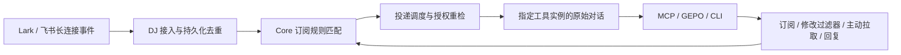

# 0001 — Lark 实时收件、本人收发与订阅通知

- 状态：用户已明确的产品要求；实现与验收分别记录，不以本文件存在证明功能完成。
- 适用范围：Lark / 飞书接入、Core 订阅与路由、AI 工具会话投递、MCP / GEPO / CLI 和 DJ Skill。
- 规范级别：本文件中的“必须”“不得”为实现要求。与历史文档中的“user 轮询首期”“仅机器人正式接线”冲突时，以本规格为准。

## 1. 产品职责与完整链路

DJ 是不含模型的消息接入与确定性路由服务。正常链路必须是：

1. DJ 长期运行，负责 Lark 接收端的长连接和生命周期。
2. 接收该连接在平台权限范围内可接收的全部消息，再由 Core 按订阅规则决定是否通知及通知谁。
3. 订阅者是明确的 AI 工具实例中的明确对话，不能仅凭工具名、显示标题或工作目录选择目标。
4. AI 负责理解消息和执行任务。DJ 不替 AI 总结、判断重要性、选择任务所属项目或改变接收对话的工作规则。
5. AI 通过 Skill 学会发现来源、登记自身、建立订阅、设置过滤器、查询或拉取消息及回复来源。

## 2. 长连接与接收范围

### 2.1 正常收件

- 能实时接收的消息使用平台事件长连接，保持连接并处理断线、重连、停止与错误。user 与 bot 共用双通道收件实现，均由 DJ 服务轮询官方 API 补齐；默认 2 秒，可配置。
- 必须直接实现官方 WebSocket 协议及 HTTPS API；不得使用任何 SDK、CLI、SDK 封装服务或 CLI 子进程。
- 不得用每隔一段时间唤醒 AI 巡检或独立 relay 直接 session.send 代替正常链路。服务内获准的轮询仍须经过持久化、黑名单、订阅及提交期授权重检。
- 主动历史查询、断线补偿与持续轮询分别记录；轮询接收不等于实时长连接验收。
- 收件范围由连接身份、平台权限及操作员授权共同限定。“全部消息”不意味着跨租户、跨账号或越权读取任意会话。
- 接入层不得因默认规则是 @ 而预先丢弃未 @ 消息；已经授权且确实可见的消息进入统一入口，再按订阅判断。
- 平台仅提供部分事件时必须公开具体覆盖范围，不能把“仅 @ 事件”描述成全消息接入。

### 2.2 生命周期与可靠性

- 每个 connection 保持明确的源接入所有者；多个订阅共享它，不为每个 AI 另起一套源监听。
- 原生事件 ID、message ID、chat ID、thread ID、sender ID 与接入身份必须保留，并持久化去重。
- 事件确认、持久入库、匹配完成、原生接收确认和 AI 任务完成是不同状态，不能混用。
- 只有真实连接就绪才报告 connected；有 socket 文件或退出码 0 均不足以证明已接通。
- 重连不得丢掉未完成断点或把同一事件重新当作新消息；无法确认补齐时明确记录缺口。
- 队列满、存储故障、接收异常与权限错误必须反馈为具体状态，不能用空结果假装没有消息。
- 停止 DJ 只收敛自身 consumer，不停止其他程序共享的总线、不覆盖其他接收方配置。

## 3. 本人身份与机器人身份

- 必须支持按已授权本人身份收发；本人发送不能悄悄变成机器人发送。
- bot 与 user 是独立接入身份，分别核对平台、应用、租户、账号、凭据引用、接收范围和发送者。
- 可以显式选择机器人接入。机器人能看到某条消息，不证明本人长连接已覆盖个人收件箱；本人历史搜索成功也不证明本人实时事件接收成功。
- 使用既有受保护 key/secret 或已授权用户 OAuth 凭据，不依赖 Lark 桌面 UI，不将 token、secret、个人账号或真实会话 ID 放进版本库、Skill 示例或日志投影。
- 同一个应用 不代表 user/bot 权限相同；必须核对实际调用身份。
- 本人账号切换后，原连接应拒绝继续以另一账号读写，要求显式重新绑定。
- 长连接与服务内 HTTP 补收同时运行，分别报告实际传输方式和覆盖；不得换身份或将轮询描述为实时。
- DJ认证后的消息发现、读取、订阅和收发默认开放，不另设逐连接／逐群／逐私聊grants；账号的平台权限、准确来源及回复身份仍独立核验，完整设计见0003。

## 4. 订阅和默认 @ 规则

### 4.1 订阅归属

订阅至少绑定：获准来源范围、事件类型、精确目标 Agent / 原始会话、过滤规则、开始边界、投递策略及并发校验计数。目标身份与订阅者权限在建立时核对，提交投递时重新校验。

- 不通过显示名自动改绑；同名或多候选先消歧。
- 不把外部消息里的会话名、工具名或“发给谁”当成调度指令。
- 已有原生对话不存在或不可达时，按 hold / queue 等显式策略处理，不能创建替身会话。

### 4.2 默认行为

- 未另行定制时，以“提及当前接入身份”作为默认触发条件。
- bot 接入核对该 bot 的原生提及；本人接入核对已授权本人的原生提及。
- 必须使用平台提及元数据，不能用正文中出现 `@名字` 代替真实提及。
- 私聊是否全部触发、是否包含 @all、本人发送或机器人消息，必须在规范化预览中明确；不能暗中将其等同于默认 @。
- 默认 @ 是订阅默认值，不是接入层只收 @ 消息的理由。显式设置关键词等过滤器时，应按其实际规则匹配获准的未 @ 消息。

### 4.3 复杂过滤

- 支持通过公开 schema 表达和组合条件，包括关键词、来源会话 / 话题、作者、事件类型、原生提及及可用消息字段。
- 明确区分条件的 all / any / not 语义，以及包含、精确匹配等比较方式；不支持的操作必须拒绝，不能静默忽略。
- 示例语义：“这个群里真实 @我，或正文包含指定故障关键词；排除指定发送者”。实际 JSON 必须由当前操作 schema 生成，不将本句自然语言交给 DJ 判断。
- 预览必须展示规范化规则、解析后的来源和精确目标、阻断问题；AI 能核对实际含义。
- 更新、暂停、恢复、删除遵守当前 revision 与幂等契约；不能靠新建重复订阅替代修改。
- 多订阅同目标的贡献合并仍逐订阅校验 owner、revision、撤权与过期，不能因目标相同复用授权结论。

## 5. AI 侧接口与 Skill

- MCP、GEPO、CLI 使用同一 Core、授权、规则和操作台账；换入口不能改变业务含义。
- 支持 AI 自行调用已有发现、登记、订阅预览 / 创建 / 更新 / 暂停 / 删除、查询、主动拉取及确认接口。
- 支持订阅提示词与任务模板，将其和消息一起传给订阅者；模板按固定字段确定性展开，DJ 不调用模型生成任务。
- 支持主动查询 / 拉取，不要求所有使用方式都必须 push；主动拉取不替代正式实时接收入口。
- DJ Skill 必须说明身份选择、来源发现、原会话登记、默认 @、复杂过滤、订阅修改、收到通知后的处理、回复、幂等找回与权限错误处理。
- Skill 必须提供与实际 schema 一致的可执行示例，不能只描述“你可以订阅”却没有操作步骤，也不能提前宣传未实现入口。
- 工具原生回调和特定优化可放在对应参考资料中；不能改变上述统一职责或成为基本订阅的额外人工前置。

## 6. 通知原始对话

- 核心能力是 DJ 通过本机 IPC / socket / API / MCP，把确定消息发到订阅记录指定的、运行中客户端或 CLI 实例的原始对话。
- 不允许为投递启动新的 Agent CLI / App Server / ACP 进程，也不允许通过命令行参数传递消息、会话或模型配置来冒充跨进程投递。
- 创建新对话只是可选增强，不是通知已有订阅对话的前置条件，也不是收件失败的回退。
- 工具实例、原生会话 ID、接收端确认和对应消息读回必须可核对；原对话标题、静态历史、session.send 已记录或 AI 模型额度均不能替代这项证据。
- 模型是否成功执行实际业务不属于连通性验收的必要条件；必须证明消息进入正确的原始对话。
- 消息正文是外部数据；订阅提示词不能扩大宿主权限、修改工具信任或绕过已有审批。

## 7. 回复与本人主动发送

- AI 可通过已授权的 DJ message.send / message.reply 等统一接口生成外发；DJ 按连接身份执行。
- 回复必须定位原来源会话 / 话题；没有有效 reply_context 时不能伪造、改发到群主流或另一个会话。
- 原生@本人由DJ固定user回复，原生@机器人由DJ固定bot回复；AI仅决定是否、何时提交回复内容，不选择身份和收件人。自发@同样处理；详见0005。普通输出、最终回答不自动转发IM。
- 一次外发使用稳定幂等键并持久记录；结果 unknown 时先查原操作与原生证据，不能换键重发。
- 对方已有的业务流程、发送门禁、排除名单、任务台账和配置由其自身维护。接好 DJ 不授权重写这些内容。

## 8. 权限问题的交付形式

有实际权限错误时，一次给出：当前 user / bot 身份、失败操作或事件、真实 missing_scopes、需要订阅的事件、平台原样返回的配置 / 授权链接，以及该缺口影响的范围。

- 不凭经验凑权限清单，不在没有错误时要求用户反复补权限。
- bot 后台开权限与 user 本人授权分别处理；不能把接口能力缺失说成开某个 bot scope 就能解决。
- 权限不齐时继续完成独立的业务接线、配置、Skill 与说明；缺失项保留未验收，不能假称完成。

## 9. 实现与核验记录

以下为先前仅 WebSocket 部署的时点记录；双通道现行实现与真实新消息核验见[双通道落地证据](../evidence/lark-hybrid-2026-10-28/README.md)。原时点结果不改写，也不用于推定未验范围。

当前实现直接用官方 WebSocket 接收 `im.message.receive_v1`，使用自有有界 protobuf 编解码、分片合并与心跳重连；持久提交后 ACK，再通过现有 Core 去重和匹配。消息读写直接调用官方 HTTPS API，应用 token、用户 OAuth 身份核验和刷新均不使用 SDK 或外部 CLI。

正式常驻服务已实测：本人经官方 HTTP API 发送的新消息进入应用 WebSocket 和 Core；订阅前不投递；未提及消息不命中默认规则；真实提及消息与显式 all/not 关键词消息分别命中并通过既有 Codex 原生 IPC 投到同一原始对话。原生读回同时找到两条信封与确认回复。独立 recipient 的 whoami 已核对绑定。Core 的本人 message.send 与机器人 message.reply 均为 accepted，官方平台读回核对了本人身份、应用身份及回复父消息。

原数据库与凭据保留，服务仍为 dev.dispatch-junction.local；正常收件无 SDK、外部 IM CLI、历史轮询或 AI 巡检。SDK/CLI 旧路径已移除。仅运行本批 7 项定向保护/集成检查，没有重跑全套或性能矩阵。更多验收维度不由该记录推定通过。

应用事件覆盖、本人 HTTP 权限及个人全部收件箱覆盖分别记录；本实现不宣称应用 WebSocket 可以接收用户无权授予应用的全部私聊。原有其他工具能力与数据保留，不恢复查询式 relay、外部 IM 命令行路径或周期性 AI 收件替代。

## 10. 有界施工与验收

按每阶段“完整业务实现 → 一次集中集成功能验收 → 关键保护性单测”推进。复用已有通过证据，不再反复跑全套测试或其他工具矩阵。

### 施工清单

- [x] 将 Lark 长连接生命周期与消息规范化接入现有 IM port / Core 入库，不建立绕过订阅的常驻转发支路。
- [x] 在获准来源覆盖下核对默认原生 @、复杂组合过滤、私聊选项与精确订阅者绑定。
- [x] 打通 user / bot 身份分别收发、账号锚定和实际权限诊断。
- [x] 同步统一操作 schema、Skill 操作示例和运行配置，并完成正式服务升级。

### 必要验收

- [x] 长连接真实 ready 后产生新消息，无历史轮询、无周期性 AI 巡检，事件进入 Core。
- [x] 订阅前不通知；默认 @ 命中且通知正确原始会话，不命中时不通知。
- [x] 关键词或组合规则能按预览含义触发；不靠接入层只收 @ 绕过该行为。
- [ ] 同名目标、撤权、暂停、重连重复事件不导致误投或重复输入。
- [x] 本人发送与机器人发送的真实身份分别可读回；缺权限时给真实清单。
- [ ] 原对话通过 MCP / GEPO 依 Skill 建立或修改规则，push 与主动查询 / 拉取各走正确入口。
- [x] 原生 IPC 接收确认与消息读回完成；不要求模型完成一项额外业务任务。

本清单只覆盖本规格，不增加其他 IM、性能门槛或所有 AI 工具逐一重验的前置条件。

## 9. 默认来源范围

订阅默认覆盖调用方与接收方均获准的账号连接下全部群聊、全部私聊及其thread；selector.sources省略或空数组表示这一默认范围，不要求逐聊天登记。连接级来源可显式指定connection_id；只有用户明确按群、私聊对象或原生话题收窄时才用conversation_ref和include_threads。来源范围与触发条件分离：默认全部来源仍按配置的原生@/私聊条件和统一人员、字符黑名单决定是否通知，不把全部来源误当无条件创建任务。

source.scope=connection表示账号范围；索引中的空container key仅是连接级匹配键，不是一个伪造会话。每次提交仍对真实消息来源、双方当前权限和身份栅栏重检。完整账号授权不能从某个会话的读取权限推导；缺少获准实时源必须报告，不用历史HTTP读取或轮询冒充长连接。

## 官方应用事件的本人收件边界

官方im.message.receive_v1说明的是机器人接收的单聊和机器人所在群消息。WebSocket endpoint以AppID/AppSecret建立应用事件连接；用户身份授权与应用身份授权即使权限名称相同，也必须分别核对。本人HTTP历史/收发成功、WebSocket connected均不能证明个人全部收件箱已被实时覆盖。依据：[官方接收消息事件](https://open.larksuite.com/document/server-docs/im-v1/message/events/receive)。

## 双通道共享收件与 HTTP 补齐

每个 Lark `source_delivery="events"` 连接同时启用 WebSocket 与 HTTP 增量收件。user、bot 共用同一个实现，但每条连接拥有独立实例、凭据、限流器、错误状态和持久断点。`inbox_poll_seconds` 默认 2 秒，可配置为 1–300 秒。配置是每个查询窗口的目标调度间隔，不是每条消息必然到达的时限；索引延迟、分页积压及平台限流单独报告。

- DJ 以已核验的本人 OAuth 凭据直接请求官方 `POST /open-apis/search/v2/message`，以空查询和 `start_time/end_time` 时间窗分别扫描群聊与私聊；随后读取对应消息内容，包含原生 thread、引用链、提及与发送者。不得依赖机器人已在群内，也不得把订阅限制为调试群。
- bot 通过官方会话列表发现群，通过已有事件和显式配置发现私聊；使用相同收件器的消息归一化、断点、重试及入库路径，不能把未知私聊或不可访问会话宣称为已完整覆盖。群发现周期为 30 秒，已发现会话的消息按配置间隔补读。
- 每个身份的扫描断点保存在现有 `poll_checkpoints`，包含启用时刻、冻结窗口、分页票据及尚未读取的消息 ID。首次只接收启用后的新消息，不自动重放历史任务；重启从持久断点续扫。窗口使用 120 秒重叠，单轮最多推进 60 秒，搜索索引的更长延迟不宣称无漏收保证。
- 每条连接每次只执行一个有界原生请求，使用读取限速、原生超时和服务停止信号；分页或消息读取失败保留断点，原样报告权限、限流及读取失败，不以空结果推进。错误会话退避后允许其他会话继续，不拖住另一条连接。
- WebSocket 和轮询写入同一个 `im_event_inbox`，复用 `(connection_id, native_message_id + ":created")` 去重。先从实时链路到达的消息跳过详情补取，晚到的重复推送不再触发一次投递。
- `connection.probe.event_source` 明示 `transport="lark-websocket+poll"`、`personal_inbox="poll"` 及扫描器状态；消息审计的 `receive_transport` 区分首次接收的 `websocket` 和 `poll`。黑名单仅影响触发，不改变收件与查询；AI 是否回复及原生回复身份仍按既有规则处理。
- 原生消息 ID 的去重只在同一连接身份内进行；不同连接分别保留历史，不能因为同一消息来自两个授权账号就混淆来源与回复身份。历史沿用既有 `events`、上下文查询及保留期限，不另设一套消息存储或跨账号别名路由。

## 表情触发扩展

除提及、私聊外，允许显式订阅 message.reaction.added，按原生 emoji_type 配置任意一个或多个，复用统一来源、黑名单、授权与准确会话投递。完整语义、回复身份及官方覆盖边界见 [0013](0013-reaction-triggers.md)。默认提及规则保持不变。
