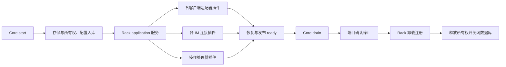

# 0014 — 服务模块装配

## 目标与基线

基线 c05e8b0：Core 集中选择适配器，连接管理器保存平台工厂和连接实例，
Core 停止时手动关闭连接与适配器。消息事务、所有权、状态机和收件断点已有
独立职责。工作区在本次施工前干净。

目标：使用独立 Rack 包组装服务，统一模块依赖、实例和资源生命周期；保持
现有消息行为及用户数据。Rack 不依赖本应用，也不保存应用业务数据。

```text
packages/rack/src/{util,errors,effects,tracking,kernel,logger,index,loader}.eli  新增独立运行时
src/service/composition.eli                             新增端口生命周期装配
src/service/core.eli                                    修改装配和安全退出
src/connections/manager.eli                             修改每连接实例装配
src/library.eli                                        导出包入口
tools/build-inputs.eli                                 绑定包源码和配置
```



## 精确接线

- `createComposition()` 只创建内存上下文；构造 Core 不开始外部工作。
- `mountPort(rack,name,map,key,factory)` 声明 application 依赖，提供端口服务，
  注册清理。平台、账号和业务地址仍由扁平连接注册表管理。
- `managePort(port)` 合并并发关闭，只有原端口不再报告 draining 才确认停止。
- `createConnectionManager(connections,host,injected,composition?)` 复用同一
  装配上下文；独立调用时拥有自己的上下文。`assemble()` 等待插件激活。
- `createCore` 完成存储与所有权准备后提供 application，装配适配器、连接及
  操作处理器。初始化、恢复、发布 ready 的业务顺序保持不变。
- Core 必须先完成既有 drain，确认无原生在途工作并停止端口，再卸载插件、
  释放租约、关闭数据库。draining 不可被框架完成状态覆盖。
- 事务提交、防重、收件断点、订阅过滤、回复身份和消息状态不转成任意插件
  广播。框架加载不自动启动另一个 Agent，不自动外发消息。
- 包源码、文档、元数据不记录参考来源；不增加同功能旧路径或兼容开关。

## 施工与验收

- [x] C01 独立包、核心生命周期、服务、事件及配置树的业务实现。
- [x] C02 端口和 Core 装配、操作处理器接线，构建输入绑定。
- [x] A01 独立包完整集成功能与资源退出验收。
- [x] A02 真实 SQLite Core 的收件、投递、防重和退出回归。
- [x] A03 构建及打包验证，包独立性与来源隔离检查。
- [x] A04 关键保护性单元测试，签名提交并推送。

功能验收覆盖独立包的依赖到达/丢失/恢复、作用域与调用者资源归属、异步获取与
重复释放、初始化回滚、事件分发、配置树、真实 HTTP/SQLite/定时器关闭，以及
Core 的消息入库防重、定向投递、幂等回复和重复停机。保护性单测覆盖父子隔离、
构造服务、嵌套清理、配置拒绝、可用性变化与可调用服务。已有混合收件、过滤、
提及回复及全来源订阅回归按影响复验；不重跑性能或各工具真实账号矩阵。

独立包单独编译、运行包打包均通过。现有安装服务与真实消息/订阅数据未替换；
代码交付和服务安装分开报告。当前源码验收不等于对所有外部扩展或引擎私有缓存
机制的等价性证明。

本次定向验收与保护性回归共 24 项通过（含既有消息链路），构建与包独立性已确认；未运行性能或逐工具全矩阵。


## 核心行为完整对齐与实际服务升级

沿用已选定的核心快照，逐项补齐公开运行行为；不以既有小集合验证替代对齐。
本次不引入模型执行、业务任务决策或额外外部生态插件。

- [x] C03 上下文原型、保留属性、符号作用域、追踪接收者及关联成员。
- [x] C04 同步/异步资源、迭代器、单次释放与结构所有者等待、失败回收。
- [x] C05 插件状态数值、依赖快照、配置先后顺序、局部更新钩子和完整通知。
- [x] C06 内置事件、反射、注册表、日志服务及公共辅助接口。
- [x] C07 DJ 状态暴露实际装配信息，保留现有收件与停机语义。
- [x] A05 针对行为清单集中验收和必要消息链路回归，补关键保护性单测。
- [x] A06 构建打包、原配置/规则/订阅保存，更新本机常驻服务并从实际接口核实。
- [x] A07 来源隔离与签名推送，记录真实部署证据。

新行为先一次写完，再集中验收。旧 24 项记录保留，不作为尚未覆盖行为的通过证明。

`service.status` 向操作员返回 `module_runtime="rack"` 与 `modules` 摘要（名称、状态、依赖、资源数及有界错误），不公开配置、账号或消息正文。升级核对实际运行 build_id 和全部模块状态，不以包已生成代替服务已更新。


### 本轮交付证据

核心最终集成与保护性回归 27 项通过；结合未受末轮细节影响的消息过滤、
提及回复、全来源订阅及混合收件 9 项，本轮定向覆盖共 36 项。独立包单独
编译及 26 项包内验收通过，完整构建和运行包生成通过。未扩展性能或逐工具
账号验收矩阵。

当前 macOS 常驻服务已经更新到 Rack 装配；通过真实操作员 `service.status`
核验 `state=ready`、`module_runtime=rack`、22 个模块全部 `active`。配置原字节、
订阅及持久规则各表摘要一致；已有未确认投递保持原状态。两个连接状态与升级
前一致，原有单连接 `not_observed` 诊断不作为本轮新增故障或通过证明。
持续收件对照监控已恢复；构建/切换期间的诊断监控交接间隔单独保留，不宣称
该诊断循环全程无间断。原始失败和修复记录、安装前数据库副本、构建 manifest
原字节及实际进程核验记录保存在私有运行状态目录，均不进入仓库。
