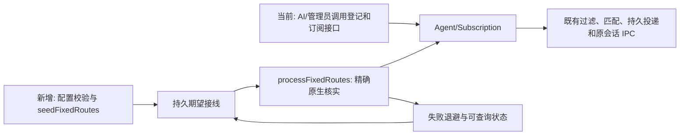

# 0021 — 配置声明固定 IM → Agent 接线

## 目标与基线

基线为 master 的 a59fc4f，工作树干净。现有多账号连接管理、Agent 登记、订阅预览/提交、过滤、投递和回复路由已存在；缺少服务配置自动装配这些对象的入口。本批只增加固定接线，不创建 AI 对话或进程，不增加第二套消息转发器，不替 AI 决定是否回复。

`fixed_routes` 是服务配置中的可选数组，最多 128 项，默认空。每项：

| 字段 | 类型及语义 |
| --- | --- |
| id | 唯一、稳定的非空字符串；不按显示名称查重 |
| owner_principal_id | 已配置且未停用的 operator；沿用其实际权限 |
| recipient_principal_id | 已配置且未停用的 agent；目标必须符合其 target_constraint |
| target | `{instance_id,native_session_id}`；工具、命名空间从已配置 endpoint 精确确定 |
| sources | 1–100 个 `{connection_id,native_chat_id?,native_thread_id?,include_threads?}`；省略 chat 为整条账号连接，指定 chat 时 include_threads 默认 true；精确 thread 默认 false 且不允许 true |
| enabled | boolean，默认 true |
| event_kinds | 可选，复用订阅事件种类，省略使用现行默认消息与表情事件 |
| predicate | 复用订阅的 all/any/not 和字段条件；省略时使用现行默认 @、私聊、引用、话题及表情回应条件 |
| context_policy / delivery_policy / instruction_policy | 复用现行订阅定义、默认值和字节/深度预算；始终为 push，从首次接通后的新事件开始 |

不同接线可以使用同一或不同 IM 账号，也可以共用同一个准确目标；同一 recipient 只能绑定同一个目标。示例见 config/fixed-routes.example.json。所有账号仍走同一连接管理器、黑名单及订阅匹配，不按机器人名字分支。

## 生命周期、管理权与恢复

1. 配置结构、引用、重复 ID、目标约束、条件及提示词在触及存储前整体校验。配置不生成凭据、不放宽 grants。
2. 启动在 intake 开放前持久登记期望接线；运行中可通过既有 SIGHUP/Core.reloadConfig 原子替换 fixed_routes，不能顺便改端点/连接/数据库。无变化不重复更新订阅，不改变生效水位。
3. 接线只使用准确 instance/session 原生接口核实。首次目标不在线时显示 pending/retrying，不阻塞其他接线，不创建同名替代会话。每个后台 turn 最多处理两项，5–300 秒退避；已接通后的目标离线继续由原有投递队列等待恢复。首次尚未接通以前的历史消息不隐式补投。
4. 固定接线维护表记录 desired_hash、generation、agent_id、subscription_id、applied_hash、状态、次数、下一次重试和稳定错误码。generation 只用于防止配置更新期间旧异步任务写回，不是产品多版本。接线登记/更新与维护表的引用在同一事务提交，崩溃后不会重复建活动订阅。
5. 复用现有 Agent 时必须同时匹配 recipient、owner 和准确目标；冲突显示 blocked，不抢占或重绑其他 Agent。同一 recipient 要切换目标时须明确使用新的 recipient，不能牵动其原有其他订阅。仍被启用接线引用的 Agent 禁止通过公开 rebind/unregister 改写；须先停用或移除全部相关固定接线，避免改变配置指定的准确目的地。
6. 配置变化先暂停该接线旧订阅，再核验并应用新条件；失败不会继续使用旧规则。enabled=false 或删除只暂停该配置拥有的订阅，不停 IM 连接、不注销共享 Agent、不改 AI 自建订阅。已提交/unknown 投递按原规范保留，不重发。
7. 配置拥有的订阅返回 configuration_id，需通过配置修改；公开 update/pause/resume/delete 拒绝改写仍由配置管理的对象。普通 AI 自建订阅不受影响，显式历史 replay 仍走原授权和过滤。
8. service.status.fixed_routes 按 operator 全部、recipient 自己、其他主体不可见投影接线状态与准确目标；区分 pending/active/disabled/retrying/blocked、last_error、agent_id 和 subscription_id。状态 active 代表接线已建立，不代表 AI 已完成任务或 IM 已回复。

## 当前与目标结构

```text
src/service/config.eli       当前配置校验；新增 fixed_routes 结构及交叉引用校验
src/service/core.eli         当前 prepare/seed/recover/ready/reload；新增期望接线同步
src/service/runtime.eli      当前有界后台岗位；新增固定接线恢复岗位
src/service/projections.eli  当前 service.status；新增安全投影
src/service/fixed-routes.eli 新建：seedFixedRoutes/processFixedRoutes/projectFixedRoutes
src/storage/schema.eli      新增 fixed_routes 持久维护表
src/subscriptions/service.eli 复用 domain handler；新增配置所有权保护及投影
src/registry/agents.eli      保护固定接线目标，禁止公开改绑或注销
src/application/results.eli  接线状态和 configuration_id schema
config/fixed-routes.example.json 新建脱敏示例片段
skills/dj/references/fixed-routes.md 新建安装、配置、诊断说明
```



## 精确施工手册

| 编号 | 基线位置/符号 | 变更与依赖 |
| --- | --- | --- |
| F1 | config.eli L258 serviceConfigSchema、L315 validateStructure、L571 prepareConfig | 从 specSchema 复用条件/策略 schema，新增严格来源和目标结构；同一 recipient 多目标、无效来源/身份整体拒绝；默认 [] |
| F2 | schema.eli migrate，新增 fixed-routes.eli | fixed_routes(id,state,next_attempt_at,payload)；seedFixedRoutes(context, desired) 同步暂停变更/移除的配置订阅，保留无关业务数据；以真实 generation 防旧任务提交 |
| F3 | registry/agents.eli registerAgent、catalog/service.eli resolveSession、subscriptions/service.eli previewSubscription/commitSubscription | 固定接线使用相同领域方法，提供私有事务 accept 包装，把领域写入与固定引用一起提交；不创建伪造操作台账，不对外发消息；首次注册仍要求原生核实 |
| F4 | core.eli startCore/configurationShape/reloadConfig，runtime.eli tick L670 | seed 在 intake 之前执行；fixed_routes 支持原子策略重载，后台岗位最多两项，状态稳定后每 30 秒核对本地绑定，不轮询模型 |
| F5 | projections.eli serviceStatus、results.eli status、subscriptions/service.eli projectSubscription | 状态可见性、configuration_id 管理权保护，Skill 与配置示例同步 |
| F6 | 新建 integration/fixed-routes.test.eli、unit/fixed-routes.test.eli；cases/编译入口 | 业务全部写完后才写集成；通过后补关键单元保护，不跑全套性能/逐工具矩阵 |

## 双清单

施工：
- [x] F0 设计、引用边界、运行条件、施工/验收和 Goal 文案完整。
- [x] F1 配置结构与静态校验。
- [x] F2 持久期望状态与原子停用/替换。
- [x] F3 复用领域方法登记、订阅、错误恢复及管理权。
- [x] F4 启动、热重载和后台调度。
- [x] F5 状态、配置示例、Skill 和安装说明。
- [x] F6 集成验收及关键保护性测试。

验收：
- [x] A1 两个同平台机器人连接分别投递到两个准确 AI 对话，互不串线；一个来源多目标及多来源同目标成立。
- [x] A2 无 AI 调用即可接通；相同配置重启/重载不重复创建、不重置 start_seq；AI 自建订阅保持原样。
- [x] A3 条件/提示词/来源更新、停用、删除只影响配置拥有对象；公开管理不能覆盖固定规则；历史及 unknown 不重投。
- [x] A4 首次目标离线可恢复；目标冲突、权限不足和非法来源明确失败；正在异步核实时重载不会产生旧规则活动订阅。
- [x] A5 配置校验、状态安全投影、既有订阅/收件定向回归通过；Skill/示例可读。
- [x] A6 签名提交、推送，完成归属明确的临时产物清理。

## 验收方法及环境

已具备锁定 Bun 1.4.4、Eliscript 工具链和 SQLite Core 夹具。使用独立测试数据目录及本地 Agent/IM 协议端口，不发送真实 IM，不占用原助手会话；模拟端口只代替外部平台，配置→Core→真实 SQLite→订阅→投递链路使用实际实现。每例最多三条接线和少量消息，时间/空间按配置数与消息数线性增长；预计整组 <10 秒、峰值 <512 MiB，单例硬截止 15 秒、整组 90 秒，构建 120 秒。使用现有受控执行器和逐例计时。运行编译后的 fixed-routes 集成与相关 config/订阅回归，最后运行新增纯单元保护。若实测越界先诊断，不放大负载。详细原始输出只在任务缓存，用完回收；结果写回本清单。

## 接续 Goal 文案（文案，不创建运行 Goal）

在 DJ master 基线 a59fc4f 上完成规格 0021：支持配置多个 IM 账号到准确既有 AI 对话的固定接线。读取 AGENTS.md 与本规格，依 F1–F5 一次完成全部业务、恢复和文档；再按 A1–A5 编写并集中执行集成功能验收，修复实际缺陷；最后补 F6 的关键保护性单测。保持其他订阅、真实消息、已提交及 unknown 记录；不新建 Agent 进程、不发真实 IM、不修改本机账号接线、不改 AI 业务规则。不扩大成全性能或逐工具验收。全部必要检查通过后完成 A6 的签名提交推送及本任务产物清理。新会话按双清单继续，未实际通过的项目不得勾选。

## 本批验收结果

- 锁定 Bun 1.4.4，全量源码构建通过；构建硬截止 120 秒，最后构建约 1.79 秒、进程树峰值约 392 MiB。
- 5 项固定接线集成全部通过，精确 thread 默认值及隔离边界已定向复验：两个账号/两个既有原生端口、多对多、准确目的地、来源和话题收窄、提示词、幂等重启/重载、停用/移除、管理权隔离、首次离线恢复、权限恢复、异步配置竞态；外部 IM 和 Agent 端口为隔离夹具，Core、领域方法、SQLite、订阅与投递是真实实现，不冒充真实账号端到端验收。
- 4 项既有全来源/明确来源/组合条件/人员订阅集成通过。额外选取的 2 项旧 Agent 用例因其夹具仍配置已禁止的 managed_profiles，在 prepare_config 阶段失败；未将其算作通过，未扩改旧夹具。普通 Agent rebind/unregister 行为由本批真实 Core 集成直接验证，配置拥有的目标则拒绝改写。
- 3 项保护性单测通过：配置结构和静态引用、条件及提示词预算，期望状态摘要稳定性，退避上限。初次新增单测因测试配置缺 brand/watches 失败，修正后通过；原始业务结构未为夹具放宽。
- Skill 的 MDP/MDS 校验通过；目录包 72 项文件摘要、配置片段和 Skill 引用全部核对通过，包内 CLI 帮助可用。打包不包含私有账号或生成的测试数据。
- 本机常驻服务和已安装 Skill 已更新，service.status 读回 ready 和新 build_id；未改任何本机账号接线，fixed_routes 为空，原订阅及持久对话规则逐项未变，原 unknown 投递保留且未补投，两条 Lark 连接读回 online。本批不发送真实 IM，不扩做全套测试或性能矩阵。
- 重现：按开发指南构建后，用锁定 Bun 执行 bun test --timeout 15000 dist-tests/tests/integration/fixed-routes.test.mjs dist-tests/tests/integration/composable-subscriptions.test.mjs dist-tests/tests/integration/subscription-scope.test.mjs；保护性用例入口为 dist-tests/tests/unit/fixed-routes.test.mjs。整组通过受控 runtime 执行器设置 90 秒硬截止，并启用 DJ_TEST_TIMING_FILE 逐例记录。
