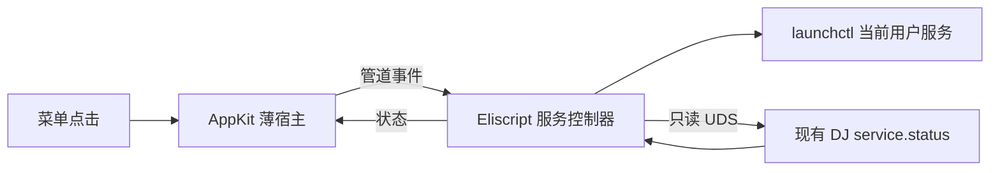

# 0022 — macOS 菜单栏服务控制器

## 目标、现状与边界

基线 master 2c4765d，工作树干净。已有用户级 launchd 服务 dev.dispatch-junction.local，以及通过私有 UDS 鉴权的 service.status；缺少可视控制入口。本批交付并安装 DJ Control.app，在菜单栏显示状态、启动/停止服务；退出控制器不停止服务，不新增第二个核心，不修改 IM、订阅或 AI 规则。

## 设计

- 可选与跨平台：核心的构建、安装、运行入口和现有 launchd plist 保持不变。默认打包不编译或包含 AppKit 宿主；显式 package --with-controller 才构建可选 UI。控制器可完全不安装，安装/退出只改变其自身文件与登录项。公共 model.eli 只处理规范状态，不依赖 launchctl/AppKit。当前 macOS 实现隔离在 platform/darwin 和 host/darwin；未来 Windows 可接原生 SCM/托盘，Linux 可接用户 systemd/StatusNotifier，原生宿主语言可按平台选择 Swift、Objective-C、C++、C# 等，不强行统一，也不创建未实现的空目录或假支持。

- AppKit 薄宿主只创建状态项、非模态控制面板和原生事件循环，经匿名 stdin/stdout 管道连接 Eliscript 控制器；没有服务业务逻辑。菜单栏使用原生20pt矢量DJ模板图标和方形NSStatusItem，由系统着色；App仍由 docs/pages/assets/dj-mark.svg 生成彩色ICNS。App 通过官方 Launch Services 注册，可从 Dock 的 App 启动器、Finder 或 Spotlight 打开。菜单显示运行中、启动中、停止中、已停止、异常和未安装，含安全的错误说明。弹出面板使用applicationDefined行为，由图标、收起按钮或Esc明确关闭，不自动失焦关闭。显示进程不等于 service.status 已确认 ready。
- Eliscript createServiceController({uid,launch_agent}, ports) 负责 refresh/action；端口为 run、inspectPlist、probe、now。固定目标为当前用户 gui 域的 dev.dispatch-junction.local，不接受任意服务名或 shell 文本。默认 root 为用户目录下 .dj；配置及凭据不进入 App 或仓库。
- 每 3 秒及打开菜单时刷新，最多一个探测在途，不重叠堆积。launchctl 每次最多 10 秒、输出最多 65536 字符；UDS 状态最多 1 秒。没有完整状态证据时显示异常，不把超时解释为停止。
- 启动：校验用户拥有且不可被组/其他用户改写的 plist，Label 精确一致；enable，然后已加载则 kickstart，否则 bootstrap。停止：disable 再 bootout，防 KeepAlive 或下次登录自动启动。OS 正常终止和服务恢复边界继续生效，不读取/改写业务数据库，不对 unknown 补投。连续点击合并，动作期间禁用按钮，最多等待 30 秒状态收敛。
- 原生宿主持有文件锁，重复打开不产生第二个后台控制器；子控制器退出显示异常并允许关闭后重开。关闭宿主终止所属子进程；不终止 DJ 或 Agent。菜单栏 App 不显示 Dock 图标。
- 安装到系统 Applications/DJ Control.app，单独的用户 LaunchAgent dev.dispatch-junction.controller 在登录时显示菜单，KeepAlive=false。使用当前已安装 Bun，不下载/启动额外 Agent；安装器明确绑定目录包和运行时，更新时只替换控制器自身文件。不得覆盖不同归属的同名 App。

## 当前与目标结构及差异

```text
现有：tools/build.eli → tools/process-helper.eli → process-info.c
      tools/package.eli → 目录包 → launchd → DJ Core → UDS service.status
新增：src/controller/model.eli 与 platform/darwin/{service,main,install}.eli → service.status / launchctl
      src/host/darwin/status-bar.m → AppKit，管道连接 main
      tools/controller.eli → 构建原生宿主
      src/controller/platform/darwin/install.eli → 安装独立 .app 与登录项
修改：编译入口、打包及输入清单纳入新入口和原生二进制；Skill 和服务指南说明。
```



| 施工项 | 文件/基线符号 | 精确变化 |
| --- | --- | --- |
| C1 | src/controller/platform/darwin/service.eli 与 model.eli（新建） | 固定 launchd 目标、parseLaunchStatus/projectStatus、createServiceController；可注入系统端口；错误不泄露 stdout/凭据 |
| C2 | src/controller/platform/darwin/main.eli（新建） | runCommand 有界子进程、真实 plist 校验、callService；3 秒刷新、行协议与退出回收 |
| C3 | src/host/darwin/status-bar.m（新建） | NSStatusItem、NSPopover、子进程管道、单实例锁和退出；只接受结构化状态 |
| C4 | tools/controller.eli、src/controller/install.eli 及 platform/darwin/install.eli（新建）；interfaces/cli.eli runCli；package.eli buildPackage / build-inputs.eli requiredBuildInputs | 构建宿主纳入摘要；复制 libexec/dj-status-bar、独立后端和 Logo 图标；安装 .app、Info.plist 和自身登录项；Eliscript entry 两个配置新增 |
| C5 | docs/guides/macos-service.md、README、Skill、TODO、AGENTS | 行为、安装和停止语义，唯一规格导航 |
| C6 | tests/integration/controller.test.eli、tests/unit/controller.test.eli（新建） | 业务完成后集中验收，再补状态映射/并发保护；编译及 case 清单接线 |

## 双清单

施工：
- [x] C1 服务控制业务与错误路径。
- [x] C2 管道后端、刷新与资源回收。
- [x] C3 原生菜单栏宿主。
- [x] C4 构建、打包和安装。
- [x] C5 使用说明与 Skill。
- [x] C6 集成及关键保护性测试。

验收：
- [x] A1 真正菜单栏可见且单实例，状态与已安装 DJ 相符；关闭控制器不关闭 DJ。
- [x] A2 隔离 launchd 服务通过同一后端启动、停止、再次启动，停止后不被 KeepAlive 拉起；不操作真实消息。
- [x] A3 认证失败、缺 plist、启动失败/超时、连续点击均安全呈现，不虚报 ready 或重复启动。
- [x] A4 关键状态映射和动作序列保护通过；目录包及安装资产摘要有效。
- [x] A5 本机安装并设置控制器登录项，现有服务配置、订阅及 unknown 保持；签名提交推送和自有缓存清理。

## 集中验收与恢复

业务代码全部完成后编写集成。使用独立私有目录和当前用户唯一测试 launchd label，以受约束测试端口映射固定逻辑目标到自有 dummy job；外部 DJ 状态使用本地 UDS 测试响应，不碰 IM。真实服务仅只读 ready 检查；原生菜单通过本机界面核验。每例规模常数，整组预计 <30秒、峰值 <512MiB；构建 120 秒、测试 90 秒硬截止，逐例计时并回收 dummy job。最后补状态映射、乱序及点击合并保护；不跑业务全套或性能矩阵。缓存位于本任务独立 caches 目录，结束回收；正式结果记本规格。

接续 Goal 文案（不启动 Goal）：在基线 2c4765d 上完成本规格 C1–C6，严格先完整业务、再集成功能、最后关键单测。完成 A1–A5 并安装菜单栏控制器，不改现有消息或规则，不创建 Agent 进程，不重跑全套。恢复先读 AGENTS 和本规格，沿双清单续接；未验证不勾选，最终签名推送并清理本任务产物。

## 本轮结果

- 业务完成后，2 项定向集成通过：真实隔离 launchd 的启动→ready→停止→保持停止→再次启动（381.57ms）及失败状态（0.29ms）；8 条断言。随后3项保护性单测通过（状态、5路合并刷新/点击、30秒收敛期限），14条断言。未运行全量功能或性能验收。
- 默认目录包79项资产，无原生宿主；可选包82项资产，增加原生宿主、自足后端和由现有SVG转换的图标，资产逐项摘要核对。初版独立后端误带共享chunk依赖，已改为单文件构建；AppKit委托生命周期已固定；当前安装后端可独立报告真实ready、stdin关闭后正常退出。
- 本机核心PID、原服务配置、原服务plist与current目录目标安装前后完全一致；退出控制器不停止DJ。系统 Applications 安装独立App与控制器登录项，已从Finder打开，重复打开只保留一个宿主/后端。既有7个Skill入口同步更新，未改核心发行目录或AI配置。
- 真实系统菜单栏通过 com.apple.MenuBarAgent 发现“DJ 服务控制器 / 服务：运行中”。此前NSMenu的OPEN/CLOSE日志只证明AXPress路径，不等于物理鼠标验证；用户再次报告不收起后撤回“物理点击已通过”的推断。当前读取NSPopover的真实isShown投影与完整面板内容，不以回调数或窗口代理几何替代最终显隐。
- 打开或重新打开App只确保状态项可见，不模拟点击图标自动弹菜单，避免图标布局尚未完成或被收纳时错误展开到屏幕左侧。状态项使用稳定autosaveName；位置由macOS及用户菜单栏安排管理，不强制改动其他工具的布局。
- 更新安装时先正常关闭同一bundle ID且同一安装路径的控制器（包括手动打开的实例），有界等待操作系统确认PID退出，再替换资产；不依据缓存的App对象状态误报仍在运行。
- App注册使用Apple官方 [LSRegisterURL](https://developer.apple.com/documentation/coreservices/1446350-lsregisterurl)；只更新此App的登记，不操作启动器数据库。运行时作为菜单栏App，不占用Dock中的运行图标；启动器入口与常驻菜单是两个独立界面。

## 原生交互与验收边界

方形imageOnly状态项使用20pt模板图标。它仅在left/rightMouseDown切换applicationDefined NSPopover，直接依据isShown执行show/close；无NSMenu模态跟踪、无transient自动关闭、无mouseUp重开路径，也不加时间防抖。收起按钮与Esc执行幂等关闭。显隐从实际popover对象投影到状态图标的“已展开/已收起”，只有一个状态来源。

| 验证项 | 结果 |
| --- | --- |
| 系统图标AX动作展开/收起，读取完整面板与最终状态 | 通过；跨状态刷新仍保持收起 |
| 面板“收起”按钮120ms鼠标按下/松开 | 通过，最终状态收起 |
| 原生Esc键 | 通过，最终状态收起 |
| 同一状态图标的物理pointer点击 | 工具返回cannotClickOffscreenElement，尚未验证；不能用AXPress结果替代 |

未发现普通键鼠输入整体失效的证据，不把本次问题归为用户电脑故障。物理图标点击仍须在可定位该图标的工具或真人输入下核实；当前测试与未测边界分别保留。

启动／停止超时或命令失败后，控制器保留该次操作的目标。后续普通刷新确认目标
已真正达到时清除旧错误：启动必须读到 ready，停止必须确认登录项已卸载且接口不再
可达。服务仍在运行不能掩盖一次失败的停止；清除错误不启动或重启核心服务。
