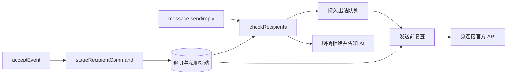

# 0023 — IM 收件人禁收与出站黑白名单

基线 `640825a`，工作树原先干净。需求是收件人可以拒绝 DJ 发来的 AI 消息，DJ 记录选择并在所有后续发送前拦截；不是订阅触发黑名单，不隐藏历史，也不替 AI 决定业务。

## 行为与身份

- 每条通过 DJ 创建的文本消息默认附：**不再接收 AI 消息，请回复 TD 或退订。** 编辑文本也保留提示，不重复附加；正文加提示一起接受长度校验，不截断原文。
- 人类在私聊发送完整 `TD`（大小写不敏感、允许两端空白）或 `退订`，或在群里原生回复 DJ 发出的一条消息并输入该命令，持久禁收。`恢复接收` 只能由同一个原生用户主动解除自身退订。正文包含这些词不算命令；机器人、本人回声、表情、截断正文不算。
- 群聊按实际回复者禁收（已提出选项，当前按不影响其他成员的保守范围实现）。群里的普通广播仍可见，DJ 无法单独隐藏群消息；明确回复或原生 @ 退订者的出站内容拦截。不能把一个成员的意愿扩成整个群禁发。
- 使用原生 connection_id、recipient_id、chat_id 精确匹配。同一Lark品牌/应用的open_id、同一Slack工作区的user_id、Telegram原生user_id分别使用可证相同的ID命名空间，共享该人的最新明确选择；无法确定命名空间时保持连接边界。不能通过同一原生身份的user/bot连接绕过。不同应用或平台不按姓名猜同一人。退订不限制对方继续来信；退订命令本身及后续消息仍按原订阅条件正常触发AI；禁收只限制出站，不限制入站或事件匹配。任何新增表情（含自动Typing/Get）也属于出站，必须拦截；已有受托工作中表情继续清理。
- 不对退订者自动发确认消息，避免确认本身变成禁收后的发送。管理员可读回设置。只在收件人明确恢复接收后才恢复；管理员白名单不能覆盖退订。
- 消息已交到平台或 native I/O 已在途，无法保证撤回；拦截保证覆盖受理前和转入 submitting 前的检查，不谎称能撤销已发内容。

## 数据与接口

统一模块 `src/messaging/recipients.eli`：`recipientCommand(event)` 纯解析；`stageRecipientCommand(context,event)` 同入库事务登记并防重复/旧时间覆盖；`recipientContent(content)` 附提示；`recipientTargets(context,address,replyTo,content)` 读取持久私聊对端、原消息作者及原生提及；`recipientScope/recipientDenied` 只在已知相同命名空间内复用选择；`ownRecipientMessage` 核对群内回复的原消息来源；`checkRecipients(...) -> Result` 执行优先级；`policyOperation(...)` 管理黑白名单。

表：`recipient_policies(connection_id,revision,payload)`；`recipient_optouts(connection_id,recipient_id,state,payload)` 保存原事件、源时间和更新时间，唯一键为连接+用户；`recipient_peers(connection_id,native_chat_id,recipient_id)` 保存私聊的精确对端，历史正文过期后仍能拦截。SQLite 当前 schema 内幂等建表，不引入接口多版本。

`message.recipient_policy.get {connection_id,after?}` 仅 connection.manage 管理员，返回该连接策略、从该连接收到的最多100条选择与has_more/next_after；跨相关连接的选择按来源连接查询，实际拦截统一生效。`message.recipient_policy.set {connection_id,expected_revision,policy}` 使用既有幂等受理及类型化recipient_policy结果投影；新策略revision=0，后续乐观校验。policy为：

```json
{"default_action":"allow","allow":{"recipient_ids":[],"chat_ids":[]},"deny":{"recipient_ids":[],"chat_ids":[]}}
```

每列表最多256，拒绝优先；default_action=deny时只有命中白名单允许。白名单只抵消默认拒绝，不能抵消显式拒绝或收件人退订。AI 无权自行设置管理规则。所有 AI 共享收件人选择，而非只拦某条订阅。

`recipient_opted_out` / `recipient_blocked` 为明确非重试错误，说明未发送并提醒不要更换账号、工具、渠道绕过。排队项检查失败标为failed/definite_not_sent/retryable=false，outbound.get暴露blocked_reason；不会每tick重复尝试。unknown只核实，不按退订改写成未发送。

## 精确施工与流程

当前：ingestion.acceptEvent→events/routing_work；message.send/reply→acceptOutbound→outboundReady→dispatchIm(send)；message.edit/reaction及lark.api.call另有原生写入口。

目标：



| 文件/基线锚点 | 改动 |
| --- | --- |
| src/storage/{schema,repository}.eli schemaStatements/migrate/defineTable | 新表、持久行映射 |
| src/messaging/recipients.eli 新建 | 唯一过滤与退订机制 |
| src/ingestion/service.eli acceptEvent | events落库后更新收件人选择，不改变routing_work正常路由或订阅匹配 |
| src/messaging/service.eli acceptOutbound/outboundReady/dispatchOutbound/projectOutbound/handleOperation | 附提示、受理及派发复查、明确终态、管理接口 |
| src/delivery/working.eli trackWorking/queueAcknowledgement/processMark | 自动Typing/Get及异步创建前复查，禁收时仅清理已有受托表情 |
| src/messaging/actions.eli handleOperation | 编辑与新增表情复查，撤回和清理表情仍允许 |
| src/lark/service.eli requestSpec | 原生IM消息写入必须经受控message接口，不能绕开过滤；其他官方API保留 |
| src/application/{operations,results,help,execute}.eli、src/service/projections.eli、src/core/errors.eli | 所有CLI/MCP/GEPO共用描述、类型、错误、幂等结果投影和说明 |
| skills/dj/SKILL.md、references/recipients.md、docs/index.md、AGENTS.md、TODO.md | 使用说明与边界 |
| tests/integration/recipients.test.eli、tests/unit/recipients.test.eli、eliscript.tests.json、tests/cases.json | 业务完成后集中验收，再补关键保护 |

施工：
- [x] C1 统一持久策略、退订识别、正文提示。
- [x] C2 所有原生出站路径与管理接口接通。
- [x] C3 Skill/文档同步。

验收（隔离SQLite/注入原生端口，不向真实IM发送测试）：
- [x] A1 私聊TD持久阻断、新消息/重启后生效，恢复与重复/旧事件正确；包括TD在内的输入仍按原规则触发AI。
- [x] A2 群内精确回复者禁收、无关成员不受影响；正文关键词、机器人及回声不误触发。
- [x] A3 黑白名单优先级、管理员校验、不可覆盖退订；CLI/MCP描述与结果schema通过。
- [x] A4 受理后退订仍阻断队列、无native请求、明确failed原因；未知发送不重放；raw API写入不可旁路、编辑保留提示。
- [x] A5 提示仅一次、含提示长度校验与关键保护性单测。

预计每组定向用例<30秒、<512MiB，构建120秒、集成90秒硬截止，不重复全套或性能测试。恢复入口即本规格：完成C1-C3→A1-A4集成通过→A5保护性测试→签名提交推送；不启动新Goal，不修改真实用户规则或消息作为夹具。

## 本轮验收结果

3项新增集成在真实隔离SQLite、Core、入库/路由/出站及注入IM端口组合上通过；覆盖退订前已入队拒发、重启、恢复/迟到事件、群内原生回复和非目标消息、同应用user/bot跨连接禁收、默认拒绝/白名单/显式拒绝及管理员边界。最终连同既有message-actions、两项Lark包/API集成与2项新保护单测共8项、178条断言通过（486ms）。官方HTTPS协议由本机模拟响应，未冒充真实IM外发。

2项关键保护单测与原消息动作、API及契约定向回归共35项/305条断言通过（191ms）；包括整词命令、机器人/非消息/截断拒绝、Unicode原文及提示不重复、编码路径写入拦截而读取/文件上传/撤回保留。全量构建通过，未运行全量功能与性能。初次构建符号/括号错误及首次集成发现的领域错误传播、初始revision问题均已修复；失败日志未改写。

这些是本地集成与协议证据；没有向真实同事或群发送退订测试消息，也不宣称真实Lark/Slack用户端验收。

补充：输出禁收包含全部新增表情，已排队自动表情也复查；输入不被禁收影响，TD与后续消息均正常参与订阅匹配。退订不等于静音订阅或禁止AI处理来信。

此补充经10项定向集成（100条断言、688ms）及5项既有关键保护单测（47条断言、50ms）通过：已有Typing被清理，TD前排队的Get不添加；TD及后续普通消息均进入原订阅对话，后续自动表情、主动已阅和文字回复被拦截。没有真实IM外发测试。
