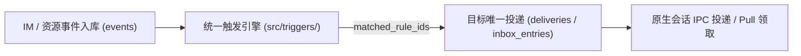

# 0035 — 单目标唯一订阅逻辑线与统一触发条件模块

## 目标与零兼容边界

本规格确立 DJ 订阅与触发的唯一现行架构：

1. **一个接收目标 ↔ DJ 之间只有唯一一条逻辑订阅线**：不再允许同一个已登记对话（`agent_id`）或同一个显式分发组（`group_id`）创建多条平行 `subscription`。不同对话之间仍可各自拥有自己的一条逻辑线（保留多对话同时接收同一事件的能力），但单个目标只有唯一一个订阅槽位、一套投递模式与忙时策略。
2. **订阅内部支持多条件、多事件形式**：单条订阅通过结构化 `rules[]`（`1..64` 条规则分支）统一承载 IM 消息、置顶、表情回应、指定群首行/逐行多条件告警、云文档评论提及、多维表格变更等全部触发形式；每条分支可独立声明来源范围、事件种类、任意布尔组合谓词及可选上下文/补充说明覆盖。
3. **订阅条件统一收敛到单一模块 `src/triggers/`**：谓词语法与三值求值、来源解析与权限校验、`rules[]` 归一化与索引展开、全局触发黑名单（`message.filter`）及跨连接人员身份映射统一归入 `src/triggers/`；预览、实时路由匹配与显式重放共用同一求值入口。
4. **删除 `contributions` 中间扇入层，不保留任何旧兼容代码**：按无版本化、不兼容、无历史包袱原则，直接移除多订阅 `subscription.create`/`subscription.update` 双入口、孤立多 `subscription_id` 管理、`contributions` 表、部分撤销 SQL 与多订阅合并逻辑；所有读写、Schema、Help、MCP 自描述、配置与 Skill 一次同步到干净的目标形态。

本规格替代 `0001`、`0002`、`0021`、`0027`、`0028` 中“同一目标可创建多条独立订阅并通过 `contributions` 合并”的旧设定；其余连接认证、实时收件、全局人员黑名单、通知归并（`0031`）、回复身份固定（`0005`）和外发防回声（`0032`）边界保持不变。

## 唯一逻辑线模型

### 1. 目标键与唯一槽位

每个订阅直接绑定唯一的目标标识 `target_key`：

- 单对话目标：`session:<session_key>`（由已登记 `agent_id` 精确解析到唯一的原生会话 `session_key`；即使该对话经历 `agent.unregister` 后再次登记获得新 `agent_id`，仍落回同一个物理会话槽位，绝不产生孤立旧订阅行）
- 组分发目标：`group:<group_id>`（按 `0028` 在组内机械选一名成员）

`subscriptions` 表以 `target_key` 为唯一主键槽位（不再维护一对多的独立 `subscription_id` 写入集合；历史投递若需审计溯源，直接记录 `target_key` 与 `subscription_revision`）。管理员 `fixed_routes`（`0021`）同样直接绑定目标的这唯一槽位：同一配置中禁止两条 `fixed_route` 指向同一 `session_key` 或 `group_id`；配置托管期间（`configuration_id` 非空），公开订阅写接口拒绝覆盖。

当同一物理对话同时具备自身的单对话订阅（`session:<session_key>`）且又是某个命中组订阅（`group:<group_id>`）的成员时，严格执行以下可验证规则：

1. **评估顺序与唯一通知键**：路由阶段固定先评估全部 `session:*` 单对话订阅，再评估 `group:*` 组订阅；`dispatch_notifications` 以 `(event_key, session_key)` 为唯一通知槽位（不按 `push`/`pull` 拆成两个槽位，也不按 `group_id` 拆分）。若单对话订阅本身已有效命中，则由该对话自有的 `delivery_mode`（`push` 或 `pull`）先行占有 `(event_key, session_key)`。
2. **组选人与归并记录**：组订阅执行成员筛选时，先按配置的额度与在线可用性策略筛出合格成员；对本事件已占有 `(event_key, session_key)` 的成员，在存在其他合格未通知成员时予以跳过，其余合格成员继续按配置的 `random` / `round_robin` / `priority` 算法机械选人。若合格成员全部已在本事件占有 `(event_key, session_key)`，则不重复创建第二条 `push` 投递或 `pull` 待领项，`group_dispatches` 记录 `state="coalesced"` 与 `coalesced_into` 指向原通知持有记录。

### 2. 单条订阅结构（`spec`）

| 字段 | 级别 | 语义 |
| --- | --- | --- |
| `agent_id` / `group_id` | 线级（严格二选一） | 接收该逻辑线的唯一对话或分发组 |
| `distribution` | 线级（仅 `group_id`） | 组内机械选择策略（`random` / `round_robin` / `priority` 及额度筛选） |
| `subscriber_model` | 线级（可选） | 订阅者自报模型参考（原生观察优先） |
| `delivery_mode` | 线级 | `"push"`（默认）或 `"pull"`；同一目标全局唯一，消除同对话 push/pull 冲突 |
| `delivery_policy` | 线级 | `{busy: "steer" \| "queue", offline: "hold", ttl_seconds}`；同一目标全局唯一 |
| `context_policy` | 线级默认 | `{mode: "recent" \| "current", max_events, max_bytes}`，供未单独声明上下文策略的分支继承 |
| `instruction_policy` | 线级公共（可选） | `{prompt?, task_template?}`，对话级路由/任务说明只保存一份 |
| `rules` | 分支列表（`1..64` 条） | 结构化触发规则分支；省略时自动归一化为单条 `"default"` 默认分支 |

每条规则分支 `rules[i]` 结构固定为：

| 字段 | 必填 | 语义 |
| --- | --- | --- |
| `id` | 是 | 本订阅内唯一的稳定分支标识（`1..128` 字符，如 `"im-messages"`、`"fire-alert"`、`"bug-bitable"`、`"doc-comment"`） |
| `enabled` | 是 | 布尔开关；`false` 停用该分支但保留定义，无需拆建多条订阅 |
| `sources` | 否 | 该分支适用的来源列表（`0..100` 项 `{connection_id}` 或 `{conversation_ref, include_threads?}`）；省略或 `[]` 表示当前获准可读的全部连接 |
| `event_kinds` | 否 | 该分支匹配的事件种类子集（`message.created`、`message.reaction.added`、`message.pinned`、`resource.changed`）；省略默认为消息、表情与置顶三类 |
| `predicate` | 是 | 任意多条件的递归 `all` / `any` / `not` 字面类型化谓词（含 `text`、`text.first_line`、`text.lines` 及 `eq`/`in`/`contains`/`prefix`/`suffix`） |
| `context_policy` | 否 | 该分支命中时的上下文策略覆盖（如 IM 分支用 `recent/10`，表格/文档变更分支用 `current/1`） |
| `instruction_policy` | 否 | 该分支专属补充说明或模板（仅在该分支实际命中时附加在线级公共说明之后） |

### 3. 多分支同时命中的确定性语义

同一外部事件对同一目标的唯一订阅只做一次整体判定：

1. 全局 `message.filter`（`suppress_trigger`）与出站回声检查（`0032`）优先执行；被抑制时保留诊断与消息历史可见性，不生成投递。
2. 逐条评估 `enabled=true` 且来源、权限与 `event_kinds` 满足的 `rule`：
   - 任一分支返回 `"true"`：订阅整体判定为 `"match"`，记录按声明顺序排列的 `matched_rule_ids`（非空数组）。
   - 无分支返回 `"true"`，但存在分支返回 `"indeterminate"`：订阅整体判定为 `"indeterminate"`（不触发）。
   - 全部为 `"false"`：判定为 `"no_match"`。
3. 有效 `context_policy`：在所有命中的分支（未显式声明者取线级默认 `context_policy`）中，若任一为 `mode="recent"` 则采用 `"recent"`，并取最大的 `max_events` 与 `max_bytes`；否则采用 `"current"`。
4. 有效 `instructions`：若配置了线级公共 `instruction_policy` 则排在首位（仅一份），随后按分支声明顺序附加本次命中的分支级 `instruction_policy`（带对应 `rule_id`）。

## 统一触发条件模块（`src/triggers/`）

将原先分散在 `src/core/rules.eli`、`src/filtering/policy.eli`、`src/subscriptions/service.eli`、`src/routing/matcher.eli`、`src/subscriptions/replay.eli` 中的条件逻辑收敛为单一高内聚目录：

```text
src/triggers/
  predicate.eli    字段定义、all/any/not 校验、全文/首行/逐行字面匹配、截断三值求值与字符预算
  sources.eli      分支来源解析（connection_id / conversation_ref）、读写授权核验与事件来源匹配
  rules.eli        订阅 rules[] 归一化、默认规则生成、索引键展开与唯一求值入口 evaluateSubscriptionRules
  suppression.eli  服务级 message.filter 规则校验、跨连接 people 身份映射与触发抑制判定
```

`subscription.preview`、实时路由 `routing/matcher.eli` 与历史重放 `subscription.replay` 全部调用 `evaluateSubscriptionRules` 与 `evaluateTriggerFilters`，不再各自拼装来源、事件种类与谓词判断。后续富媒体规格（`0034`）如需按附件属性筛选，仅在 `src/triggers/predicate.eli` 扩展附件字段，不改动订阅与路由主干。

## 直线投递链路（移除 `contributions`）



- 移除 `contributions` 表、`planContribution` 多订阅合并、`delivery/read-scope.eli` 多贡献缓存及跨订阅部分撤销查询。
- `deliveries`（`origin="subscription_event"`）与 `inbox_entries` 直接记录 `target_key`、`subscription_revision`、`matched_rule_ids`、生效 `context_policy` 与 `instructions`。
- 信封中的 `matched` 简化为该目标唯一订阅的命中摘要：`{target_key, subscription_revision, rule_ids}`。
- 当该目标唯一订阅执行 `set`（更新规则）、`pause`、`delete` 或 `agent.unregister` 时，提交点前（`ready` / `deferred` / `blocked`）属于旧 `revision` 的待投项直接原子标记为 `cancelled`（pull 待领项标记为 `revoked`）；已进入 `submitting` / `accepted` / `unknown` 的投递保持原义，不撤回、不重发。

## 登记与订阅的恢复

原生客户端重启、接收口离线或 DJ 重启不改变订阅状态。已有实例按 [0018](0018-offline-recovery.md) 重验接收端，继续处理仍有效且尚未提交的原会话投递。

显式 `agent.unregister` 关闭登记并暂停该会话的活跃订阅，规则仍保存在同一 `session:<session_key>` 槽位。同一原生会话和接收主体重新登记后，应使用新 `agent_id` 读取槽位并显式 `subscription.resume`。恢复仅接收新入站事件，暂停期间的事件可由调用方按准确事件 ID 显式重放。

## 统一公开操作目录

去掉 `subscription.create` 与 `subscription.update` 的双操作拆分及多 `subscription_id` 选择负担，所有订阅操作仅按目标（`agent_id` 或 `group_id` 严格二选一）定位：

- `subscription.preview`：`{spec, expected_revision?, sample_event_ids?}`。目标尚无订阅时 `expected_revision` 省略或传 `0`；已有订阅时传当前 `revision`。返回冻结 `preview_id`、归一化 `spec`、解析后各分支来源与样例匹配结果（含每条样例命中的 `matched_rule_ids`）。
- `subscription.set`：`{preview_id, expected_revision, idempotency_key}`。凭有效 `preview_id` 原子创建或替换该目标的唯一订阅。
- `subscription.get`：`{agent_id}` 或 `{group_id}`（严格二选一，不提供按旧 `subscription_id` 的第二查询入口）。
- `subscription.list`：分页列举当前有权查看的目标订阅。
- `subscription.pause` / `subscription.resume` / `subscription.delete`：`{agent_id | group_id, expected_revision, idempotency_key}`。
- `subscription.replay`：`{agent_id | group_id, expected_revision, event_ids, idempotency_key}`。
- `subscription.pull`：`{agent_id, group_id?, lease_seconds?, idempotency_key}`；`subscription.ack`：`{claim_ref, disposition, idempotency_key}`。
- `subscription.group.dispatches`：`{group_id, after_id?, limit?}`。

## 与 0034（富媒体及统一附件）的接口契约

1. `event.content.text` 保持可读多行纯文本语义（供 `text`、`text.first_line`、`text.lines` 稳定匹配）；`event.attachments` 仅记录稳定的资源描述与原生来源定位锚点，本地文件路径、展示状态与下载结果由 `0034` 在投递准备与渲染阶段补入通知，且补取动作不再次触发订阅。
2. `src/delivery/envelope.eli` 中，`0035` 只负责单订阅 `matched`（`{target_key, subscription_revision, rule_ids}`）与 `instructions` 结构收敛；`0034` 独立负责 `attachments` 字段与通知文本末尾的统一附件附录渲染，互不耦合。

## 施工与验收清单

施工阶段（按 `bulk-development` 三段式）：
- [x] S1 实现 `src/triggers/`（`predicate.eli`、`sources.eli`、`rules.eli`、`suppression.eli`），移除旧分散模块。
- [x] S2 重构 `src/storage/schema.eli`、`src/subscriptions/*`、`src/routing/matcher.eli`、`src/delivery/*`、`src/service/fixed-routes.eli`、`src/registry/agents.eli`、`src/sessions/rules.eli`，落地单目标唯一订阅槽位并彻底移除 `contributions`。
- [x] S3 同步 `src/application/operations.eli`、`results.eli`、`help.eli`、配置示例与 `skills/dj/` 全套文档。
- [x] S4 编写并集中执行集成功能验收（单对话多分支覆盖 IM + 资源变更 + 首行多条件、单分支独立启停、`set`/`pause`/`resume`/`delete` 切流、多对话同事件各自单线通知、直订与组成员重合单次通知、`fixed_routes` 与组订阅单槽位、全局黑名单抑制）。
- [x] S5 补充 `src/triggers/` 与单线状态转换关键保护性单测并运行回归。
- [x] S6 签名提交推送；本机服务升级切换前完整清点现有活跃订阅与规则，按新单线结构一次性写入各目标的唯一订阅槽位（保留全部已登记 Agent、消息历史、已提交投递、`session.rules` 与退订策略，服务运行代码不内建旧表迁移或兼容分支），更新已安装 Skill 并清理全部临时构建产物。
