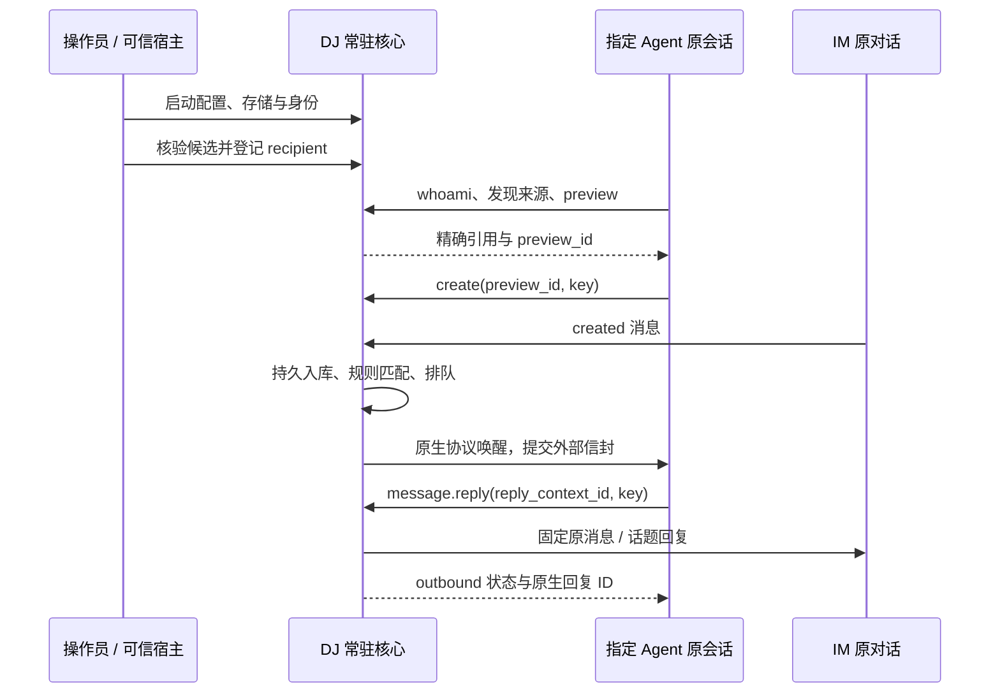

# 从启动 DJ 到收到消息并回复

本章描述首期完整目标流程，全部为尚未实现的契约。命令、输入文件、服务配置和凭据配置在本轮都没有创建或执行；这里不要求模型在文档阶段启动服务。范围以 [首批接入](release-scope.md)为准，业务字段以 [统一操作](interfaces/operations.md)为准。

本章是 IM 订阅闭环；新增 [Agent 控制面](agent-control-plane.md)可以在没有 IM Connection、订阅或 AgentTarget 登记时独立使用。只装配目录/工具端口也可启动 DJ；查询、直发、显式启动/创建分别授权，不要求先走下文全部 IM 步骤。



## 角色、配置与前置条件

操作员准备运行环境、Lark 用户 OAuth/Telegram bot 与允许范围、凭据和 Agent 目标；可信宿主将凭据送到实际 CLI/MCP 进程。调用方模型用这些已授予的能力登记、选源和建订阅。DJ 只收件、验证、转发和记录；外部 Agent 决定工作和回复内容。

未来本地部署默认采用 `~/.dj/service.json`；默认根目录和受保护文件布局见 [开工准备](construction/readiness.md#local-layout)。所有文件位置相对该配置目录解析，秘密仅写 credential_ref，配置/秘密/状态都不随仓库发布。配置需明确以下内容，未知字段拒绝：

| 配置块 | 必须表达的内容 | 启动行为 |
| --- | --- | --- |
| service / storage | schema_version、service_id、私有 socket 与状态目录引用、SQLite 模式 | DJ 服务身份区别于 Agent instance_id；唯一调度者/持久化自检，不默认回退空库 |
| principals / grants | operator 与每个 recipient 的独立主体、凭据引用、来源/动作范围、target_constraint | 默认拒绝未授予动作；不从 clientInfo/cwd 赋权 |
| connections | 稳定 connection_id、平台、direct/existing_source、账号/profile/secret 引用、允许 chat/thread | 首期选择 direct；一连接一收件者，不改既有 webhook/bus 所有权 |
| agent_endpoints | OpenCode 的受信 endpoint_ref、namespace、允许原生会话及凭据引用 | 只读发现和探测，不新建 session 或改模型 |
| managed_profiles | OpenCode serve / Pi RPC 的固定可执行文件、参数数组、工作区、资源、会话存储、auto_start/resume_policy 和安全停止策略 | 缺省不启动；显式策略生效前先恢复 lifecycle/slot 栅栏，不重复拉起 |
| client_profiles | CLI/MCP 可读的 endpoint 名、socket 引用与 recipient 凭据引用 | 每个主体独立受保护配置；凭据不放请求或模型正文 |

允许范围配置原生 ID 是可信部署行为；IM 订阅/发送使用 conversation_ref，Agent 直发使用 session_ref 或已登记 agent_id，两种引用不能混用。部署连接不等于有订阅，不将历史消息自动变成工作。

部署步骤为每个主体用操作系统随机源生成独立的至少 256 位凭据，服务配置保存验证摘要引用，客户端 profile 保存受保护的凭据引用；原文不由模型选择或经聊天传递。服务用传输认证解析固定 Principal，不因 Agent 报出 recipient ID 就签发凭据。部署和轮换属于操作员配置流程，普通 agent.register 不生成或扩大认证权限。

OpenCode 首期优先用专用 server/工作区及独立 DJ recipient 配置。若宿主的 MCP 配置或 shell 环境被多个会话共享，它们实际使用同一 Principal；DJ 无法由普通 MCP 请求证明真实发起会话。共享者必须处于同一受信授权边界；要隔离不同 Agent 主体，必须分开宿主作用域/运行环境或实现可信会话绑定桥接。不能把口头自报会话 ID 当作隔离。对能读取相同文件的同一 OS 用户，文件模式也不提供强多租户隔离。

## 1. 操作员前台启动

未来命令为：

```bash
dj serve --config ~/.dj/service.json
```

启动按确定顺序执行：

1. 读配置版本、路径归属/权限和受保护引用，检查 Bun/编译产物/依赖清单；不启动编译器，不输出秘密。
2. 独占绑定配置的 socket 并取得 service_lease；重复实例拒绝。已有 socket 不自动删除，旧 owner 仍活着不因超时抢占；需先核验归属再由操作员处理陈旧状态。
3. 打开同一 SQLite，检查模式、实际版本、迁移版本与容量。已知迁移在启收件前事务执行；新于程序认识的 schema、校验失败或磁盘不可用直接失败，不建立另一份空库。必要备份在迁移前取得一致性快照。
4. 装载已持久订阅/规则索引、routing work、队列、操作/出站台账；将未结算 submitting 按契约恢复 unknown。配置不覆盖持久订阅，不补发暂停期间消息。
5. 核对已记账 LifecycleAction、launch_token/slot、进程归属及 epoch 后，才启动获准 Lark user 轮询及 Telegram/OpenCode 事件流，或执行明确配置的 OpenCode/Pi auto_start/resume_policy。手动 profile 等显式 instance.start，不因查询或离线隐式启动。Pi 由可信宿主读取 get_state 的真实 sessionId 后补齐 target_constraint，未核实前不给模型可登记候选。
6. 每连接/目标单独给出 configured/online/degraded/offline 等事实。服务控制面 ready 只表示存储和操作可用；status 另列收件流、目标与未结算项，不能用一个 ready 掩盖所有源离线。

服务由 launchd 监督重启，但正确性依赖事务与恢复，不依赖优雅退出。未来由部署步骤安装服务配置，Agent 不隐式改 launchd。Lark user 适配器核验 profile/身份/获准 chat/thread 的只读访问后标 online，由 DJ 调度持久增量窗口；无用户消息 event consumer。停止只取消自有读取进程，不停止共享 CLI bus。

## 2. 身份接线、发现与登记

操作员先为目标配置独立 recipient 及最小 grants（发现/读取允许来源、管理自身订阅、回复原话题）；目标的执行/模型权限仍由工具原有配置决定。通过可信文件/进程环境选择 client profile，模型只看到逻辑目标及能力，不看到凭据值。

采用两种等价路径，首条闭环建议操作员代登记，减少现有宿主的身份启动歧义：

- 操作员调用 agent.discover，核对 tool/surface、namespace、原生 session、实例 epoch 和 live_receiver，拿到 candidate_ref；调用 agent.register，传 candidate_ref、display_name、binding_mode、recipient_principal_id 与幂等键。服务原子建立目标、recipient 的 bound_agent_id 与约束绑定，并返回 agent_id。operator 的管理权限不复制给 recipient。
- 已由可信宿主准确绑定 target_constraint 的普通 Agent，可自己 discover/register；不允许指定 recipient_principal_id，不能登记其他人的目标。native ID 尚未核实则 target_unbound，不能让模型猜。

Pi managed 候选指向刚才获准启动的真实进程；模型的 register 不触发创建。既有 OpenCode 必须是已核验原生会话；若只发现历史或另一个 server，就报告限制。已有绑定重启只 probe/rebind 同一会话，不复用标题或新 ID 替换原 agent_id。

## 3. Agent 核对身份与统一入口

可信宿主使该 Agent 的 CLI/MCP 使用其 client profile。未来调用顺序：

```bash
dj status --endpoint local --json
dj agent whoami --endpoint local --json
```

正常结果为已认证 principal_id、bound_agent_id、目标摘要与能力。未绑定时按上一步登记，不能从“我正在 OpenCode 里”推出具体会话。Skill 安装/发现/读取独立确认；没有可用 DJ 运行时就止于说明。

若宿主支持所选 MCP 规范，可由其启动：

```bash
dj mcp serve --transport stdio --endpoint local
```

代理从同一受保护 profile 取得身份，经 UDS 转发；不拥有数据库或收件任务。首期 Pi 通过已有 shell/tool 权限使用 CLI，OpenCode 可用 CLI 或经过实际兼容验收的 MCP。协议不支持时明确 incompatible，不能伪造工具调用成功。临时改用 CLI 仍须同一授权主体和幂等键。

## 4. 选择来源、预览、提交

Agent 按用户意图读取 connection.list，再 conversation.list；列表给精确引用、平台/账号/群/话题摘要和可见范围。缺少列举能力时，对明确地址使用 resolve。两个同名群由模型依据用户信息选择，DJ 不排序猜目标。

随后模型编写 spec：目标为 whoami 的 agent_id，来源使用返回的 conversation_ref，event_kinds=message.created；首期 context=current、busy=queue、offline=hold，并使用明确谓词。例如“所选话题的人类文本包含指定字面子串”，不能把“重要的事”直接当规则。

```bash
dj subscription preview --input preview-request.json --endpoint local --json
dj subscription create --input commit-request.json --endpoint local --json
```

输入文件是未来调用者生成的完整参数，不是当前仓库文件。JSON 形状沿用 [Skill 示例](../skills/dj/references/workflows.md)：preview 输入含 spec；模型核对 normalized_spec、resolved_sources/resolved_target 与 warnings，无阻断才将 preview_id 和保存的幂等键写入 create 输入。create 不再接 spec，不添加额外人类确认步骤。

服务在同一事务受理 Operation、Subscription、稳定 resolved_sources、编译规则索引与 start_seq，返回 operation_id/subscription_id/revision。短期 conversation_ref 到期不撤销已有订阅；后续用稳定地址和当前授权处理，不让 Agent 定时刷新引用。超时先按原操作与原键查询，不能换键重建。创建后 CLI/MCP 可退出；Agent 不创建轮询任务，DJ 继续收件。

## 5. IM 消息进入 DJ

Lark 由 DJ 的固定 user profile 增量读取并将新观察消息规范化；Telegram 将收到的 update 与可推进游标原子持久后才确认。DJ 验证连接、允许范围、来源键并规范化，保存 Event/ingress_seq/routing_work；只对已提交 start_seq 后且匹配当前订阅版本的事件工作。

来源索引取候选，执行有界字面规则；不确定记录 indeterminate。每目标/事件合并有效贡献后持久 Delivery，不同目标分别排队。一条 IM 消息命中 OpenCode 和 Pi，就各有自己的 delivery_id、目标序列、权限和回复上下文；不存在“选一个最合适 AI”的隐藏逻辑。

## 6. 向原目标提交并开始工作

DJ 检查有效贡献、recipient 权限、目标 Binding 与原生状态。busy 等待，offline hold，waiting_permission 不绕过；idle 且具备 start_idle 才在事务里进入 submitting、签发有权限的 reply_context 并冻结信封，然后在事务外写出。

OpenCode 对原 server 的原 session 提交；Pi 对绑定的同一 RPC 子进程提交。信封作为结构化外部数据编码到厂商支持的消息输入中，正文不能改变协议字段。外部正文仍可能诱导模型，序列化不能保证模型理解正确，因此执行权限和出站校验始终独立生效。

DJ 记录原生接受、开始、结束/稳定等分立观察，不读取答案语义判断成功。OpenCode 的 204、Pi 的 handled 都不能当成已完成任务。外部模型/工具错误按实际证据显示；DJ 不选新模型或把任务转给另一个会话。

## 7. Agent 主动调用回复工具

Agent 读取信封、在既有权限下执行任务并形成回复，使用给定 reply_context_id。缺少该引用、已经过期或没有回复权限时保留限制，不自己拼群地址。

```bash
dj message reply --input reply-request.json --endpoint local --json
```

reply 输入仅含 reply_context_id、content={type:text,text:回复内容} 和逻辑请求的幂等键。服务重检身份、原账号/群/话题/原消息、有效期与文本大小；同一事务创建 Operation 与 Outbound，返回 operation_id/outbound_id。受理不代表 IM 已接受。

Lark 适配器使用固定 profile/user 和原消息 ID，按原话题语义选择 reply-in-thread；Telegram 保留原 chat/topic 和 reply 参数。无法保留目的地就 unsupported，不降级发群主流。原生返回消息 ID 后保存回执与 echo_index，之后按已知 ID 抑制自身回声。首期单条文本超出平台限制在受理前拒绝，不调用模型缩写。

Agent 用 outbound.get 读最终状态；请求超时则先 operation.get 找回 outbox，外部结果 unknown 时只 reconcile。不能重发一份“可能没出去”的回答。模型只结束回合而没有调用 message.reply 时，DJ 不自动转发其最后答案，这条链也不能报“已回复”。

## 8. 退订、停止与恢复

Agent 通过 subscription.pause/delete 与 expected_revision/幂等键停止后续贡献；submitting 起可能已送，不承诺撤回。unregister 另关闭登记/暂停订阅，但不取消独立直发或清 route 屏障。显式 instance.stop 先关实例 gate，send/create/新订阅启用被拒绝，已排队输入 hold；仅 drain 原生工作与在途动作，不等待队列全空。

操作员给 dj serve 发正常停止信号，DJ 停止新 intake/提交、保存游标与尝试、优雅关闭自有 consumer；已存在的 OpenCode server 不被停止。自有 OpenCode/Pi 按同一安全 drain 策略停止，活跃/unknown 尚未核清时不强杀或提前关 RPC 管道；期限到保留 draining 与未完成诊断。部署监督器必须允许该行为。外部强制终止/系统崩溃可能中断原生工作，恢复为 unknown，不声称无损退出。

重启先恢复台账和屏障，再接流和核验 Binding；Pi 只有显式 resume_policy 授权且能保持原 session ID 才恢复，不能默认启动新会话顶替。已 accepted 的输入不重发；已发出的 IM 回复不因 Agent 没收到 API 响应再发一次。源不可重放的窗口记 gap，不能让 Agent 用定时拉取掩盖。

## 不依赖 IM 的入口与创建后接线

仅启用目录/Agent 端口时：启动 DJ → 客户端认证/status → list/search 或精确 resolve/get → probe → session.send → delivery.get。查询没有 register 门槛，也不隐式刷新、启动或创建；取回答则显式定点 catalog.refresh(include_content=true) 后 session.message.list/get。短期引用过期按稳定 session_key 重新 get，不重新发送。

需要新实例/会话时：profile.list → instance.start → lifecycle.get 到 ready → instance.get；OpenCode 再 session.create → lifecycle.get 到 ready 的 session_key，Pi 直接用 start 的 initial_session_key → session.get/probe → 单独 send。已就绪兼容实例复用同 slot；stopping/unknown 不另起。创建空会话不证明 DJ 工具已接线。

若要把新会话变成 IM 订阅目标，操作员/可信宿主在预配 recipient 下核对原生身份、设置精确 target_constraint、将该主体的受保护 client profile/Skill 接入实际会话作用域，再按第 2–4 节登记/核对/预览/提交。普通创建者不改绑自己、不配置新凭据、不复制权限；缺这段接线就只声明可直发，不声明可在会话内调用 reply。各类路径的统一顺序与恢复收口见 [业务流程](workflows.md#统一路径与收口)。

## 可观察闭环

最终验收必须同时关联：原生源消息 ID → DJ event_id → subscription/revision → delivery_id → 原生目标 session/输入及开始观察 → Agent 的 message.reply 调用 → outbound_id → 同一原群/话题中的原生回复 ID。业务答案是否正确属于外部 Agent 验收，不由 DJ 判断；服务只报告这条可追溯转发链。四种组合和故障分支分别记录，详见 [验收](acceptance.md)。
