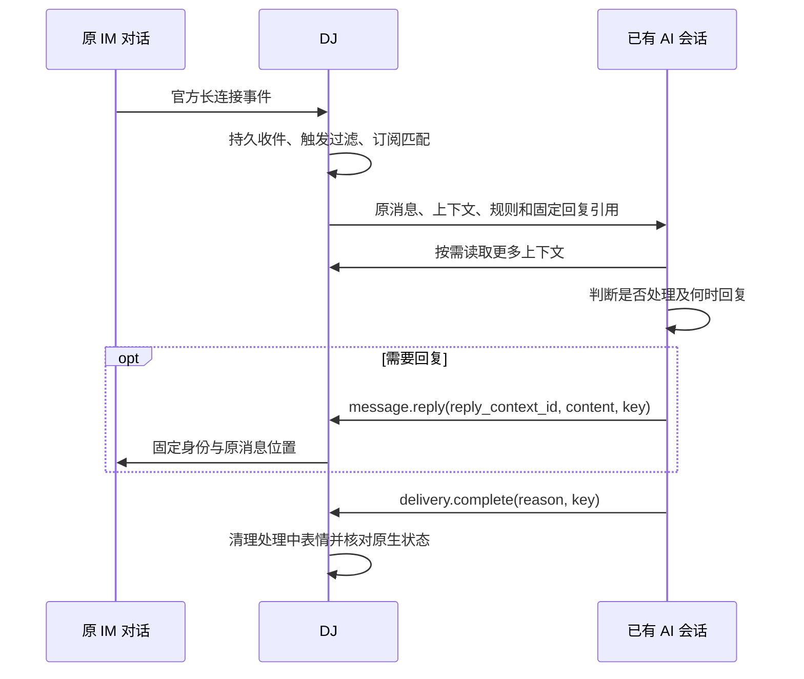

# 从收件到回复

运行准备见[安装指南](delivery.md)，Lark 实际订阅步骤见[实时订阅指南](guides/lark-realtime.md)。本章说明各方责任与消息流，不替代账号授权或端口能力检查。

## 接线

可信操作员核对已有实例、原会话和工作区，为接收方配置独立 recipient 与 target_constraint。AI 使用自己的 profile 查询 `agent.whoami`，然后选择获准来源、核对 preview 并创建订阅。不能根据标题猜目标，也不能把 operator 凭据交给接收模型。

## 触发

默认来源是获准范围的全部群、私聊和话题；可显式按对话收窄。原生 @、关键词与组合 predicate 决定是否触发。服务级人员/字符黑名单只限制自动触发；消息继续保存和可见。真实事件可见性由平台权限和事件类型决定，不以历史读取、重放或周期扫描替代长连接证明。

## 处理与回复

投递进入原订阅会话。规则与上下文恢复职责，不赋予消息正文额外权限。AI 决定通知是否对应任务、是否属于已有任务及是否需要回复；普通输出不自动发回 IM。

`reply_context_id` 固定来源、目标和回复身份。AI 只提交内容、时机与幂等键，不重新选择账号或收件人。结果未知时先查原 operation/outbound，不换键重发。

处理结束、无需回复、取消或失败时，通过 `delivery.complete` 表达实际结果并触发表情清理。消费确认、投递接受、平台接受和任务完成分别记录。

## 其他入口

- 不依赖 IM 的准确会话查询与直发：`session.resolve/probe/send`。
- AI 主动领取：`subscription.pull/ack`，使用同一权限、提示词和回复上下文。
- 显式空会话创建：仅在已有实例确有接口且获准时使用，创建不自动 prompt、登记或订阅。

参数与错误见[操作契约](interfaces/operations.md)，异常排查见[故障指南](guides/troubleshooting.md)。
