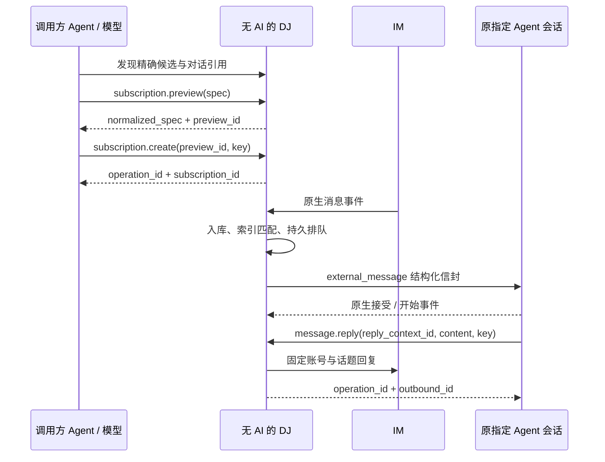

# 业务流程

所有自然语言解释和目标选择发生在调用方；DJ 的每一步都是结构校验、明确状态转移或确定性协议操作。实际部署、凭据与客户端接线顺序见 [从启动到回复](startup-to-reply.md)，本文维护通用业务状态。

另有三条无需订阅的独立路径：跨工具 catalog/session 查询、精确 session.send、已有实例中的可选 session.create。对象与顺序以 [Agent 控制面](agent-control-plane.md#三条独立业务流程)为准；下文登记是长期 IM 订阅的身份步骤，不是所有读取/直发的必经门槛。

## 统一路径与收口

所有路径从已认证 CLI/MCP/API → service.status 开始，使用同一业务层；服务存储不可用时不启动影子服务。下表给出当前业务分支，IM 订阅步骤并非直发的前置条件。

| 意图 | 顺序 | 完成事实与后续 |
| --- | --- | --- |
| 跨工具找会话/消息 | tool/instance.list → session.list/search；需新数据时 catalog.refresh → catalog.get/显式 continuation → 继续查询 → session.message.list/get | 返回授权事实、as_of/覆盖和 cursor；调用方判断任务位置，不触发原生工作 |
| 已知会话免订阅输入 | session.get(session_key) 或 resolve(instance_id,native_session_id) → probe → session.send → operation/delivery.get | 原生 accepted/started 分开；消息响应需显式刷新该 session_key 后查询，不生成 IM 回复 |
| 运行实例内新工作会话 | instance.get → session.create(instance_id,epoch,workspace_ref) → lifecycle.get → session.get/probe → 单独 send | create ready 只证明空会话存在，send/读取分别授权；缺少原生接口时明确 unsupported |
| 新会话用于订阅 | 上述空会话 → 可信部署面接入 recipient/client profile/Skill → discover/register → 接收方 whoami/工具核对 → 来源发现/preview/create | 接收工具、订阅与回复分别有证据；不复制创建者绑定或权限 |
| IM 自动触发与回复 | 入库去重 → 匹配贡献 → canonical route 入队 → gate/权限/idle 检查 → submitting → 原会话开始 → 显式 message.reply → outbound.get | 固定原 IM 账号、消息与话题，按实际接线记录证据；不自动转发最后答案 |
| 暂停、注销或停 DJ | pause/delete/unregister 撤未提交贡献；DJ 停止先关 gate 再 drain | direct 与订阅相互不撤销；accepted 不重发，unknown 先核对；期限到明确仍在停止 |

只拥有原生 ID 时，resolve 可按精确地址作只读核验；仅有稳定 session_key 时 get 重取短期引用。session.probe 不写测试消息，发送提交点仍再核验，不能依赖上一步状态永远不变。检索正文未覆盖时，catalog.refresh(scope.session_keys,include_content=true) 是精确补取路径，不要求扫描整类工具。

直发结果保留在目标原生会话；调用方需要回答时显式刷新/查询，或由 DJ 对已配置来源作有界增量更新，不能把它改成 Agent 定时器。没有原生开始/模型回复证据时只报输入状态。任何有副作用步骤超时都先按原操作/键找 Operation → resource_refs → 对应 Delivery/Outbound/LifecycleAction；get 只是观察，reconcile 只核对，unknown 不换键再做。

新会话订阅的部署接线不是隐藏自动化：操作员在既有配置流程中为已核验会话指定预配独立 recipient；配置不在普通 MCP/API 中修改。创建者可继续查询/直发，但 whoami 仍是自己原有绑定。缺实际作用域/工具接线则暂停于“已创建、未具备订阅回复能力”，不能把模型收到一条消息当作接线成功。

## 身份接入与登记

1. 操作员或可信启动宿主预先配置 Principal、grants 与 target_constraint；凭据通过受保护通道交给 CLI/MCP 代理，不能放进模型正文。
2. agent.whoami 返回当前主体、已绑定目标或 unbound。缺少绑定不代表 DJ 可以从 cwd、clientInfo、标题或当前聊天猜会话 ID。
3. 调用方使用 agent.discover 查看获准候选，核对工具/形态/namespace/实例/原生会话/活收件口。多个合理候选由调用方消除歧义，不由服务选择。
4. agent.register 接收 candidate_ref。DJ 核验主体约束、原生身份与能力后原子建立目标和主体绑定；已有相同登记直接返回原目标。
5. 后续使用 agent_id。进程变化只 probe/rebind 同一原生会话；existing 离线不启动替代进程。

操作员代登记必须指定独立 recipient 主体。discover/probe 不启用 Inspector、不发送测试消息，不把历史恢复或托管新进程当作接管现有实例。

## 发现来源、预览与提交

1. connection.list 与 conversation.list 返回获授权来源和 conversation_ref。无法列举时，对明确原生 ID 执行 resolve；不提供模糊标题写操作。
2. 调用方模型编写结构化 spec，subscription.preview 返回规范化规则、来源/目标摘要、样本决定与 blocking_issues。
3. 没有阻断问题时取得 preview_id；模型核对其是否符合用户意图，使用该句柄和稳定幂等键 create。无需额外人类确认步骤，但仍受既有授权约束。
4. DJ 重新检查票据/授权/revision，原子保存 Operation、订阅与 commit 后 start_seq。返回 subscription_id/revision；客户端退出不影响订阅。

## 事件、扇出与输入

验证源平台/账号/允许来源后规范化。DJ 控制 ACK 时在事件与源游标原子持久后确认；外部协议决定 ACK 时序时公开其保证边界。Lark 使用官方 WebSocket 与 HTTPS，不通过 SDK/CLI 收件。只按来源和事件类型索引取候选，执行编译的有界谓词；indeterminate 记录原因，不调用模型判断。

按同目标同事件合并有效贡献，不同目标独立排队。权限和上下文按 recipient 身份与当前贡献检查，不合并出额外可见范围。正文作为 JSON/等价类型数据注入，不能与协议头拼接。信封包含事件/投递 ID、来源、作者、触发原因、截断信息、附件元数据及可选 reply_context。

## 空闲、忙碌与离线

idle 且支持 start_idle 时按原生协议提交；busy 的默认 queue 等待可靠 idle，或使用已声明的安全原生队列；无可靠观察/排队能力则 blocked，不周期性试发。显式 steer 绑定活动回合身份，失配后重新观察，不改成 start。waiting_permission 不是 idle。

offline 默认 hold，贡献过期则撤销；仍有有效贡献继续成立，全部过期才 expired。探测和重连由服务退避调度，Agent 不设拉取定时器。DJ 不替目标选择模型、补充权限或判断任务完成。

## 回复、主动发送与结果查询

message.reply 使用提交前签发的 reply_context，DJ 重检 recipient、权限、固定原话题与有效期；主动发送另用 conversation_ref 作为 destination_ref。没有回复权限不签发可用 reply_context。回复内容由外部 Agent 产生，DJ 不摘要或评价。

发送先原子创建 Operation 与 Outbound；CLI/MCP 成功受理后可用 outbound.get 读当前状态。请求超时先 operation.get 按原键核对，不能将 outbound_id 当作 delivery_id。部分发送结果未知时按子消息证据处理，禁止整条重发。

## 修改、暂停与提交点

修改必须 preview 更新对象后用固定票据 update，不能换 agent_id。pause/delete 撤销提交点之前的贡献；resume 创建新 start_seq，不复活旧贡献、不补发暂停期间消息。提交点是校验并原子把 ready/deferred 改为 submitting 的事务，定义上从这里开始输入可能已送出。

控制操作与该事务串行决定先后：pause 先提交则阻止该贡献的输入；submitting 先提交则可能已送达，即使实际 socket 尚未写出也不能承诺撤回。unknown/submitting 的取消只记录限制，不伪称成功。之后观察到原生接受仍保留事实。

## 恢复与解除未知

取得唯一服务所有权后恢复当前规则与并发校验状态、源游标、未完成 routing work、ready/deferred/blocked 与尝试。租约失效的 submitting 转 unknown 并先 lookup；不能只因旧 worker 不见而重发。accepted 不重新提交，resolved 只恢复其人工决定，后续 queue 仍需可靠 idle。

无法核对的 unknown 保持可见屏障。操作员可明确 resolve 为“不再重发”的人工决定，保留 manual 证据；DJ 与模型都不能把它标为厂商接受。详见 [可靠投递](delivery-storage.md)。
